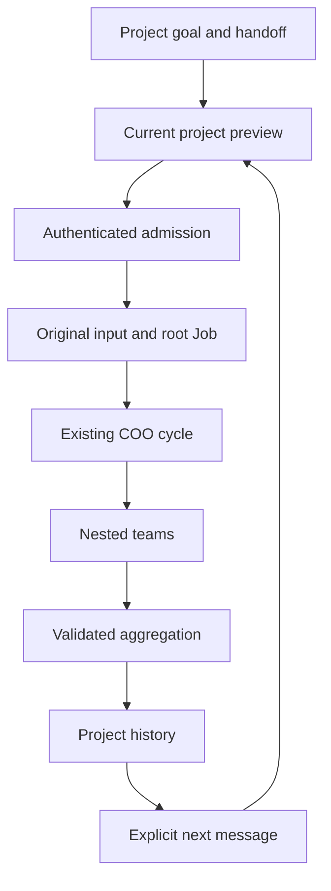

# Project team execution in Mastermind OS

## Intended product outcome

A user creates or opens a project, supplies a goal and optional handoff, and
starts a CEO-led team from Mastermind OS. The CEO reads the exact project record,
adopted plan and supplied context, builds a task plan, delegates bounded
subprojects to COOs, and receives their workers' results through the original
root. The project retains its work and conversation after the request and app
close when the installed service supports durable execution.

A follow-up message is a new explicit project run linked to a validated completed
result. It preserves the previous root, original input and evidence. It does not
requeue a completed Job or reopen a single-use native return session.

This change implements that path using the incumbent Executive Runtime,
authenticated Workspace source, COO cycle, model router, registered workers,
Fabric placements and pending-operation store. It introduces no replacement
scheduler, identity service, conversation database, retry queue or daemon.

## Product journeys

| Journey | Behavior |
| --- | --- |
| Create and open a project | After creation is confirmed in the source, Open project refreshes the existing Programs catalogue and opens the exact current canonical record. Initial planning remains available, and execution starts only through Start work. |
| Start work on a rootless project | Current project context is acquired; a live effect-free preview supplies eligible profiles, actual coordinator model, repository/base and durable/attended mode. Static launch enrollment is unnecessary. |
| Goal and handoff | Exact user text and source bodies remain in the existing private original-input artifact. Multiline goal text is retained exactly; only the incumbent scalar intent receives normalized line whitespace. |
| Build scope | Bounded code changes require declared paths and structured validation. The installed Mastermind repository and exact base are visible before submission. |
| Uncertain submission | The existing IndexedDB store retains only the original operation key, kind and project target. Reopen checks that operation; it does not create another run. |
| Team execution | Existing plan/work/review/repair/aggregation roles support nested COOs and same-root descendants. Existing inherited authority and budget limits apply. |
| Project history | The current conversation READ owner lists at most eight original-principal project runs. It reads retained input and canonical completed aggregation evidence. |
| Follow-up | A completed result supplies a read-only parent witness. A separate authenticated preview and submission re-prove it before admitting one new successor. |
| Auth loss | Private unsent fields remain local under the incumbent presentation policy. Cached launch authority is invalidated. Sign-out or an owner change clears private drafts. |
| Source or grant changes | New admission refuses stale context. Existing original-operation recovery is resolved before current planning/routing is consulted. |

## Ownership and flow

The UI obtains Workspace and Executive authorization independently. The server
verifies the same principal, actual installed App/peer, current permission
binding and exact source. Presentation previews and history references confer
no write authority.

A closed private source binds the original command, principal namespace, project
work reference, input fingerprint, captured context, execution binding and
continuation mode to the strict-v2 root's unique creation event. The source is
nominally issued by the actual factory and original foreground operation.

The existing private artifact store holds the exact authored record, adopted
plan/decision, file content, goal, handoff and execution request. Every actual
descendant obtains the original root input through its validated Runtime lineage.
Mixed execution supervisors explicitly reference the same original input owner;
they do not copy an artifact into another store.

## Accepted creation to current project

The setup journey offers **Open project** only after its original creation
operation is accepted as `SOURCE_OBSERVED`. The returned work reference is a
navigation hint. It does not substitute for the canonical Programs record or
supply a Runtime root.

An explicit click requests a refresh through the existing Programs owner. The
handoff waits for a read newer than the request counter captured at the click
and still equal to the current request. It requires a current, available
catalogue with exactly one matching project, the original host and
authentication context, and the same live setup selection and route. Only then
does the existing catalogue selector open that actual record.

An unavailable catalogue, absent or ambiguous record, changed authority or
navigation away ends that gesture without selecting a stale project. Setup
retains its existing safe drafts and recovery pointers; an explicit retry can
request another read. There is no background retry loop or second reader.
Initial planning and Keep result remain available. Opening does not repeat
creation, adopt a plan or submit work automatically; the project presents its
separate Start work action.

## App entry without a legacy Launch manifest

The production entry calls `composeMissionHost` with the actual client. An
Executive transport mounts the existing qualified command context, controller
and IndexedDB pending-operation store even when `VITE_MM_LAUNCH_CONFIG` is
absent. Current-project work and fresh conversations attach to that same owner.
The separate selected-session owner and its durable namespace are unchanged.

A missing legacy manifest produces an empty legacy catalog. It cannot create,
prepare or submit a legacy Launch intent, synthesize a workstream, or grant a
project profile. Original pending-operation status recovery remains available
under the original principal when the manifest is removed. Authentication loss,
principal changes, source validity and current project admission still use
their existing checks.

Qualification includes the actual native client, production host composition
with `config=null`, App and a retained IndexedDB database. The pre-repair case
failed to open the project Goal form through this entry; the unchanged case
passes after mounting the shared owner independently of the legacy catalog.
Transport calls in these tests are inert and do not prove installed enrollment
or provider execution.

The closed web asset recipe supports three explicit public-input modes. Ambient
`VITE_` variables remain excluded from the build process.

| Inputs | Receipt | Capability boundary |
| --- | --- | --- |
| Neither Executive resource nor legacy manifest | Existing v1, `web` | Read-only default; no Executive command configuration is inferred. |
| Exact qualified Executive resource only | `mastermind.os_web_build.executive.v3`, `web+executive` | The receipt includes `executive_resource`; legacy manifest fields are absent and refused if added. |
| Exact qualified Executive resource and legacy manifest | Existing v2, `web+launch` | The original manifest bytes, digest and legacy Launch qualification remain required. |

A manifest without the qualified resource is refused. The existing asset
qualifier/importer validates v3 source, input and asset digests. The separate
legacy Launch publication qualifier remains v2-only, so a resource-only receipt
cannot stand in for legacy Launch enrollment. These are build-input contracts,
not a credential, registration, installed service or provider-start proof.

## Durable and attended modes

Eligibility is derived from the installed service and registered worker
composition. A source-qualified sealed project uses the existing COO cycle; it
does not promote the native-return profile into a child-spawning worker.

DURABLE is frozen only when the installed service allows background COO execution
and no attended placement/qualification requires the original request. The
incumbent tick selects and advances it after admission releases its reservation.
An interrupted initial workspace preparation may be resumed only for the exact
untouched original root/path/branch. Existing, partial, dirty, symlinked or foreign
destinations are not replaced.

ATTENDED is explicitly represented. It requires the original live foreground
operation and cannot later be promoted by changing service configuration.
Attended roots are skipped by the durable selector so they cannot starve an
independent durable project.

The API reports eligibility rather than asserting a provider START. It reports
admission separately from process execution, completion, installation and
acceptance.

## Conversation continuity

Each follow-up includes a closed nine-field parent witness: the previous root,
its unique creation event and digest, project source digest, private input
fingerprint, current completed attempt, aggregation envelope digest and terminal
receipt digest.

The new operation key includes that witness and the exact new goal/handoff.
Before insertion, the incumbent Job/Event write transaction validates the
previous completion again and checks that no distinct successor already exists.
Concurrent different messages cannot fork the same parent. A same-key replay
resolves its original root before the unused-parent check.

The previous result envelope and receipt are retained inside the new original
input. COO lineage remains unchanged: the new run is a self-root under the same
project, not a child of the previous completed root.

Failed, lost, cancelled, active or unvalidated roots do not authorize a normal
follow-up. Their existing recovery and reconciliation controls remain required.

## Code artifact continuity

Research and code profiles have separate source-derived execution bindings. The
preview offers only profiles supported by the current host composition; the
submitted operation includes the binding for the selected profile. Read-only
paid and attended placements retain their existing authority and input limits.
The planner receives those actual placement limits before proposing work.

A code worker returns a sealed artifact containing the declared changes and
validation evidence. The existing workspace allocator adopts those exact bytes
as a service-authored local Git snapshot only after canonical terminal-result
verification and worker quiescence. The original root's constraints and input
remain immutable. A subsequent child receives the verified snapshot as its base;
it does not lose the preceding worker's files or treat model-supplied commit text
as workspace authority.

Snapshot adoption binds the original workspace identity, parent and resulting
Git trees, terminal receipt, allowed paths and file digests. Recovery reconciles
the original snapshot and index, including a crash after the Git reference was
advanced but before the index was replaced. Unrelated staged changes, additional
files, links, changed modes and mismatched source or terminal evidence remain
refusals. No active worker's workspace is reset or repurposed.

A completed code run's follow-up privately retains that verified workspace
revision alongside the existing public parent witness. The incumbent allocator
creates the next run from the exact snapshot. A preview only reads this evidence;
it does not snapshot files, reopen a sealed workspace or create work. Missing or
changed previous workspace evidence refuses new admission. Once a new root has
been committed, a later failure is recovered through that original operation.
These local continuity snapshots do not publish code or merge a repository PR.

## Fixed transport surfaces

| Purpose | Fixed operation/path |
| --- | --- |
| Launch preview | POST /os/executive/project-execution/preview |
| Launch | POST /os/executive/project-execution/submit |
| Original recovery | POST /os/executive/project-execution/status |
| Run references | POST /os/executive/session/project-executions |
| Original run read | POST /os/executive/session/project-execution-read |

The first three use the existing dual-resource App transport and private socket
lifetime. The two history routes reuse the current Executive conversation READ
transport and policy pairing. Native and web adapters share the closed schemas.
The public edge accepts these exact paths while preserving complete prior
route profiles. The composed native Session Send POST and protected BYOK metadata
GET remain separate fixed routes with their existing authorization. No wildcard
route or authentication bypass is added.

The current App also retains the parent's Activity and result-reading behavior:
recorded child activity is attached to the exact selected root, summaries precede
source details, and Back returns to the retained-result list. Native Session Send
continues through its own current private Executive owner and fixed four-field
body. Project follow-ups use the completed-result witness described above.

## Qualification evidence and limits

Focused source tests cover actual signed HTTP/private Unix/Runtime admission;
original-input retention; revocation rollback; post-commit uncertainty; nested
teams; workspace recovery; actual canonical completed results; successive and
competing follow-ups; original-principal history; late auth/source replacement;
native/web selectors; and IndexedDB reopen.

The code continuity suite drives the actual factory, service, Runtime, native
collector and allocator through two completed code runs, including the nominal
mixed-supervisor composition. It checks that code survives into aggregation and
a follow-up, a read-only follow-up retains its child policy, unsafe previous
workspaces refuse new admission, stale native plans refuse child creation, and an
active Attempt blocks workspace transformation. Allocator cases separately cover
ref/index crash recovery, source withdrawal and file/index tampering. Its bounded
history exceeds the incumbent maximum of 16 descendants; each follow-up starts
from its own admitted immutable base.

The actual native-client and manifest-free App integration also joins accepted
creation, an explicit fresh Programs read, the exact rootless project record,
Start work preview and one submission. It checks English/Chinese action names,
read-only retry for unavailable or absent rows, navigation away and auth loss
while a read waits, alongside initial planning, Keep and original recovery.

Physical workers and provider returns in the automated source tests are inert.
The retained frontend history fixture is produced by the actual test Runtime
reader and explicitly labels that provenance. The browser proof entry uses the
actual App, host factories, ports and IndexedDB on a separate localhost origin
with inert transport controls. The entry builds successfully. At the 6 November
2026 source checkpoint, the connected browser could not reach that origin
(`ERR_SOCKET_NOT_CONNECTED`) while the development server returned HTTP 200.
Visual/browser acceptance is therefore outstanding. The fixture is not installed
authentication or provider execution.

The initial candidate targets the installed Mastermind repository. A project
record naming another repository cannot grant a new checkout or write authority.
Build profiles are offered only for the supported sealed-worker composition;
paid/attended placements retain their existing profile restrictions. Worker
choice and token-pool admission remain with the incumbent router and Fabric.

The original Paper identity refusal and 09b administrator/private-artifact hold
are unchanged. No held artifact, canary replay, new session owner, service
restart or credential action is implied by source qualification.

## Release and acceptance

1. Publish the coherent source with its exact test evidence; integrate material
   changes from the parent project-journey candidate and protected master.
2. Satisfy actual repository checks, applicable reviews and explicit holds;
   inspect both native auto-merge and merge-queue state before one release request.
3. Read the actual protected merge commit before package or runtime promotion.
4. Use the supported installed OS/backend/edge procedure and preserve the
   original administrator and private-artifact boundaries.
5. Verify an actual project start, service continuation, nested result return,
   reopen, and a follow-up from the installed app under real current grants.

Source tests, a package or a screenshot alone do not complete step 5.
