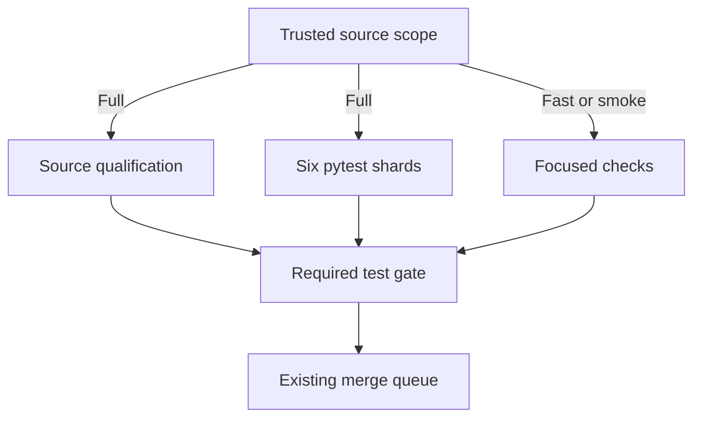

# MastermindX lightning CI architecture and execution plan

Created: 2026-11-06 America/Vancouver. Execution checkpoint updated 2026-11-07 UTC.
Program: existing Mastermind #917 / #1607, Macro #6351, WS:CI-MERGE-CONTROL-PLANE.
Implementation operation: ci-lightning-architecture-20261107-c2.
Procedure: Mastermind protected master 615146aac6a1b0c0933bc9b815517a2fd285ed4a,
Skillpack mastermind.sol_skillpack.v1 / 1.0.1 / bootstrap 1.
This is a detailed CI extension of P3.O3 / Phase 4 of the existing
[delivery-turnaround task tree](superpowers/plans/2026-11-02-delivery-turnaround-execution.md).
It introduces no new workstream, queue, scheduler, runtime or acceptance owner.

The final **Current execution checkpoint** section supersedes historical execution
statuses below. Baselines, earlier receipts and unachieved acceptance targets remain
explicitly distinguished.

## Outcome and completion criterion

Make ordinary engineering feedback feel immediate while completing full consequential
validation quickly and predictably across Mastermind, macro and mastermind-terminal.
Optimize final source revision to required green, and separately eligible revision to
protected merge. Preserve the exact selected tests, meaningful integration checks,
source identity, current trust boundaries and original product outcomes.

An implementation is complete only after its existing workflow consumes it, a
representative natural cohort demonstrates the target by risk class, required failure
cases remain red, and its source/evidence/rollback are recoverable. A cache hit,
local test, isolated runner canary, green workflow or plan is evidence at its own layer.

## Verified starting point

Read-only source observations at intake:

| Repository | Default revision | Current implementation |
|---|---|---|
| Mastermind | 615146aac6a1b0c0933bc9b815517a2fd285ed4a | Trusted scope -> fast/smoke or six canonical pytest shards -> required test; merge-group scope from merged #2129; same-SHA postmerge reuse and existing ci-profile consumer |
| macro | 72c249a2e1967d1ec6dcf6179a7a8728f3305e44 | Existing semantic ci-plan -> selected ci-pack -> ci-gate; incumbent merge-on-green, proof freshness and adaptive admission |
| mastermind-terminal | dd49fa9bd4746d283bfc12581153463629de2b4e | Three stable required contexts; 12 PR browser shards; merged #1320 avoids duplicate merge-group browser matrix; merged #1324 scopes responsive verification |

The [latest native measurements](https://github.com/mastermindx-market-intelligence/Mastermind/issues/917#issuecomment-6702164981)
report Mastermind merge-group-created to required-green STANDARD/smoke n=8
p50 1m53.5s / nearest-rank p95 3m10s; FULL n=6 p50 40m47.5s / p95 43m57s.
STANDARD merge-group-created to merge p95 was 29m44s, so a fast check is not
necessarily a fast release. These selected cohorts are not a causal speedup experiment.

The [Terminal full PR cohort](https://github.com/mastermindx-market-intelligence/Mastermind/issues/917#issuecomment-6700311570)
has n=4, workflow-created to complete-green p50 57m22s / p95 58m42s.
The ubuntu0 desktop-1 canaries were 16m06s with one worker and 8m08s with
four workers ([four-worker run](https://github.com/mastermindx-market-intelligence/mastermind-terminal/actions/runs/42029519496)),
against an earlier hosted 54m41s comparison. These are one-shard observations,
not matched-source whole-suite or sustained fleet results.

Macro's [FIF split proposal](https://github.com/mastermindx-market-intelligence/macro/pull/10788)
records one pack at 69 minutes while its siblings finished in 10-33 minutes.
Its stale calibration weight was 1,630 seconds. We must not confuse calibrated
model weights with observed wall time. Current proof-refresh scarcity and frequent
check-definition invalidation are independent contributors.

## Architecture decision

Extend the existing GitHub Actions owners with a common contract, not a common
replacement orchestrator. Keep repo-specific suites and required-check names.
Treat every run as five separable costs: admission/queue, acquisition/setup,
selected execution critical path, aggregation, and integration/release wait.

1. **Trusted affected-work planner.** Compute changed paths from exact Git identities.
   Use protected policy, explicit dependency closure and conservative invalidators.
   Missing, renamed, dynamic, ambiguous or incomplete dependency evidence goes full.
   Review risk and sufficient test scope remain separate decisions.
2. **Small deterministic tasks.** Split expensive semantic families at natural test
   boundaries, keep stable ownership and prove exact selected coverage once.
   Balance using current measured durations; preserve serial affinity where required.
3. **Cheap hot execution.** Restore locked dependency caches, avoid repeated installation,
   compile production browser assets once per tested candidate where semantics permit,
   and reuse that immutable build across browser shards. Do not ship test flags.
4. **Bounded parallelism.** Choose shard count and per-shard workers together, accounting
   for total slots, memory, databases, ports and queue demand. More fan-out can be slower.
   Use ephemeral isolated runners only through the already qualified runner owner.
5. **Trustworthy reuse.** Begin with immutable dependency/build reuse. A reusable test
   result must bind exact task inputs and transitive dependencies, runtime/toolchain,
   platform, lockfiles, command, trusted policy, environment inputs and artifact digest.
   Untrusted candidate writes cannot supply trusted qualification. Unknown means miss.
6. **Stable aggregate.** Each existing required context reports for every admitted event.
   It validates planner identity, complete coverage, expected shard outcomes and result
   provenance. Cancellation, omission, wrong source, partial results and unqualified
   cache hits cannot turn it green.
7. **Existing release owners.** Preserve native queues and Macro merge-on-green.
   Reduce unnecessary invalidation at its existing owner, while retaining actual
   integrated-candidate proof. Never add a second lease, retry or verdict store.
8. **Existing measurement consumer.** Extend ci-profile/semantic timing artifacts.
   Measure failure/timeout/supersession as well as successful latency, by class and
   phase. Report queue delay separately only where the native timestamp semantics
   actually establish it; a job start offset also includes dependencies.

## Target service levels (proposals, not achieved results)

The end state is seconds for inert changes and a few minutes for substantive changes.
A ten-minute broad/full path is an interim milestone; it does not close the final goal.

| Measurement | Interim p95 | Final p95 | Required meaning |
|---|---:|---:|---|
| First actionable static/contract failure | Establish baseline | <=60 seconds | Real failure surfaced to author; successful runs are not counted as failures |
| Verified docs/metadata required verdict | <=2 minutes | <=90 seconds | Trusted inert allowlist; no executable/config/consumed-data escape |
| Ordinary bounded source required verdict | <=5 minutes | <=3 minutes | Relevant unit/contracts and affected integration/browser paths |
| Broad/full canonical required verdict | <=10 minutes | <=5 minutes | Complete assigned assurance; no expanded exclusions or renamed scope |
| Queue delay on intended capacity | <=60 seconds | <=30 seconds | Native queue timestamps; dependency waiting separately classified |
| Aggregate after last dependency | <=10 seconds | <=10 seconds | Stable required context verifies completeness and provenance |
| Eligible source to protected merge | <=20 minutes | <=10 minutes | Includes integration candidate and queue wait; separate from authoring age |

These are engineering targets, not promises established by current hardware or suites.
The five-minute full target requires removing current indivisible work, not just
changing worker counts. Report cold and warm distributions separately, plus their
actual mix. Publish p50/p95, sample size, selected coverage, runner class, attempts,
failures and cancellations. At least 30 successive eligible observations per populated
class provide an initial operational cohort, not a statistical guarantee. Small
canaries retain their observed ranges and explicit sample counts. Do not choose only
green, fast or warm runs to manufacture acceptance.

A target is not met if test-step time falls but queueing increases the author's
end-to-end wait, total compute becomes unsustainable, or previously required work
silently disappears. A scope reduction is accepted only when the trusted dependency
contract proves that omitted work is irrelevant.

## Preserve and integrate the last few days' work

| Existing change | Intake disposition | Next useful action |
|---|---|---|
| Mastermind #2044 six-shard rebalance, #2129 scoped merge groups, #1570 reuse, #2000/fast-ship profiler | Already merged according to recovered source/history | Consume; do not rebuild these owners |
| Mastermind #2065 four xdist workers per shard | Open b3fdd6ada45a48b940666380938862e558170477; conflicted at intake; current recovery below | Reconcile actual live writer; compose current source in original carrier; qualify worker-death and exact completion guard; measure full run |
| Macro #10735 control-plane family split | Open dbd83c93d5b50f18e11057bd19844336859edc92 | Preserve original split and current repairs; resolve only proven current failure/integration |
| Macro #10788 FIF three-way split | Open 8e7a1de816e246cb8a96031284483576769bdc46 | Compose with the chosen worker design and prove selected-test conservation |
| Macro #10658 / #10738 FIF parallelism | Overlapping existing lanes | Reconcile exact owners/diffs; one resulting source implementation |
| Macro #10752 narrowed-pack compaction | Open 4ddd347bb74a1a04d3f608cae698c203b30effbf | Preserve baseline checks and selected work; measure slots saved versus critical path |
| Macro #10770 adaptive proof cap | Merged in latest checkpoint | Observe actual mature-run capacity decisions; no guessed cap increase |
| Macro #10764 manifest-scoped freshness / #10745 replay environment | Existing source lanes with inherited-red/freshness dependencies | #10755 board-cap repair is already merged; preserve #10674 hold, then #10745, then existing-owner refresh of #10735 |
| Macro #10656 authored/refresh admission and #10674 continuation | Existing control-plane work; #10674 original operation26751 uncertain | Preserve uncertain effect and live source; this plan does not replay or replace it |
| Terminal #1320 native browser dedup / #1324 scoped QA | Merged | Preserve current integrated contracts |
| Terminal #1297 trusted docs scope | Intake 6a7137dc; now integrated/published as 10230a0b on the same PR | Consume natural exact-head CI, then prove natural docs PR latency; release-rule read is currently denied |
| Terminal #1306 optional isolated e2e lane | Open a709b18c3bd25e3aaa264fe3236dbda3155733c9 | Qualify trust/isolation and complete matrix before activation; no implicit host install |
| Terminal #1223 weighted 7/5/5 + serial browser topology, trace and timing work | Draft e34862900a09bfbcf124397ffe0db02a4f509a49; unpublished candidate and uncertain create-commit | Reconcile original effect; preserve already-authored on-first-retry tracing, explicit zero-retry traces, per-attempt JSON timings and one-time Node unit discovery; do not reimplement or replay |

## Critical-path evidence and consequences

Direct native job inspection corroborates the existing cohort reports:

| Observed source/run | Component | Measured elapsed | Decision |
|---|---|---:|---|
| [Terminal 42302235414](https://github.com/mastermindx-market-intelligence/mastermind-terminal/actions/runs/42302235414), mobile 2 | Playwright test / whole job / npm ci | 3298 / 3345 / 17 seconds | Test execution is 98.6% of this job. Prioritize browser/runtime/fixture work over another dependency cache. |
| Same Terminal run | Unit job / current-checkout capture / Vitest | 1013 / 544 / 285 seconds | Capture and Vitest account for 81.8% of the unit job. Browser-shard tuning alone leaves a roughly 17-minute constraint. |
| [Mastermind serial run 42331481657](https://github.com/mastermindx-market-intelligence/Mastermind/actions/runs/42331481657), shard 0 | Whole job / pytest / native application custody | 2131 / 1437 / 373 seconds | The serial qualification prefix must be included in the graph, not hidden inside pytest averages. |
| Same Mastermind run, shards 2 / 3 | Pytest | 1655 / 1683 seconds | Broad serial execution is still expensive across several shards. |
| [Mastermind xdist candidate 42202096909](https://github.com/mastermindx-market-intelligence/Mastermind/actions/runs/42202096909), head b3fdd6ad | Shard 0 whole / pytest / custody / private HTTP compatibility | 1650 / 956 / 382 / 125 seconds | Four workers improve the pytest part, while qualification before pytest dominates the remaining tail. |
| Same xdist candidate, shard 2 | Whole / pytest | 1330 / 1226 seconds | The longest test granules still need work. Other shard jobs were 620-998 seconds. |

These different runs are observational comparisons with potentially different source
and load. They do not establish a controlled causal speedup.

For a workflow DAG, measure queue + setup + collection + the actual dependent
execution path + aggregation. Concurrent job durations are not added to estimate
latency; their sum is compute consumption. Conversely, a serial prefix and its
dependent shard cannot be treated as parallel.

### Amdahl and test granularity

The historical 788.9-second capacity-artifact module establishes a 13m09s floor
if it remains one unchanged unit under xdist loadfile. The [xdist distribution
contract](https://pytest-xdist.readthedocs.io/en/stable/distribution.html) keeps all
tests in one file on one worker. Four workers per job cannot divide that module.

Macro's old 1630-second FIF unit divided perfectly into three remains approximately
9m03s per sibling before setup. The observed 69-minute pack also shows that
calibration, nested execution or fixture behavior differs from that old estimate.

The next optimization must therefore do one of the following with evidence:
remove repeated deterministic fixture construction, shorten legitimate individual
test work, separate independent fixture-affinity groups, or place the same work on
qualified faster capacity. Increasing timeouts or deleting assertions is not an
optimization. Parallelism is bounded by:

`concurrent runs × jobs per run × workers per job`

Choose all three together. Reserve capacity for the existing merge/admission path
through its current owner. Do not create another reservation service.

## Repository implementation design

### Mastermind: finish xdist, then remove the remaining long units

Existing source owners are `scripts/ci_pr_scope.py`,
`scripts/ci_parallel_shard.py`, `scripts/ci_pytest.py`,
`scripts/ci_pytest_timing.py`, `scripts/ci_xdist_guard.py` in #2065,
and `.github/workflows/ci.yml`. Keep the required `test` aggregate and the
accepted #2129 trusted merge-group scope.

1. Integrate #2065 against the actual current source in its original workspace.
   Preserve four workers, no worker restart, deterministic collection, expected
   test completion and all closure/security repairs. Qualify the exact integrated
   head; the earlier green head does not qualify a new merge.
2. Profile `tests/test_capacity_host_artifacts.py` by setup/call/teardown and
   subprocess/build work. Reuse immutable *fixture inputs* only where each test
   still receives private mutable state. Never memoize an admission decision,
   security assertion, ownership result or tamper outcome. If work is independent,
   split coherent test families and prove collection conservation.
3. Decompose shard 0's independent compatibility/custody preflights from its pytest
   execution where their dependencies allow parallel execution. The existing
   aggregate must require every resulting job. Account for shared build inputs
   and service resources before allowing overlap; no success-on-skip shortcut.
4. Recalibrate after fixture changes and after xdist. Duration weights measured
   serially on one runner are not valid automatically for four concurrent workers.
   Optimize the maximum job path, not equal numbers of files.

The completed audit separates a fixture-only candidate from production Git batching.
The next source slice caches initial test-repository construction only, gives each
test a private full Git copy, and must qualify independently of #2065. Production
batching remains deferred; the audit's 138 common failures do not establish full
security parity. See the adjudication and exact implementation child below.

### Macro: smaller semantic units and less unnecessary reproof

Keep `scripts/ci_pr_scope.py`, `scripts/run_ci_pack.py`,
`scripts/ci_semantic_proof.py`, the existing `ci-plan -> ci-pack -> ci-gate`
workflow, and `scripts/merge_on_green.py` as the owners.

1. Reconcile the overlapping FIF worker proposals (#10658/#10738) and the
   three-way split (#10788) into one source progression. Apply #10735's independent
   control-plane family split and #10752's narrowed-plan compaction without
   losing baseline check identities or selected logical jobs.
2. Calibrate current logical-job and expensive constituent durations from real
   native artifacts. Investigate why FIF pack 0 took 69 minutes; do not tune a
   scheduler against the obsolete 1630-second estimate.
3. Split again at genuine independent or fixture-affinity boundaries whenever the
   longest group exceeds the required budget. Preserve ordered/serial state
   dependencies explicitly. The planner must assert every selected unit exactly
   once, including after compaction, fallback and empty/narrow changes.
4. Complete the existing manifest-scoped freshness and replay-environment work
   (#10764/#10745), so irrelevant changes do not invalidate unrelated proof.
   Definition, command, environment and dependency changes still invalidate it.
5. Complete #10656's existing authored/refresh admission programme through its
   original owner. Main admission remains OFF until its actual producer, consumer,
   fairness and cutover acceptance is established. #10674 operation26751 remains
   uncertain and is not retried or replaced by this plan.

Batch compatible check-definition changes for integration, then calibrate. Repeated
global definition changes followed by repeated proof refreshes waste the very
capacity the execution changes are intended to free.

### Terminal: complete existing topology, address capture, and qualify build reuse

Keep `scripts/ci_e2e_scope.py`, `terminal/playwright.config.ts`,
`terminal/e2e/globalSetup.ts` and the existing workflow/aggregate. Preserve
`Quote Hub tests`, `Terminal typecheck + tests`, and
`Ingest + signal-layer tests` as required contexts.

1. Reconcile #1223's original create-commit uncertainty before further publication
   of its unpublished composed candidate. Its trace policy, attempt reports,
   weighted 7/5/5-plus-serial topology and Node-test discovery repair are already
   authored. #1297's trusted docs lane must compose with the merged #1324 selector.
2. Measure individual slow tests, repeated navigation/warmup, retries and server
   compile time using the existing #1223 timing output. Use weights appropriate
   to runner class and worker count. Keep known serial Company Intelligence and
   other dependency chains intact until isolation is demonstrated.
3. Profile the unit job's 544-second capture separately from its 285-second Vitest
   execution. Preserve required evidence consumers and exact-source identity.
   Reuse same-candidate capture outputs across consumers where valid; only select
   fewer capture journeys after proving the impacted-journey contract.
4. Build one immutable browser-test artifact for a candidate and fan it out to
   shards **only after fixture-mode equivalence is qualified**. Current tests use
   `next dev`; their `ADMIN_DEV`, fixture identity/entitlement and runtime data
   behavior do not automatically survive `next build && next start`.
5. Treat test fixture build inputs as a distinct, nondeployable artifact class.
   Keep localhost binding, deterministic fixture data, explicit identity, no live
   credential/provider requirement, and production auth refusal tests. Do not
   widen production's development-only bypass to obtain a faster test. If safe
   production-build parity requires application changes, retain the dev-server
   lane until those are qualified.
6. Compare one controlled shard with identical tests/source under both runtime
   modes, then the complete selected matrix and required aggregate. Browser
   version, fixture/build digest and environment must travel with the artifact.
   Zero-retry evidence jobs retain their deliberate failure trace.
7. Expand #1306 only through its actual isolated runner trust and capacity owner.
   Measure the whole matrix under realistic concurrent demand; the 8m08s canary
   does not prove an 18-shard fleet will achieve that time.

[Playwright's trace guidance](https://playwright.dev/docs/trace-viewer) supports
on-first-retry CI traces. That recommendation is already embodied in #1223; it is
not a reason to author another trace change. Its [CI guidance](https://playwright.dev/docs/ci)
also makes worker count a resource/stability decision, not a universal maximum.

## Common evidence contract and reuse boundaries

This is an additive contract for existing planner/proof/timing artifacts. It does
not introduce a new daemon, registry, scheduler or authoritative database.

| Evidence component | Must bind or establish |
|---|---|
| Source and policy | Repository; PR or merge-candidate SHA; trusted planner/policy revision; verified diff base |
| Selected work | Required task/group identities; test/helper/config/data closure; serial affinity; expected partitions |
| Execution identity | Exact command; dependency locks; runtime/toolchain/browser; OS/architecture; material nonsecret environment inputs |
| Input/build artifact | Content digest; producer source and trusted provenance; fixture mode; compatible consumer; nondeployable test marking where applicable |
| Test outcome | Attempt and runner identity; complete collection/execution; success/failure/cancel state; coverage membership; completion evidence |
| Reuse validity | Matching relevant inputs; trust namespace; accepted freshness rule; policy eligibility; miss reason when unverifiable |
| Performance | Queue/setup/collection/execution/aggregate times; retries; cold/warm state; total compute; source class |

Artifact reuse accelerates a fresh test. Result reuse substitutes an already
qualified assertion and needs the stronger identity above. A passing PR proof is
not automatically proof of a different integrated merge candidate.

Use the accepted trusted merge-group selector and the current repository-specific
composition contract. GitHub's [merge queue](https://docs.github.com/en/repositories/configuring-branches-and-merges-in-your-repository/configuring-pull-request-merges/managing-a-merge-queue)
checks the candidate containing current base and preceding queued changes. Preserve
Terminal's accepted removal of duplicate browser fanout while accurately stating
what its merge-group checks establish; add only the specifically owed composition
proof, not the old blanket matrix by default.

Candidate code cannot select a weaker classifier for itself. Unknown dependencies,
renames, policy changes and incomplete analysis expand validation. Missing,
cancelled, wrong-source or unexpectedly skipped selected work cannot satisfy the
aggregate. A cache hit cannot override an observed failure.

Start result reuse with one deterministic, hermetic task in shadow mode: compare
its reuse decision with actual fresh execution before letting it satisfy an
existing required check. Invalidate on a test/helper/lock/config/runtime/environment
change, evidence tampering or trust mismatch. Preserve the existing broader-run
fallback and rollback at the same owner.

The prior [Vercel CI research](https://vercel.com/blog/introducing-vercel-ci)
provides a useful task-graph/cache/per-task-compute pattern. Its vendor performance
claims are not MastermindX measurements. Adopting a new external CI platform is not
required for this plan and is not authorized by an architecture analogy.

## Falsifiers, rollout and rollback

The strongest counterargument is that narrow selection or proof reuse can hide
dynamic dependencies or interactions between individually passing changes.
The architecture fails qualification if:

- A helper, fixture, lockfile, configuration or policy change incorrectly leaves
  affected work out of the plan or keeps a stale result eligible.
- A candidate changes its own classifier and thereby reduces its required work.
- A selected shard is absent/cancelled/duplicated and the aggregate still passes.
- Individually passing changes violate an owed integrated-candidate behavior.
- A full audit finds a selection false negative.
- Additional fanout improves an isolated test while worsening end-to-end p95 or
  completed delivery throughput under representative load.

Use focused negative tests for these failures, then existing full CI and the real
PR-to-integration path. Keep first-attempt pass rate and retries visible; do not
use retries, longer timeouts or exclusions to hide regressions.

Roll out one material execution dimension per interpretable canary. Preserve the
previous trusted planner/worker/runtime setting for source-level rollback. On
bad selection or invalid proof, fall back to the broader canonical run. On runner
or performance regression, restore the previous admitted execution topology.
Rollback does not replay an uncertain operation or resurrect a stale proof.

## Ordered execution tree

These IDs extend the existing Phase 4 CI work, and are editorial source nodes only.

| ID | Deliverable | Dependency | Acceptance |
|---|---|---|---|
| P4.L1 | Reconciled architecture, current cohort, source/collision map | Current source and #917 evidence | Exact citations and separate observed/forecast/held states |
| P4.L2 | Finish existing parallelism/pack/fast-scope implementations | Original custody and current source | No duplicate PR; actual exact-head coverage and runtime measurements |
| P4.L3 | Terminal browser build/setup critical-path slice | Current workflow/config and no overlapping writer | Same user journeys against immutable candidate; focused failures stay red; real hosted canary |
| P4.L4 | Remove hot Mastermind test/setup overhead | Current measured heavy modules; L2 compatibility | No cached security outcomes; unchanged assertions; Linux proof |
| P4.L5 | Macro duration calibration and split/compact reconciliation | Existing logical-job owner and L2 | Every selected job exactly once, current weight evidence, bounded maximum pack duration |
| P4.L6 | Trusted task-result reuse pilot in incumbent planner | Input contract + deterministic hermetic task | Shadow equivalence first; tamper/environment/dependency changes miss; no false green |
| P4.L7 | Qualified runner economics and execution capacity | Full isolation/trust/capacity canary | Whole-matrix benefit, no starvation of Fabric, rollback through same owner |
| P4.L8 | Natural-cohort acceptance and closed migration | Previous slices | SLO distribution, unchanged coverage, failure/freshness behavior, recoverable rollback |

Execute source-disjoint ready work now. No new CI run merely to produce activity;
use natural candidate validation and actual changed-source canaries where needed.
No merge, approval, runner activation or publication of held operations is inferred
from this plan. Source edits and qualified ordinary PR publication are in scope.

## Initial execution record (historical)

Architecture/planning and non-overlapping source investigation are assigned to the
current session. Native child advice is C3 architecture judgment only. Routine
bounded source labor uses admitted paid Fabric where useful, with one original root,
true parent, stable child ID and retained result; principal direct work requires a
recorded whole-cycle reason. No post-turn execution is promised without real START
and a supported return path.

Current execution: the existing Mastermind #2065 original workspace was
integrated with master 23c9b011e30a4acc6892a59d67a629f74b07a491 after confirming
clean tracked source, exact old head and no observed active handles/index locks.
Six actual test-source conflicts were reconciled. The canonical native stage
builder reproduced the composed 107-member manifest and source inventory
byte-for-byte (manifest 8a7e89dd92cd4c8252ac03188670985f9d76d498a8710a120b1a8a5adfa25cb7).
A new frozen remote-cwd predecessor test exposed one additional observer-preimage
composition mismatch. Its authentic historical observer bytes were restored in
the disposable fixture; the frozen expected digest remained unchanged.

**Published original-branch integration:** [433105846b4d9698d89cffbb54516f51069edacc](https://github.com/mastermindx-market-intelligence/Mastermind/commit/433105846b4d9698d89cffbb54516f51069edacc),
parents b3fdd6ad and 23c9b011, ordinary non-force push with exact GitHub readback.
The same PR now reports mergeable=true. The workflow difference against the
integrated base is still only the four-worker argument; #2129 scope is preserved.
This is principal integration (PRINCIPAL_JUDGMENT / CRITICAL_PATH_SHORTCUT).

**Qualification:** initial 13-file four-worker local batch completed with failures,
not a pass. One was the newly repaired frozen fixture. The other reported failures
were sparse-Git observation refusals; a traced representative returned Git exit0
with a sparse-index expansion warning on stderr. The same representative fails on
unchanged 615146aa source in the separate managed workspace. No warning was ignored
and no production guard was relaxed. The final repaired Go stage and native support
composition selection passed **71 tests, zero failures/errors/skips**, JUnit time
3.651 seconds on macOS Python3.14.7. This is focused local evidence, not full Linux
qualification.

The natural new-head required CI is [42340989000](https://github.com/mastermindx-market-intelligence/Mastermind/actions/runs/42340989000);
shadow CI is [42340989046](https://github.com/mastermindx-market-intelligence/Mastermind/actions/runs/42340989046).
Both were pending at source readback. The earlier green head is not reused to
claim qualification of this integration. No release request has been issued.

### Terminal original-branch integration

[Terminal #1297](https://github.com/mastermindx-market-intelligence/mastermind-terminal/pull/1297)
is now published at [10230a0bf622da83b6acd6c2d9bb2134e9593918](https://github.com/mastermindx-market-intelligence/mastermind-terminal/commit/10230a0bf622da83b6acd6c2d9bb2134e9593918),
parents 6a7137dc and protected dd49fa9b. The original clean workspace was first
reconciled to its bot-created remote merge, then the two selectors were composed.
Two explicit conflict sites and duplicate YAML needs/if/env keys were resolved;
five paths differ from the current protected source. Original #1223 and #1306
source/effects remain untouched.

The docs selector is an optional optimization: an invalid/failed selector runs
ordinary validation. The independent browser selector is mandatory for all events.
Only a successful, exact docs classification on an actual pull_request can excuse
the intentional unit/browser skips. The accepted merge_group browser skip remains.
The stable aggregate checks both selectors and required job outcomes, and explicitly
fails cancellation; missing, failed or unqualified skipped work cannot pass it.

Executed qualification: **207 Python tests passed in 18.98s**, including actual
aggregate-shell truth cases, existing scope/matrix contracts, recursive duplicate-key
checks and cancellation behavior; **10 TypeScript guard tests passed**. No timeout,
test exclusion or required context was weakened. The natural exact-head run is
[42342421881](https://github.com/mastermindx-market-intelligence/mastermind-terminal/actions/runs/42342421881).
Both selectors passed and all expected native jobs were admitted at readback.
Full browser qualification and actual docs-latency acceptance remain pending.

The connector's Terminal branch-protection read returned **403, Resource not
accessible by integration**. That action is stopped; no alternate-account/carrier
replay was attempted. The pre-integration formal review is not claimed as review
of this new source. No new queue or merge request was issued.

### Macro dependency correction

The old #10735 run's board-headroom failure was real at its tested source, but
[the existing #10755 repair](https://github.com/mastermindx-market-intelligence/macro/pull/10755)
already merged as d7843f7f on November 5. Current main c0f0597e has
DISPLAY_BOARD_CAP=640. Do not recreate the repair or describe 480 as current main.
The repair's historical cost estimates are not new VPS runtime qualification.

The source-linked order in
[#10735's owner disposition](https://github.com/mastermindx-market-intelligence/macro/pull/10735#issuecomment-6656361530)
therefore reduces to: preserve/reconcile the existing #10674 held source/effects;
qualify #10745's replay environment through its existing release owner; let the
incumbent update-branch/sweeper reprove #10735 on the resulting base. #10674 currently
remains merge-blocked; its old operation26751 uncertainty is not cleared by a newer
visible branch head. No duplicate cap repair, queue request or rerun is authorized
by finding a stale failure.

### Audit adjudication and next performance slice

Both paid audits returned terminal rc0 with root verified and complete response
bytes consumed. These are research returns, not formal GitHub approval or hosted
performance acceptance. Native C3 advice addressed prioritization and isolation
only; it performed no source mutation.

- **Mastermind audit:** ci-lightning-mastermind-hotspot-audit-20261107-c2-01,
  response SHA256 64b507a2109331a75b795148d361e4195ddebfb5eff41d912c3605907153e5a6.
  The pinned timing artifact directly confirms 788.9s for
  tests/test_capacity_host_artifacts.py. The worker reports 24,846 Git subprocesses
  in its local baseline and 8,584 after three combined proposals; local wall falls
  41.33s to 36.94s. Its approximately 300s hosted forecast assumes spawn latency
  fitted to the old timing and is **not a measured hosted result**. Both local
  variants retained 138 failures, so zero outcome divergence is not full assurance.
  The complete audit return was accepted by manual_result_review with the exact
  response digest above; that receipt does not accept the proposed source patch.
  Accept the diagnostic hypothesis and a fixture-only experiment. Defer both
  production batching proposals until their filesystem-change, path/object,
  malformed-output, refusal-order and tamper semantics have direct qualification.
- **Terminal audit:** ci-lightning-terminal-runtime-audit-20261107-c2-01,
  response SHA256 5693da53b5eba5e7337243586acea8c0bc0136b1f614bece787c776685a32837.
  Its dev-only auth and existing-writer map are useful. Its claim that a passing
  first-retry trace is removed is **rejected**: the
  [Playwright contract](https://playwright.dev/docs/api/class-testoptions#test-options-trace)
  records and keeps that retry. Its assertion that adding seven routes leaves
  every shard's total compile work unchanged is also unproved, especially for
  focused shards. Do not implement blanket warmup additions from this report.
  This return is not accepted as a complete correct performance recommendation.

Direct parent inspection fills part of the Terminal audit's missing evidence:
[mobile-2 job128182990557](https://github.com/mastermindx-market-intelligence/mastermind-terminal/actions/runs/42302235414/job/128182990557)
reports **14 warmup routes in 12s**, **368 passed /115 skipped in 55.0m**, and no
flaky/retry count. Slow files include news-flow-responsive (6.3m) and
options-companion (5.8m). This run does not support warmup as the dominant cost.
Its startup also executes Node-test diagnostics before the Playwright run; the
already-authored #1223 discovery repair remains material. The unit job's
current-checkout capture decision reports full-pr-proof despite zero drifted
files; preserving its assurance while reducing capture/setup remains a separate
design task. Do not claim unmeasured route or trace savings.

The fixture-only child and its parent experiment are now terminal; see the current
checkpoint below. Its principal-owned integration workspace remains at base
7fee845723c44dafe1e9e1159058ad9bd3f3e06b with no candidate published. The experiment
did not demonstrate a whole-module wall-time improvement. Production batching
remains deferred under the safety and measurement requirements above.

Posting a PR status comment was rejected by automatic approval review because
explicit permission to message others was absent. That comment is not retried or
repackaged. Source authoring and qualification continue independently. No source
merge, runner activation or product acceptance is claimed.

## Current execution checkpoint — 2026-11-07 UTC

### Published source and native evidence

| Carrier | Exact current source | Observed outcome and remaining gate |
| --- | --- | --- |
| [Mastermind #2065](https://github.com/mastermindx-market-intelligence/Mastermind/pull/2065) | 91d1d8dd76f8a7d0d42cd2f479b4bb6832ebee96; tree 50db06f262c5e818a8348810766a09f40bcd253a; protected parent 5f8c13da926011fb5fdc8cea21287b532ac968db | Parallel qualification and strict ten-job proof reader published on the original branch. Required [run 42348719795](https://github.com/mastermindx-market-intelligence/Mastermind/actions/runs/42348719795) and shadow run 42348719763 require consumption. No latest-head green, queue or merge claim. |
| [Terminal #1297](https://github.com/mastermindx-market-intelligence/mastermind-terminal/pull/1297) | 689757a5fecab76bac601efbef9178f8115ae01e | Full native [run 42344305342](https://github.com/mastermindx-market-intelligence/mastermind-terminal/actions/runs/42344305342) **SUCCESS**, including every browser shard and required Terminal typecheck + tests. Started 05:49:00, completed 06:53:13 UTC: approximately 64m13s end to end. Release-rule verification remains blocked by the GitHub integration's explicit 403 on Terminal branch protection. |
| [Macro #10825](https://github.com/mastermindx-market-intelligence/macro/pull/10825) | d49837ea333bfef114466139d410ee217ed1c999 | Authored pointer added to the existing W-ACCELERATION-20261104 record; Agent OS validation exited 0 and exact GitHub readback matched. Ready source PR, not a new workstream or runtime owner. |
| [Mastermind #2191](https://github.com/mastermindx-market-intelligence/Mastermind/pull/2191) | This architecture carrier | Earlier doc head 3db9d30 ran all six shards; five passed and shard 0 correctly refused the same protected-base realm pin mismatch. Source #2065 contains the qualified compatibility repair. The architecture still owes current required CI and normal release. |

The protected procedure pin 615146aac6a1b0c0933bc9b815517a2fd285ed4a remains compatible:
bounded comparison through 5f8c13 found no changes in AGENTS, sol_skills, session
review, delivery workflow or active-execution law. No new review waiver is invented.

### Mastermind scheduling slice

The nine former matrix-zero qualification steps now run as one **Source qualification**
job alongside pytest. Every moved step field, command, pinned source, environment
binding and relative order is unchanged except removal of the matrix-zero predicate.
The existing source/runtime bootstrap is copied intact. The six retained pytest
jobs keep their canonical membership, four workers, loadfile placement and zero
worker restart. Their retained step dictionaries are unchanged.

For full scope, both heavy results must be successful and fast checks skipped.
For verified fast/smoke scope, focused checks must succeed and both heavy results
must be skipped. Protected pushes and deliberate dispatches always require full
qualification. Failed, missing, cancelled, unknown or unexpectedly skipped
qualification remains red. The new job has source-read permission, a 30-minute cap,
and depends only on the incumbent scope decision. Actions-read permission remains
confined to pytest jobs; their existing 60-minute budget is unchanged.

The incumbent reuse reader previously expected seven job records, while the
trusted-scope workflow already emitted nine. It now requires the actual full
ten-record shape, including successful source qualification and scope, the exactly
skipped empty fast job, all six successful shards and the successful required gate.
Same commit/clean checkout, native queue actor, exact workflow/attempt, freshness,
unique job/step identities and authenticated API boundaries remain. Executed-job
timestamps remain ordered; skipped-fast metadata is bounded to the run even when
GitHub stamps its start after the skip decision. Missing proof still runs pytest.
Current source qualifications remain mandatory even when pytest can be reused.
Native merge-group/post-merge acceptance of this optimization is still owed.

Qualification evidence:

- Complete-checkout guard run: 736 passed; two old workflow-layout expectations were
  corrected and both passed against the same source. This is 738 qualified cases
  across the full run and focused repair, not a fabricated single green invocation.
- Real gate-shell tests reject each wrong dependency state across PR, merge group,
  push and dispatch. New mutations reject serialized heavy dependencies, additional
  Actions permission, omitted/conditional/false-success native checks and error
  suppression. Canonical discovery, source selection, H1, cancellation and xdist
  contracts are retained.
- Earlier 433105 required run 42340989000 was green. Earlier a4aa976 shadow
  run 42344275466 is fully green after the CLI metadata repair. Neither earlier
  receipt qualifies 91d1d8d.
- The CLI repair changes only eleven parametrized test IDs: the 131073-byte input
  and assertions remain unchanged. All 99 tests passed locally; Linux E2BIG was
  reproduced with the old inherited node ID and avoided with the short ID.

### Protected-base composition repair

Accepted protected #1824 changed the live provider realm to blob
a51e2bce8d9bb312107f975d503abd6541bd5000. The translation fixture still required
eeea4c0fafc7e6df5c534c731cb6046bbe4d3f37. Actual integrated source 081a934b therefore
correctly failed required run 42344275487; the architecture run 42343812671 refused
the same mismatch. This was not a floating Macro dependency or a reason to remove
the exact source assertion.

The new candidate integrates protected 5f8c13 and deliberately advances that one
explicit live-realm pin. Frozen native A/B pins and hash checking remain fixed.
From the exact candidate tree 50db06, the unchanged translation composition ran
against paired Macro f0375acf4ba076718e7cb420ed28ab61fb0a4f26: **23 tests passed**.
All 16 commercial-realm tests also passed, zero skips. Eight generic realm tests
passed; the unchanged installed-Codex-binary test refused this Mac's different
binary digest. No host binary, provider setting or assertion was changed.

Impact planning must include explicit source-pin consumers as dependency edges;
Python imports alone do not express these contracts.

### Fixture experiment disposition

Paid child ci-lightning-mastermind-fixture-impl-20261107-c2-01 returned a complete
candidate and report, then terminated with rc 1 with provider_error/unrecognized_model
for MiniMax-M3. Root lineage was verified; this is not a successful worker return.
Response SHA256:
94aa09b2bdc28349cbda24c650d9785ba6bcb092a0a52d47f9042762f113f58b.
Patch SHA256:
de0b7c446b79e2d9292a6a4e2d5c4fa6b9a5706fc93e621c669adb4e4778c42e.
No retry or replacement dispatch was issued.

The parent independently checked the exact fixture candidate
db267ebbbc2d1c593fa16fc3b00c5bce5e1c85c244401527e8a33413d5913296.
All 167 existing test functions retain identical ASTs; the three new isolation,
pre-initialization and no-Git-on-copy checks pass. A private Linux parent was
verified against the actual custody guard before benchmarking:

| Run | Cases | Pass | Fail | Skip | Whole-module wall |
| --- | ---: | ---: | ---: | ---: | ---: |
| Unchanged source | 466 | 415 | 15 | 36 | 148.632s |
| Fixture candidate | 469 | 418 | 15 | 36 | 148.704s |

Failure IDs and messages are identical. The isolated snapshot lacks the workflow
file and historical Git object used by two tests; its nonstandard /tmp topology
and absent supplementary group account for the other failures. This is partial
environmental parity, not an all-green native qualification. Mac baselines also
exposed real custody refusals from temporary-directory groups and home-directory
ACLs. No production permission check or security assertion was relaxed.

**Disposition: do not publish this as an accepted performance optimization.**
Git subprocess reduction and a faster fixture microbenchmark did not produce a
demonstrated whole-module gain. No hosted speedup is claimed. The principal-owned
fixture integration worktree remains unchanged; the experiment does not authorize
production Git batching.

The separate paid preflight-DAG child
ci-lightning-mastermind-preflight-dag-20261107-c2-01 terminated at admission with
rc 75 / EXECUTION_NOT_ELIGIBLE and no qualified source return. It was not retried.
The principal performed the bounded integration in #2065's existing workspace,
using C3 architecture judgment and direct-source self-checks
(PRINCIPAL_JUDGMENT / CRITICAL_PATH_SHORTCUT / LOWER_TOTAL_OVERHEAD). No second
worker, source carrier, runtime route or approval identity was introduced.

### Remaining critical path and next actions

1. Consume #2065's new native runs, repair concrete failures, verify actual overlap
   and then use the existing head-fenced release path under current rules. Do not
   equate the new graph or focused tests with a five-minute outcome.
2. Retained fixed diagnostics from successful canary 42340989000 identify
   test_capacity_host_artifacts.py at **898.915 reported seconds for 466 cases** in
   shard 2. Source is integrated checkout 8fbd91d937adc20cdbe2722b2a6a09dfada2c8d6.
   Both inspected artifacts retain 512 progress records and explicitly truncate;
   they are not a complete timing inventory. This long module still exceeds the
   full-suite target under loadfile placement. Qualify smaller independent test
   units through the existing discovery/coverage owner, or demonstrate safe work
   reduction; do not create an exclusion list or extrapolate local microtimings.
3. Terminal #1297 is native green. Its full run remains about 64 minutes; green is
   not speed acceptance. Recover the existing #1223 source/effect before integrating
   its weighted topology, Node-discovery correction and per-attempt timing report.
   Global route warmup remains unjustified. Treat build/auth compatibility and
   repeated capture cost as separate measured changes. No runner activation or
   branch-rule fallback follows the 403.
4. Preserve Macro's original #10674 uncertain effect and #10656 hold. #10755 is
   already merged with DISPLAY_BOARD_CAP=640. Continue the incumbent #10674 →
   #10745 → #10735 sequence only when its source/effect evidence permits. Keep
   overlap among two/four-worker/FIF/capacity proposals under their existing owner.
5. Continue the architecture and Agent OS source carriers through their normal
   checks; add the next pointer-plus-delta handoff at an actual continuity boundary.
   Do not create a parallel memory registry or fabricate a durable execution owner.
6. Accept the program only from a representative natural cohort by risk class,
   including cold/warm setup, queue delay, failures, flakes, fallback and cancellation.
   The proposed five-minute p95, ordinary three-minute and docs 90-second targets
   remain unproved. All original safety and product journeys remain in scope.
