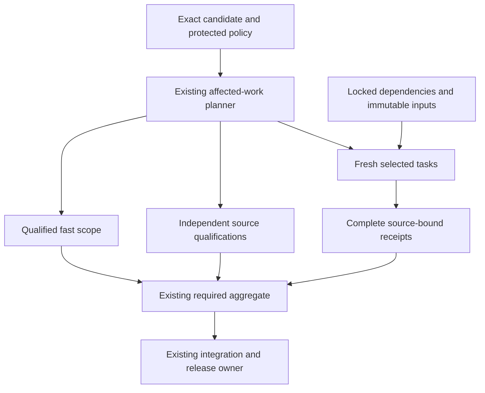

# MastermindX lightning CI architecture and execution plan

Updated: 2026-11-07, 22:10 UTC evidence milestone. Engineering targets below remain unachieved.
Program: existing Mastermind #917 / #1607, Macro #6351 and WS:CI-MERGE-CONTROL-PLANE.
Accepted architecture: [#2191](https://github.com/mastermindx-market-intelligence/Mastermind/pull/2191), merged as [accb4a6b](https://github.com/mastermindx-market-intelligence/Mastermind/commit/accb4a6bcc1f721b93b10f43881cda67eca104ea).
This revision continues the same source document on a fresh follow-up carrier; the merged #2191 branch is retired.

Verified procedure pin: Mastermind protected `66780ab7e3e9fdbfd40713bb5791fb1888529f7c`,
INDEX `b69d45de68d1f1c31d12dcf5203037122c694711`, skillpack 1.0.1 / bootstrap 1.
The compatible pin and same-SHA source laws govern this execution.
Current composed Mastermind source includes protected `20e17eb2985710f1509a5726f3719e5b8d6a37a7`.
The complete intervening protected-source censuses preserve the verified law pin; no governing guide changed.
Macro's completed #10788 consumer tested `1aadfe404d99f456a8adae2b0541541231f68b07`; Terminal's #1341 unit consumer tested `3fe618a630bd1ace2f9e1635c376d3e7cded7eca`.
The next Terminal source review uses protected `d83970570b4feb78f75105606dd27b63e88151e0`.
These are inspected source boundaries, not a claim that protected branches stopped advancing.
This extends P3.O3 / Phase 4 of the existing
[delivery-turnaround task tree](superpowers/plans/2026-11-02-delivery-turnaround-execution.md).

The decision is to keep the three incumbent CI systems, remove repeated work,
make the largest tasks independently schedulable, and qualify enough isolated
capacity for a five-minute fresh full verdict. Existing scope and proof owners
remain authoritative. Caches, parallel workers and runner upgrades each need
their own measured contribution to the complete workflow.

This revision replaces the long rolling status narrative with a current plan
and compact evidence frontier. The complete intake research, rejected experiments,
source receipts and earlier implementation history remain immutable in
[the 16:00 source-linked evidence record](https://github.com/mastermindx-market-intelligence/Mastermind/blob/8b549d74e3977e7e37749b623a224e30423c75d6/docs/CI_LIGHTNING_ARCHITECTURE.md).
The preceding milestone is also immutable at
[980429a1](https://github.com/mastermindx-market-intelligence/Mastermind/blob/980429a1ffdc30fac79c36f87e7d766539967ee0/docs/CI_LIGHTNING_ARCHITECTURE.md).
The accepted [20:00 architecture milestone](https://github.com/mastermindx-market-intelligence/Mastermind/blob/accb4a6bcc1f721b93b10f43881cda67eca104ea/docs/CI_LIGHTNING_ARCHITECTURE.md) retains the preceding full frontier.
Those historical statuses do not supersede the current disposition below.

## Outcome and completion criterion

Make ordinary engineering feedback feel immediate while completing full consequential
validation quickly and predictably across Mastermind, macro and mastermind-terminal.
Optimize final source revision to required green, and separately eligible revision to
protected merge. Preserve the exact selected tests, meaningful integration checks,
source identity, current trust boundaries and original product outcomes.

An implementation is complete only after its existing workflow consumes it, a
representative natural cohort demonstrates the target by risk class, required failure
cases remain red, and its source/evidence/rollback are recoverable. A cache hit,
local test, isolated runner canary, green workflow or plan is evidence at its own layer.

## Current disposition

**The master architecture is accepted into source, and several implementation slices have real native consumers. The three-repository speed upgrade is incomplete; no five-minute p95 is claimed.**

The remaining work is a concrete task graph: reduce oversized execution units, eliminate repeated acquisition/construction, make independent mandatory work schedulable, qualify enough isolated capacity, then prove the complete natural delivery path. Faster selected commands alone do not satisfy the objective.

| Lane | Current source and evidence | Remaining gate |
| --- | --- | --- |
| Mastermind parallel execution and qualification, [#2065](https://github.com/mastermindx-market-intelligence/Mastermind/pull/2065) | Published e6737ba03, including protected 20e17 and three explicit qualification lanes. Three-lane contracts:791 passed; preceding protected-source composition:271 passed; final composed cold/purity cohort:137 passed. Natural [required42419148121](https://github.com/mastermindx-market-intelligence/Mastermind/actions/runs/42419148121) and [RWE42419148128](https://github.com/mastermindx-market-intelligence/Mastermind/actions/runs/42419148128) queued at publication. | Consume their exact tested source, twelve-job fan-in, full outcomes and stage timings. Preserve the original H1/Gateway/initializer holds; no merge enrollment. |
| Mastermind cold compiler repair | Published2b36 and retained in e673. Original qualification800 passed, one unchanged real-root-only skip; exact final cold contracts137 passed. Three pure helpers moved with identical ASTs; default root resolution made lazy without changing canonical resolution. | Current native consumer must prove the cold-import guard and original workflows. Local qualification is not a native performance receipt. |
| Mastermind controlled comparison | Frozen d264 serial succeeds and four-process trial fails two module outcomes; complete 70,693-case identity parity is retained. Later ce38 required/RWE consumers cover71,571 cases with one cold-guard outcome difference. | Preserve failed experiments. Neither differing outcomes nor differing environments establish controlled speedup. Measure hot units after current-source correctness is established. |
| Macro narrowed packs, [#10752](https://github.com/mastermindx-market-intelligence/macro/pull/10752) | Existing one-time MOG enrollment retained. Complete prior native proof:319 logical jobs/691 steps; 89m20s. | Existing freshness controller owns refresh/admission. A genuinely narrowed natural consumer must still prove latency benefit. No manual refresh or rearm. |
| Macro two-interpreter FIF, [#10658](https://github.com/mastermindx-market-intelligence/macro/pull/10658) | Current dc90 [native 42408989367](https://github.com/mastermindx-market-intelligence/macro/actions/runs/42408989367) succeeds:97 selected jobs/290 steps,47m11s. Original120 modules execute; kernel group2,020.853s. Existing MOG retained. | Its composition with the split is now separately proved below. Do not infer five-minute performance from fresh-interpreter isolation. |
| Macro composed split, [#10788](https://github.com/mastermindx-market-intelligence/macro/pull/10788) | Published5e7; [native 42412023592](https://github.com/mastermindx-market-intelligence/macro/actions/runs/42412023592) succeeds:321 logical jobs/694 steps,63m22s. All120 FIF modules execute exactly once across44/37/39 siblings; 4,253 passed/one skipped. | Current checks are ready, but the explicit #10764-before-#10788 sequencing prerequisite remains: #10764 is still open/merge-blocked. Keep #10788 unarmed while advancing that original dependency. Fresh International success does not settle the old timed-out invocation. |
| Macro contract-analysis census, [#8094](https://github.com/mastermindx-market-intelligence/macro/pull/8094) | Published372935 with current-main composition; natural [42415102365](https://github.com/mastermindx-market-intelligence/macro/actions/runs/42415102365) still running at the22:04 read. Complete manifest validation remains before curated-only inference; ordinary planner and other five census classes are unchanged. | Draft/unarmed, semantic release hold retained. The refused long benchmark/Fabric action is not replayed. Partial natural CI is not full-finding or wall-time equivalence. |
| Macro materialization, [#6351](https://github.com/mastermindx-market-intelligence/macro/issues/6351) | Existing W-SELFHOSTED-BRIDGE owner; W3 closed. Current depth-one pack fetches range from173s to1,267s in completed observations; all 147,038 paths are materialized. | Implement the conservative full-default execution-materialization contract described below; first qualify earnings-economic-dossier. Existing #10803 history repair stays on its own carrier. |
| Terminal readiness, [#1338](https://github.com/mastermindx-market-intelligence/mastermind-terminal/pull/1338) | Merged as69c38931 after successful integrated [42407566693](https://github.com/mastermindx-market-intelligence/mastermind-terminal/actions/runs/42407566693). All prior 14 startup probes and full12-shard browser proof retained. | Accepted work: do not reopen. Reliability improvement does not close browser or unit runtime. |
| Terminal capture producer, [#1341](https://github.com/mastermindx-market-intelligence/mastermind-terminal/pull/1341) | Published05a; one-time native admission retained. [42414479074 unit job](https://github.com/mastermindx-market-intelligence/mastermind-terminal/actions/runs/42414479074/job/128529577756) succeeds:20,424 passed/50 skipped/three todo,48 Node contracts, current-capture records-mode consumers pass. Full browser matrix still pending at the recorded snapshot. | Consume final native verdict and integrated queue outcome. The650s capture and307s npm-test phases remain outside budget. No matched causal speed claim. |
| Terminal next source slice | Ticker first-load design removes17 redundant explicit documents,74→57, while retaining21 project cases/14 enabled/seven expected skips and every later presentation reset. Exact owner bytes match tested 3fe618 and protected d839. | Implement on a source-disjoint canonical workspace; prove actual document requests and original recovery/symbol/theme/language behavior. A source operation count is not a runtime result. |
| Terminal held topology / fleet | #1223's original mutation remains uncertain. #1306's hosted defaults are native-qualified; fleet administration was denied. | Do not duplicate topology/traces/Node-discovery work, replay its mutation, or activate a restricted fleet without the exact authorized control. |
| Durable ownership | Accepted architecture#2191; existing Agent OS [#10841](https://github.com/mastermindx-market-intelligence/macro/pull/10841) at 528eb8e, one MOG enrollment retained. | Update the same W-ACCELERATION frontier at material milestones and verify exact source readback. |

Execution remains within existing source, planning, proof, delivery and admission owners. No new scheduler, queue, worker daemon, result authority or materialization programme is introduced.

## Historical intake baseline

These intake observations explain the original design. Current source disposition is above:

| Repository | Default revision | Current implementation |
|---|---|---|
| Mastermind | 615146aac6a1b0c0933bc9b815517a2fd285ed4a | Trusted scope -> fast/smoke or six canonical pytest shards -> required test; merge-group scope from merged #2129; same-SHA postmerge reuse and existing ci-profile consumer |
| macro | 72c249a2e1967d1ec6dcf6179a7a8728f3305e44 | Existing semantic ci-plan -> selected ci-pack -> ci-gate; incumbent merge-on-green, proof freshness and adaptive admission |
| mastermind-terminal | dd49fa9bd4746d283bfc12581153463629de2b4e | Three stable required contexts; 12 PR browser shards; merged #1320 avoids duplicate merge-group browser matrix; merged #1324 scopes responsive verification |

The [latest native measurements](https://github.com/mastermindx-market-intelligence/Mastermind/issues/917#issuecomment-6702164981)
report Mastermind merge-group-created to required-green STANDARD/smoke n=8
p50 1m53.5s / nearest-rank p95 3m10s; FULL n=6 p50 40m47.5s / p95 43m57s.
STANDARD merge-group-created to merge p95 was 29m44s, so a fast check is not
necessarily a fast release. These selected cohorts are not a causal speedup experiment.

The [Terminal full PR cohort](https://github.com/mastermindx-market-intelligence/Mastermind/issues/917#issuecomment-6700311570)
has n=4, workflow-created to complete-green p50 57m22s / p95 58m42s.
The ubuntu0 desktop-1 canary jobs were 16m06s with one worker and 8m08s with
four workers ([four-worker run](https://github.com/mastermindx-market-intelligence/mastermind-terminal/actions/runs/42029519496)),
against an earlier hosted 54m41s comparison. These are one-shard observations,
not matched-source whole-suite or sustained fleet results. The four-worker canary's
whole workflow lasted 17m36s; its 8m08s value is the job clock.

Macro's [FIF split proposal](https://github.com/mastermindx-market-intelligence/macro/pull/10788)
records one pack at 69 minutes while its siblings finished in 10-33 minutes.
Its stale calibration weight was 1,630 seconds. We must not confuse calibrated
model weights with observed wall time. Current proof-refresh scarcity and frequent
check-definition invalidation are independent contributors.

## Architecture decision

Extend the existing GitHub Actions owners with a common evidence contract. Keep repo-specific suites and required-check names.
Treat every run as five separable costs: admission/queue, acquisition/setup,
selected execution critical path, aggregation, and integration/release wait.

1. **Trusted affected-work planner.** Compute changed paths from exact Git identities.
   Use protected policy, explicit dependency closure and conservative invalidators.
   Missing, renamed, dynamic, ambiguous or incomplete dependency evidence goes full.
   Review risk and sufficient test scope remain separate decisions.
2. **Small deterministic tasks.** Split expensive semantic families at natural test
   boundaries, keep stable ownership and prove exact selected coverage once.
   Balance using current measured durations; preserve serial affinity where required.
3. **Cheap hot execution.** Restore locked dependency caches and avoid repeated installation.
   Reuse immutable candidate builds only after their fixture/runtime identity is qualified.
   Terminal retains its development runtime until a nondeployable compiled fixture preserves
   the original auth, data and browser journeys, including cold build/distribution cost.
   Do not ship test flags or widen production authentication bypasses.
4. **Bounded parallelism.** Choose shard count and per-shard workers together, accounting
   for total slots, memory, databases, ports and queue demand. More fan-out can be slower.
   Use ephemeral isolated runners only through the already qualified runner owner.
5. **Trustworthy reuse.** Begin with immutable dependency/build reuse. A reusable test
   result must bind exact task inputs and transitive dependencies, runtime/toolchain,
   platform, lockfiles, command, trusted policy, environment inputs and artifact digest.
   Untrusted candidate writes cannot supply trusted qualification. Unknown means miss.
6. **Stable aggregate.** Each existing required context reports for every admitted event.
   It validates planner identity, complete coverage, expected shard outcomes and result
   provenance. Cancellation, omission, wrong source, partial results and unqualified
   cache hits cannot turn it green.
7. **Existing release owners.** Preserve native queues and Macro merge-on-green.
   Reduce unnecessary invalidation at its existing owner, while retaining actual
   integrated-candidate proof. Never add a second lease, retry or verdict store.
8. **Existing measurement consumer.** Extend ci-profile/semantic timing artifacts.
   Measure failure/timeout/supersession as well as successful latency, by class and
   phase. Report queue delay separately only where the native timestamp semantics
   actually establish it; a job start offset also includes dependencies.

The execution graph keeps fast scope, fresh execution and independent qualification
visible in the same required verdict:

## Target service levels (proposals, not achieved results)

The end state is seconds for inert changes and a few minutes for substantive changes.
A ten-minute broad/full path is an interim milestone; it does not close the final goal.

| Measurement | Interim p95 | Final p95 | Required meaning |
|---|---:|---:|---|
| First actionable static/contract failure | Establish baseline | <=60 seconds | Real failure surfaced to author; successful runs are not counted as failures |
| Verified docs/metadata required verdict | <=2 minutes | <=90 seconds | Trusted inert allowlist; no executable/config/consumed-data escape |
| Ordinary bounded source required verdict | <=5 minutes | <=3 minutes | Relevant unit/contracts and affected integration/browser paths |
| Broad/full canonical required verdict | <=10 minutes | <=5 minutes | Complete assigned assurance; no expanded exclusions or renamed scope |
| Queue delay on intended capacity | <=60 seconds | <=30 seconds | Native queue timestamps; dependency waiting separately classified |
| Aggregate after last dependency | <=10 seconds | <=10 seconds | Stable required context verifies completeness and provenance |
| Eligible source to protected merge | <=20 minutes | <=10 minutes | Includes integration candidate and queue wait; separate from authoring age |

These are engineering targets, not promises established by current hardware or suites.
The five-minute full target requires removing current indivisible work, not just
changing worker counts. Report cold and warm distributions separately, plus their
actual mix. Publish p50/p95, sample size, selected coverage, runner class, attempts,
failures and cancellations. At least 30 successive eligible observations per populated
class provide an initial operational cohort, not a statistical guarantee. Small
canaries retain their observed ranges and explicit sample counts. Do not choose only
green, fast or warm runs to manufacture acceptance. Failed or cancelled runs do not
receive a fast time-to-green; report terminal-verdict latency and qualification
success separately, with retries and unfinished observations visible.

A target is not met if test-step time falls but queueing increases the author's
end-to-end wait, total compute becomes unsustainable, or previously required work
silently disappears. A scope reduction is accepted only when the trusted dependency
contract proves that omitted work is irrelevant.

## Closing the five-minute budget

The allocations are design limits for the whole fresh required path. They include
scheduling, setup, collection/readiness and fan-in. They are not achieved timings.
Upstream scheduling is the cumulative queue delay along the critical path before
the aggregate, not a separate allowance for each job. The aggregate allocation
includes its own runner wait and validation after the last dependency. The separate
queue SLO still applies to the complete critical path; dependency execution is not
misclassified as queue time.

| Repository | Upstream scheduling | Planning | Checkout/environment | Collection/readiness | Longest fresh execution branch | Aggregate | Total |
| --- | ---: | ---: | ---: | ---: | ---: | ---: | ---: |
| Mastermind | 30s | 10s | 40s | 20s | 190s | 10s | 300s |
| Macro | 30s | 15s | 35s | 20s | 190s | 10s | 300s |
| Terminal dev profile | 30s | 15s | 45s | 20s | 180s | 10s | 300s |

Mandatory independent qualification must also finish inside the graph: at most
210s after setup for Mastermind/Macro and 200s for Terminal. New jobs pay their own
queue and setup costs. A compiled browser experiment must include cold build and
distribution; measuring only the subsequent test command is insufficient.

**Task-size rule:** aim for at most 90s per independently schedulable unit on the
admitted runner class. Preserve shared mutable transactions and required fixture
affinity. Use the incumbent planner to pack those units within the execution limit.
A unit above 90s needs legitimate work reduction, an independent affinity split or
qualified faster execution before the branch can close. The unit ceiling is necessary,
not sufficient: total selected work must also fit admitted concurrency, memory and
setup capacity without lengthening the end-to-end queue path.

**Historical sizing evidence:** the complete c854 parallel inventory reported
10,565.219s across 2,326 runtime modules. With unchanged service and 24 equivalent
processes, perfect balancing alone is 440.217s. Fitting 190s under that artificial
model requires about 56.84% less service, or about 55.6 equivalent processes.
Neither is a CPU lower bound or authorization to start 56 processes: grouping,
fixture sharing, contention, package versions and runner class change those costs.
The matched d264 RWE pair now exists, but the parallel trial failed two outcomes;
its elapsed reduction still cannot be accepted as a qualified speedup.

The current composed FIF commands still take629.906s,820.212s and765.374s; Macro's full run retains a2,742s pack execution tail. Its checkout alone can exceed twenty minutes. Terminal's newly qualified capture is650s and npm-test307s, while the prior full browser matrix has a53m16s command. These different units independently exceed their design allocations. Work reduction, task granularity, materialization and qualified capacity must close together; they are not additive or causal speed comparisons.

Capacity is chosen only after measuring the fresh graph. Model concurrent runs,
jobs per run and workers per job together; include memory, ports, browser/server
cost, setup and serial affinity. Preserve the existing Fabric and release budgets.
No new runner, scheduler, queue, lease store or admission plane is introduced.

## Preserve and compose the existing work

| Existing owner | Preserve | Concrete composition boundary |
| --- | --- | --- |
| Mastermind merged #2044 / #2129 / #1570 and profiler | Six outer shards, trusted merge-group scope, exact-SHA postmerge reuse and ci-profile | Extend their contracts; do not reconstruct them. |
| Mastermind #2065 | Four prepartitioned child interpreters, exact cover, terminal receipts, observer, RWE adapter, physical capacity-test partition | Complete matched-profile proof, hot-unit work and current required source qualification. |
| Mastermind reserved #1714 | SDK/runtime lane at `47164aef5c1cf928f0618be28996d465c9564efa`, including `pyproject.toml` and both RWE locks | Regenerate lock provenance from the combined inputs when composed. The narrow pytest qualification does not complete this future integration. The reservation alone proves neither a live writer nor a global exclusive fence. |
| Macro #10788 + #10658 | 120 FIF modules; #10788's 44/37/39 split and #10658's one fresh interpreter per file, with at most two files running concurrently | Implemented and native-qualified at 5e7: the existing helper runs each split sibling's own file list. Its path is in all three closures: 1,139 → 1,140 raw entries and 1,135 → 1,136 unique paths each; preserve the four existing duplicates. Declare the helper in the exclusive control-plane owner too. Preserve B's P2/G-pack/Node ownership and ancestor-package additions. |
| Macro #10738 | Historical failed four-worker shared-xdist experiment | It is not a qualified two-to-four-worker progression or fallback for #10658. |
| Macro #10752 | Genuinely narrowed-plan compaction and exact baseline/full/off/shadow fallback | Keep twelve-slot output, selected-job objects/digests/order and real consumer closure. |
| Macro #10735 / #10745 / #10764 | Control-plane family split, replay environment, manifest-scoped freshness | #10755 cap 640 and #10770/#10766 are accepted. Preserve #10674's original uncertainty, then compose #10745 and #10735 through their original owners. |
| Macro #10656 / #10674 | Existing authored/refresh admission programme | Main admission remains OFF. Original proof-preparation process26751 and its unbound publisher disposition stay unresolved; no invented GitHub-mutation identity, alternate continuation or retry. |
| Terminal accepted #1320 / #1324 / #1297 / #1334 | Native browser deduplication, scoped QA, trusted docs scope and accepted News navigation repair | Preserve their selectors, original journeys and required aggregate. #1297 acceptance is `90ddc139`; no redo. |
| Terminal #1306 | Optional lane binder, selected ports/workers, trust/isolation/rollback runbook | Published scoped-CI integration is independent of fleet activation and #1223's held mutation. |
| Terminal #1223 | Already-authored weighted topology, traces, attempt timing and Node discovery | Reconcile its original create-commit. A new implementation on another carrier would duplicate held work. |
| Terminal accepted #1338 | Context-entry repair, actual EN/ZH evidence and strict fixture-startup probe | Merged69c38931; preserve app assertions, runtime, topology, traces and historical evidence. |

## Critical-path evidence and consequences

These are actual completed native measurements. They come from different runs and environments; comparisons are observational unless explicitly qualified.

| Native source/run | Observed cost | Architectural consequence |
| --- | --- | --- |
| Mastermind ce38 [required42410396607](https://github.com/mastermindx-market-intelligence/Mastermind/actions/runs/42410396607) | Source qualification590s; required verdict15m58 with the cold-compiler failure | Qualification is independently too large. Three explicit lanes are now implemented; new queue/setup costs still count. |
| Mastermind ce38 [RWE42410396564](https://github.com/mastermindx-market-intelligence/Mastermind/actions/runs/42410396564) | Successful33m15; outer receipt durations1,194.90–1,751.46s; aggregate waited158s, then executed4s | Pytest work and aggregate scheduling remain large constraints after the qualification split. No worker-count inference from wall time alone. |
| Macro #10658 [42408989367](https://github.com/mastermindx-market-intelligence/macro/actions/runs/42408989367) | Contract-delta job 883s:100s checkout and767.4s analysis command | A mandatory independent analysis branch exceeds300s by itself. #8094 addresses one census band, not the entire branch. |
| Macro #10788 [pack 0](https://github.com/mastermindx-market-intelligence/macro/actions/runs/42412023592/job/128522729070) / [pack 1](https://github.com/mastermindx-market-intelligence/macro/actions/runs/42412023592/job/128522729142) | Exact depth-one fetch1,266.824s /850.457s; subsequent checkout63.881s /91.416s; 147,038 paths each | Do not propose depth0→1 as an unimplemented pack optimization. Separate acquisition and materialization; current logs do not split network/remote/local Git cost. |
| Macro #10788 [pack 3](https://github.com/mastermindx-market-intelligence/macro/actions/runs/42412023592/job/128522729066) | Fetch173.013s plus checkout93.552s; 147,038 paths | Object caching can reduce acquisition; a verified execution closure can also reduce worktree writes. Neither saving is yet measured for a qualified W4 profile. |
| Macro #10788 FIF | Three kernel commands629.906s,820.212s,765.374s; original 120 modules all complete | The composed split has a real consumer and preserves module coverage, but each command remains far beyond190s. Do not add concurrent command durations as verdict wall. |
| Macro #10788 last pack 6 | Validate/run step 2,742s; full verdict63m22s | The next command-level owner must be identified from that actual tail. FIF tuning alone does not close the graph. |
| Terminal integrated readiness [42407566693](https://github.com/mastermindx-market-intelligence/mastermind-terminal/actions/runs/42407566693) | Unit1,297s: capture 698s, Vitest 408s, other191s | The independent unit path remains a separate budget constraint after browser reliability improves. |
| Terminal #1341 [unit128529577756](https://github.com/mastermindx-market-intelligence/mastermind-terminal/actions/runs/42414479074/job/128529577756) | Unit1,107s: capture 650s, npm-test307s, typecheck79s | One redundant composition read is removed and native consumers pass. Further capture and unit graph work is still required. |

For a workflow DAG, latency follows the actual dependency path, including every queue/setup/collection/readiness interval and final aggregation. Summed concurrent durations describe work consumption, not latency. Conversely, serial prefixes cannot be modeled as parallel.

### Why the three Mastermind qualification lanes are needed

The590s source-qualification observation includes approximately 63s setup,2s preflight,31s Paper,179s Fabric,7s compile/shell,215s native bundle,40s capsule and49s Brain acquisition/composition. The native bundle contains13.95s of unittest prelude plus200.59s of native pytest.

After setup, the approximately 523s of work cannot fit two perfectly balanced lanes inside the210s qualification budget: the idealized split is261.5s per lane before new overhead. The implemented three-lane grouping puts native pytest, Fabric, and the remaining core work on separate jobs; the unittest prelude stays intact in the core lane. This is a dependency-preserving design based on observed components, not a prediction that the new jobs will finish in 201/179/143s. Fresh setup, contention and scheduling must be measured.

### Amdahl, total work and task granularity

The old788.9s capacity-artifact file has already been physically split into twelve coherent files preserving466 cases. Trend's44 cases have already been divided into17/16/11 complete units. Do not redo those accepted transformations.

The next optimization must remove repeated deterministic construction, shorten legitimate work, separate independent fixture-affinity groups, or qualify faster execution capacity. Timeout increases, retries and assertion deletion do not qualify. Choose concurrent runs × jobs per run × workers per job together, with real memory/ports/browser/server/setup demand and the incumbent admission budget.

The historical10,565.219 module-seconds /24-process440.217s ideal-balance model is not CPU service or a hard lower bound. It does show why placement alone cannot justify the190s fresh-execution budget on an assumed unchanged profile. Actual task demand and admitted capacity must close together.

## Repository implementation design

### Mastermind

Keep the incumbent scope, shard, pytest timing, xdist guard, RWE environment, workflow and postmerge-proof owners.

1. **Consume the current source before changing it again.** Published e673 composes protected 20e17, the cold compiler repair, exact historical observer cohorts and three qualification lanes. Required42419148121 and RWE42419148128 are the natural consumers. Establish actual tested merge/tree and complete per-module outcomes before accepting current-source correctness or performance.
2. **Keep the current fixed-capacity partition.** Six canonical outer pytest jobs have four independent serial child interpreters, exact once-only module coverage, private diagnostics and terminal receipts. Do not nest another four xdist workers inside them. The separate guarded native qualification keeps its existing four-worker command.
3. **Keep all three mandatory qualification lanes in the required graph.** Core owns Paper/Studio/compile/shell/unittest-prelude/capsule/Brain; Fabric owns the complete Fabric block; native owns the intact guarded pytest block. Each pays setup and queue. All commands remain present exactly once. The aggregate requires all three successes on full scope and all three skips on fast scope.
4. **Use the exact twelve-job postmerge contract.** Scope, fast, six pytest jobs, three source qualifications and aggregate must match exact source/actor/workflow/attempt/freshness and mandatory-step ownership. Missing, duplicate, wrong-job, stale, unknown or old10/11-job proof falls back to full selected pytest. This implementation has791 passing local contract tests; hosted qualification is pending.
5. **Continue measured hot-unit reduction.** Trend's construction/copy isolation and17/16/11 partition, capacity's immutable Git seed plus fresh per-case copies, and current observer identity are already implemented. Consume their native phase receipts; choose the next above90s unit from actual composed-source data. Never cache a security, admission, transport or crash-replay verdict.
6. **Preserve original effect and release holds.** The new bounded H1 diagnostic and fresh successful invocations do not recover the old ATT1/process-settlement receipt. Gateway/initializer release conditions remain separate. The current source work does not install, enroll or activate runtime components.

The cold repair moves three AST-identical pure helper functions to the existing pure entry owner and makes one identical default-root resolution lazy. It preserves updater CLI bootstraps, security joins and canonical symlink behavior. Final composition passes all 15 cold/adoption and122 original purity tests; it does not weaken the cold guard.

### Macro

Keep the existing semantic planner, catalog, dependency inference, pack runner, proof producer, gate and MOG controller.

1. **Deliver the proven FIF composition through existing controls after #10764 merges.** The [existing sequencing ruling](https://github.com/mastermindx-market-intelligence/macro/pull/10788#issuecomment-6674602501) preserves the freshness-before-manifest order to avoid invalidating the armed backlog. #10764 remains open at 99c6f46e with MOG/merge-blocked; no old-author approval ritual is added. #10788's 44/37/39 siblings use #10658's incumbent fresh-interpreter helper, two files at a time within each sibling. Native proof conserves all 120 module starts and completions,4,253 passes/one skip, B's P2/G-pack/Node steps and the complete 321-job/694-step gate. The local missing control-plane helper dependency was fixed and qualified before publication.
2. **Reduce the actual largest remaining command.** The completed run's pack 6 validate/run step is2,742s. Attribute its individual commands before proposing another split. Retain source ordering, semantic IDs, original inputs, cleanup, exact-base replay and all selected work. Existing duration weights are placement inputs, not runtime promises.
3. **Finish the mandatory contract-analysis path.** #8094 performs full manifest validation before limiting one inference census to curated jobs. It leaves the ordinary planner and five other census classes unchanged. Current-source composition is published; the original semantic/data hold and explicit long-benchmark refusal remain. Code-owner success does not mean the separately retained data-health assertions passed.
4. **Implement W4 materialization under #6351.** Use the detailed full-default contract below; selection scopes alone are not execution closures. Do not duplicate #10803's finite provided-action history helper or the accepted object-cache design.
5. **Preserve command settlement and replay.** An expired execution allowance must not remove cleanup's observation allowance. Attempted kill is not descendant settlement. Fresh International proof completes all current commands, including IM14 browser10-pass/zero-skip, but cannot settle the older fixed-path invocation.
6. **Consume narrowed compaction and freshness naturally.** #10752 keeps full/baseline/off/shadow/global-invalidating behavior. Preserve existing MOG enrollment, queue limits and proof freshness. Main admission stays OFF until its own producer/consumer/fairness/cutover acceptance. #10674's original unknown custody is not a reason to abandon independent source work.

#### Contract-analysis decomposition

The completed767.4s command already runs candidate/base work concurrently. Reported stages are closure478/439.2s, probes153.2/131.6s, skip census39.2/39.8s and trigger audit70.2/71.2s. #8094 targets only part of the first stage; existing AST caches are already present.

Even an idealized removal of that entire first stage leaves roughly 405s including the observed checkout. This is explanatory arithmetic from one run, not a measured floor or benchmark claim. After the original permitted natural consumer is consumed, any next source change must identify its exact preserved finding set and current owner. Do not substitute a hosted benchmark for the refused long benchmark.

#### W4: verified execution materialization

**Owner:** existing W-SELFHOSTED-BRIDGE / #6351, with W3 already closed. #6505's P3B-B merged onAugust27; an Agent OS sentence calling it next is stale. Correct that existing owner record at the appropriate source boundary, rather than create a parallel programme.

**Why current scope metadata is insufficient:** catalog paths and exclusive scopes decide selection. Exclusive scope can suppress fallback inference; wildcard/initializer coverage has separate census rules; direct-read inference omits some data-marked inputs. A tracked-path inventory proves existence, not bytes. None establishes that an executing pack may safely omit every other file.

**Minimal contract and algorithm:**

- Add a strictly validated optional materialization declaration to the existing catalog; default every unenrolled job to full.
- The existing dependency owner compiles a deterministic execution closure: command/test/helper inputs, transitive first-party imports, package initializers, pytest configuration/conftests/plugins, runner/bootstrap, templates/assets/configuration/goldens/data and declared glob membership.
- Resolve every member against the exact tested Git tree with canonical path, mode and object ID. Bind contract version and member digest inside the incumbent authoritative plan and execution-contract digest.
- Any unresolved dynamic import, subprocess dependency, traversal, unsupported language/command/tree entry or unclassified runtime input selects full before execution. Exclusive scope does not suppress that result.
- For each pack already selected by the current planner, materialize bootstrap union all qualified job closures. If any assigned job requires full, the pack stays full. Do not change eligibility, weights, assignment or pack count to manufacture a favorable closure.
- Full packs retain current unfiltered depth-one checkout. Closed packs acquire and verify every required object offline before unchanged tests start. A malformed/wrong-SHA/incomplete published profile refuses; it must not silently widen after execution starts. Bounded object count is not a byte bound.
- Preserve the same pack union through workspace restoration. Restore tracked members, remove untracked/generated contamination and reverify HEAD/profile. Git repair respects that union or refuses.
- Validate the whole catalog, including unselected jobs, with the existing exact-tree inventory context. Missing unselected bytes must not weaken existing manifest validation.
- Leave history-dependent consumers full initially. Preserve #10803's exact-SHA finite ancestry behavior and holds.
- Keep exact-base failure replay full and independently pinned to the base's own runner/catalog. Never reuse the candidate closure as the base closure.

**Compatibility order:** implement full-default producer/consumer semantics first, including the existing trusted main-owned executor and control-bundle contract; only then opt in a named job. Candidate source cannot demand an unsupported materialization profile from a protected consumer. Unsupported versions refuse. This infrastructure stage earns no speed claim.

**First qualification candidate:** earnings-economic-dossier, the sole logical job in completed #10788 pack 2, with 2,740 passes/176 skips and one fixed pytest command. It is not yet proved closed. Establish the complete closure before enrollment; retain full if any dependency remains uncertain. Compare exact collected case identities with multiplicity, phases/outcomes and all 176 existing skip reasons. Preserve commands, dependencies, semantic IDs and job membership. Inject failure to prove full exact-base replay and normal settlement behavior. If future packing places it with an unqualified job, that whole pack remains full.

**Decisive negatives:** opaque/dynamic/exclusive-hidden dependency retains full; omitted initializer/conftest/plugin/template/fixture cannot become an accepted new skip; wrong tree/OID/mode/path escape/duplicate/digest refuses; invalid unselected job still fails; modified tracked or generated/sparse-config contamination is cleared or refused; wrong ancestry and UNKNOWN replay remain unchanged; hosted and trusted consumers agree.

**Existing files:** catalog, ci_scope_dependencies.py, run_ci_pack.py, ci.yml, trusted-ci-executor.yml and their existing pack/workflow/execution-profile contracts. The accepted read-only shared Git object cache can reduce origin acquisition; W4 can additionally reduce worktree writes for qualified packs. Neither replaces the other, and neither alone establishes five-minute delivery.

### Terminal

Keep current scope, Playwright configuration, fixture warmup/readiness, evidence writers/readers and the three stable required contexts.

1. **Retain accepted readiness and scope.** #1338 merged after integrated qualification; #1320/#1324/#1297/#1334 remain accepted. The strict startup probe retains its direct200, fixture provenance, complete schema, one deadline and existing14-route warmup. Do not reopen these slices or claim they explain every later request stall.
2. **Finish #1341's natural delivery.** It reuses the validated writeComposition return instead of immediately rereading the same composition. All50 selections,24 PL6/30 VI records, two operations, canonical bytes and downstream reader guards remain. Native unit and records-mode consumers pass; full browser/integrated outcome remains separate. The removed later producer-only snapshot has an explicit temporal difference; no atomicity claim is made.
3. **Implement Ticker first-load consolidation.** Existing prepare installs isolation/routes without the redundant initial document; existing presentation setup performs the first intended-language document, then all later reloads and visible appearance actions remain. Install case-specific routes before that first document. Preserve21 project cases,14 enabled/seven expected skips,12 presentation cells, CN/HK original headlines, held Apple→MSFT progress and recovery's exactly-one additional snapshot/no-navigation assertion.
4. **Prove74→57 actual documents.** Source counts are13→12 for matrix,6→4 unavailable,15→12 recovery,2→1 grouped,2→1 held-response,3→3 editorial,33→24 CN/HK. Observe main-frame document requests from before first navigation; use the same runtime/fixture/workers for timing attribution. First Chinese language, later language changes, light-specimen cleanup and later symbol transitions must all remain valid. Seventeen fewer documents does not imply a percentage runtime improvement.
5. **Partition independent unit work from capture-dependent imports.** The direct PL6/VI consumers call selectedComposition at module import; Options loads its manifest at import. Their collection/import must occur in a fresh process only after capture selects the composition. Independent unit work may form another existing-workflow branch. Preserve exact file/case union in both records mode and the legitimate merge-group legacy path, and propagate either partition's failure. Account for additional setup/queue; same-runner overlap has no demonstrated benefit.
6. **Qualify capture runtime isolation before parallel launch.** PL6 and VI use different ports but the same default .next checkout state, different dev-server environments, and PL6's owned server supplies Options capture. Simple Promise.all or shared-server substitution is unqualified. PL6 also has a module-global immutablePng, so concurrent surface calls can race byte association.
7. **If separate packet jobs are pursued, preserve the present evidence contract.** One complete PL6 job and one complete VI job can still produce exactly two operations. Preserve24/30 execution records,20+30 selected cases, exact run/attempt IDs, source/profile provenance and Options under PL6. Transfer completed immutable records through a verified artifact/materialization boundary; never transplant live writer filesystem custody or strip identities. Compose only after both complete and validate. Per-locale/project packet sharding is a different contract and is not a drop-in change.
8. **Keep compiled fixtures and fleet activation as separately qualified stages.** Development auth/preview seams cannot be broadened into production bypasses. A compiled nondeployable fixture needs coherent existing authority/data contracts and cold build/distribution costs. #1306 owns restricted-runner trust, isolation, capacity and rollback; its hosted proof is not fleet activation. #1223 owns held topology/traces/Node discovery; do not duplicate it.

An idealized overlap of the entire observed307s npm-test phase would still leave650s capture plus approximately 150s other unit work before deferred consumers or new overhead. Unit partitioning is useful intermediate work, not completion. The final plan must reduce capture work or qualify faster isolated runtime as well as address browser task size.

## Common evidence contract and reuse boundaries

This is an additive contract for existing planner/proof/timing artifacts. It does
not introduce a new daemon, registry, scheduler or authoritative database.

| Evidence component | Must bind or establish |
|---|---|
| Source and policy | Repository; PR or merge-candidate SHA; trusted planner/policy revision; verified diff base |
| Selected work | Required task/group identities; test/helper/config/data closure; serial affinity; expected partitions |
| Execution identity | Exact command; dependency locks; runtime/toolchain/browser; OS/architecture; material nonsecret environment inputs |
| Input/build artifact | Content digest; producer source and trusted provenance; fixture mode; compatible consumer; nondeployable test marking where applicable |
| Test outcome | Attempt and runner identity; complete collection/execution; success/failure/cancel state; coverage membership; completion evidence |
| Reuse validity | Matching relevant inputs; trust namespace; accepted freshness rule; policy eligibility; miss reason when unverifiable |
| Performance | Queue/setup/collection/execution/aggregate times; retries; cold/warm state; total compute; source class |

Artifact reuse accelerates a fresh test. Result reuse substitutes an already
qualified assertion and needs the stronger identity above. A passing PR proof is
not automatically proof of a different integrated merge candidate.

Use the accepted trusted merge-group selector and the current repository-specific
composition contract. GitHub's [merge queue](https://docs.github.com/en/repositories/configuring-branches-and-merges-in-your-repository/configuring-pull-request-merges/managing-a-merge-queue)
checks the candidate containing current base and preceding queued changes. Preserve
Terminal's accepted removal of duplicate browser fanout while accurately stating
what its merge-group checks establish; add only the specifically owed composition
proof, not the old blanket matrix by default.

Candidate code cannot select a weaker classifier for itself. Unknown dependencies,
renames, policy changes and incomplete analysis expand validation. Missing,
cancelled, wrong-source or unexpectedly skipped selected work cannot satisfy the
aggregate. A cache hit cannot override an observed failure.

Start result reuse with one deterministic, hermetic task in shadow mode: compare
its reuse decision with actual fresh execution before letting it satisfy an
existing required check. Invalidate on a test/helper/lock/config/runtime/environment
change, evidence tampering or trust mismatch. Preserve the existing broader-run
fallback and rollback at the same owner.

The prior [Vercel CI research](https://vercel.com/blog/introducing-vercel-ci)
provides a useful task-graph/cache/per-task-compute pattern. Its vendor performance
claims are not MastermindX measurements. Adopting a new external CI platform is not
required for this plan and is not authorized by an architecture analogy.

## Falsifiers, rollout and rollback

The strongest counterargument is that narrow selection or proof reuse can hide
dynamic dependencies or interactions between individually passing changes.
The architecture fails qualification if:

- A helper, fixture, lockfile, configuration or policy change incorrectly leaves
  affected work out of the plan or keeps a stale result eligible.
- A candidate changes its own classifier and thereby reduces its required work.
- A selected shard is absent/cancelled/duplicated and the aggregate still passes.
- Individually passing changes violate an owed integrated-candidate behavior.
- A full audit finds a selection false negative.
- Additional fanout improves an isolated test while worsening end-to-end p95 or
  completed delivery throughput under representative load.

Use focused negative tests for these failures, then existing full CI and the real
PR-to-integration path. Keep first-attempt pass rate and retries visible; do not
use retries, longer timeouts or exclusions to hide regressions.

Roll out one material execution dimension per interpretable canary. Preserve the
previous trusted planner/worker/runtime setting for source-level rollback. On
bad selection or invalid proof, fall back to the broader canonical run. On runner
or performance regression, restore the previous admitted execution topology.
Rollback does not replay an uncertain operation or resurrect a stale proof.

## Ordered execution tree

These IDs extend the existing Phase 4 CI work, and are editorial source nodes only.

| ID | Deliverable | Dependency | Acceptance |
|---|---|---|---|
| P4.L1 | Reconciled architecture, current cohort, source/collision map | Current source and #917 evidence | Exact citations and separate observed/forecast/held states |
| P4.L2 | Finish existing parallelism/pack/fast-scope implementations | Original custody and current source | No duplicate PR; actual exact-head coverage and runtime measurements |
| P4.L3 | Terminal browser build/setup critical-path slice | Current workflow/config and no overlapping writer | Same user journeys against immutable candidate; focused failures stay red; real hosted canary |
| P4.L4 | Remove hot Mastermind test/setup overhead | Current measured heavy modules; L2 compatibility | No cached security outcomes; unchanged assertions; Linux proof |
| P4.L5 | Macro split/compact reconciliation, contract-analysis and W4 execution materialization | Existing logical-job/#6351 owners and L2 | Exact selected jobs/cases, full-default compatibility, current weights, bounded acquisition/materialization/execution |
| P4.L6 | Trusted task-result reuse pilot in incumbent planner | Input contract + deterministic hermetic task | Shadow equivalence first; tamper/environment/dependency changes miss; no false green |
| P4.L7 | Qualified runner economics and execution capacity | Full isolation/trust/capacity canary | Whole-matrix benefit, no starvation of Fabric, rollback through same owner |
| P4.L8 | Natural-cohort acceptance and closed migration | Previous slices | SLO distribution, unchanged coverage, failure/freshness behavior, recoverable rollback |

Execute source-disjoint ready work now. No new CI run merely to produce activity;
use natural candidate validation and actual changed-source canaries where needed.
No merge, approval, runner activation or publication of held operations is inferred
from this plan. Source edits and qualified ordinary PR publication are in scope.

## Current evidence frontier

### Mastermind: current source and exact qualification layers

[#2065](https://github.com/mastermindx-market-intelligence/Mastermind/pull/2065) publishes e6737ba03a254310e5eddb28dbe0839713b72694, tree e0363dfd2aa864d6719a79533f763df188749c20, including protected 20e17. Natural required42419148121 and RWE42419148128 were queued at 22:07:59. No required/RWE run existed on the preceding conflicted2b36 head; only CodeQL completed.

| Source slice | Qualified result | Limit |
| --- | --- | --- |
| Cold compiler repair2b36 | 800 passed, one unchanged actual-root-only skip; three fresh-interpreter cold-map regressions and two canonical-root cases; isolated CLI usage exit64 | Nonroot Darwin proof; native consumer still owed |
| 0d protected composition5fd5617 | 271 passed, zero failure/error/skip; seven whole owner files plus pure initializer selector | No H1 positive invocation or runtime activation |
| Three lanes1793685 | 791 passed, zero failure/error/skip; strict workflow, actual aggregate shell, cancellation, step ownership and exact12-job proof | Local contracts, not hosted timing |
| Final20e17 compositione673 | 15 cold/adoption +122 original purity passed, zero failure/error/skip; only accepted registry keyword changes entry AST; all 9 lane postimages unchanged | Earlier counts remain bound to their own source identities |

The final composition preserves accepted v3/v4 privacy requirements and exact identity-review rows. Those frozen token/source records do not create an independent formal approval requirement or grant runtime authority.

The completed ce38 required/RWE pair uses actual merge4a204499613a95610ebbc8a9d3e2ca1bf2c1871d, tree 310bf3219477781b249524886f5d51ca3cdf8298 and paired Macro256c757b. Both have2,358 complete unique module companions and71,571 collected=invoked=finished cases, zero recorder errors/deselection and exact identity/count parity. Outcomes match for2,357 modules; the cold compiler guard differs. Required fails in 15m58; RWE succeeds in 33m15. All24 children return. Six environment receipts bind lock fa122bfe..., environment 58de61f3d39fc214, CPython 3.12.16, pip-check success and zero degraded records.

The earlier frozen [d264 controlled-pair artifact](CI_RWE_CONTROLLED_PAIR_20261107.json), [Trend partition mapping](CI_TREND_PARTITION_PROOF_20261107.json) and [ACL diagnostic](CI_GATEWAY_ACL_BRACKET_DIAGNOSTIC_20261107.md) remain immutable evidence. The parallel d264 trial failed outcome parity; it is not an accepted speedup. The current H1/Gateway/initializer holds remain.

### Macro: complete current native composition

**#10788:** [42412023592](https://github.com/mastermindx-market-intelligence/macro/actions/runs/42412023592) succeeds at 21:41:48,63m22 after creation. Actual tested merge 1aadfe404d99f456a8adae2b0541541231f68b07 has base 74873cdaf3c8a3f305ddcac732975f815a7e87fa and candidate 5e7a585fee0650ee53f6727b229322a9f015c5d6; actual Git tree f0ae64ff479683310f6e99c212a994c3d31a43ee. The semantic field named tested_tree_sha contains the merge commit, not that tree.

All321 eligible logical jobs are selected and pass; all 694 semantic steps pass, failure signatures are null and infrastructure findings are empty. Plan digest 26926098d468f3ed59b0cce9a5d8086f21131e394ad51830fa0d89b9ca05e3ab; evidence digestf83861a98d792b630016c986ad49df4c7fb1130dc5d956b525931598778c5dca. Plan artifact 13588999643 ZIP 19c77e02...; final artifact 13591374164 ZIP 6213f973....

FIF44/37/39 source lists match120 distinct starts and120 successful summaries exactly. A:1,368 passed/629.906s; B:1,169 passed/820.212s; C:1,716 passed/one skip/765.374s. All B P2/G-pack/Node companions pass. These are module-launch and terminal-result proofs, not a collected-node identity claim. Fresh International work passes all commands, including10 IM14 browser passes with no skip; original run 42390957332's whole-descendant settlement remains unknown.

**#10658:** current dc90 [42408989367](https://github.com/mastermindx-market-intelligence/macro/actions/runs/42408989367) succeeds in 47m11 with 97 jobs/290 steps. Actual tested merge 9842603411317571aa2ec81fb3eb9c05f17533cf, base 35f6c48f361894d360505b7223260195bd073814; semantic digestae341eae79e684145ff1afbb4a9082b6263cffd16d5fdb86feac55d290824d90. All120 launches and4,253 passes/one skip are observed; unsplit kernel2,020.853s. Existing MOG is retained.

**#10752:** prior complete proof319 jobs/691 steps and existing MOG enrollment are retained. Freshness and admission remain under the incumbent controller. Earlier full refresh caps are not permission to manually bypass them; the later truncated list does not establish a new per-PR disposition.

**#8094:** current 372935 keeps full validation before curated-only inference, accepted current-main semantic owners and original data_gate assertions. The22:04 snapshot has successful plan, contract-delta and seven packs; five packs run and the final gate does not yet exist. Draft/unarmed and semantic/data hold remain. The original 686-pass/three-UNKNOWN record is not relabeled green; long benchmark/Fabric denial remains fenced.

**Materialization owner:** protected Agent OS still assigns W4 to#6351; W3 closed. #10803 remains open at 1c7ed6e4 with its existing finite history helper and holds. #6505 is already merged as4b9c9ece8593a2483997432e25f233bfe7af8779. The new closure contract is a proposed implementation under that existing owner, not a claim of present qualification.

### Terminal: accepted readiness and new capture consumer

[#1338](https://github.com/mastermindx-market-intelligence/mastermind-terminal/pull/1338) merged at 20:05:38 as69c3893169a991b15fe7934b53122d55fd4eaaec, with the exact qualified tree 69c7ae0e0a160fdb4401e0bbac8dda5a0701a3b3. Integrated42407566693 succeeds with six passing jobs and two intentional deduplication skips. Its unit reports20,420 passes/50 skips/three todo; capture 698s, Vitest 408.45s. Prior full PR proof retains 4,693 browser cases:3,690 pass/999 skip/four flaky/zero final failure and all 14 startup probes. Do not count intentional deduplication skips as missing owed matrix work.

[#1341](https://github.com/mastermindx-market-intelligence/mastermind-terminal/pull/1341) at 05a567b8b79df517ff1c6ff87e6247badad75e07 has one existing auto/MOG enrollment at 21:28:13. Its successful unit in 42414479074 tests merge 3fe618a630bd1ace2f9e1635c376d3e7cded7eca, tree e8e9bcaacc18c500eea244e66854e685a7fd9d39. Typecheck and48 Node contracts pass; capture selects records mode and PL6/VI/Options consumers pass. Vitest:20,424 passed/50 skipped/three todo,1,158 passed files/six skipped. Native artifact 13591860933 contains128 files/4,956,051 bytes with digest 347678fddb2ab84ef80caa54bae157b08e783741d64224bdd114e79647f3530d. The full browser/final aggregate was pending at the recorded snapshot; no rearm.

Local capture qualification had48 passing contracts,24/30 actual records,50 selected cases and all five consumer assertions passing; a single removed extra read cost12.933s locally. Native Linux/Node 20 and local Darwin/Node 26 are different profiles. No causal hosted saving is inferred.

Ticker owner blobs at tested 3fe618 and protectedd839 match: ticker-news.spec.ts ef060d04..., presentationControls.ts5823f758..., watchlistStore.tsf910cca4.... They do not overlap #1223's published changed paths. First-load consolidation remains an implementation/proof task; the architecture does not claim the74→57 count was executed.

### Continuity, authority and scope

The accepted master architecture is accb4a6b/#2191; its source branch is retired. Macro Agent OS#10841 at 528eb8e updates only existing W-ACCELERATION, validates2,237 records with zero errors and195 existing warnings, and retains its original MOG enrollment. Its21:36 note precedes these newest milestones and must be advanced on that same owner with exact readback.

Web review waiver applies; actual protected/CODEOWNERS/security/release rules remain. Eligible paid labor roots are exhausted/blocked; recorded attended-parent source integration remains permitted. Native children supply bounded read-only judgment, not implementation labor. No Slack/email transport, fleet activation, denied action replay or source-unknown publication is implied.

## Held effects and exact next controls

| Hold | Preserved original identity | Required next evidence |
| --- | --- | --- |
| Terminal #1223 create-commit | Original operation `mastermind-queue-clearance-20261104-c1`; tree `8a95165da4779cbbee961f6fc903de02afd1e27f`; parents `e34862900a09bfbcf124397ffe0db02a4f509a49` and `3d02d79a2d7c49dcd157976f09d720851f40906f`; actor MastermindX1 / 318945197; original remote disconnect | Original service invocation/commit-object receipt. Earlier bounded object reconciliation is exhausted. Unchanged refs do not prove no commit object exists. |
| Macro #10788 delivery sequence | [Existing ruling](https://github.com/mastermindx-market-intelligence/macro/pull/10788#issuecomment-6674602501): #10764 protected-merged before arming the FIF manifest change | #10788 native checks pass, but #10764 remains open at 99c6f46e with MOG/merge-blocked. Advance its original carrier; then reconcile and enroll #10788 once. This does not block independent source work or require a historical named reviewer. |
| Macro #10674 | Original C4 proof-preparation process26751 under root github-pr-sweep-2028-c4, with an unbound original publisher-effect disposition; existing #10745 → #10735 dependency order | Original tool-session/action binding is not established. The bounded lookup is closed; the existing Source OS recovery-interface commission has no qualified installed return. Reconcile original custody, terminal/quiescence and publisher disposition before forward action. Do not relabel the process as an identified GitHub mutation or repeat endpoint/account/archive searches. |
| Mastermind earlier H1 positive fixture | Run42394477066/job 128468846887, ATT-1; receipt absent, rc75, REMOTE_SUB_ADMISSION_REFUSED; fixture settlement unknown | Original owned settlement evidence or legitimate source-owner resolution. Docker --rm/tmpfs and absent diagnostic upload do not prove a surviving recovery namespace. |
| Macro International timeout | Run42390957332/job 128458803087; original command group and fixed dossier paths | Original descendant/whole-tree settlement or disposal evidence. Attempted process-group kill and generic Actions cleanup are insufficient; no workspace restoration/base replay was done. |
| Mastermind earlier release holds | Gateway release HOLD6704040875; initializer four-process qualification failure; actuator journal cause unproved | Preserve their existing accepted conditions; local fixture or ACL tests do not release them. |
| Repository-rule visibility | Prior Macro/Terminal protection reads returned403 | Rule visibility through those connections is unavailable. This does not establish that an unspecified merge/release operation requires an administrator. Preserve actual rules and do not replay the denied reads through another account or carrier. |
| Terminal fleet action | The previously attempted Terminal administrative action returned403 | Its exact external control remains unavailable through that connection. Obtain the specific authorized control for any required fleet activation; do not replay the denied action or infer that source publication is blocked. |
| Review/communication | Web review waiver applies; repository-mandated formal approval still binds. Prior #2065 comment write was denied. | Obtain eligible non-author approval only where actually mandatory. No self-approval/self-merge or comment replay; source/PR-body updates remain the permitted evidence carrier. |

These holds are lane-local. They do not bar independent source work, permitted
diagnostics, original-carrier integrations or the separate RWE profile experiment.
No CI run alone is described as a durable autonomous worker.

## Ordered next execution and acceptance

1. **Consume the published Mastermind three-lane consumer.** Establish actual source identity,12-job contract, full outcomes and timings; preserve its current run while independent work advances. Diagnose only concrete new failures. Do not repeat accepted271/791/137 local cohorts without a changed risk or required gate.
2. **Deliver proven Macro/Terminal slices through incumbent controls.** Advance the existing #10764 prerequisite, then reconcile #10788's exact head/checks/holds for one MOG enrollment after a protected-merge receipt. Its complete native result does not supersede that sequencing. #10658/#10752 retain existing MOG. #1341 retains its one native admission. Do not bulk-arm, manually refresh, duplicate queue effects or equate green with released acceptance.
3. **Implement and prove Ticker first-load reduction.** One incumbent test owner, all original journeys, actual document counts, matched runtime settings. Do not change #1223's held topology/traces/discovery.
4. **Implement Macro W4 contract with full defaults.** Use#6351's existing source/admission sequence. Preserve#10803. Coordinate authoritative plan, pack restoration and protected trusted consumer before enrollment; qualify earnings-economic-dossier's complete closure and exact outcomes. Source infrastructure alone is not a speed result.
5. **Reduce the remaining mandatory branches.** Attribute Macro's2,742s tail and contract-analysis stages; partition Terminal independent unit collection from capture-dependent readers, then qualify capture isolation/work reduction; choose Mastermind's next actual above90s unit. Retain original inputs, assertions, selection and negative failures.
6. **Qualify capacity and reuse.** Use#1306's restricted-runner owner and Mastermind's exact-source postmerge pilot. Include cold setup, trust/isolation, total demand, queue/aggregate delay and rollback. The denied administrative action remains an exact control boundary.
7. **Resolve original held effects through existing owners.** #10674 needs its qualified installed original-binding interface; #1223 needs its original invocation/commit receipt; old H1/International settlement and Gateway/initializer holds retain their actual conditions. Exhausted searches are not repeated and safe source work continues elsewhere.
8. **Accept the complete natural path.** At least30 successive eligible observations per populated risk class; final source→required verdict and separately eligible source→protected merge; cold/warm mix, retries/failures/cancellations/unfinished work, selected coverage, freshness and compute cost. Reach interim full≤600s then full p95≤300s, ordinary p95≤180s and docs p95≤90s without false green or reduced journeys.

**Named reuse pilot:** incumbent Mastermind ci_postmerge_proof binds the exact tested merge SHA to its protected push using the current **twelve-job, three-qualification-lane contract**. Wrong source/actor/workflow/attempt, stale proof, missing/duplicate/wrong-job steps or unknown results run full selected pytest. Source qualifications still execute. Broader cross-revision reuse needs a named logical task, complete transitive inputs, trusted producer and conservative-miss qualification.

**Durable ownership:** GitHub owns source/PR/CI/evidence; Agent OS owns existing WS-CI-MERGE-CONTROL-PLANE continuity; Executive OS owns runtime/admission. Linear and Slack remain projections/transport. No second lifecycle, state, publication, materialization programme, queue, scheduler or watcher is introduced.

Completion requires truthful source/input bindings, useful original product journeys, complete consequential validation, natural cohort targets and recoverable rollback across all three repositories. Current lifecycle: **MORE_WORK_EXISTS**.
