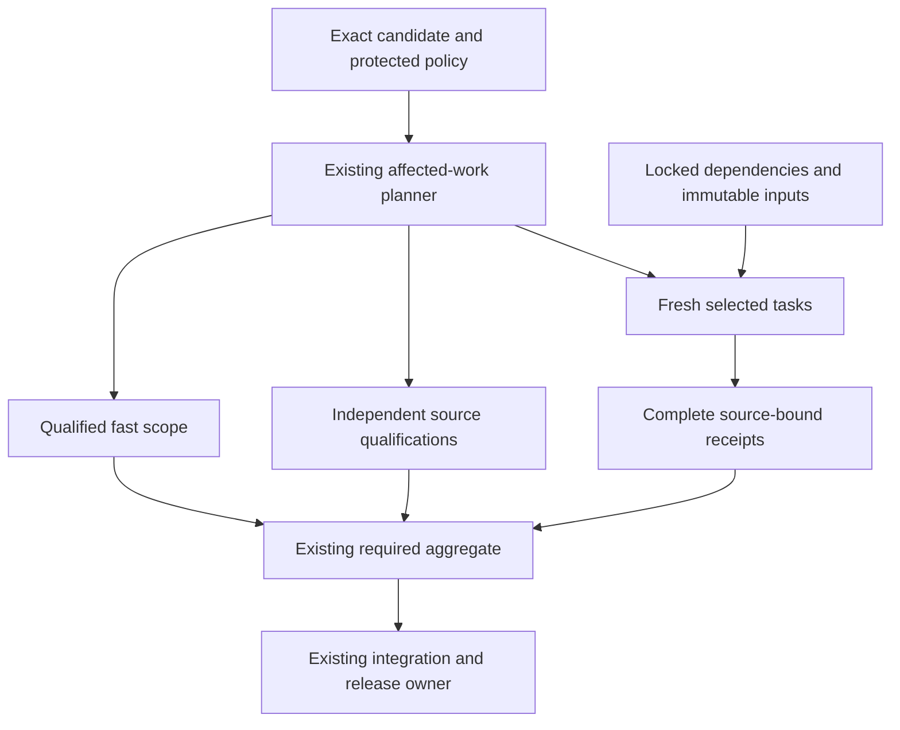

# MastermindX lightning CI architecture and execution plan

Updated: 2026-11-07, 20:00 UTC evidence milestone. Engineering targets below remain unachieved.
Program: existing Mastermind #917 / #1607, Macro #6351 and WS:CI-MERGE-CONTROL-PLANE.
Source carrier: Mastermind #2191 / `ci-lightning-architecture-20261107-c2`.

Verified procedure pin: Mastermind protected `66780ab7e3e9fdbfd40713bb5791fb1888529f7c`,
INDEX `b69d45de68d1f1c31d12dcf5203037122c694711`, skillpack 1.0.1 / bootstrap 1.
The compatible pin and same-SHA source laws govern this execution.
Current inspected composition bases are Macro `07c55fb9e2c60dde232b6ad8b436fb2239cfd9ad`
and Terminal `f8c845b94d6b799b6ca294328859bd086bf8b64f`.
Macro's admission controller was separately inspected at `309cbf2511bcedbddf8a221acb4f942a0b79988c`.
These are inspected source boundaries, not a claim that protected branches stopped advancing.
This extends P3.O3 / Phase 4 of the existing
[delivery-turnaround task tree](superpowers/plans/2026-11-02-delivery-turnaround-execution.md).

The decision is to keep the three incumbent CI systems, remove repeated work,
make the largest tasks independently schedulable, and qualify enough isolated
capacity for a five-minute fresh full verdict. Existing scope and proof owners
remain authoritative. Caches, parallel workers and runner upgrades each need
their own measured contribution to the complete workflow.

This revision replaces the long rolling status narrative with a current plan
and compact evidence frontier. The complete intake research, rejected experiments,
source receipts and earlier implementation history remain immutable in
[the 16:00 source-linked evidence record](https://github.com/mastermindx-market-intelligence/Mastermind/blob/8b549d74e3977e7e37749b623a224e30423c75d6/docs/CI_LIGHTNING_ARCHITECTURE.md).
The preceding milestone is also immutable at
[980429a1](https://github.com/mastermindx-market-intelligence/Mastermind/blob/980429a1ffdc30fac79c36f87e7d766539967ee0/docs/CI_LIGHTNING_ARCHITECTURE.md).
Those historical statuses do not supersede the current disposition below.

## Outcome and completion criterion

Make ordinary engineering feedback feel immediate while completing full consequential
validation quickly and predictably across Mastermind, macro and mastermind-terminal.
Optimize final source revision to required green, and separately eligible revision to
protected merge. Preserve the exact selected tests, meaningful integration checks,
source identity, current trust boundaries and original product outcomes.

An implementation is complete only after its existing workflow consumes it, a
representative natural cohort demonstrates the target by risk class, required failure
cases remain red, and its source/evidence/rollback are recoverable. A cache hit,
local test, isolated runner canary, green workflow or plan is evidence at its own layer.

## Current disposition

**The architecture is concrete and several delivery slices are qualified; the
three-repository upgrade is not accepted and no five-minute p95 is claimed.**
The remaining gap is dominated by mandatory qualification and large executable
units, in addition to source freshness and a few unresolved original effects.

| Lane | Current source and evidence | Remaining gate |
| --- | --- | --- |
| Mastermind parallel execution and RWE, [#2065](https://github.com/mastermindx-market-intelligence/Mastermind/pull/2065) | Published `9e36bab664078f20bdd4115466ad4b23f98a4a86`, including four qualified local commits. Fresh required [42407487042](https://github.com/mastermindx-market-intelligence/Mastermind/actions/runs/42407487042) has successful source qualification and shard 2, but shards 4 and 5 are red at this milestone; another shard remains active. | Diagnose the newly observed predecessor-fixture hash mismatch and installed-ASGI assertion. Consume the complete current native receipts, including RWE [42407487040](https://github.com/mastermindx-market-intelligence/Mastermind/actions/runs/42407487040). A new positive H1 invocation does not settle the older invocation. |
| Mastermind controlled profile experiment | Frozen `d26440a`: serial [42398700247](https://github.com/mastermindx-market-intelligence/Mastermind/actions/runs/42398700247) passed; four-process [42402970898](https://github.com/mastermindx-market-intelligence/Mastermind/actions/runs/42402970898) failed. Both cover 2,334 complete module companions / 70,693 cases with exact collection/finished identity parity; two modules differ in outcome. | The trial has complete diagnostic evidence but failed parity. Its timings are not an accepted speedup. The two demonstrated source defects were repaired and locally qualified before publication. |
| Mastermind fixtures, partition and diagnostics | Published commits `2c433be8`, `dc4f4aa6`, `e888d046` and `9e36bab6`. Trend 44 cases remain conserved across 17/16/11 modules; immutable fixture reuse and copy isolation preserve real consumer work. H1 diagnostics retain only bounded public admission fields. The two RWE repairs pass 425 tests across four complete owning files. | Bind every benefit to native Linux evidence and the whole required path. Original release/settlement holds remain separate. |
| Macro narrowed-pack compaction, [#10752](https://github.com/mastermindx-market-intelligence/macro/pull/10752) | Head `5e23be9cd4f73bfb298206ddd79886ef9d9e168e`; [42397007951](https://github.com/mastermindx-market-intelligence/macro/actions/runs/42397007951) passed: 319 logical jobs / 691 semantic steps, about 89m20s. Enrolled once through the existing MOG label after a clean admission fence. | Current catalog changes stale that proof under the existing policy. Consume the existing controller's full refresh disposition. A natural genuinely narrowed consumer, rather than a full fallback, must still prove latency benefit. |
| Macro two-interpreter FIF, [#10658](https://github.com/mastermindx-market-intelligence/macro/pull/10658) | Head `9f3fe48a28c5d3fe45494ad111a63742efbc1737`; [42400346906](https://github.com/mastermindx-market-intelligence/macro/actions/runs/42400346906) passed: 97 logical jobs / 290 steps. All 120 file launches are observed; the kernel group takes 1,854.396s. The narrow scope-only correction is now published at `dc90e19d8b2764a8a5592cf5f2d0f15849403cb8`, after 20 owning tests passed. | The implementation remains far outside the final budget. Consume new-head checks while preserving controller state, and compose with the split once. |
| Macro FIF split/composition, [#10788](https://github.com/mastermindx-market-intelligence/macro/pull/10788) | Remote remains `4281c188`; local main integration `50e1994190c8d78de17f738dea6bc8c3dfde17ac` preserves accepted main. The local composition uses the incumbent helper in 44/37/39 sibling lists, preserving 120 unique targets. Eight-file qualification produced 570 passes, 10 subtests, two existing sparse-checkout skips and one real dependency-closure failure. | Added the missing helper path to the existing control-plane owner and narrowed the worker assertion to FIF. Qualify those changed inputs. Original International timeout still lacks whole-tree settlement; do not replay its old command or restore its workspace. |
| Terminal isolated runner lane, [#1306](https://github.com/mastermindx-market-intelligence/mastermind-terminal/pull/1306) | Head `418f44dd`; hosted-default [42397250070](https://github.com/mastermindx-market-intelligence/mastermind-terminal/actions/runs/42397250070) passed all 19 jobs. Browser inventory is 4,693: 3,693 pass, 999 skip, one flaky, zero final failures. | Restricted-runner trust, isolation, capacity and rollout remain separate. No fleet variable or runner was activated. |
| Terminal readiness, [#1338](https://github.com/mastermindx-market-intelligence/mastermind-terminal/pull/1338) | Head `92c5b806b4168f1cd011d25044e3355aa32011e9`; [42399940917](https://github.com/mastermindx-market-intelligence/mastermind-terminal/actions/runs/42399940917) passed all 19 jobs. All 14 startup probes succeeded. Browser inventory is 4,693: 3,690 pass, 999 skip, four flaky, zero final failures. Native queue admission is confirmed. | Consume the actual integrated queue result. The longest browser job is 54m05s; readiness repairs reliability and attribution, not the full runtime. No zero-retry or skip-reason-audit claim. |
| Terminal topology/tracing, [#1223](https://github.com/mastermindx-market-intelligence/mastermind-terminal/pull/1223) | Draft `e3486290`; original create-commit effect remains uncertain. Existing 7/5/5 topology, tracing, timings and Node discovery source is preserved. | Original invocation/commit receipt remains required. Bounded lookup is exhausted; do not replay, re-home or duplicate the held implementation. |
| Durable continuity | Accepted Macro #10825/#10827 remain immutable. Fresh original continuity carrier [#10841](https://github.com/mastermindx-market-intelligence/macro/pull/10841) updates only the existing W-ACCELERATION wave. | Publish this consolidated source/evidence milestone and read back its exact document and continuity references. |

The operating sequence is: finish qualified original-carrier deliveries; repair
concrete native defects; make remaining expensive units independently schedulable;
qualify enough isolated capacity; and demonstrate the complete end-to-end budget
on natural traffic. A green slice does not close the product upgrade.

## Historical intake baseline

These intake observations explain the original design. Current source disposition is above:

| Repository | Default revision | Current implementation |
|---|---|---|
| Mastermind | 615146aac6a1b0c0933bc9b815517a2fd285ed4a | Trusted scope -> fast/smoke or six canonical pytest shards -> required test; merge-group scope from merged #2129; same-SHA postmerge reuse and existing ci-profile consumer |
| macro | 72c249a2e1967d1ec6dcf6179a7a8728f3305e44 | Existing semantic ci-plan -> selected ci-pack -> ci-gate; incumbent merge-on-green, proof freshness and adaptive admission |
| mastermind-terminal | dd49fa9bd4746d283bfc12581153463629de2b4e | Three stable required contexts; 12 PR browser shards; merged #1320 avoids duplicate merge-group browser matrix; merged #1324 scopes responsive verification |

The [latest native measurements](https://github.com/mastermindx-market-intelligence/Mastermind/issues/917#issuecomment-6702164981)
report Mastermind merge-group-created to required-green STANDARD/smoke n=8
p50 1m53.5s / nearest-rank p95 3m10s; FULL n=6 p50 40m47.5s / p95 43m57s.
STANDARD merge-group-created to merge p95 was 29m44s, so a fast check is not
necessarily a fast release. These selected cohorts are not a causal speedup experiment.

The [Terminal full PR cohort](https://github.com/mastermindx-market-intelligence/Mastermind/issues/917#issuecomment-6700311570)
has n=4, workflow-created to complete-green p50 57m22s / p95 58m42s.
The ubuntu0 desktop-1 canary jobs were 16m06s with one worker and 8m08s with
four workers ([four-worker run](https://github.com/mastermindx-market-intelligence/mastermind-terminal/actions/runs/42029519496)),
against an earlier hosted 54m41s comparison. These are one-shard observations,
not matched-source whole-suite or sustained fleet results. The four-worker canary's
whole workflow lasted 17m36s; its 8m08s value is the job clock.

Macro's [FIF split proposal](https://github.com/mastermindx-market-intelligence/macro/pull/10788)
records one pack at 69 minutes while its siblings finished in 10-33 minutes.
Its stale calibration weight was 1,630 seconds. We must not confuse calibrated
model weights with observed wall time. Current proof-refresh scarcity and frequent
check-definition invalidation are independent contributors.

## Architecture decision

Extend the existing GitHub Actions owners with a common evidence contract. Keep repo-specific suites and required-check names.
Treat every run as five separable costs: admission/queue, acquisition/setup,
selected execution critical path, aggregation, and integration/release wait.

1. **Trusted affected-work planner.** Compute changed paths from exact Git identities.
   Use protected policy, explicit dependency closure and conservative invalidators.
   Missing, renamed, dynamic, ambiguous or incomplete dependency evidence goes full.
   Review risk and sufficient test scope remain separate decisions.
2. **Small deterministic tasks.** Split expensive semantic families at natural test
   boundaries, keep stable ownership and prove exact selected coverage once.
   Balance using current measured durations; preserve serial affinity where required.
3. **Cheap hot execution.** Restore locked dependency caches and avoid repeated installation.
   Reuse immutable candidate builds only after their fixture/runtime identity is qualified.
   Terminal retains its development runtime until a nondeployable compiled fixture preserves
   the original auth, data and browser journeys, including cold build/distribution cost.
   Do not ship test flags or widen production authentication bypasses.
4. **Bounded parallelism.** Choose shard count and per-shard workers together, accounting
   for total slots, memory, databases, ports and queue demand. More fan-out can be slower.
   Use ephemeral isolated runners only through the already qualified runner owner.
5. **Trustworthy reuse.** Begin with immutable dependency/build reuse. A reusable test
   result must bind exact task inputs and transitive dependencies, runtime/toolchain,
   platform, lockfiles, command, trusted policy, environment inputs and artifact digest.
   Untrusted candidate writes cannot supply trusted qualification. Unknown means miss.
6. **Stable aggregate.** Each existing required context reports for every admitted event.
   It validates planner identity, complete coverage, expected shard outcomes and result
   provenance. Cancellation, omission, wrong source, partial results and unqualified
   cache hits cannot turn it green.
7. **Existing release owners.** Preserve native queues and Macro merge-on-green.
   Reduce unnecessary invalidation at its existing owner, while retaining actual
   integrated-candidate proof. Never add a second lease, retry or verdict store.
8. **Existing measurement consumer.** Extend ci-profile/semantic timing artifacts.
   Measure failure/timeout/supersession as well as successful latency, by class and
   phase. Report queue delay separately only where the native timestamp semantics
   actually establish it; a job start offset also includes dependencies.

The execution graph keeps fast scope, fresh execution and independent qualification
visible in the same required verdict:

## Target service levels (proposals, not achieved results)

The end state is seconds for inert changes and a few minutes for substantive changes.
A ten-minute broad/full path is an interim milestone; it does not close the final goal.

| Measurement | Interim p95 | Final p95 | Required meaning |
|---|---:|---:|---|
| First actionable static/contract failure | Establish baseline | <=60 seconds | Real failure surfaced to author; successful runs are not counted as failures |
| Verified docs/metadata required verdict | <=2 minutes | <=90 seconds | Trusted inert allowlist; no executable/config/consumed-data escape |
| Ordinary bounded source required verdict | <=5 minutes | <=3 minutes | Relevant unit/contracts and affected integration/browser paths |
| Broad/full canonical required verdict | <=10 minutes | <=5 minutes | Complete assigned assurance; no expanded exclusions or renamed scope |
| Queue delay on intended capacity | <=60 seconds | <=30 seconds | Native queue timestamps; dependency waiting separately classified |
| Aggregate after last dependency | <=10 seconds | <=10 seconds | Stable required context verifies completeness and provenance |
| Eligible source to protected merge | <=20 minutes | <=10 minutes | Includes integration candidate and queue wait; separate from authoring age |

These are engineering targets, not promises established by current hardware or suites.
The five-minute full target requires removing current indivisible work, not just
changing worker counts. Report cold and warm distributions separately, plus their
actual mix. Publish p50/p95, sample size, selected coverage, runner class, attempts,
failures and cancellations. At least 30 successive eligible observations per populated
class provide an initial operational cohort, not a statistical guarantee. Small
canaries retain their observed ranges and explicit sample counts. Do not choose only
green, fast or warm runs to manufacture acceptance. Failed or cancelled runs do not
receive a fast time-to-green; report terminal-verdict latency and qualification
success separately, with retries and unfinished observations visible.

A target is not met if test-step time falls but queueing increases the author's
end-to-end wait, total compute becomes unsustainable, or previously required work
silently disappears. A scope reduction is accepted only when the trusted dependency
contract proves that omitted work is irrelevant.

## Closing the five-minute budget

The allocations are design limits for the whole fresh required path. They include
scheduling, setup, collection/readiness and fan-in. They are not achieved timings.
Upstream scheduling is the cumulative queue delay along the critical path before
the aggregate, not a separate allowance for each job. The aggregate allocation
includes its own runner wait and validation after the last dependency. The separate
queue SLO still applies to the complete critical path; dependency execution is not
misclassified as queue time.

| Repository | Upstream scheduling | Planning | Checkout/environment | Collection/readiness | Longest fresh execution branch | Aggregate | Total |
| --- | ---: | ---: | ---: | ---: | ---: | ---: | ---: |
| Mastermind | 30s | 10s | 40s | 20s | 190s | 10s | 300s |
| Macro | 30s | 15s | 35s | 20s | 190s | 10s | 300s |
| Terminal dev profile | 30s | 15s | 45s | 20s | 180s | 10s | 300s |

Mandatory independent qualification must also finish inside the graph: at most
210s after setup for Mastermind/Macro and 200s for Terminal. New jobs pay their own
queue and setup costs. A compiled browser experiment must include cold build and
distribution; measuring only the subsequent test command is insufficient.

**Task-size rule:** aim for at most 90s per independently schedulable unit on the
admitted runner class. Preserve shared mutable transactions and required fixture
affinity. Use the incumbent planner to pack those units within the execution limit.
A unit above 90s needs legitimate work reduction, an independent affinity split or
qualified faster execution before the branch can close. The unit ceiling is necessary,
not sufficient: total selected work must also fit admitted concurrency, memory and
setup capacity without lengthening the end-to-end queue path.

**Historical sizing evidence:** the complete c854 parallel inventory reported
10,565.219s across 2,326 runtime modules. With unchanged service and 24 equivalent
processes, perfect balancing alone is 440.217s. Fitting 190s under that artificial
model requires about 56.84% less service, or about 55.6 equivalent processes.
Neither is a CPU lower bound or authorization to start 56 processes: grouping,
fixture sharing, contention, package versions and runner class change those costs.
The matched d264 RWE pair now exists, but the parallel trial failed two outcomes;
its elapsed reduction still cannot be accepted as a qualified speedup.

Macro's current FIF-B unit has an observed 1,706.863s command; the newest completed
FIF-C command reports 1,213.133s. Its International composite consumed a 1,200s
deadline. Weight correction improves placement but cannot make these units fit 190s.
The latest two-interpreter FIF kernel group still takes 1,854.396s. Terminal's
latest readiness-qualified workflow has a 53m16s browser command and a separate
425s capture-validation step; its historical four-worker canary also reported 431s
of one shard's test work. These facts make granularity and work reduction mandatory,
alongside capacity qualification. They are different measured units and profiles,
not additive estimates or a causal speed comparison.

Capacity is chosen only after measuring the fresh graph. Model concurrent runs,
jobs per run and workers per job together; include memory, ports, browser/server
cost, setup and serial affinity. Preserve the existing Fabric and release budgets.
No new runner, scheduler, queue, lease store or admission plane is introduced.

## Preserve and compose the existing work

| Existing owner | Preserve | Concrete composition boundary |
| --- | --- | --- |
| Mastermind merged #2044 / #2129 / #1570 and profiler | Six outer shards, trusted merge-group scope, exact-SHA postmerge reuse and ci-profile | Extend their contracts; do not reconstruct them. |
| Mastermind #2065 | Four prepartitioned child interpreters, exact cover, terminal receipts, observer, RWE adapter, physical capacity-test partition | Complete matched-profile proof, hot-unit work and current required source qualification. |
| Mastermind reserved #1714 | SDK/runtime lane at `47164aef5c1cf928f0618be28996d465c9564efa`, including `pyproject.toml` and both RWE locks | Regenerate lock provenance from the combined inputs when composed. The narrow pytest qualification does not complete this future integration. The reservation alone proves neither a live writer nor a global exclusive fence. |
| Macro #10788 + #10658 | 120 FIF modules; #10788's 44/37/39 split and #10658's one fresh interpreter per file, with at most two files running concurrently | After current-main qualification, use the existing helper on each split sibling's own file list. Add its path to all three closures: 1,139 → 1,140 raw entries and 1,135 → 1,136 unique paths each; preserve the four existing duplicates. Declare the helper in the exclusive control-plane owner too. Preserve B's P2/G-pack/Node ownership and ancestor-package additions. |
| Macro #10738 | Historical failed four-worker shared-xdist experiment | It is not a qualified two-to-four-worker progression or fallback for #10658. |
| Macro #10752 | Genuinely narrowed-plan compaction and exact baseline/full/off/shadow fallback | Keep twelve-slot output, selected-job objects/digests/order and real consumer closure. |
| Macro #10735 / #10745 / #10764 | Control-plane family split, replay environment, manifest-scoped freshness | #10755 cap 640 and #10770/#10766 are accepted. Preserve #10674's original uncertainty, then compose #10745 and #10735 through their original owners. |
| Macro #10656 / #10674 | Existing authored/refresh admission programme | Main admission remains OFF. Original proof-preparation process26751 and its unbound publisher disposition stay unresolved; no invented GitHub-mutation identity, alternate continuation or retry. |
| Terminal accepted #1320 / #1324 / #1297 / #1334 | Native browser deduplication, scoped QA, trusted docs scope and accepted News navigation repair | Preserve their selectors, original journeys and required aggregate. #1297 acceptance is `90ddc139`; no redo. |
| Terminal #1306 | Optional lane binder, selected ports/workers, trust/isolation/rollback runbook | Published scoped-CI integration is independent of fleet activation and #1223's held mutation. |
| Terminal #1223 | Already-authored weighted topology, traces, attempt timing and Node discovery | Reconcile its original create-commit. A new implementation on another carrier would duplicate held work. |
| Terminal #1338 | Existing context-entry repair and actual EN/ZH evidence | The new fixture-startup slice remains in the existing helper; preserve app assertions, runtime, topology, traces and historical evidence. |

## Critical-path evidence and consequences

The following historical native observations remain useful cost attribution. Current exact-head results are in the execution frontier:

| Observed source/run | Component | Measured elapsed | Decision |
|---|---|---:|---|
| [Terminal 42302235414](https://github.com/mastermindx-market-intelligence/mastermind-terminal/actions/runs/42302235414), mobile 2 | Playwright test / whole job / npm ci | 3298 / 3345 / 17 seconds | Test execution is 98.6% of this job. Prioritize browser/runtime/fixture work over another dependency cache. |
| Same Terminal run | Unit job / current-checkout capture / Vitest | 1013 / 544 / 285 seconds | Capture and Vitest account for 81.8% of the unit job. Browser-shard tuning alone leaves a roughly 17-minute constraint. |
| [Mastermind serial run 42331481657](https://github.com/mastermindx-market-intelligence/Mastermind/actions/runs/42331481657), shard 0 | Whole job / pytest / native application custody | 2131 / 1437 / 373 seconds | The serial qualification prefix must be included in the graph, not hidden inside pytest averages. |
| Same Mastermind run, shards 2 / 3 | Pytest | 1655 / 1683 seconds | Broad serial execution is still expensive across several shards. |
| [Mastermind xdist candidate 42202096909](https://github.com/mastermindx-market-intelligence/Mastermind/actions/runs/42202096909), head b3fdd6ad | Shard 0 whole / pytest / custody / private HTTP compatibility | 1650 / 956 / 382 / 125 seconds | Four workers improve the pytest part, while qualification before pytest dominates the remaining tail. |
| Same xdist candidate, shard 2 | Whole / pytest | 1330 / 1226 seconds | The longest test granules still need work. Other shard jobs were 620-998 seconds. |

These different runs are observational comparisons with potentially different source
and load. They do not establish a controlled causal speedup.

For a workflow DAG, measure queue + setup + collection + the actual dependent
execution path + aggregation. Concurrent job durations are not added to estimate
latency; their sum is compute consumption. Conversely, a serial prefix and its
dependent shard cannot be treated as parallel.

### Amdahl and test granularity

The historical 788.9-second capacity-artifact module imposed a 13m09s constraint
while it remained one unchanged unit under xdist loadfile. The [xdist distribution
contract](https://pytest-xdist.readthedocs.io/en/stable/distribution.html) keeps all
tests in one file on one worker. The published #2065 execution slice has physically split
that module into twelve coherent files while preserving all 466 cases. This removes
that particular indivisible unit; it does not establish a five-minute full run.

Macro's old 1630-second FIF unit divided perfectly into three remains approximately
9m03s per sibling before setup. The observed 69-minute pack also shows that
calibration, nested execution or fixture behavior differs from that old estimate.

The next optimization must therefore do one of the following with evidence:
remove repeated deterministic fixture construction, shorten legitimate individual
test work, separate independent fixture-affinity groups, or place the same work on
qualified faster capacity. Increasing timeouts or deleting assertions is not an
optimization. Parallelism is bounded by:

`concurrent runs × jobs per run × workers per job`

Choose all three together. Reserve capacity for the existing merge/admission path
through its current owner. Do not create another reservation service.

## Repository implementation design

### Mastermind

Keep `ci_pr_scope.py`, `ci_parallel_shard.py`, `ci_pytest.py`,
`ci_pytest_timing.py`, `ci_xdist_guard.py`, `rwe_env.py` and the existing
workflow/aggregate as the owners.

1. **Use the completed controlled comparison to finish correctness.** The existing
   RWE workflow ran processes 0 and 4 sequentially on frozen d264 source. All twelve
   receipt archives match the lock, realized package environment and vendored Macro
   pin. Collection and finished identities match for all 70,693 cases; two module
   outcomes failed. Preserve the [complete comparison](CI_RWE_CONTROLLED_PAIR_20261107.json),
   qualify the two repairs in the natural new-head consumer, and resolve newly
   observed current-source defects before accepting speed. Do not compare the
   unlocked required profile to the RWE lock as a controlled experiment.
2. **Retain precollection partitioning.** Six outer jobs each receive their
   canonical module selection; four independent child interpreters collect only
   their assigned subsets. Keep independent partition domains, exact once-only
   cover, private child directories and complete receipts. Do not nest another
   four xdist workers inside each child. Serial remains the explicit control.
3. **Reduce fixture construction with outcome conservation.** Trend now constructs
   its synthetic holdout once per function-scoped fixture and returns a fresh
   deep copy on every loader call. The independent reproducibility a/b runs,
   seeds, horizons, all 44 tests and production code remain unchanged.
   Capacity's optional crash-module seed shares only immutable Git producer
   construction; every case receives an ordinary full copy and builds its own
   real transport. All descriptor, ownership, fsync, repair, replay and rollback
   operations still run. The shared helper's default remains independent.
4. **Prioritize actual native hot units.** At `9a849c4e`, Trend reports 182.691931s
   in serial and 208.098650s in required parallel, with 44 cases. Capacity crash
   replay reports 106.928820s and 68.532505s respectively, with 18 cases.
   These are summed pytest phase durations under different profiles. Trend is
   the clearer remaining 90s-unit obstacle. That partial slow-case
   evidence produced a published, locally qualified three-module split: 17 core,
   16 reference and 11 run-contract cases. All test bodies, decorators, parameters
   and support ASTs are preserved from the qualified fixture candidate. The
   existing selector places them at outer/child 3/0, 3/1 and 4/0 without any new
   pins or movement of unrelated modules. Obtain native timings for those units. No statistical scenario or
   independent reproducibility run may be removed to hit the target.
5. **Shorten the independent qualification branch.** Earlier source qualification
   took 10m15s; the latest source-qualification job is 7m04s. These observations
   are not a controlled comparison. The existing design extracts source qualification from pytest
   shard 0; it still needs genuinely independent qualification jobs or reduced
   repeated setup. Advance the required aggregate and exact postmerge job-set
   contract together, with the original negative proofs intact. Never claim
   a pytest-only speedup closes this serial qualification cost.
6. **Retain H1 diagnosis at its existing owner.** The earlier native refusal is
   before model command/reservation, but its admission snapshot was discarded
   and the positive fixture did not prove settlement. A bounded
   allowlisted admission-reason/scalar diagnostic is now published at
   the existing H1 reporter: 96 synthetic cases pass. The new required shard 2
   passed, binding a fresh invocation only.
   Do not change admission thresholds, positive assertions, settlement rules or
   mount generic Git diagnostics into its deliberately Git-less container.
   This source repair cannot retroactively clear the original hold.

The rejected fixture-template experiment from the historical ledger remains
DO_NOT_REDO: it produced no whole-module improvement. The current immutable
producer and synthetic-holdout experiments are distinct, explicitly measured
construction work. No Git/security/admission outcome is memoized.

### Macro

Keep `ci_pr_scope.py`, `run_ci_pack.py`, `ci_semantic_proof.py`, the
`ci-plan → ci-pack → ci-gate` workflow and `merge_on_green.py`.

1. **Deliver the qualified original-source integration.** #10658's
   current-main composition at `9f3fe48a` preserves accepted `c4844c22` and the
   `press-account-claim-consumer` owner. Its natural native run completed all 97
   selected jobs / 290 steps successfully. Retain that exact source proof when
   publishing the narrow test-only ownership correction; new-head required
   checks still belong to the normal controller. The sparse local import check
   alone never proved the sealed sector-cycles renderer/manifest path.
2. **Compose split and fresh-interpreter scheduling once.** Keep #10788's exact
   120-file union and sibling ownership; apply the existing two-worker
   helper inside each sibling. Each file runs once in a fresh interpreter, with
   at most two files running concurrently. This isolates Python process/import
   state; the helper shares the working directory and environment and does not
   itself isolate filesystem paths or ports.
   Keep helper selection paths in every affected closure and test all three
   invocations. The local composition exposed one concrete missing helper input
   in `ci-control-plane-contracts`; add that single path and requalify the affected
   planner/fragment checks. The shared-xdist experiment remains failed evidence.
3. **Expose real command units and settlement.** In the existing command owner,
   keep execution deadline, bounded cleanup and confirmed terminal settlement
   distinct. An already-expired execution deadline must not eliminate cleanup's
   observation budget; an attempted kill is not a descendant-disposal receipt.
   Unknown settlement continues to withhold dependent work. This source design
   does not settle the original invocation or authorize its fixed-path replay.
   The International job currently combines browser
   installation, canonical-main acquisition, 442 builder/template tests, a
   199-case DOM command, table filtering, IM13 Python/browser and IM14
   Python/browser proof under one deadline. Represent separable units through
   the incumbent manifest with their closure and ordering contracts. Preserve
   frozen-main preparation and workspace restoration boundaries. Concurrent
   mutable commands in the same checkout are not a safe shortcut.
4. **Reduce measured repeated construction.** The foundation browser file's
   18 tests account for 276.891s of the completed 277.456s DOM command.
   Its helper renders HTML via synchronous Python and launches/closes Chromium
   per call. After the original settlement boundary clears, attribute render,
   launch, navigation and assertion time. Qualify immutable rendered-variant
   reuse if it helps; keep the no-payload, stub, ordinary and states variants
   distinct and preserve fresh browser/context isolation. IM13 already caches
   its own three variants, providing an existing design precedent.
5. **Keep placement honest.** Published measured weights are FIF-B 1,707,
   International 852, ontology 350, government-revenue candidate 436 and
   BioCatalyst 308 seconds. FIF-A/C 537/538 are provisional; the completed
   current FIF-C command is 1,213.133s, so its next calibration must reflect
   current evidence. Distinguish installation, checkout, canonical-base
   acquisition, candidate execution and exact-base replay.
6. **Consume narrowed-pack compaction naturally.** #10752 is additive only for a
   genuinely narrowed active selection whose maximum modeled weight does not
   exceed the legacy partition. Full, baseline, shadow/off and global-invalidating
   work retains its named packs. Prove the real planner-to-consumer path after
   publication, including exactly-once logical coverage and failure propagation.
7. **Finish existing freshness/admission work.** Preserve #10674's uncertainty and
   the #10745 → #10735 source order. Manifest-scoped proof can survive irrelevant
   changes only through the incumbent identity/freshness contract. Command,
   dependency, environment and policy changes invalidate it. Main admission
   remains OFF until its existing producer/consumer/fairness/cutover acceptance.

Batch compatible definition changes at legitimate source boundaries to limit
needless global proof churn. A new candidate's proof cannot retrospectively settle
a timed-out original invocation.

### Terminal

Keep `ci_e2e_scope.py`, `playwright.config.ts`, `globalSetup.ts`,
`fixtureWarmup.cjs`, visual-evidence producers/consumers and the existing required
contexts: Quote Hub tests, Terminal typecheck + tests, and Ingest + signal-layer tests.

1. **Preserve accepted scope and journeys.** Consume the accepted docs, responsive
   selector and merge-group deduplication behavior. The independent context-entry
   repair and six actual EN/ZH captures remain source-bound evidence. Report
   reported skips separately until their reasons are audited.
2. **Qualify fixture startup before browser work.** A single strict
   `/api/flow?f=prophet_idx` probe qualified in all fourteen native invocations requires direct 200,
   fixture provenance and a complete valid object with the existing schema/plans
   shape, allowing empty plans. One deadline covers headers and body, within
   the existing 25s client allowance; no retry or timeout increase.
   It runs after the unchanged 14-route warmup in the same helper used by
   Playwright and PL6 capture. Failure reports a finite classification without
   payloads. This distinguishes failure to qualify startup from a later request failure during the browser journey.
   It does not establish why the historical native requests stalled.
3. **Honor the held topology owner.** #1223 already contains 7/5/5-plus-serial
   placement, trace-on-first-retry, explicit zero-retry trace retention,
   per-attempt timing and Node discovery. Reconcile the original effect before
   publication. Use independent startup/source work without duplicating it.
4. **Optimize the whole unit/capture branch.** Historical capture and Vitest
   steps were 544s and 285s; the latest observed steps are 425s and 227.56s.
   These are observations from different source runs. Browser-shard tuning
   leaves that separate path.
   Reuse same-candidate immutable capture outputs through current consumers.
   Select fewer journeys only after proving the affected-journey contract.
   Preserve historical evidence hashes; recapture through the legitimate
   producer/selection path when a current source binding changes.
5. **Retain dev mode until compiled fixture identity is coherent.** The protected
   application has development-only auth/preview seams. A compiled experiment
   needs the existing Supabase/Macro authorities with isolated test data and
   a deliberately nondeployable fixture artifact. Do not widen production auth
   bypasses to make tests pass. First qualify an original-journey canary, then
   the complete matrix, including cold build/distribution and browser identity.
6. **Qualify capacity through #1306.** Its hosted defaults, serial opt-ins and
   stable aggregate are preserved and the native hosted matrix passed. Before activation,
   demonstrate restricted runner-group trust, separate no-sudo identities/JIT
   credentials, fresh homes and ephemeral drain, process visibility and
   login/timer escape checks, realistic concurrent demand, and rollback.
   The historical Default-group canary is not that fleet proof.

The prior local trace-on/off/on sample (31.722 / about 8.6 / about 16.6s) is an
unmatched small observation. The trace policy is already owned by #1223, and
neither that sample nor one fast local browser pass earns hosted p95 credit.

## Common evidence contract and reuse boundaries

This is an additive contract for existing planner/proof/timing artifacts. It does
not introduce a new daemon, registry, scheduler or authoritative database.

| Evidence component | Must bind or establish |
|---|---|
| Source and policy | Repository; PR or merge-candidate SHA; trusted planner/policy revision; verified diff base |
| Selected work | Required task/group identities; test/helper/config/data closure; serial affinity; expected partitions |
| Execution identity | Exact command; dependency locks; runtime/toolchain/browser; OS/architecture; material nonsecret environment inputs |
| Input/build artifact | Content digest; producer source and trusted provenance; fixture mode; compatible consumer; nondeployable test marking where applicable |
| Test outcome | Attempt and runner identity; complete collection/execution; success/failure/cancel state; coverage membership; completion evidence |
| Reuse validity | Matching relevant inputs; trust namespace; accepted freshness rule; policy eligibility; miss reason when unverifiable |
| Performance | Queue/setup/collection/execution/aggregate times; retries; cold/warm state; total compute; source class |

Artifact reuse accelerates a fresh test. Result reuse substitutes an already
qualified assertion and needs the stronger identity above. A passing PR proof is
not automatically proof of a different integrated merge candidate.

Use the accepted trusted merge-group selector and the current repository-specific
composition contract. GitHub's [merge queue](https://docs.github.com/en/repositories/configuring-branches-and-merges-in-your-repository/configuring-pull-request-merges/managing-a-merge-queue)
checks the candidate containing current base and preceding queued changes. Preserve
Terminal's accepted removal of duplicate browser fanout while accurately stating
what its merge-group checks establish; add only the specifically owed composition
proof, not the old blanket matrix by default.

Candidate code cannot select a weaker classifier for itself. Unknown dependencies,
renames, policy changes and incomplete analysis expand validation. Missing,
cancelled, wrong-source or unexpectedly skipped selected work cannot satisfy the
aggregate. A cache hit cannot override an observed failure.

Start result reuse with one deterministic, hermetic task in shadow mode: compare
its reuse decision with actual fresh execution before letting it satisfy an
existing required check. Invalidate on a test/helper/lock/config/runtime/environment
change, evidence tampering or trust mismatch. Preserve the existing broader-run
fallback and rollback at the same owner.

The prior [Vercel CI research](https://vercel.com/blog/introducing-vercel-ci)
provides a useful task-graph/cache/per-task-compute pattern. Its vendor performance
claims are not MastermindX measurements. Adopting a new external CI platform is not
required for this plan and is not authorized by an architecture analogy.

## Falsifiers, rollout and rollback

The strongest counterargument is that narrow selection or proof reuse can hide
dynamic dependencies or interactions between individually passing changes.
The architecture fails qualification if:

- A helper, fixture, lockfile, configuration or policy change incorrectly leaves
  affected work out of the plan or keeps a stale result eligible.
- A candidate changes its own classifier and thereby reduces its required work.
- A selected shard is absent/cancelled/duplicated and the aggregate still passes.
- Individually passing changes violate an owed integrated-candidate behavior.
- A full audit finds a selection false negative.
- Additional fanout improves an isolated test while worsening end-to-end p95 or
  completed delivery throughput under representative load.

Use focused negative tests for these failures, then existing full CI and the real
PR-to-integration path. Keep first-attempt pass rate and retries visible; do not
use retries, longer timeouts or exclusions to hide regressions.

Roll out one material execution dimension per interpretable canary. Preserve the
previous trusted planner/worker/runtime setting for source-level rollback. On
bad selection or invalid proof, fall back to the broader canonical run. On runner
or performance regression, restore the previous admitted execution topology.
Rollback does not replay an uncertain operation or resurrect a stale proof.

## Ordered execution tree

These IDs extend the existing Phase 4 CI work, and are editorial source nodes only.

| ID | Deliverable | Dependency | Acceptance |
|---|---|---|---|
| P4.L1 | Reconciled architecture, current cohort, source/collision map | Current source and #917 evidence | Exact citations and separate observed/forecast/held states |
| P4.L2 | Finish existing parallelism/pack/fast-scope implementations | Original custody and current source | No duplicate PR; actual exact-head coverage and runtime measurements |
| P4.L3 | Terminal browser build/setup critical-path slice | Current workflow/config and no overlapping writer | Same user journeys against immutable candidate; focused failures stay red; real hosted canary |
| P4.L4 | Remove hot Mastermind test/setup overhead | Current measured heavy modules; L2 compatibility | No cached security outcomes; unchanged assertions; Linux proof |
| P4.L5 | Macro duration calibration and split/compact reconciliation | Existing logical-job owner and L2 | Every selected job exactly once, current weight evidence, bounded maximum pack duration |
| P4.L6 | Trusted task-result reuse pilot in incumbent planner | Input contract + deterministic hermetic task | Shadow equivalence first; tamper/environment/dependency changes miss; no false green |
| P4.L7 | Qualified runner economics and execution capacity | Full isolation/trust/capacity canary | Whole-matrix benefit, no starvation of Fabric, rollback through same owner |
| P4.L8 | Natural-cohort acceptance and closed migration | Previous slices | SLO distribution, unchanged coverage, failure/freshness behavior, recoverable rollback |

Execute source-disjoint ready work now. No new CI run merely to produce activity;
use natural candidate validation and actual changed-source canaries where needed.
No merge, approval, runner activation or publication of held operations is inferred
from this plan. Source edits and qualified ordinary PR publication are in scope.

## Current evidence frontier

### Mastermind: completed controlled pair and published repairs

The immutable [controlled-pair artifact](CI_RWE_CONTROLLED_PAIR_20261107.json)
contains all twelve artifact identities/digests, environment/lock bindings,
six-shard timings, every child return and exact comparison totals.

Both runs use source `d26440aac2c45b960d7175836121b885d94f9301`,
environment `58de61f3d39fc214`, CPython 3.12.16 and 78 packages with freeze digest
`185d3127c6dabf1a98442541ddcf9732ea3d0551ac4e2973bd9717d7b8f5b247`.
The Linux lock is `fa122bfe79054625f0f094eea13ec9668f54c36f5fdd6f7146b0c1f6dd08c29a`;
the vendored Macro pin is `256c757b3c4f0ec759571c29a30a71387d0a18f8`.
All pip checks pass and degraded lists are empty.

| Outer shard | Modules | Serial gate seconds | Four-process gate seconds | Parallel result |
| --- | ---: | ---: | ---: | --- |
| 0 | 413 | 1,545.65 | 691.18 | Pass |
| 1 | 364 | 1,868.49 | 834.84 | Pass |
| 2 | 355 | 1,214.90 | 355.16 | Pass |
| 3 | 391 | 1,934.55 | 719.63 | Fail |
| 4 | 388 | 1,382.71 | 480.17 | Pass |
| 5 | 423 | 1,736.71 | 412.57 | Fail |

All 2,334 module companions are complete. Both sides collect, invoke and finish
70,693 cases with zero deselection, duplicate companions, malformed receipts,
incomplete modules or collection errors. Collection and finished digests match
for every module. Outcome hashes match for 2,332 modules; two differ.
All 24 reported parallel pytest children returned: 22 exit zero and two exit one.
This is child-return evidence, not an assertion about every operating-system descendant.

The failed cases were the Hermes diagnostic-privacy cross-variant fixture and
the installed preproof grandparent-acceptance case. The former observed a disappearing
Git maintenance lock during recursive chmod. The latter compared all nine stat
fields for an ordinary ancestor's initial guard, inconsistent with its existing
later five-field custody check. The historical remover and precise volatile field
are not retained, so neither is invented as an observed cause.

Published repair commit `9e36bab664078f20bdd4115466ad4b23f98a4a86`:

- Disables automatic Git maintenance/GC only in the synthetic Hermes fixture's
  own Git command arguments; no global Git configuration or weakened traversal.
- Uses the existing five-field identity for ordinary non-exact directory ancestors.
  Exact directories and files retain the nine-field check. Descriptor, no-follow,
  type, promotion, alias, absence and namespace contracts are preserved.
- Adds 22 deterministic regressions: four tolerated volatile ancestor changes,
  five refused custody changes, twelve exact-directory/file negative cases and
  one ancestor-to-exact promotion rejection.
- Refreshes only the existing reviewed file's exact digest after checking that the
  three reviewed identity tokens and their owning ASTs remain unchanged.
- Passes all 425 tests across the four owning files in 101.458s. Original source
  fails the four intended baseline regressions and passes the other eighteen.

The earlier three published commits preserve the locally qualified fixture,
diagnostic and partition results: Trend 44 passes with identical original outcome
digest; capacity 18 passes plus an independent copy-isolation case; admission
diagnostics 96 passes; Trend partition 44 passes plus 138 selector checks.
The [partition artifact](CI_TREND_PARTITION_PROOF_20261107.json) records all 44
case mappings and all 42 original function ASTs. Its capture-time unpublished
status is historical; the source is now published in #2065.

Fresh required [42407487042](https://github.com/mastermindx-market-intelligence/Mastermind/actions/runs/42407487042)
tests merge `11e2913a306de7c5a3ea8b1a825a9d4dbd235505`, tree
`077ce3382c63666931192c7d46159f5896c3bae0`, with parents protected
`5abd2017f4ae4a69dddce4ff4f0aa4cb5246a402` and candidate `9e36bab6`.
It has a successful 7m04s source-qualification job and successful shard 2 at this
milestone. Shards 4/5 expose a predecessor fixture hash mismatch before provider
execution; shard 4 also has one installed-ASGI assertion failure. These are new
native observations under diagnosis, not suppressed flakes or proof that the
earlier repairs failed. RWE [42407487040](https://github.com/mastermindx-market-intelligence/Mastermind/actions/runs/42407487040)
and the remaining required jobs must be consumed fully before another publication
that would cancel their source-bound observation.

The old H1 invocation remains held at run `42394477066`, job `128468846887`:
ATT-1 receipt absent, rc75, timeout false, primary admission refusal and unknown
settlement. The new bounded diagnostic does not retroactively recover its snapshot.
The earlier [ACL bracket diagnostic](CI_GATEWAY_ACL_BRACKET_DIAGNOSTIC_20261107.md)
also does not clear the Gateway or initializer release holds.

### Macro: native consumers and original-carrier composition

**#10752:** native [42397007951](https://github.com/mastermindx-market-intelligence/macro/actions/runs/42397007951)
passes all 319 logical jobs / 691 steps with no infrastructure classifications.
Semantic evidence digest:
`51b2ca3feeabca24b7cbba23044362c135890f1552159fcbcafeb2a46130ba46`.
The semantic producer's field named `tested_tree_sha` contains
`64807eebec39ac507473f8760d0ba7d0706b3632`; do not relabel that object as a Git
tree without checking its type. Recorded base is
`2ac8eef3ca975b1045949b40c6244c5f4b209a1a`.

Enrollment was one MOG label mutation after native clean eligibility and the
post-body-update authority check settled. Head remains `5e23be9c`, open with
`merge-on-green`; no native-auto route was used for Macro. Existing catalog changes
make fresh proof necessary. The inactive native-queue pilot check is not a binding
main-branch gate under the inspected controller. No stale review is represented
as a new-head formal approval.

**#10658:** native [42400346906](https://github.com/mastermindx-market-intelligence/macro/actions/runs/42400346906)
passes 97 jobs / 290 steps, semantic digest
`7421bec880b414557f2901a03f8a2bd22278bbf2080b13e62ce4236929192999`,
recorded base `e404167e0472a7150721192479d54ab1d8c37535` and tested source
`67239e31dce3a3ef73007e461e4035f7871fd76e`.
The native FIF pack log observes all 120 unique file launches between
18:40:43.467 and 19:11:37.863 UTC: 1,854.396s for that kernel group.
P2/G-pack/Node companions run afterward. A fresh Python interpreter per file
does not imply a fresh filesystem or private environment.

The only follow-up correction narrows the imported shared-worker prohibition to
the owning FIF job. Complete owning shape file: 20 passes, zero skips/failures/errors,
6.486s, postimage blob `cebec6b9903c2dcfaa2dc487cf32587d86c384bb`.
Runtime/helper/catalog bytes are unchanged. It is now published as commit
`dc90e19d8b2764a8a5592cf5f2d0f15849403cb8`, tree
`915bdeed661969c291ffcb333afe3013de0a5d54`, with exact remote readback.
The existing controller labels are preserved; this is not another admission attempt.

**#10788:** local main-integration commit
`50e1994190c8d78de17f738dea6bc8c3dfde17ac`, tree
`ab3565411b202a696f5ae9e9a45d385ab005718e`, has parents remote
`4281c1886f52a93913f6eec85f9f4407fd738fb6` and accepted main
`07c55fb9e2c60dde232b6ad8b436fb2239cfd9ad`. All non-feature tracked paths match
that accepted main. Press ownership, curated scopes and new packing ceilings remain.

The incumbent helper is exact blob
`ae7c3feaa88d8200a3941398c159a2fc4eff1c6a`. A/B/C retain 44/37/39 ordered
manifest targets, 120 unique paths in total, and the same other steps/dependencies.
Each has 1,140 raw closure entries / 1,136 unique paths. Four duplicate paths
already existed and are preserved. Scheduling submission order follows the
incumbent helper's weights; it is not claimed identical to manifest order.

The first complete eight-file qualification is retained as 570 passed,
one failed and two existing sparse-mockup skips, plus ten subtests; fragments
passed. The failure correctly identifies a missing helper path in the exclusive
`ci-control-plane-contracts` owner. The repair adds only that path (108 → 109
unique entries) and narrows the worker assertion to the three FIF IDs.
Current repaired candidate blobs are:

| Path | Git blob |
| --- | --- |
| `.github/ci/legacy-jobs.yml` | `d9a0d4cd062c6f52368e044265eb9a73237b6122` |
| `tests/test_ci_pack.py` | `ea929b53f7f80ef5c5073b8c2b5efeb2b0914793` |
| `tests/test_fif_publication_workflow_shape.py` | `c017d4e3fdd461cbfb0f37bc545f53e1cee73c25` |
| `scripts/ci/run_fif_kernel_suites.py` | `ae7c3feaa88d8200a3941398c159a2fc4eff1c6a` |

The final catalog intentionally changes four job bodies relative to the local
main integration: three FIF runtime definitions and one control-plane dependency
declaration. The remaining 390 job definitions are unchanged. The corrected
catalog/shape proof is a pending new receipt, not a relabeling of the failed invocation.

Original International run `42390957332` remains separate: eleven packs passed,
one composite command exhausted its 1,200s deadline, and nine subsequent steps
were withheld. The 320-job / 692-step record is 682 passed / 10 unknown.
IM14's final browser command had only about 86s left after earlier work.
No calibration-caused assertion failure is established. Attempted process-group
SIGKILL and zero-time remaining join did not provide whole-descendant settlement.

### Terminal: readiness qualified and admitted; runtime remains long

Readiness run [42399940917](https://github.com/mastermindx-market-intelligence/mastermind-terminal/actions/runs/42399940917)
tested merge `f4860ea24fd9351a5deada94d53046af381a7bc5`, tree
`69c7ae0e0a160fdb4401e0bbac8dda5a0701a3b3`, with parents protected
`f8c845b94d6b799b6ca294328859bd086bf8b64f` and candidate
`92c5b806b4168f1cd011d25044e3355aa32011e9`.

All nineteen jobs and twelve browser jobs pass. Fourteen browser invocations
all qualify the fixture before `Running`, with probes between 152 and 632ms.
The complete inventory is 4,693 selected: 3,690 passed, 999 skipped, four flaky
and zero final failures. The previous incomplete desktop-5 consumer completes
280 passes / 22 skips. Unit results are 20,420 passed / 50 skipped / three todo;
Vitest is 227.56s and source-capture validation is 425s.
Native Node is 20.20.2; local Darwin/Node26 observations remain separate.

The longest tablet job is 54m05s, including a 53m16s browser command.
The overall workflow is about 59m15s. Readiness therefore removes one identified
failure mode and improves attribution; it is not a five-minute runtime result.
The four flaky outcomes remain reported and must not disappear from reliability
acceptance. Reported skips are not automatically audited exclusions.

Native admission used Terminal's documented MOG label plus one head-leased
auto-squash call. Confirmed queue entry:
`MQE_lQDOTOzwKM8AAAABNhlBz84ABTs-zgPOXLw`.
The PR is open and the native queue result is pending at this milestone.
REST `auto_merge=null` does not justify a second enqueue.

Separate #1306 hosted qualification [42397250070](https://github.com/mastermindx-market-intelligence/mastermind-terminal/actions/runs/42397250070)
tested merge `9798d310ea90c3805a8d973dfb8ed2f8bd025ae6` for candidate
`418f44dd8302954892ff194b4dc12477288699c9`.
All twelve browser jobs pass on hosted ubuntu-latest:
4,693 selected = 3,693 pass / 999 skip / one flaky. This is source/default-route
qualification, not restricted-fleet activation or whole-matrix capacity proof.

A read-only hotspot review identifies a bounded future Ticker News first-load
consolidation. Source operation counts suggest 74 → 57 explicit document loads
across desktop/tablet/mobile while preserving all later presentation resets.
That is an unimplemented hypothesis, not runtime savings. It requires qualified
source independence, all 21 project cases (14 enabled / seven expected skips),
original recovery/symbol/presentation journeys and actual document-count proof.
Do not reopen the exhausted #1223 lookup or duplicate its held implementation.

### Continuity, authority and scope

The current architecture carrier remains #2191. Accepted continuity #10825 and
#10827 are not edited after merge; fresh #10841 carries the same existing wave.
The master law pin remains `66780ab7e3e9fdbfd40713bb5791fb1888529f7c`.
The parent direct-integration exception applies to consumed/blocked Fabric roots;
no new root, watcher or silent native implementation labor was created.
Native agents provided C3 read-only judgments. Their judgments are not GitHub
approvals or substitutes for native consumer evidence.

## Held effects and exact next controls

| Hold | Preserved original identity | Required next evidence |
| --- | --- | --- |
| Terminal #1223 create-commit | Original operation `mastermind-queue-clearance-20261104-c1`; tree `8a95165da4779cbbee961f6fc903de02afd1e27f`; parents `e34862900a09bfbcf124397ffe0db02a4f509a49` and `3d02d79a2d7c49dcd157976f09d720851f40906f`; actor MastermindX1 / 318945197; original remote disconnect | Original service invocation/commit-object receipt. Earlier bounded object reconciliation is exhausted. Unchanged refs do not prove no commit object exists. |
| Macro #10674 | Original C4 proof-preparation process26751 under root github-pr-sweep-2028-c4, with an unbound original publisher-effect disposition; existing #10745 → #10735 dependency order | Original tool-session/action binding is not established. The bounded lookup is closed; the existing Source OS recovery-interface commission has no qualified installed return. Reconcile original custody, terminal/quiescence and publisher disposition before forward action. Do not relabel the process as an identified GitHub mutation or repeat endpoint/account/archive searches. |
| Mastermind earlier H1 positive fixture | Run42394477066/job128468846887, ATT-1; receipt absent, rc75, REMOTE_SUB_ADMISSION_REFUSED; fixture settlement unknown | Original owned settlement evidence or legitimate source-owner resolution. Docker --rm/tmpfs and absent diagnostic upload do not prove a surviving recovery namespace. |
| Macro International timeout | Run42390957332/job128458803087; original command group and fixed dossier paths | Original descendant/whole-tree settlement or disposal evidence. Attempted process-group kill and generic Actions cleanup are insufficient; no workspace restoration/base replay was done. |
| Mastermind earlier release holds | Gateway release HOLD6704040875; initializer four-process qualification failure; actuator journal cause unproved | Preserve their existing accepted conditions; local fixture or ACL tests do not release them. |
| Repository-rule visibility | Prior Macro/Terminal protection reads returned403 | Rule visibility through those connections is unavailable. This does not establish that an unspecified merge/release operation requires an administrator. Preserve actual rules and do not replay the denied reads through another account or carrier. |
| Terminal fleet action | The previously attempted Terminal administrative action returned403 | Its exact external control remains unavailable through that connection. Obtain the specific authorized control for any required fleet activation; do not replay the denied action or infer that source publication is blocked. |
| Review/communication | Web review waiver applies; repository-mandated formal approval still binds. Prior #2065 comment write was denied. | Obtain eligible non-author approval only where actually mandatory. No self-approval/self-merge or comment replay; source/PR-body updates remain the permitted evidence carrier. |

These holds are lane-local. They do not bar independent source work, permitted
diagnostics, original-carrier integrations or the separate RWE profile experiment.
No CI run alone is described as a durable autonomous worker.

## Ordered next execution and acceptance

1. **Deliver qualified slices through existing controls.** Consume Terminal #1338's
   integrated native queue result and Macro #10752's complete freshness-controller
   disposition. Consume #10658's naturally triggered scope-only correction checks on its original
   branch. Do not re-arm an already admitted effect or use native auto-merge for Macro.
2. **Finish current-source correctness.** Consume all #2065 required/RWE results
   at 9e36, identify exact tested source, and repair the concrete predecessor-hash
   and installed-ASGI failures through their actual owners. Preserve the complete
   failed d264 pair and all original holds. Do not rerun unchanged failures.
3. **Finish the composed FIF source slice.** Qualify the corrected #10788
   catalog/shape inputs against the existing planner/fragment and closure guards,
   then commit on the original workspace. Preserve 44/37/39 ownership and
   120-file coverage. Adjudicate fresh execution independence before publication
   that invokes the held International path; never replay the old fixed-path command.
4. **Close the largest graph constraints.** Decompose independently safe Macro
   command units through the current manifest, reduce measured browser fixture
   construction, continue Mastermind hot-unit work and shorten its independent
   source-qualification branch. Preserve original journeys and negative assertions.
   Recalibrate only from actual composed-source timings.
5. **Advance held original effects through their existing recovery programme.**
   #10674 needs the qualified installed original-binding interface; #1223 needs
   its original invocation/commit receipt. Their bounded searches are exhausted.
   Continue independent work without inventing new carriers or waiting for old
   authors to approve routine source work.
6. **Qualify capacity and reuse.** Use #1306's existing restricted-runner owner
   and the named Mastermind postmerge reuse consumer below. Prove cold setup,
   trust/isolation, whole-matrix capacity, fallback and rollback before activation.
7. **Accept the complete natural path.** Demonstrate the budget from eligible
   revision through required verdict and separately protected merge. Use at least
   thirty successive eligible observations per populated class, with cold/warm mix,
   first-attempt reliability, failures, cancellations, unfinished work, selected
   coverage, freshness and compute cost. A fast successful subset does not close
   this migration.

**Named reuse pilot:** existing Mastermind `ci_postmerge_proof` on the exact tested
merge SHA followed by its protected push. Qualify the current ten-job contract,
or deliberately advance it with the eleven-job source-qualification design.
Wrong source/actor/workflow/attempt, stale proof, missing/duplicate jobs or steps,
and unknown results must run full selected pytest work. Source qualifications
still execute. Broader cross-revision reuse needs a separately named logical task,
transitive input closure, trusted producer and conservative-miss proof.

**Durable ownership:** GitHub owns source/PR/CI/evidence; Agent OS owns the existing
WS-CI-MERGE-CONTROL-PLANE continuity. Update those at material milestones with
exact readback. Executive OS remains the runtime/admission authority; Linear and
Slack are projections/transport. No new workstream, publication plane, queue,
scheduler or watcher is part of this plan.

Completion requires the original product journeys, truthful input/source bindings,
complete consequential validation, natural cohort targets, and recoverable rollback
across all three repositories. Current lifecycle: **MORE_WORK_EXISTS**.
