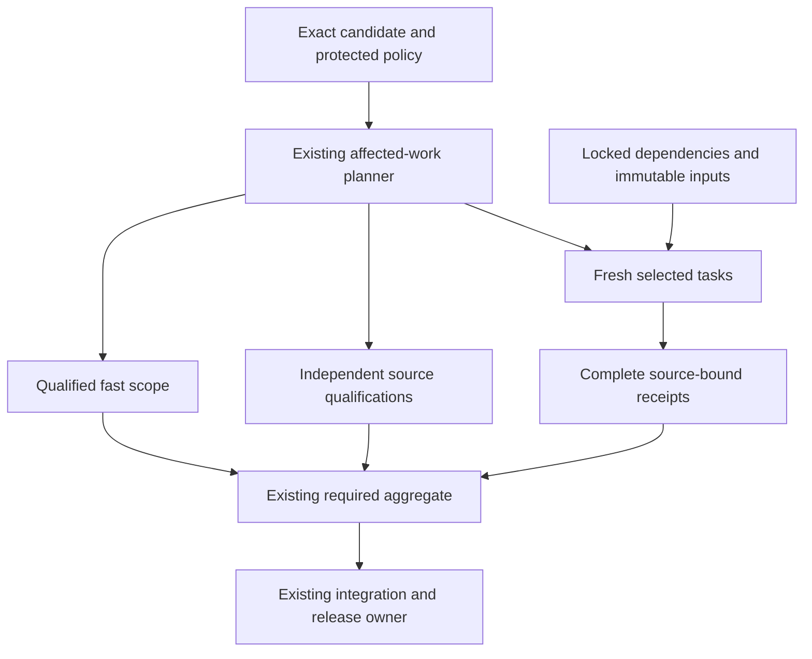

# MastermindX lightning CI architecture and execution plan

Updated: 2026-11-07. Engineering targets below remain unachieved.
Program: existing Mastermind #917 / #1607, Macro #6351 and WS:CI-MERGE-CONTROL-PLANE.
Source carrier: Mastermind #2191 / `ci-lightning-architecture-20261107-c2`.

Verified procedure pin: Mastermind protected `66780ab7e3e9fdbfd40713bb5791fb1888529f7c`,
INDEX `b69d45de68d1f1c31d12dcf5203037122c694711`, skillpack 1.0.1 / bootstrap 1.
The compatible pin and same-SHA source laws govern this execution.
Current inspected integration bases are Macro `86fdcd66b92fa29ac52eafe7de503b65bc343646`
and Terminal `da93645b9f21d8bdd25ace98ef24d08d0914c2fd`.
This extends P3.O3 / Phase 4 of the existing
[delivery-turnaround task tree](superpowers/plans/2026-11-02-delivery-turnaround-execution.md).

The decision is to keep the three incumbent CI systems, remove repeated work,
make the largest tasks independently schedulable, and qualify enough isolated
capacity for a five-minute fresh full verdict. Existing scope and proof owners
remain authoritative. Caches, parallel workers and runner upgrades each need
their own measured contribution to the complete workflow.

This revision replaces the long rolling status narrative with a current plan
and compact evidence frontier. The complete intake research, rejected experiments,
source receipts and earlier implementation history remain immutable in
[the 16:00 source-linked evidence record](https://github.com/mastermindx-market-intelligence/Mastermind/blob/8b549d74e3977e7e37749b623a224e30423c75d6/docs/CI_LIGHTNING_ARCHITECTURE.md).
Those historical statuses do not supersede the current disposition below.

## Outcome and completion criterion

Make ordinary engineering feedback feel immediate while completing full consequential
validation quickly and predictably across Mastermind, macro and mastermind-terminal.
Optimize final source revision to required green, and separately eligible revision to
protected merge. Preserve the exact selected tests, meaningful integration checks,
source identity, current trust boundaries and original product outcomes.

An implementation is complete only after its existing workflow consumes it, a
representative natural cohort demonstrates the target by risk class, required failure
cases remain red, and its source/evidence/rollback are recoverable. A cache hit,
local test, isolated runner canary, green workflow or plan is evidence at its own layer.

## Current disposition

**The architecture is concrete and execution has advanced; the three-repository
upgrade is not accepted and no five-minute p95 is claimed.**

| Lane | Current source and evidence | Remaining gate |
| --- | --- | --- |
| Mastermind parallel execution and RWE, #2065 | Published `d26440aac2c45b960d7175836121b885d94f9301`; actual PR checkout `9a849c4eca99c1768d8294f866c962b7a97960eb`. Required run [42394477066](https://github.com/mastermindx-market-intelligence/Mastermind/actions/runs/42394477066) failed in 17m40s. Serial RWE [42394477042](https://github.com/mastermindx-market-intelligence/Mastermind/actions/runs/42394477042) passed in 34m41s. | Required shard 2's selected pytest phase never ran: its H1 admission-fixture prefix failed. Preserve its unresolved settlement. Complete the independent matched RWE experiment and required release evidence. |
| Mastermind exact case evidence | Serial has 2,334 complete module companions / 70,693 cases. Five parallel shards match serial exactly for 1,979 modules / 60,268 cases. | The missing 355 modules / 10,425 cases prevent full parallel comparison. Required and RWE packages still differ beyond pytest. |
| Mastermind controlled profile experiment | Processes=0 [42398700247](https://github.com/mastermindx-market-intelligence/Mastermind/actions/runs/42398700247) is fully successful. All six receipts match source `d26440a`, environment `58de61f3d39fc214`, 78 installed packages and the exact vendored input. Processes=4 was dispatched once and reconciled as [42402970898](https://github.com/mastermindx-market-intelligence/Mastermind/actions/runs/42402970898), initially queued. | Consume complete processes=4 evidence before any comparison or branch update. Keep remote `d26440a` frozen because same-ref runs cancel predecessors. |
| Mastermind deterministic fixtures | Unpublished original-carrier candidates: Trend 44/44 pass, unchanged identity/outcome digests, local service 85.131132 → 76.740074s. Capacity 18/18 pass, unchanged digests, 155.057522 → 145.788483s; independent copy-isolation test passes. | These are local single before/after observations. Native qualification and full-workflow benefit remain owed. No consumer/security verdict is cached. |
| Mastermind Trend granularity | Local commit `e888d046d3dbe6d0d2fa566a06b2ffbf897acaf3` splits the 44 cases into 17 core / 16 reference / 11 run-contract cases. All 44 pass in separate invocations; 138 selector checks also pass. | Preserve the explicit 44-case identity mapping: 17 IDs unchanged, 27 change only module prefix. Native Linux timings and full-branch effect remain owed. |
| Mastermind admission diagnostics | Local commit `dc4f4aa699a3bb1d285073d34a9652fe445dcbec` retains bounded admission reasons and quantities; all 96 synthetic contracts pass. | No positive fixture or settlement rule changed; the original H1 hold remains. |
| Macro FIF split/calibration, #10788 | Published `4281c1886f52a93913f6eec85f9f4407fd738fb6`; actual checkout `28919621ded37c81d12d0546cecdf6d8bf82b435`. [42390957332](https://github.com/mastermindx-market-intelligence/macro/actions/runs/42390957332) failed after 75m52s; eleven packs passed. | International exhausted its shared 20-minute deadline; original descendant settlement is unknown. Its five following logical jobs were withheld. No assertion regression or calibration-caused failure is established. |
| Macro narrowed-pack compaction, #10752 | Published `5e23be9cd4f73bfb298206ddd79886ef9d9e168e`, composed with accepted main. 476 tests + 10 subtests pass; two existing sparse-checkout skips. Native [42397007951](https://github.com/mastermindx-market-intelligence/macro/actions/runs/42397007951) has ten successful packs; packs 0/10 remain executing at the bounded milestone. | Current native aggregate and a natural genuinely narrowed consumer are owed. Historical replay preserves 21 jobs while compacting 12 active packs to 2; that is not a live latency result. |
| Macro two-worker FIF, #10658 | Published `9f3fe48a28c5d3fe45494ad111a63742efbc1737`, composed with accepted `86fdcd66b92fa29ac52eafe7de503b65bc343646`; exactly three feature paths. All 80 focused tests pass with zero skips/failures; fragment check passes with 392 jobs / 394 fragments. | Natural full-source CI remains owed, including the sealed import case absent from this sparse checkout. Existing MOG semantic refusal is retained; no queue change was made. |
| Terminal isolated runner lane, #1306 | Published `418f44dd8302954892ff194b4dc12477288699c9` after protected scoped-CI composition. All 264 focused tests pass. Native [42397250070](https://github.com/mastermindx-market-intelligence/mastermind-terminal/actions/runs/42397250070) is successful: all 19 jobs, including all twelve browser jobs, unit/typecheck and the required aggregate. | This is hosted-default qualification. Restricted-runner trust/isolation and whole-matrix capacity proof remain. No fleet variable or runner was activated. |
| Terminal context/readiness, #1338 | Published `92c5b806b4168f1cd011d25044e3355aa32011e9`, after the original `2a99682d` evidence delivery. [42387278303](https://github.com/mastermindx-market-intelligence/mastermind-terminal/actions/runs/42387278303) cancelled after 78m04s; desktop-5 had 16 failed cases / 32 retries. First failure was the Prophet data-read error. | A strict bounded fixture-readiness probe is now published through the existing helper. All 15 focused contracts and the 16 original desktop cases pass locally. Changed-source native [42399940917](https://github.com/mastermindx-market-intelligence/mastermind-terminal/actions/runs/42399940917) is running; the historical server cause is unproved. |
| Terminal topology/tracing, #1223 | Draft `e34862900a09bfbcf124397ffe0db02a4f509a49`; original create-commit effect remains uncertain. Existing 7/5/5, tracing, timings and Node discovery source is preserved. | Reconcile the original invocation receipt. No replay, replacement carrier or duplicate implementation. |
| Continuity | Macro #10827 was accepted at `0c02daa5c4e6a986b6fc2553d1c3b7a5cd495002`, preserving accepted #10825. | Record the next material milestone through a fresh continuation on the same Agent OS workstream; do not amend an already accepted carrier. |

The latest source revisions above are publication facts. Local test success,
native workflow success, mandatory review, protected merge, deployment and product
acceptance remain separate evidence layers.

## Historical intake baseline

These intake observations explain the original design. Current source disposition is above:

| Repository | Default revision | Current implementation |
|---|---|---|
| Mastermind | 615146aac6a1b0c0933bc9b815517a2fd285ed4a | Trusted scope -> fast/smoke or six canonical pytest shards -> required test; merge-group scope from merged #2129; same-SHA postmerge reuse and existing ci-profile consumer |
| macro | 72c249a2e1967d1ec6dcf6179a7a8728f3305e44 | Existing semantic ci-plan -> selected ci-pack -> ci-gate; incumbent merge-on-green, proof freshness and adaptive admission |
| mastermind-terminal | dd49fa9bd4746d283bfc12581153463629de2b4e | Three stable required contexts; 12 PR browser shards; merged #1320 avoids duplicate merge-group browser matrix; merged #1324 scopes responsive verification |

The [latest native measurements](https://github.com/mastermindx-market-intelligence/Mastermind/issues/917#issuecomment-6702164981)
report Mastermind merge-group-created to required-green STANDARD/smoke n=8
p50 1m53.5s / nearest-rank p95 3m10s; FULL n=6 p50 40m47.5s / p95 43m57s.
STANDARD merge-group-created to merge p95 was 29m44s, so a fast check is not
necessarily a fast release. These selected cohorts are not a causal speedup experiment.

The [Terminal full PR cohort](https://github.com/mastermindx-market-intelligence/Mastermind/issues/917#issuecomment-6700311570)
has n=4, workflow-created to complete-green p50 57m22s / p95 58m42s.
The ubuntu0 desktop-1 canary jobs were 16m06s with one worker and 8m08s with
four workers ([four-worker run](https://github.com/mastermindx-market-intelligence/mastermind-terminal/actions/runs/42029519496)),
against an earlier hosted 54m41s comparison. These are one-shard observations,
not matched-source whole-suite or sustained fleet results. The four-worker canary's
whole workflow lasted 17m36s; its 8m08s value is the job clock.

Macro's [FIF split proposal](https://github.com/mastermindx-market-intelligence/macro/pull/10788)
records one pack at 69 minutes while its siblings finished in 10-33 minutes.
Its stale calibration weight was 1,630 seconds. We must not confuse calibrated
model weights with observed wall time. Current proof-refresh scarcity and frequent
check-definition invalidation are independent contributors.

## Architecture decision

Extend the existing GitHub Actions owners with a common evidence contract. Keep repo-specific suites and required-check names.
Treat every run as five separable costs: admission/queue, acquisition/setup,
selected execution critical path, aggregation, and integration/release wait.

1. **Trusted affected-work planner.** Compute changed paths from exact Git identities.
   Use protected policy, explicit dependency closure and conservative invalidators.
   Missing, renamed, dynamic, ambiguous or incomplete dependency evidence goes full.
   Review risk and sufficient test scope remain separate decisions.
2. **Small deterministic tasks.** Split expensive semantic families at natural test
   boundaries, keep stable ownership and prove exact selected coverage once.
   Balance using current measured durations; preserve serial affinity where required.
3. **Cheap hot execution.** Restore locked dependency caches, avoid repeated installation,
   compile production browser assets once per tested candidate where semantics permit,
   and reuse that immutable build across browser shards. Do not ship test flags.
4. **Bounded parallelism.** Choose shard count and per-shard workers together, accounting
   for total slots, memory, databases, ports and queue demand. More fan-out can be slower.
   Use ephemeral isolated runners only through the already qualified runner owner.
5. **Trustworthy reuse.** Begin with immutable dependency/build reuse. A reusable test
   result must bind exact task inputs and transitive dependencies, runtime/toolchain,
   platform, lockfiles, command, trusted policy, environment inputs and artifact digest.
   Untrusted candidate writes cannot supply trusted qualification. Unknown means miss.
6. **Stable aggregate.** Each existing required context reports for every admitted event.
   It validates planner identity, complete coverage, expected shard outcomes and result
   provenance. Cancellation, omission, wrong source, partial results and unqualified
   cache hits cannot turn it green.
7. **Existing release owners.** Preserve native queues and Macro merge-on-green.
   Reduce unnecessary invalidation at its existing owner, while retaining actual
   integrated-candidate proof. Never add a second lease, retry or verdict store.
8. **Existing measurement consumer.** Extend ci-profile/semantic timing artifacts.
   Measure failure/timeout/supersession as well as successful latency, by class and
   phase. Report queue delay separately only where the native timestamp semantics
   actually establish it; a job start offset also includes dependencies.

The execution graph keeps fast scope, fresh execution and independent qualification
visible in the same required verdict:

## Target service levels (proposals, not achieved results)

The end state is seconds for inert changes and a few minutes for substantive changes.
A ten-minute broad/full path is an interim milestone; it does not close the final goal.

| Measurement | Interim p95 | Final p95 | Required meaning |
|---|---:|---:|---|
| First actionable static/contract failure | Establish baseline | <=60 seconds | Real failure surfaced to author; successful runs are not counted as failures |
| Verified docs/metadata required verdict | <=2 minutes | <=90 seconds | Trusted inert allowlist; no executable/config/consumed-data escape |
| Ordinary bounded source required verdict | <=5 minutes | <=3 minutes | Relevant unit/contracts and affected integration/browser paths |
| Broad/full canonical required verdict | <=10 minutes | <=5 minutes | Complete assigned assurance; no expanded exclusions or renamed scope |
| Queue delay on intended capacity | <=60 seconds | <=30 seconds | Native queue timestamps; dependency waiting separately classified |
| Aggregate after last dependency | <=10 seconds | <=10 seconds | Stable required context verifies completeness and provenance |
| Eligible source to protected merge | <=20 minutes | <=10 minutes | Includes integration candidate and queue wait; separate from authoring age |

These are engineering targets, not promises established by current hardware or suites.
The five-minute full target requires removing current indivisible work, not just
changing worker counts. Report cold and warm distributions separately, plus their
actual mix. Publish p50/p95, sample size, selected coverage, runner class, attempts,
failures and cancellations. At least 30 successive eligible observations per populated
class provide an initial operational cohort, not a statistical guarantee. Small
canaries retain their observed ranges and explicit sample counts. Do not choose only
green, fast or warm runs to manufacture acceptance.

A target is not met if test-step time falls but queueing increases the author's
end-to-end wait, total compute becomes unsustainable, or previously required work
silently disappears. A scope reduction is accepted only when the trusted dependency
contract proves that omitted work is irrelevant.

## Closing the five-minute budget

The allocations are design limits for the whole fresh required path. They include
scheduling, setup, collection/readiness and fan-in. They are not achieved timings.

| Repository | Scheduling | Planning | Checkout/environment | Collection/readiness | Longest fresh execution branch | Aggregate | Total |
| --- | ---: | ---: | ---: | ---: | ---: | ---: | ---: |
| Mastermind | 30s | 10s | 40s | 20s | 190s | 10s | 300s |
| Macro | 30s | 15s | 35s | 20s | 190s | 10s | 300s |
| Terminal dev profile | 30s | 15s | 45s | 20s | 180s | 10s | 300s |

Mandatory independent qualification must also finish inside the graph: at most
210s after setup for Mastermind/Macro and 200s for Terminal. New jobs pay their own
queue and setup costs. A compiled browser experiment must include cold build and
distribution; measuring only the subsequent test command is insufficient.

**Task-size rule:** aim for at most 90s per independently schedulable unit on the
admitted runner class. Preserve shared mutable transactions and required fixture
affinity. Use the incumbent planner to pack those units within the execution limit.
A unit above 90s needs legitimate work reduction, an independent affinity split or
qualified faster execution before the branch can close.

**Current sizing evidence:** the complete c854 parallel inventory reported
10,565.219s across 2,326 runtime modules. With unchanged service and 24 equivalent
processes, perfect balancing alone is 440.217s. Fitting 190s under that artificial
model requires about 56.84% less service, or about 55.6 equivalent processes.
Neither is a CPU lower bound or authorization to start 56 processes: grouping,
fixture sharing, contention, package versions and runner class change those costs.
The later native profile comparison cannot be used as a controlled speed ratio.

Macro's current FIF-B unit has an observed 1,706.863s command; the newest completed
FIF-C command reports 1,213.133s. Its International composite consumed a 1,200s
deadline. Weight correction improves placement but cannot make these units fit 190s.
Terminal's historical four-worker canary reported 431s of one shard's test work,
already above the entire 300s budget. These facts make granularity and work reduction
mandatory, alongside capacity qualification.

Capacity is chosen only after measuring the fresh graph. Model concurrent runs,
jobs per run and workers per job together; include memory, ports, browser/server
cost, setup and serial affinity. Preserve the existing Fabric and release budgets.
No new runner, scheduler, queue, lease store or admission plane is introduced.

## Preserve and compose the existing work

| Existing owner | Preserve | Concrete composition boundary |
| --- | --- | --- |
| Mastermind merged #2044 / #2129 / #1570 and profiler | Six outer shards, trusted merge-group scope, exact-SHA postmerge reuse and ci-profile | Extend their contracts; do not reconstruct them. |
| Mastermind #2065 | Four prepartitioned child interpreters, exact cover, terminal receipts, observer, RWE adapter, physical capacity-test partition | Complete matched-profile proof, hot-unit work and current required source qualification. |
| Mastermind reserved #1714 | SDK/runtime lane at `47164aef5c1cf928f0618be28996d465c9564efa`, including `pyproject.toml` and both RWE locks | Regenerate lock provenance from the combined inputs when composed. The narrow pytest qualification does not complete this future integration. The reservation alone proves neither a live writer nor a global exclusive fence. |
| Macro #10788 + #10658 | 120 FIF modules; #10788's 44/37/39 split and #10658's one fresh interpreter per file, with at most two files running concurrently | After current-main qualification, use the existing helper on each split sibling's own file list. Add its path to all three closures: 1,139 → 1,140 each. Preserve B's P2/G-pack/Node ownership and ancestor-package additions. |
| Macro #10738 | Historical failed four-worker shared-xdist experiment | It is not a qualified two-to-four-worker progression or fallback for #10658. |
| Macro #10752 | Genuinely narrowed-plan compaction and exact baseline/full/off/shadow fallback | Keep twelve-slot output, selected-job objects/digests/order and real consumer closure. |
| Macro #10735 / #10745 / #10764 | Control-plane family split, replay environment, manifest-scoped freshness | #10755 cap 640 and #10770/#10766 are accepted. Preserve #10674's original uncertainty, then compose #10745 and #10735 through their original owners. |
| Macro #10656 / #10674 | Existing authored/refresh admission programme | Main admission remains OFF. Original operation26751 stays uncertain; no alternate continuation or retry. |
| Terminal accepted #1320 / #1324 / #1297 / #1334 | Native browser deduplication, scoped QA, trusted docs scope and accepted News navigation repair | Preserve their selectors, original journeys and required aggregate. #1297 acceptance is `90ddc139`; no redo. |
| Terminal #1306 | Optional lane binder, selected ports/workers, trust/isolation/rollback runbook | Published scoped-CI integration is independent of fleet activation and #1223's held mutation. |
| Terminal #1223 | Already-authored weighted topology, traces, attempt timing and Node discovery | Reconcile its original create-commit. A new implementation on another carrier would duplicate held work. |
| Terminal #1338 | Existing context-entry repair and actual EN/ZH evidence | The new fixture-startup slice remains in the existing helper; preserve app assertions, runtime, topology, traces and historical evidence. |

## Critical-path evidence and consequences

The following historical native observations remain useful cost attribution. Current exact-head results are in the execution frontier:

| Observed source/run | Component | Measured elapsed | Decision |
|---|---|---:|---|
| [Terminal 42302235414](https://github.com/mastermindx-market-intelligence/mastermind-terminal/actions/runs/42302235414), mobile 2 | Playwright test / whole job / npm ci | 3298 / 3345 / 17 seconds | Test execution is 98.6% of this job. Prioritize browser/runtime/fixture work over another dependency cache. |
| Same Terminal run | Unit job / current-checkout capture / Vitest | 1013 / 544 / 285 seconds | Capture and Vitest account for 81.8% of the unit job. Browser-shard tuning alone leaves a roughly 17-minute constraint. |
| [Mastermind serial run 42331481657](https://github.com/mastermindx-market-intelligence/Mastermind/actions/runs/42331481657), shard 0 | Whole job / pytest / native application custody | 2131 / 1437 / 373 seconds | The serial qualification prefix must be included in the graph, not hidden inside pytest averages. |
| Same Mastermind run, shards 2 / 3 | Pytest | 1655 / 1683 seconds | Broad serial execution is still expensive across several shards. |
| [Mastermind xdist candidate 42202096909](https://github.com/mastermindx-market-intelligence/Mastermind/actions/runs/42202096909), head b3fdd6ad | Shard 0 whole / pytest / custody / private HTTP compatibility | 1650 / 956 / 382 / 125 seconds | Four workers improve the pytest part, while qualification before pytest dominates the remaining tail. |
| Same xdist candidate, shard 2 | Whole / pytest | 1330 / 1226 seconds | The longest test granules still need work. Other shard jobs were 620-998 seconds. |

These different runs are observational comparisons with potentially different source
and load. They do not establish a controlled causal speedup.

For a workflow DAG, measure queue + setup + collection + the actual dependent
execution path + aggregation. Concurrent job durations are not added to estimate
latency; their sum is compute consumption. Conversely, a serial prefix and its
dependent shard cannot be treated as parallel.

### Amdahl and test granularity

The historical 788.9-second capacity-artifact module imposed a 13m09s constraint
while it remained one unchanged unit under xdist loadfile. The [xdist distribution
contract](https://pytest-xdist.readthedocs.io/en/stable/distribution.html) keeps all
tests in one file on one worker. The published #2065 execution slice has physically split
that module into twelve coherent files while preserving all 466 cases. This removes
that particular indivisible unit; it does not establish a five-minute full run.

Macro's old 1630-second FIF unit divided perfectly into three remains approximately
9m03s per sibling before setup. The observed 69-minute pack also shows that
calibration, nested execution or fixture behavior differs from that old estimate.

The next optimization must therefore do one of the following with evidence:
remove repeated deterministic fixture construction, shorten legitimate individual
test work, separate independent fixture-affinity groups, or place the same work on
qualified faster capacity. Increasing timeouts or deleting assertions is not an
optimization. Parallelism is bounded by:

`concurrent runs × jobs per run × workers per job`

Choose all three together. Reserve capacity for the existing merge/admission path
through its current owner. Do not create another reservation service.

## Repository implementation design

### Mastermind

Keep `ci_pr_scope.py`, `ci_parallel_shard.py`, `ci_pytest.py`,
`ci_pytest_timing.py`, `ci_xdist_guard.py`, `rwe_env.py` and the existing
workflow/aggregate as the owners.

1. **Finish the controlled process comparison.** The existing RWE workflow exposes
   processes 0 and 4. Dispatch sequentially on one frozen source, then compare
   the lock bytes, realized package/environment receipt, vendored Macro pin,
   selected inventory, every module's collection and outcome digests, terminal
   child receipts, actual process count and complete gate. Do not compare the
   current unlocked required profile to the RWE lock as a speed experiment.
2. **Retain precollection partitioning.** Six outer jobs each receive their
   canonical module selection; four independent child interpreters collect only
   their assigned subsets. Keep independent partition domains, exact once-only
   cover, private child directories and complete receipts. Do not nest another
   four xdist workers inside each child. Serial remains the explicit control.
3. **Reduce fixture construction with outcome conservation.** Trend now constructs
   its synthetic holdout once per function-scoped fixture and returns a fresh
   deep copy on every loader call. The independent reproducibility a/b runs,
   seeds, horizons, all 44 tests and production code remain unchanged.
   Capacity's optional crash-module seed shares only immutable Git producer
   construction; every case receives an ordinary full copy and builds its own
   real transport. All descriptor, ownership, fsync, repair, replay and rollback
   operations still run. The shared helper's default remains independent.
4. **Prioritize actual native hot units.** At `9a849c4e`, Trend reports 182.691931s
   in serial and 208.098650s in required parallel, with 44 cases. Capacity crash
   replay reports 106.928820s and 68.532505s respectively, with 18 cases.
   These are summed pytest phase durations under different profiles. Trend is
   the clearer remaining 90s-unit obstacle. Use the existing partial slow-case
   evidence has now produced a qualified local three-module split: 17 core,
   16 reference and 11 run-contract cases. All test bodies, decorators, parameters
   and support ASTs are preserved from the qualified fixture candidate. The
   existing selector places them at outer/child 3/0, 3/1 and 4/0 without any new
   pins or movement of unrelated modules. Obtain native timings for those units. No statistical scenario or
   independent reproducibility run may be removed to hit the target.
5. **Shorten the independent qualification branch.** Current source qualification
   took 10m15s. The existing design extracts source qualification from pytest
   shard 0; it still needs genuinely independent qualification jobs or reduced
   repeated setup. Advance the required aggregate and exact postmerge job-set
   contract together, with the original negative proofs intact. Never claim
   a pytest-only speedup closes this serial qualification cost.
6. **Repair H1 diagnosis at its existing owner.** The latest native refusal is
   before model command/reservation, but its admission snapshot was discarded
   and the positive fixture did not prove settlement. A bounded
   allowlisted admission-reason/scalar diagnostic is now locally qualified at
   the existing H1 reporter: 96 synthetic cases pass.
   Do not change admission thresholds, positive assertions, settlement rules or
   mount generic Git diagnostics into its deliberately Git-less container.
   This source repair cannot retroactively clear the original hold.

The rejected fixture-template experiment from the historical ledger remains
DO_NOT_REDO: it produced no whole-module improvement. The current immutable
producer and synthetic-holdout experiments are distinct, explicitly measured
construction work. No Git/security/admission outcome is memoized.

### Macro

Keep `ci_pr_scope.py`, `run_ci_pack.py`, `ci_semantic_proof.py`, the
`ci-plan → ci-pack → ci-gate` workflow and `merge_on_green.py`.

1. **Qualify the published original-source integration.** #10658's
   current-main composition is published at `9f3fe48a`, preserving accepted `c4844c22` and the new
   `press-account-claim-consumer` logical owner. The original sparse workspace
   lacks the sealed sector-cycles renderer/manifest, so a local import sweep
   cannot prove that accepted import repair. Natural full-source CI must.
2. **Compose split and fresh-interpreter scheduling once.** Keep #10788's exact
   120-file union and sibling ownership; apply the existing two-worker
   helper inside each sibling. Each file runs once in a fresh interpreter, with
   at most two files running concurrently. This isolates Python process/import
   state; the helper shares the working directory and environment and does not
   itself isolate filesystem paths or ports.
   Keep helper selection paths in every affected closure and test all three
   invocations. The shared-xdist experiment remains failed evidence.
3. **Expose real command units.** The International job currently combines browser
   installation, canonical-main acquisition, 442 builder/template tests, a
   199-case DOM command, table filtering, IM13 Python/browser and IM14
   Python/browser proof under one deadline. Represent separable units through
   the incumbent manifest with their closure and ordering contracts. Preserve
   frozen-main preparation and workspace restoration boundaries. Concurrent
   mutable commands in the same checkout are not a safe shortcut.
4. **Reduce measured repeated construction.** The foundation browser file's
   18 tests account for 276.891s of the completed 277.456s DOM command.
   Its helper renders HTML via synchronous Python and launches/closes Chromium
   per call. After the original settlement boundary clears, attribute render,
   launch, navigation and assertion time. Qualify immutable rendered-variant
   reuse if it helps; keep the no-payload, stub, ordinary and states variants
   distinct and preserve fresh browser/context isolation. IM13 already caches
   its own three variants, providing an existing design precedent.
5. **Keep placement honest.** Published measured weights are FIF-B 1,707,
   International 852, ontology 350, government-revenue candidate 436 and
   BioCatalyst 308 seconds. FIF-A/C 537/538 are provisional; the completed
   current FIF-C command is 1,213.133s, so its next calibration must reflect
   current evidence. Distinguish installation, checkout, canonical-base
   acquisition, candidate execution and exact-base replay.
6. **Consume narrowed-pack compaction naturally.** #10752 is additive only for a
   genuinely narrowed active selection whose maximum modeled weight does not
   exceed the legacy partition. Full, baseline, shadow/off and global-invalidating
   work retains its named packs. Prove the real planner-to-consumer path after
   publication, including exactly-once logical coverage and failure propagation.
7. **Finish existing freshness/admission work.** Preserve #10674's uncertainty and
   the #10745 → #10735 source order. Manifest-scoped proof can survive irrelevant
   changes only through the incumbent identity/freshness contract. Command,
   dependency, environment and policy changes invalidate it. Main admission
   remains OFF until its existing producer/consumer/fairness/cutover acceptance.

Batch compatible definition changes at legitimate source boundaries to limit
needless global proof churn. A new candidate's proof cannot retrospectively settle
a timed-out original invocation.

### Terminal

Keep `ci_e2e_scope.py`, `playwright.config.ts`, `globalSetup.ts`,
`fixtureWarmup.cjs`, visual-evidence producers/consumers and the existing required
contexts: Quote Hub tests, Terminal typecheck + tests, and Ingest + signal-layer tests.

1. **Preserve accepted scope and journeys.** Consume the accepted docs, responsive
   selector and merge-group deduplication behavior. The independent context-entry
   repair and six actual EN/ZH captures remain source-bound evidence. Report
   reported skips separately until their reasons are audited.
2. **Qualify fixture startup before browser work.** A single strict
   `/api/flow?f=prophet_idx` probe now being qualified requires direct 200,
   fixture provenance and a complete valid object with the existing schema/plans
   shape, allowing empty plans. One deadline covers headers and body, within
   the existing 25s client allowance; no retry or timeout increase.
   It runs after the unchanged 14-route warmup in the same helper used by
   Playwright and PL6 capture. Failure reports a finite classification without
   payloads. This distinguishes failure to qualify startup from a later request failure during the browser journey.
   It does not establish why the historical native requests stalled.
3. **Honor the held topology owner.** #1223 already contains 7/5/5-plus-serial
   placement, trace-on-first-retry, explicit zero-retry trace retention,
   per-attempt timing and Node discovery. Reconcile the original effect before
   publication. Use independent startup/source work without duplicating it.
4. **Optimize the whole unit/capture branch.** Historical capture and Vitest
   steps were 544s and 285s; browser-shard tuning leaves that separate path.
   Reuse same-candidate immutable capture outputs through current consumers.
   Select fewer journeys only after proving the affected-journey contract.
   Preserve historical evidence hashes; recapture through the legitimate
   producer/selection path when a current source binding changes.
5. **Retain dev mode until compiled fixture identity is coherent.** The protected
   application has development-only auth/preview seams. A compiled experiment
   needs the existing Supabase/Macro authorities with isolated test data and
   a deliberately nondeployable fixture artifact. Do not widen production auth
   bypasses to make tests pass. First qualify an original-journey canary, then
   the complete matrix, including cold build/distribution and browser identity.
6. **Qualify capacity through #1306.** Its hosted defaults, serial opt-ins and
   stable aggregate are preserved in the new composition. Before activation,
   demonstrate restricted runner-group trust, separate no-sudo identities/JIT
   credentials, fresh homes and ephemeral drain, process visibility and
   login/timer escape checks, realistic concurrent demand, and rollback.
   The historical Default-group canary is not that fleet proof.

The prior local trace-on/off/on sample (31.722 / about 8.6 / about 16.6s) is an
unmatched small observation. The trace policy is already owned by #1223, and
neither that sample nor one fast local browser pass earns hosted p95 credit.

## Common evidence contract and reuse boundaries

This is an additive contract for existing planner/proof/timing artifacts. It does
not introduce a new daemon, registry, scheduler or authoritative database.

| Evidence component | Must bind or establish |
|---|---|
| Source and policy | Repository; PR or merge-candidate SHA; trusted planner/policy revision; verified diff base |
| Selected work | Required task/group identities; test/helper/config/data closure; serial affinity; expected partitions |
| Execution identity | Exact command; dependency locks; runtime/toolchain/browser; OS/architecture; material nonsecret environment inputs |
| Input/build artifact | Content digest; producer source and trusted provenance; fixture mode; compatible consumer; nondeployable test marking where applicable |
| Test outcome | Attempt and runner identity; complete collection/execution; success/failure/cancel state; coverage membership; completion evidence |
| Reuse validity | Matching relevant inputs; trust namespace; accepted freshness rule; policy eligibility; miss reason when unverifiable |
| Performance | Queue/setup/collection/execution/aggregate times; retries; cold/warm state; total compute; source class |

Artifact reuse accelerates a fresh test. Result reuse substitutes an already
qualified assertion and needs the stronger identity above. A passing PR proof is
not automatically proof of a different integrated merge candidate.

Use the accepted trusted merge-group selector and the current repository-specific
composition contract. GitHub's [merge queue](https://docs.github.com/en/repositories/configuring-branches-and-merges-in-your-repository/configuring-pull-request-merges/managing-a-merge-queue)
checks the candidate containing current base and preceding queued changes. Preserve
Terminal's accepted removal of duplicate browser fanout while accurately stating
what its merge-group checks establish; add only the specifically owed composition
proof, not the old blanket matrix by default.

Candidate code cannot select a weaker classifier for itself. Unknown dependencies,
renames, policy changes and incomplete analysis expand validation. Missing,
cancelled, wrong-source or unexpectedly skipped selected work cannot satisfy the
aggregate. A cache hit cannot override an observed failure.

Start result reuse with one deterministic, hermetic task in shadow mode: compare
its reuse decision with actual fresh execution before letting it satisfy an
existing required check. Invalidate on a test/helper/lock/config/runtime/environment
change, evidence tampering or trust mismatch. Preserve the existing broader-run
fallback and rollback at the same owner.

The prior [Vercel CI research](https://vercel.com/blog/introducing-vercel-ci)
provides a useful task-graph/cache/per-task-compute pattern. Its vendor performance
claims are not MastermindX measurements. Adopting a new external CI platform is not
required for this plan and is not authorized by an architecture analogy.

## Falsifiers, rollout and rollback

The strongest counterargument is that narrow selection or proof reuse can hide
dynamic dependencies or interactions between individually passing changes.
The architecture fails qualification if:

- A helper, fixture, lockfile, configuration or policy change incorrectly leaves
  affected work out of the plan or keeps a stale result eligible.
- A candidate changes its own classifier and thereby reduces its required work.
- A selected shard is absent/cancelled/duplicated and the aggregate still passes.
- Individually passing changes violate an owed integrated-candidate behavior.
- A full audit finds a selection false negative.
- Additional fanout improves an isolated test while worsening end-to-end p95 or
  completed delivery throughput under representative load.

Use focused negative tests for these failures, then existing full CI and the real
PR-to-integration path. Keep first-attempt pass rate and retries visible; do not
use retries, longer timeouts or exclusions to hide regressions.

Roll out one material execution dimension per interpretable canary. Preserve the
previous trusted planner/worker/runtime setting for source-level rollback. On
bad selection or invalid proof, fall back to the broader canonical run. On runner
or performance regression, restore the previous admitted execution topology.
Rollback does not replay an uncertain operation or resurrect a stale proof.

## Ordered execution tree

These IDs extend the existing Phase 4 CI work, and are editorial source nodes only.

| ID | Deliverable | Dependency | Acceptance |
|---|---|---|---|
| P4.L1 | Reconciled architecture, current cohort, source/collision map | Current source and #917 evidence | Exact citations and separate observed/forecast/held states |
| P4.L2 | Finish existing parallelism/pack/fast-scope implementations | Original custody and current source | No duplicate PR; actual exact-head coverage and runtime measurements |
| P4.L3 | Terminal browser build/setup critical-path slice | Current workflow/config and no overlapping writer | Same user journeys against immutable candidate; focused failures stay red; real hosted canary |
| P4.L4 | Remove hot Mastermind test/setup overhead | Current measured heavy modules; L2 compatibility | No cached security outcomes; unchanged assertions; Linux proof |
| P4.L5 | Macro duration calibration and split/compact reconciliation | Existing logical-job owner and L2 | Every selected job exactly once, current weight evidence, bounded maximum pack duration |
| P4.L6 | Trusted task-result reuse pilot in incumbent planner | Input contract + deterministic hermetic task | Shadow equivalence first; tamper/environment/dependency changes miss; no false green |
| P4.L7 | Qualified runner economics and execution capacity | Full isolation/trust/capacity canary | Whole-matrix benefit, no starvation of Fabric, rollback through same owner |
| P4.L8 | Natural-cohort acceptance and closed migration | Previous slices | SLO distribution, unchanged coverage, failure/freshness behavior, recoverable rollback |

Execute source-disjoint ready work now. No new CI run merely to produce activity;
use natural candidate validation and actual changed-source canaries where needed.
No merge, approval, runner activation or publication of held operations is inferred
from this plan. Source edits and qualified ordinary PR publication are in scope.

## Current evidence frontier

### Mastermind: publication, parity and local construction experiments

The `d26440a` merge preserves accepted protected `66780a` source and the original
parallel/RWE work. Eleven composition-sensitive paths were checked; the complete
107-file manifest and inventory were regenerated with matching source bytes.
Manifest SHA-256 is `d8e17896581fcf5568157cae6dfb71b502cd5029364586f123240b5f05b8b7f1`;
inventory SHA-256 is `1424f60513e0bc0b162a23515ece964b1cfb90077ecd507bc7df625e64670813`.
The host-pull/admission inverse chain and both independently pinned source
histories remain validated. Focused whole-file qualification passed 587 cases
with complete companions; broader local path/ancestry failures remain recorded
as environment-limited evidence, not repaired production behavior.

Observer isolation now captures the serializer callable and four finite limits
per observer instance. Negative observers created after deliberate limit changes
still receive those limits. Hash-locked pytest 9.2.0 was generated through actual
CPython 3.12 / pip-tools, keeping the other 74 locked packages unchanged. This
repairs case-ID compatibility without truncating selected cases or enlarging
observer bounds.

The completed serial native inventory has 2,334 complete module companions,
70,693 collected/invoked/finished cases, zero deselections and 213,528 phase reports.
Six explicitly represented zero-case modules explain 2,328 timing summaries.
The five executed required shards match every corresponding collection, identity,
count, phase and outcome digest across 1,979 modules / 60,268 cases. The remaining
355 modules / 10,425 cases have only serial proof.

Both profiles used Python 3.12.16 / pytest 9.2.0, but required/RWE package versions
differ: pluggy 1.7.0/1.6.0, NumPy 2.5.4/2.5.2, pandas 3.1.1/3.0.5 and pyarrow
26.0.1/25.0.1, among others. The explicit processes=0/4 workflow pair on one
published source is therefore still necessary.

The local fixture experiments use CPython 3.12.13 / pytest 9.2.0 on Darwin,
environment `d5017703d014cce5`, with the exact Macro vendor
`256c757b3c4f0ec759571c29a30a71387d0a18f8`.

| Experiment | Before → after reported module service | Complete proof | Interpretation |
| --- | ---: | --- | --- |
| Trend function-scoped synthetic holdout | 85.131132 → 76.740074s | 44 pass; identity/outcome digests unchanged; all test bodies and independent a/b runs unchanged | 9.857% lower in this local observation. Ten constructions become three while all ten loader calls return fresh nested data. |
| Capacity crash Git-producer seed | 155.057522 → 145.788483s | 18 pass; identities/outcomes unchanged; separate real-helper isolation case passes in 2.081032s | 5.978% lower module service before the additional isolation-test cost. 153 repeated Git subprocesses are removed; real transport and consumer verification still execute per case. |

Trend identity digest is `578af2549c2971be6c93098289496508624d36ab48f21181b7abb17341076f2d`;
capacity identity digest is `8bb743504c5120eda9f646c748765ce4d49c837d4aa00f21c522841379de799b`.
Capacity's valid baseline required physical Darwin temp ancestry and a pytest-child-only
umask 022 under a private 0700 parent. Earlier failures exposed an ancestor ACL and
an implicit host-directory mode; no global TMPDIR, ACL or production guard changed.
The seed isolation proof covers bytes, executable modes, both commits, nonmaterial
history, independent Git refs/index/objects and manifest mutation. No hardlinks are used.

The independent [ACL-bracket diagnostic](CI_GATEWAY_ACL_BRACKET_DIAGNOSTIC_20261107.md)
remains two passing injected/control cases. It does not clear the historical
gateway release hold or prove its cause.

#### Latest controlled serial result and local granularity proof

The controlled serial run [42398700247](https://github.com/mastermindx-market-intelligence/Mastermind/actions/runs/42398700247)
has all eight jobs successful. Its six complete environment receipts agree on
CPython 3.12.16, 78 packages, freeze digest
`185d3127c6dabf1a98442541ddcf9732ea3d0551ac4e2973bd9717d7b8f5b247`,
lock digest `fa122bfe79054625f0f094eea13ec9668f54c36f5fdd6f7146b0c1f6dd08c29a`,
and environment `58de61f3d39fc214`. Pip checks pass; no receipt is degraded.
The inventory and all 70,693 case companions are complete, including the six
explicit zero-case modules.

| Serial shard | Selected modules | Gate seconds | Receipt artifact |
| --- | ---: | ---: | --- |
| 0 | 413 | 1,545.65 | 13584854656 |
| 1 | 364 | 1,868.49 | 13585851239 |
| 2 | 355 | 1,214.90 | 13585640600 |
| 3 | 391 | 1,934.55 | 13585617463 |
| 4 | 388 | 1,382.71 | 13585327951 |
| 5 | 423 | 1,736.71 | 13585054538 |

The final gate waited **370 seconds** for a runner after all shards finished,
then executed for two seconds. Last-gate completion was 40m19s after run creation.
The raw selected-module phase sum is 8,389.846412s; it is an observation under this
profile, not CPU service or a p95 estimate. The corresponding four-process run
[42402970898](https://github.com/mastermindx-market-intelligence/Mastermind/actions/runs/42402970898)
was dispatched exactly once at 18:46:50 UTC and reconciled to the same frozen
source. It is the pending second half; no speed ratio is yet claimed.

The original source carrier now has three local commits, all held from remote
publication while that comparison runs: fixture construction `2c433be85`,
bounded H1 diagnosis `dc4f4aa69`, and Trend partition `e888d046d`.
The [complete Trend identity mapping and qualification](CI_TREND_PARTITION_PROOF_20261107.json)
records all 42 unchanged test-function ASTs, 44 cases, unchanged support/fixture
ASTs, 17 unchanged node IDs and 27 changes confined to module prefixes. The
ordinary selector adds two modules, with zero exclusions and no unrelated
outer/child movement. The scientific source, pins and committed results are
unchanged.

| Independently selected Trend module | Cases | Local controller seconds | Reported phase seconds | Outer / child |
| --- | ---: | ---: | ---: | --- |
| Existing core module | 17 | 31.563 | 29.702951 | 3 / 0 |
| Reference and volatility | 16 | 27.060 | 25.654133 | 3 / 1 |
| Authority and run contracts | 11 | 24.585 | 23.451856 | 4 / 0 |

All three pass when invoked separately, without retries/skips/failures.
The two complete existing discovery/prepartition contract files add 138 passes.
This proves local case conservation and standalone fixture resolution, not a
native 90-second bound. No new placement pins or scheduler are introduced.

The H1 diagnostic's 96 synthetic cases validate its closed reason vocabulary,
bounded finite numbers, duplicate/malformed JSON rejection, privacy boundaries
and original failure/cleanup preservation. No positive H1 invocation was used
for this local slice.

Fresh qualification of a new descendant must preserve the existing isolation
contract: a new networkless container with fresh private tmpfs state, exclusive
home directories, private backend/database and original-owner settlement guards.
A repeated fixture-local `ATT-1` does not by itself mean the old operation is
being resumed. The three unchanged source bindings are workflow
`6e16bcf6f0ae1d6e310612974070f25b79e41513`, Dockerfile
`69bf590e027a812de1cf2100495883095dad8384`, and provider fixture
`a80cf451217e6077802a703d6b0b8b0d497acc72`. Recheck those and the original
one-case/23-case guards before publication. This is the effect-scoped independence
required by [RECONCILE_STATE](https://github.com/mastermindx-market-intelligence/Mastermind/blob/66780ab7e3e9fdbfd40713bb5791fb1888529f7c/docs/sol_skills/RECONCILE_STATE.md)
and [ACTIVE_EXECUTION](https://github.com/mastermindx-market-intelligence/Mastermind/blob/66780ab7e3e9fdbfd40713bb5791fb1888529f7c/docs/sol_skills/ACTIVE_EXECUTION.md).
It neither assumes old-container cleanup nor clears the original settlement or
release hold. A later pass binds its own new fixture, not the missing old receipt.

### Macro: current native closure and concrete long units

The predecessor eb307 run [42385192083](https://github.com/mastermindx-market-intelligence/macro/actions/runs/42385192083)
passed in 61m59s at actual checkout `8fbccaf621bb7725f7684ab133be2421f8b83e03`.
It accounted for all 320 logical jobs / 692 proof steps. The calibrated 4281 run
used protected base `30bfa2b85f3ef95f2afd1c82730b54e7e2bfc6c8` despite stale base
metadata on the run object. Its completed aggregate has 682 passed / 10 unknown
steps, with semantic digest
`cfe349cc2b50b1ffb9e54e57d6c0d919f3ed23a146aa1da0963ab33c47fba387`.
Artifact 13583966822 has ZIP SHA-256
`6b50242af641058daa676ffc6f0e8c20508695115eae2d12f39d4a80a5ca7e14`.

The International logical job's one shared deadline ran 16:43:04.669–17:03:04.678.
Observed group intervals were 37.34s browser installation, 104.19s canonical-main
acquisition, 278.15s builder/template tests, 277.58s DOM/browser, 10.21s table
filtering, 216.50s IM13 Python, 134.89s IM13 browser and 55.10s IM14 Python.
Only 86.05s remained for the final dossier browser command. Eight cases passed;
GB1 and F12 have no terminal outcomes. Five subsequent logical owners were
correctly withheld. These facts do not establish a test regression.

Successful pack 4 ended with no failed jobs. FIF-C passed 1,716 cases / one skip
in 1,211.80s pytest time; its command group took 1,213.133s. Its dislocation command
groups total 600.282s, including 142.496s canonical acquisition, 225.991s view
contracts and 209.316s browser proof. Fixing the International timeout alone cannot
close the five-minute target.

#10752 retains its original compactor source blob
`1d6a395d138e8f6601dc988ef7f44e653f578c49`. Its composed merge was nonforce-pushed
once with exact PR/three-blob readback. The original Fabric root is terminal rc0
and its scratch prototype was not accepted. The installed typed publisher's one
generic NOT_APPLIED precheck refusal remains unexplained; a bounded source
diagnostic separately established that its commit contract cannot represent
merge parents. The original normal Git carrier was retained. No account,
operation or queue replacement occurred.

### Terminal: first failure and separate readiness qualification

The earlier 030c browser run completed all twelve jobs at
`30e7a4bd94b74711619b3db922b0111818c5113f`, with the same app tree as its source
head. Its fourteen invocations selected 4,693 cases: 3,691 passed, 999 reported
skips, three flaky and zero final failures. The subsequent 2a996 evidence repair
resolved the AnalysisWorkspace source-lock gap through six actual EN/ZH captures
and existing owner tests; it did not change the browser app or specs.

At failed native checkout `125efd80d89ed4e7018d54bb32054df381296d09`,
desktop-5 selected 302 cases and recorded 16 failing cases / 32 retries before
cancellation near its 60-minute job limit. It has no final Playwright summary.
The eleven other successful browser jobs selected 4,391 cases, with 3,414 passes,
977 reported skips and no flaky/failure/retry annotations. Do not report all
4,693 as finished. The required aggregate correctly failed on cancelled e2e.

The first original cohort-card PNG and error-context show Options/Prophet and
Macro Plans mounted, with “Could not load prophet data.” The document returned
200 in 56.794ms. Two index requests, at 15:58:54.182 and 15:59:19.195, have no
recorded response, status or completed body. Desktop-5 artifact 13582169924
has ZIP SHA-256
`71b3ffba5a66b7515b2340e9c01a4f5dc764300007dbf2dd7ab69c0a04a88d77`.
The first trace SHA-256 is
`d8c040f9f9641a2427293b0afe0b10f59cf1e29dfb95b2367c882e6d3b0e1fe9`.

Twenty-one app/test/config source pairs are identical to the prior successful
browser tree. The cohort tile itself can render without cohort data, while its
Prophet parent returns early on failed index data. The API fixture branch bypasses
upstream entitlement/cache, and middleware excludes /api. The trace supplies no
observed 429 or other response. A single unchanged local first-case reproduction
passed in 7.78s, one worker/zero retries, with index 200 in 126ms. It used Node
26.5.0 and an existing Next cache versus native Node 20.20.2. This does not explain
or clear the native failure.

The strict startup probe is published as `92c5b806b4168f1cd011d25044e3355aa32011e9`.
Fifteen focused refusal/deadline contracts pass. All sixteen original desktop cases
across cohort-card, cohort-tile and settings pass with one worker/zero retries in
27.8s Playwright / 28.181s controller time. The startup API qualified in 129ms and
the server closed afterward. Source remained unchanged. This is a separate
readiness contract; it does not mock the browser's later read or alter its assertions. Legacy PL6 hashes remain historical;
current source capture/selection owns new evidence. The existing visual source
membership does not include the warmup/globalSetup helper, so no broader membership
claim is made from that manifest alone.

#1306's source composition keeps protected scope, both trusted matrix expressions,
serial opt-ins, artifacts and frozen aggregate. Its 264 focused tests pass; all
other workflow fields are structurally identical to the protected parent after
reversing the original lane fields. The historical canary on ubuntu0-canary-3
(Default group, 32 CPU / 29 GiB) selected 268 cases: 236 pass / 32 reported skips.
Its 431s test clock, 8m08s job and 17m36s workflow are distinct observations.

The completed #1306 run [42397250070](https://github.com/mastermindx-market-intelligence/mastermind-terminal/actions/runs/42397250070)
qualifies its hosted default at `418f44dd`: all 19 jobs succeeded, including all
twelve browser jobs and the required aggregate. Every job used `ubuntu-latest`;
this is not optional-runner performance evidence. The longest browser job took
55m29s, and the unit/typecheck job took 20m08s. The final aggregate waited another
242s for a runner and ran for three seconds; the full observed path took 59m57s.
These timings reinforce the separate browser-granularity, qualification-branch
and queue-capacity work in the architecture.

## Held effects and exact next controls

| Hold | Preserved original identity | Required next evidence |
| --- | --- | --- |
| Terminal #1223 create-commit | Original operation `mastermind-queue-clearance-20261104-c1`; tree `8a95165da4779cbbee961f6fc903de02afd1e27f`; parents `e34862900a09bfbcf124397ffe0db02a4f509a49` and `3d02d79a2d7c49dcd157976f09d720851f40906f`; actor MastermindX1 / 318945197; original remote disconnect | Original service invocation/commit-object receipt. Earlier bounded object reconciliation is exhausted. Unchanged refs do not prove no commit object exists. |
| Macro #10674 | Original operation26751, existing #10745 → #10735 dependency order | Reconcile original mutation before continuation. No alternate queue/root/carrier. |
| Mastermind current H1 positive fixture | Run42394477066/job128468846887, ATT-1; receipt absent, rc75, REMOTE_SUB_ADMISSION_REFUSED; fixture settlement unknown | Original owned settlement evidence or legitimate source-owner resolution. Docker --rm/tmpfs and absent diagnostic upload do not prove a surviving recovery namespace. |
| Macro International timeout | Run42390957332/job128458803087; original command group and fixed dossier paths | Original descendant/whole-tree settlement or disposal evidence. Attempted process-group kill and generic Actions cleanup are insufficient; no workspace restoration/base replay was done. |
| Mastermind earlier release holds | Gateway release HOLD6704040875; initializer four-process qualification failure; actuator journal cause unproved | Preserve their existing accepted conditions; local fixture or ACL tests do not release them. |
| Repository-rule visibility | Prior Macro/Terminal protection reads returned403 | Rule visibility through those connections is unavailable. This does not establish that an unspecified merge/release operation requires an administrator. Preserve actual rules and do not replay the denied reads through another account or carrier. |
| Terminal fleet action | The previously attempted Terminal administrative action returned403 | Its exact external control remains unavailable through that connection. Obtain the specific authorized control for any required fleet activation; do not replay the denied action or infer that source publication is blocked. |
| Review/communication | Web review waiver applies; repository-mandated formal approval still binds. Prior #2065 comment write was denied. | Obtain eligible non-author approval only where actually mandatory. No self-approval/self-merge or comment replay; source/PR-body updates remain the permitted evidence carrier. |

These holds are lane-local. They do not bar independent source work, permitted
diagnostics, original-carrier integrations or the separate RWE profile experiment.
No CI run alone is described as a durable autonomous worker.

## Ordered next execution and acceptance

1. Finish the current original-carrier native qualifications: Terminal readiness
   and Macro #10658/#10752. Terminal #1306's hosted-default native path is now
   successful; its optional restricted-runner activation remains separate.
2. Consume RWE processes=4 run42402970898 against the fully qualified serial
   run42398700247 on unchanged remote d264. Compare full selected identities,
   outcomes, realized environment and complete receipts before assessing timings.
3. Publish the locally committed fixture, diagnostic and Trend partition slices
   only after the comparison's source boundary and the exact independence checks
   above. Native Linux proof and whole-required-path effect remain owed.
4. Resolve original held delivery/settlement actions through their exact owners.
   Continue source-disjoint granularity and startup work while those lanes wait.
5. Compose FIF split + two-worker fresh-interpreter scheduling, finish command-unit decomposition,
   and extract independent mandatory qualification paths. Calibrate after real
   composed-source observations rather than repeatedly changing global weights.
6. Qualify runner economics/trust and one named reuse consumer through existing
   owners. Activate only after the concrete prerequisites and rollback are proven.
7. Use successive natural cohorts to prove final budgets, first-attempt reliability,
   full selected coverage, failure propagation, proof freshness and delivery latency.
   At least 30 initial eligible observations per populated class are required;
   publish failures, cancellations, unfinished work and cold/warm mix alongside
   distributions. A fast successful subset does not close the migration.

**Named reuse pilot:** existing Mastermind `ci_postmerge_proof` on the exact tested
merge SHA followed by its protected push. Qualify the current ten-job contract,
or deliberately advance it with the eleven-job source-qualification design.
Wrong source/actor/workflow/attempt, stale proof, missing/duplicate jobs or steps,
and unknown results must run full selected pytest work. Source qualifications
still execute. Broader cross-revision reuse needs a separately named logical task,
transitive input closure, trusted producer and conservative-miss proof.

**Durable ownership:** GitHub owns source/PR/CI/evidence; Agent OS owns the existing
WS:CI-MERGE-CONTROL-PLANE continuity. Update those at material milestones with
exact readback. Executive OS remains the runtime/admission authority; Linear and
Slack are projections/transport. No new workstream, publication plane, queue,
scheduler or watcher is part of this plan.

Completion requires the original product journeys, truthful input/source bindings,
complete consequential validation, natural cohort targets, and recoverable rollback
across all three repositories. The current state is ongoing execution.
