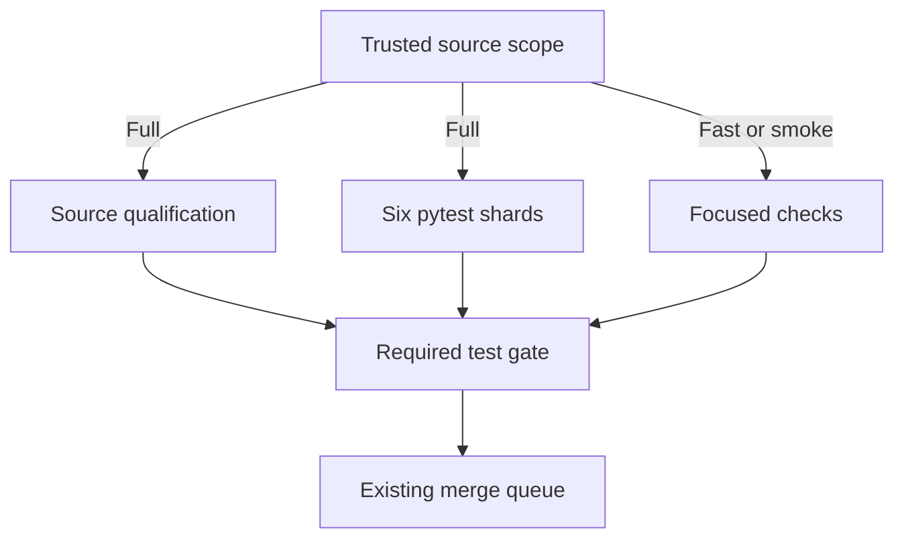

# MastermindX lightning CI architecture and execution plan

Created: 2026-11-06 America/Vancouver. Execution checkpoint updated 2026-11-07 UTC.
Program: existing Mastermind #917 / #1607, Macro #6351, WS:CI-MERGE-CONTROL-PLANE.
Implementation operation: ci-lightning-architecture-20261107-c2.
Procedure: Mastermind protected master 615146aac6a1b0c0933bc9b815517a2fd285ed4a,
Skillpack mastermind.sol_skillpack.v1 / 1.0.1 / bootstrap 1.
This is a detailed CI extension of P3.O3 / Phase 4 of the existing
[delivery-turnaround task tree](superpowers/plans/2026-11-02-delivery-turnaround-execution.md).
It introduces no new workstream, queue, scheduler, runtime or acceptance owner.

The final **Current execution checkpoint** section supersedes historical execution
statuses below. Baselines, earlier receipts and unachieved acceptance targets remain
explicitly distinguished.

## Outcome and completion criterion

Make ordinary engineering feedback feel immediate while completing full consequential
validation quickly and predictably across Mastermind, macro and mastermind-terminal.
Optimize final source revision to required green, and separately eligible revision to
protected merge. Preserve the exact selected tests, meaningful integration checks,
source identity, current trust boundaries and original product outcomes.

An implementation is complete only after its existing workflow consumes it, a
representative natural cohort demonstrates the target by risk class, required failure
cases remain red, and its source/evidence/rollback are recoverable. A cache hit,
local test, isolated runner canary, green workflow or plan is evidence at its own layer.

## Verified starting point

Read-only source observations at intake:

| Repository | Default revision | Current implementation |
|---|---|---|
| Mastermind | 615146aac6a1b0c0933bc9b815517a2fd285ed4a | Trusted scope -> fast/smoke or six canonical pytest shards -> required test; merge-group scope from merged #2129; same-SHA postmerge reuse and existing ci-profile consumer |
| macro | 72c249a2e1967d1ec6dcf6179a7a8728f3305e44 | Existing semantic ci-plan -> selected ci-pack -> ci-gate; incumbent merge-on-green, proof freshness and adaptive admission |
| mastermind-terminal | dd49fa9bd4746d283bfc12581153463629de2b4e | Three stable required contexts; 12 PR browser shards; merged #1320 avoids duplicate merge-group browser matrix; merged #1324 scopes responsive verification |

The [latest native measurements](https://github.com/mastermindx-market-intelligence/Mastermind/issues/917#issuecomment-6702164981)
report Mastermind merge-group-created to required-green STANDARD/smoke n=8
p50 1m53.5s / nearest-rank p95 3m10s; FULL n=6 p50 40m47.5s / p95 43m57s.
STANDARD merge-group-created to merge p95 was 29m44s, so a fast check is not
necessarily a fast release. These selected cohorts are not a causal speedup experiment.

The [Terminal full PR cohort](https://github.com/mastermindx-market-intelligence/Mastermind/issues/917#issuecomment-6700311570)
has n=4, workflow-created to complete-green p50 57m22s / p95 58m42s.
The ubuntu0 desktop-1 canaries were 16m06s with one worker and 8m08s with
four workers ([four-worker run](https://github.com/mastermindx-market-intelligence/mastermind-terminal/actions/runs/42029519496)),
against an earlier hosted 54m41s comparison. These are one-shard observations,
not matched-source whole-suite or sustained fleet results.

Macro's [FIF split proposal](https://github.com/mastermindx-market-intelligence/macro/pull/10788)
records one pack at 69 minutes while its siblings finished in 10-33 minutes.
Its stale calibration weight was 1,630 seconds. We must not confuse calibrated
model weights with observed wall time. Current proof-refresh scarcity and frequent
check-definition invalidation are independent contributors.

## Architecture decision

Extend the existing GitHub Actions owners with a common contract, not a common
replacement orchestrator. Keep repo-specific suites and required-check names.
Treat every run as five separable costs: admission/queue, acquisition/setup,
selected execution critical path, aggregation, and integration/release wait.

1. **Trusted affected-work planner.** Compute changed paths from exact Git identities.
   Use protected policy, explicit dependency closure and conservative invalidators.
   Missing, renamed, dynamic, ambiguous or incomplete dependency evidence goes full.
   Review risk and sufficient test scope remain separate decisions.
2. **Small deterministic tasks.** Split expensive semantic families at natural test
   boundaries, keep stable ownership and prove exact selected coverage once.
   Balance using current measured durations; preserve serial affinity where required.
3. **Cheap hot execution.** Restore locked dependency caches, avoid repeated installation,
   compile production browser assets once per tested candidate where semantics permit,
   and reuse that immutable build across browser shards. Do not ship test flags.
4. **Bounded parallelism.** Choose shard count and per-shard workers together, accounting
   for total slots, memory, databases, ports and queue demand. More fan-out can be slower.
   Use ephemeral isolated runners only through the already qualified runner owner.
5. **Trustworthy reuse.** Begin with immutable dependency/build reuse. A reusable test
   result must bind exact task inputs and transitive dependencies, runtime/toolchain,
   platform, lockfiles, command, trusted policy, environment inputs and artifact digest.
   Untrusted candidate writes cannot supply trusted qualification. Unknown means miss.
6. **Stable aggregate.** Each existing required context reports for every admitted event.
   It validates planner identity, complete coverage, expected shard outcomes and result
   provenance. Cancellation, omission, wrong source, partial results and unqualified
   cache hits cannot turn it green.
7. **Existing release owners.** Preserve native queues and Macro merge-on-green.
   Reduce unnecessary invalidation at its existing owner, while retaining actual
   integrated-candidate proof. Never add a second lease, retry or verdict store.
8. **Existing measurement consumer.** Extend ci-profile/semantic timing artifacts.
   Measure failure/timeout/supersession as well as successful latency, by class and
   phase. Report queue delay separately only where the native timestamp semantics
   actually establish it; a job start offset also includes dependencies.

## Target service levels (proposals, not achieved results)

The end state is seconds for inert changes and a few minutes for substantive changes.
A ten-minute broad/full path is an interim milestone; it does not close the final goal.

| Measurement | Interim p95 | Final p95 | Required meaning |
|---|---:|---:|---|
| First actionable static/contract failure | Establish baseline | <=60 seconds | Real failure surfaced to author; successful runs are not counted as failures |
| Verified docs/metadata required verdict | <=2 minutes | <=90 seconds | Trusted inert allowlist; no executable/config/consumed-data escape |
| Ordinary bounded source required verdict | <=5 minutes | <=3 minutes | Relevant unit/contracts and affected integration/browser paths |
| Broad/full canonical required verdict | <=10 minutes | <=5 minutes | Complete assigned assurance; no expanded exclusions or renamed scope |
| Queue delay on intended capacity | <=60 seconds | <=30 seconds | Native queue timestamps; dependency waiting separately classified |
| Aggregate after last dependency | <=10 seconds | <=10 seconds | Stable required context verifies completeness and provenance |
| Eligible source to protected merge | <=20 minutes | <=10 minutes | Includes integration candidate and queue wait; separate from authoring age |

These are engineering targets, not promises established by current hardware or suites.
The five-minute full target requires removing current indivisible work, not just
changing worker counts. Report cold and warm distributions separately, plus their
actual mix. Publish p50/p95, sample size, selected coverage, runner class, attempts,
failures and cancellations. At least 30 successive eligible observations per populated
class provide an initial operational cohort, not a statistical guarantee. Small
canaries retain their observed ranges and explicit sample counts. Do not choose only
green, fast or warm runs to manufacture acceptance.

A target is not met if test-step time falls but queueing increases the author's
end-to-end wait, total compute becomes unsustainable, or previously required work
silently disappears. A scope reduction is accepted only when the trusted dependency
contract proves that omitted work is irrelevant.

## Closing the five-minute budget

Five minutes means a **fresh complete required verdict**, including the scheduling
wait on its critical path. It is not the latency of a favorable cache hit. The
following allocations are engineering limits for the next designs; they have not
been measured as achieved.

| Repository | Total scheduling wait | Trusted planning | Checkout/environment | Collection/readiness | Longest fresh execution branch | Aggregate | Total |
| --- | ---: | ---: | ---: | ---: | ---: | ---: | ---: |
| Mastermind | 30s | 10s | 40s | 20s | 190s | 10s | 300s |
| Macro | 30s | 15s | 35s | 20s | 190s | 10s | 300s |
| Terminal, current dev profile | 30s | 15s | 45s | 20s | 180s | 10s | 300s |

Independent qualifications run alongside the fresh test branches, within their
own remaining budget: at most 210s after setup for Mastermind and Macro, and 200s
for Terminal's capture, Python, serial-browser and other mandatory consumers.
Adding parallel jobs does not remove their setup or queue costs. Any compiled
Terminal experiment must pay for cold build and distribution inside this graph.

**Task-size decision:** target at most 90s for an indivisible independently
schedulable unit under the admitted runner class, then use the incumbent planner
to keep each packed execution branch within its row's limit. This does not permit
splitting a shared mutable transaction or dropping coverage. A unit that exceeds
90s requires a source-supported affinity split, legitimate work reduction or a
qualified faster runner before that branch can close.

**Capacity decision:** keep the presently admitted capacity during diagnostic
experiments. Compute the next capacity request from the measured fresh task graph,
including setup and serial affinity; do not activate speculative fanout. Under a
deliberately conditional unchanged-service model, Mastermind's first two complete
inventories require about 52–56 equivalent processes to fit 190s, before load
imbalance. At the existing 24-process limit, that instead requires roughly
54–57% less reported service. These are sizing illustrations, not CPU lower bounds:
fixture sharing, contention, runner class and grouping change elapsed costs.
The later c371 integrated run reports 12,281.310913s, implying about **64.6**
equivalent processes under that same artificial unchanged-service model, or
**62.9%** less service at 24 processes to fit 190s. This source/load-sensitive
observation strengthens the need for measured work reduction and admitted capacity;
it is not an instruction to activate 65 processes.

The latest Macro 318-job candidate accumulated 27,046 seconds in its twelve
pack execution steps, including one failed pack and per-job setup within those
steps. Its FIF kernel subset alone reported 3,905.30s across three commands.
At unchanged observed costs, neither three FIF groups nor twelve broad packs
can explain a 190s fresh execution branch. The full job graph needs constituent
cost attribution and admitted work/capacity changes, not only new weight labels.
The same run's contract-delta step took 773s and remains a separate required path.

Terminal's qualified browser steps sum to 25,905s: desktop 10,237s, tablet 8,280s,
mobile 6,905s and the serial group 483s. Merely redistributing mobile work over
five single-worker shards still gives 1,381s on average under unchanged costs.
The held 7/5/5 topology and the News navigation repair are useful intermediate
work; they cannot be counted as five-minute completion. The 549s capture and
637s Python test steps also need their own closing experiments.

| Existing owner / carrier | Concrete next closing decision | Required discriminator |
| --- | --- | --- |
| Mastermind #2065, ci_pytest / ci_parallel_shard / ci.yml | Preserve green c371 and its 294-case native custody proof; attribute critical-shard numerical work and opaque unittest wrappers. Qualify the opt-in RWE precollection adapter and exact case/outcome diagnostics; extract further qualification branches only when they shorten the measured graph. | Whole selected work, affinity/fixture identity, complete receipts, branch budget and whole-verdict benefit. More pin churn alone is not a closing plan. |
| Macro #10788, run_ci_pack and semantic proof; #6351 / W-SELFHOSTED-BRIDGE for materialization | Replace stale FIF estimates with native observations; obtain per-constituent costs, fetch transfer/indexing evidence and exact selected-pack runtime closure. Profile check_contract_delta separately. | Same logical/semantic work and clean exact-source replay, no planner-sparse shortcut, no budget credit from the obsolete 1,630s estimate. |
| Terminal existing browser/capture/ingest owners; independent #1334 | Keep dev runtime as the accepted full path. Finish the held topology through its original effect; measure actual case/setup/capture costs and qualified runner capacity. A compiled authority canary is a separately gated application dependency. | All original responsive, ownership, entitlement and evidence journeys; cold setup/build costs and the complete required aggregate. |
| Existing runner/admission and release owners | Supply the bounded capacity required by the measured graph, with realistic concurrent demand. | Aggregate queue wait within budget, no starvation of paid Fabric, no trust/isolation regression and a measured rollback. |

A failed budget experiment leaves the target open. It does not authorize raising
resource limits, lowering assurance, excluding slow tests, or counting semantic
hits as fresh full success. First-run, exact-SHA replay, semantic hit and full miss
must be reported separately. The current exact-SHA reuse pilot is deduplication;
the three-minute ordinary-change target must be earned by fresh affected work
until a named semantic task and its complete closure are independently qualified.

## Preserve and integrate the last few days' work

| Existing change | Intake disposition | Next useful action |
|---|---|---|
| Mastermind #2044 six-shard rebalance, #2129 scoped merge groups, #1570 reuse, #2000/fast-ship profiler | Already merged according to recovered source/history | Consume; do not rebuild these owners |
| Mastermind #2065 four xdist workers per shard | Open b3fdd6ada45a48b940666380938862e558170477; conflicted at intake; current recovery below | Reconcile actual live writer; compose current source in original carrier; qualify worker-death and exact completion guard; measure full run |
| Macro #10735 control-plane family split | Open dbd83c93d5b50f18e11057bd19844336859edc92 | Preserve original split and current repairs; resolve only proven current failure/integration |
| Macro #10788 FIF three-way split | Open 8e7a1de816e246cb8a96031284483576769bdc46 | Compose with the chosen worker design and prove selected-test conservation |
| Macro #10658 / #10738 FIF parallelism | Overlapping existing lanes | Reconcile exact owners/diffs; one resulting source implementation |
| Macro #10752 narrowed-pack compaction | Open 4ddd347bb74a1a04d3f608cae698c203b30effbf | Preserve baseline checks and selected work; measure slots saved versus critical path |
| Macro #10770 adaptive proof cap | Merged in latest checkpoint | Observe actual mature-run capacity decisions; no guessed cap increase |
| Macro #10764 manifest-scoped freshness / #10745 replay environment | Existing source lanes with inherited-red/freshness dependencies | #10755 board-cap repair is already merged; preserve #10674 hold, then #10745, then existing-owner refresh of #10735 |
| Macro #10656 authored/refresh admission and #10674 continuation | Existing control-plane work; #10674 original operation26751 uncertain | Preserve uncertain effect and live source; this plan does not replay or replace it |
| Terminal #1320 native browser dedup / #1324 scoped QA | Merged | Preserve current integrated contracts |
| Terminal #1297 trusted docs scope | Intake 6a7137dc; now integrated/published as 689757a5 on the same PR | Consume natural exact-head CI, then prove natural docs PR latency; release-rule read is currently denied |
| Terminal #1306 optional isolated e2e lane | Open a709b18c3bd25e3aaa264fe3236dbda3155733c9 | Qualify trust/isolation and complete matrix before activation; no implicit host install |
| Terminal #1223 weighted 7/5/5 + serial browser topology, trace and timing work | Draft e34862900a09bfbcf124397ffe0db02a4f509a49; unpublished candidate and uncertain create-commit | Reconcile original effect; preserve already-authored on-first-retry tracing, explicit zero-retry traces, per-attempt JSON timings and one-time Node unit discovery; do not reimplement or replay |

## Critical-path evidence and consequences

Direct native job inspection corroborates the existing cohort reports:

| Observed source/run | Component | Measured elapsed | Decision |
|---|---|---:|---|
| [Terminal 42302235414](https://github.com/mastermindx-market-intelligence/mastermind-terminal/actions/runs/42302235414), mobile 2 | Playwright test / whole job / npm ci | 3298 / 3345 / 17 seconds | Test execution is 98.6% of this job. Prioritize browser/runtime/fixture work over another dependency cache. |
| Same Terminal run | Unit job / current-checkout capture / Vitest | 1013 / 544 / 285 seconds | Capture and Vitest account for 81.8% of the unit job. Browser-shard tuning alone leaves a roughly 17-minute constraint. |
| [Mastermind serial run 42331481657](https://github.com/mastermindx-market-intelligence/Mastermind/actions/runs/42331481657), shard 0 | Whole job / pytest / native application custody | 2131 / 1437 / 373 seconds | The serial qualification prefix must be included in the graph, not hidden inside pytest averages. |
| Same Mastermind run, shards 2 / 3 | Pytest | 1655 / 1683 seconds | Broad serial execution is still expensive across several shards. |
| [Mastermind xdist candidate 42202096909](https://github.com/mastermindx-market-intelligence/Mastermind/actions/runs/42202096909), head b3fdd6ad | Shard 0 whole / pytest / custody / private HTTP compatibility | 1650 / 956 / 382 / 125 seconds | Four workers improve the pytest part, while qualification before pytest dominates the remaining tail. |
| Same xdist candidate, shard 2 | Whole / pytest | 1330 / 1226 seconds | The longest test granules still need work. Other shard jobs were 620-998 seconds. |

These different runs are observational comparisons with potentially different source
and load. They do not establish a controlled causal speedup.

For a workflow DAG, measure queue + setup + collection + the actual dependent
execution path + aggregation. Concurrent job durations are not added to estimate
latency; their sum is compute consumption. Conversely, a serial prefix and its
dependent shard cannot be treated as parallel.

### Amdahl and test granularity

The historical 788.9-second capacity-artifact module imposed a 13m09s constraint
while it remained one unchanged unit under xdist loadfile. The [xdist distribution
contract](https://pytest-xdist.readthedocs.io/en/stable/distribution.html) keeps all
tests in one file on one worker. The current execution slice has physically split
that module into twelve coherent files while preserving all 466 cases. This removes
that particular indivisible unit; it does not establish a five-minute full run.

Macro's old 1630-second FIF unit divided perfectly into three remains approximately
9m03s per sibling before setup. The observed 69-minute pack also shows that
calibration, nested execution or fixture behavior differs from that old estimate.

The next optimization must therefore do one of the following with evidence:
remove repeated deterministic fixture construction, shorten legitimate individual
test work, separate independent fixture-affinity groups, or place the same work on
qualified faster capacity. Increasing timeouts or deleting assertions is not an
optimization. Parallelism is bounded by:

`concurrent runs × jobs per run × workers per job`

Choose all three together. Reserve capacity for the existing merge/admission path
through its current owner. Do not create another reservation service.

## Repository implementation design

### Mastermind: remove repeated collection, long units and serial qualification

Existing source owners are `scripts/ci_pr_scope.py`,
`scripts/ci_parallel_shard.py`, `scripts/ci_pytest.py`,
`scripts/ci_pytest_timing.py`, `scripts/ci_xdist_guard.py` in #2065,
and `.github/workflows/ci.yml`. Keep the required `test` aggregate and the
accepted #2129 trusted merge-group scope.

1. Finish qualification in #2065's original source carrier. The nine independent
   source qualifications now run beside the six pytest jobs. Capacity tests are
   physically partitioned; the native custody pytest bundle uses four processes.
   Preserve current source, security checks and explicit release holds. The current
   fixed-budget candidate is natively green; its 18m48s verdict is not speed acceptance.
2. Qualify **four independent prepartitioned pytest processes inside each existing
   outer job**, using `ci_pytest.run_shards`. The current xdist workers each collect
   the same outer shard before distributing its tests. Partition whole modules
   before interpreter startup so each process collects its own subset. Keep six
   outer jobs and four actual child interpreters: do not nest four xdist workers
   inside each of four processes. Use an independently domain-separated inner
   partition, exact cover checks, private child diagnostic directories and complete
   terminal receipts. The detailed contract and failure cases are below.
3. Treat source qualification as a separate measured critical path. The published
   change removes it from pytest shard 0, but its own serial chain is still longer
   than five minutes. After the collection experiment, qualify independent native
   Actions qualification jobs only where their source/fixture inputs are separable.
   Deliberately advance the aggregate and exact postmerge job-set contract together.
4. Use the now-complete runtime timing inventory to select remaining expensive
   modules and setup/import work. Split coherent affinity groups, shorten redundant
   legitimate fixture work, or qualify faster capacity. A fixture-template cache
   was measured and rejected: it produced no whole-module speedup. Do not resurrect
   it, cache admission outcomes, or infer production Git-batching safety from it.
5. Recalibrate after collection and granularity changes. Compare fixed-budget native
   candidates before increasing the matrix. Include contention, queueing, cold
   setup and first-attempt success. Only then choose a measured combination of work
   reduction and additional qualified capacity that can satisfy the full target.

The accepted architecture decision is a staged experiment, not a forecast that
prepartitioning alone will reach five minutes. The prior native run reports
10,383.657 seconds of test service. At 24 equivalent processes and unchanged
service costs, perfect balancing alone still takes about 433 seconds before
collection/setup. Both wasted work and the remaining compute budget must change.

### Macro: smaller semantic units and less unnecessary reproof

Keep `scripts/ci_pr_scope.py`, `scripts/run_ci_pack.py`,
`scripts/ci_semantic_proof.py`, the existing `ci-plan -> ci-pack -> ci-gate`
workflow, and `scripts/merge_on_green.py` as the owners.

1. Reconcile the overlapping FIF worker proposals (#10658/#10738) and the
   three-way split (#10788) into one source progression. Apply #10735's independent
   control-plane family split and #10752's narrowed-plan compaction without
   losing baseline check identities or selected logical jobs.
2. Use the already available exact-head native split run: FIF kernels took 957.34,
   1644.98 and 1302.98 seconds. Attribute constituent costs, especially the second
   sibling, and the 211/419/432-second checkout steps. Do not tune against the
   obsolete 1630-second estimate or rerun just to rediscover these coarse timings.
3. Split again at genuine independent or fixture-affinity boundaries whenever the
   longest group exceeds the required budget. Preserve ordered/serial state
   dependencies explicitly. The planner must assert every selected unit exactly
   once, including after compaction, fallback and empty/narrow changes.
4. Complete the existing manifest-scoped freshness and replay-environment work
   (#10764/#10745), so irrelevant changes do not invalidate unrelated proof.
   Definition, command, environment and dependency changes still invalidate it.
5. Complete #10656's existing authored/refresh admission programme through its
   original owner. Main admission remains OFF until its actual producer, consumer,
   fairness and cutover acceptance is established. #10674 operation26751 remains
   uncertain and is not retried or replaced by this plan.

Batch compatible check-definition changes for integration, then calibrate. Repeated
global definition changes followed by repeated proof refreshes waste the very
capacity the execution changes are intended to free.

### Terminal: complete existing topology, address capture, and qualify build reuse

Keep `scripts/ci_e2e_scope.py`, `terminal/playwright.config.ts`,
`terminal/e2e/globalSetup.ts` and the existing workflow/aggregate. Preserve
`Quote Hub tests`, `Terminal typecheck + tests`, and
`Ingest + signal-layer tests` as required contexts.

1. Reconcile #1223's original create-commit uncertainty before further publication
   of its unpublished composed candidate. Its trace policy, attempt reports,
   weighted 7/5/5-plus-serial topology and Node-test discovery repair are already
   authored. #1297's trusted docs lane must compose with the merged #1324 selector.
2. Measure individual slow tests, repeated navigation/warmup, retries and server
   compile time using the existing #1223 timing output. Use weights appropriate
   to runner class and worker count. Keep known serial Company Intelligence and
   other dependency chains intact until isolation is demonstrated.
3. Profile the unit job's 544-second capture separately from its 285-second Vitest
   execution. Preserve required evidence consumers and exact-source identity.
   Reuse same-candidate capture outputs across consumers where valid; only select
   fewer capture journeys after proving the impacted-journey contract.
4. **Keep dev runtime as the accepted full-suite path and budget against it.**
   Protected source does not yet provide a coherent compiled fixture identity.
   The proposed compiled authority/owner canary uses the existing Supabase and
   Macro billing authorities with isolated test data. It receives no speed credit
   until its real environment and complete parity are qualified; details follow.
5. Treat test fixture build inputs as a distinct, nondeployable artifact class.
   Keep localhost binding, deterministic fixture data, explicit identity, no live
   credential/provider requirement, and production auth refusal tests. Do not
   widen production's development-only bypass to obtain a faster test. If safe
   production-build parity requires application changes, retain the dev-server
   lane until those are qualified.
6. Compare one controlled shard with identical tests/source under both runtime
   modes, then the complete selected matrix and required aggregate. Browser
   version, fixture/build digest and environment must travel with the artifact.
   Zero-retry evidence jobs retain their deliberate failure trace.
7. Expand #1306 only through its actual isolated runner trust and capacity owner.
   Measure the whole matrix under realistic concurrent demand; the 8m08s canary
   does not prove an 18-shard fleet will achieve that time.

[Playwright's trace guidance](https://playwright.dev/docs/trace-viewer) supports
on-first-retry CI traces. That recommendation is already embodied in #1223; it is
not a reason to author another trace change. Its [CI guidance](https://playwright.dev/docs/ci)
also makes worker count a resource/stability decision, not a universal maximum.

## Common evidence contract and reuse boundaries

This is an additive contract for existing planner/proof/timing artifacts. It does
not introduce a new daemon, registry, scheduler or authoritative database.

| Evidence component | Must bind or establish |
|---|---|
| Source and policy | Repository; PR or merge-candidate SHA; trusted planner/policy revision; verified diff base |
| Selected work | Required task/group identities; test/helper/config/data closure; serial affinity; expected partitions |
| Execution identity | Exact command; dependency locks; runtime/toolchain/browser; OS/architecture; material nonsecret environment inputs |
| Input/build artifact | Content digest; producer source and trusted provenance; fixture mode; compatible consumer; nondeployable test marking where applicable |
| Test outcome | Attempt and runner identity; complete collection/execution; success/failure/cancel state; coverage membership; completion evidence |
| Reuse validity | Matching relevant inputs; trust namespace; accepted freshness rule; policy eligibility; miss reason when unverifiable |
| Performance | Queue/setup/collection/execution/aggregate times; retries; cold/warm state; total compute; source class |

Artifact reuse accelerates a fresh test. Result reuse substitutes an already
qualified assertion and needs the stronger identity above. A passing PR proof is
not automatically proof of a different integrated merge candidate.

Use the accepted trusted merge-group selector and the current repository-specific
composition contract. GitHub's [merge queue](https://docs.github.com/en/repositories/configuring-branches-and-merges-in-your-repository/configuring-pull-request-merges/managing-a-merge-queue)
checks the candidate containing current base and preceding queued changes. Preserve
Terminal's accepted removal of duplicate browser fanout while accurately stating
what its merge-group checks establish; add only the specifically owed composition
proof, not the old blanket matrix by default.

Candidate code cannot select a weaker classifier for itself. Unknown dependencies,
renames, policy changes and incomplete analysis expand validation. Missing,
cancelled, wrong-source or unexpectedly skipped selected work cannot satisfy the
aggregate. A cache hit cannot override an observed failure.

Start result reuse with one deterministic, hermetic task in shadow mode: compare
its reuse decision with actual fresh execution before letting it satisfy an
existing required check. Invalidate on a test/helper/lock/config/runtime/environment
change, evidence tampering or trust mismatch. Preserve the existing broader-run
fallback and rollback at the same owner.

The prior [Vercel CI research](https://vercel.com/blog/introducing-vercel-ci)
provides a useful task-graph/cache/per-task-compute pattern. Its vendor performance
claims are not MastermindX measurements. Adopting a new external CI platform is not
required for this plan and is not authorized by an architecture analogy.

## Falsifiers, rollout and rollback

The strongest counterargument is that narrow selection or proof reuse can hide
dynamic dependencies or interactions between individually passing changes.
The architecture fails qualification if:

- A helper, fixture, lockfile, configuration or policy change incorrectly leaves
  affected work out of the plan or keeps a stale result eligible.
- A candidate changes its own classifier and thereby reduces its required work.
- A selected shard is absent/cancelled/duplicated and the aggregate still passes.
- Individually passing changes violate an owed integrated-candidate behavior.
- A full audit finds a selection false negative.
- Additional fanout improves an isolated test while worsening end-to-end p95 or
  completed delivery throughput under representative load.

Use focused negative tests for these failures, then existing full CI and the real
PR-to-integration path. Keep first-attempt pass rate and retries visible; do not
use retries, longer timeouts or exclusions to hide regressions.

Roll out one material execution dimension per interpretable canary. Preserve the
previous trusted planner/worker/runtime setting for source-level rollback. On
bad selection or invalid proof, fall back to the broader canonical run. On runner
or performance regression, restore the previous admitted execution topology.
Rollback does not replay an uncertain operation or resurrect a stale proof.

## Ordered execution tree

These IDs extend the existing Phase 4 CI work, and are editorial source nodes only.

| ID | Deliverable | Dependency | Acceptance |
|---|---|---|---|
| P4.L1 | Reconciled architecture, current cohort, source/collision map | Current source and #917 evidence | Exact citations and separate observed/forecast/held states |
| P4.L2 | Finish existing parallelism/pack/fast-scope implementations | Original custody and current source | No duplicate PR; actual exact-head coverage and runtime measurements |
| P4.L3 | Terminal browser build/setup critical-path slice | Current workflow/config and no overlapping writer | Same user journeys against immutable candidate; focused failures stay red; real hosted canary |
| P4.L4 | Remove hot Mastermind test/setup overhead | Current measured heavy modules; L2 compatibility | No cached security outcomes; unchanged assertions; Linux proof |
| P4.L5 | Macro duration calibration and split/compact reconciliation | Existing logical-job owner and L2 | Every selected job exactly once, current weight evidence, bounded maximum pack duration |
| P4.L6 | Trusted task-result reuse pilot in incumbent planner | Input contract + deterministic hermetic task | Shadow equivalence first; tamper/environment/dependency changes miss; no false green |
| P4.L7 | Qualified runner economics and execution capacity | Full isolation/trust/capacity canary | Whole-matrix benefit, no starvation of Fabric, rollback through same owner |
| P4.L8 | Natural-cohort acceptance and closed migration | Previous slices | SLO distribution, unchanged coverage, failure/freshness behavior, recoverable rollback |

Execute source-disjoint ready work now. No new CI run merely to produce activity;
use natural candidate validation and actual changed-source canaries where needed.
No merge, approval, runner activation or publication of held operations is inferred
from this plan. Source edits and qualified ordinary PR publication are in scope.

## Initial execution record (historical)

Architecture/planning and non-overlapping source investigation are assigned to the
current session. Native child advice is C3 architecture judgment only. Routine
bounded source labor uses admitted paid Fabric where useful, with one original root,
true parent, stable child ID and retained result; principal direct work requires a
recorded whole-cycle reason. No post-turn execution is promised without real START
and a supported return path.

Current execution: the existing Mastermind #2065 original workspace was
integrated with master 23c9b011e30a4acc6892a59d67a629f74b07a491 after confirming
clean tracked source, exact old head and no observed active handles/index locks.
Six actual test-source conflicts were reconciled. The canonical native stage
builder reproduced the composed 107-member manifest and source inventory
byte-for-byte (manifest 8a7e89dd92cd4c8252ac03188670985f9d76d498a8710a120b1a8a5adfa25cb7).
A new frozen remote-cwd predecessor test exposed one additional observer-preimage
composition mismatch. Its authentic historical observer bytes were restored in
the disposable fixture; the frozen expected digest remained unchanged.

**Published original-branch integration:** [433105846b4d9698d89cffbb54516f51069edacc](https://github.com/mastermindx-market-intelligence/Mastermind/commit/433105846b4d9698d89cffbb54516f51069edacc),
parents b3fdd6ad and 23c9b011, ordinary non-force push with exact GitHub readback.
The same PR now reports mergeable=true. The workflow difference against the
integrated base is still only the four-worker argument; #2129 scope is preserved.
This is principal integration (PRINCIPAL_JUDGMENT / CRITICAL_PATH_SHORTCUT).

**Qualification:** initial 13-file four-worker local batch completed with failures,
not a pass. One was the newly repaired frozen fixture. The other reported failures
were sparse-Git observation refusals; a traced representative returned Git exit0
with a sparse-index expansion warning on stderr. The same representative fails on
unchanged 615146aa source in the separate managed workspace. No warning was ignored
and no production guard was relaxed. The final repaired Go stage and native support
composition selection passed **71 tests, zero failures/errors/skips**, JUnit time
3.651 seconds on macOS Python3.14.7. This is focused local evidence, not full Linux
qualification.

The natural new-head required CI is [42340989000](https://github.com/mastermindx-market-intelligence/Mastermind/actions/runs/42340989000);
shadow CI is [42340989046](https://github.com/mastermindx-market-intelligence/Mastermind/actions/runs/42340989046).
Both were pending at source readback. The earlier green head is not reused to
claim qualification of this integration. No release request has been issued.

### Terminal original-branch integration

[Terminal #1297](https://github.com/mastermindx-market-intelligence/mastermind-terminal/pull/1297)
is now published at [10230a0bf622da83b6acd6c2d9bb2134e9593918](https://github.com/mastermindx-market-intelligence/mastermind-terminal/commit/10230a0bf622da83b6acd6c2d9bb2134e9593918),
parents 6a7137dc and protected dd49fa9b. The original clean workspace was first
reconciled to its bot-created remote merge, then the two selectors were composed.
Two explicit conflict sites and duplicate YAML needs/if/env keys were resolved;
five paths differ from the current protected source. Original #1223 and #1306
source/effects remain untouched.

The docs selector is an optional optimization: an invalid/failed selector runs
ordinary validation. The independent browser selector is mandatory for all events.
Only a successful, exact docs classification on an actual pull_request can excuse
the intentional unit/browser skips. The accepted merge_group browser skip remains.
The stable aggregate checks both selectors and required job outcomes, and explicitly
fails cancellation; missing, failed or unqualified skipped work cannot pass it.

Executed qualification: **207 Python tests passed in 18.98s**, including actual
aggregate-shell truth cases, existing scope/matrix contracts, recursive duplicate-key
checks and cancellation behavior; **10 TypeScript guard tests passed**. No timeout,
test exclusion or required context was weakened. The natural exact-head run is
[42342421881](https://github.com/mastermindx-market-intelligence/mastermind-terminal/actions/runs/42342421881).
Both selectors passed and all expected native jobs were admitted at readback.
Full browser qualification and actual docs-latency acceptance remain pending.

The connector's Terminal branch-protection read returned **403, Resource not
accessible by integration**. That action is stopped; no alternate-account/carrier
replay was attempted. The pre-integration formal review is not claimed as review
of this new source. No new queue or merge request was issued.

### Macro dependency correction

The old #10735 run's board-headroom failure was real at its tested source, but
[the existing #10755 repair](https://github.com/mastermindx-market-intelligence/macro/pull/10755)
already merged as d7843f7f on November 5. Current main c0f0597e has
DISPLAY_BOARD_CAP=640. Do not recreate the repair or describe 480 as current main.
The repair's historical cost estimates are not new VPS runtime qualification.

The source-linked order in
[#10735's owner disposition](https://github.com/mastermindx-market-intelligence/macro/pull/10735#issuecomment-6656361530)
therefore reduces to: preserve/reconcile the existing #10674 held source/effects;
qualify #10745's replay environment through its existing release owner; let the
incumbent update-branch/sweeper reprove #10735 on the resulting base. #10674 currently
remains merge-blocked; its old operation26751 uncertainty is not cleared by a newer
visible branch head. No duplicate cap repair, queue request or rerun is authorized
by finding a stale failure.

### Audit adjudication and next performance slice

Both paid audits returned terminal rc0 with root verified and complete response
bytes consumed. These are research returns, not formal GitHub approval or hosted
performance acceptance. Native C3 advice addressed prioritization and isolation
only; it performed no source mutation.

- **Mastermind audit:** ci-lightning-mastermind-hotspot-audit-20261107-c2-01,
  response SHA256 64b507a2109331a75b795148d361e4195ddebfb5eff41d912c3605907153e5a6.
  The pinned timing artifact directly confirms 788.9s for
  tests/test_capacity_host_artifacts.py. The worker reports 24,846 Git subprocesses
  in its local baseline and 8,584 after three combined proposals; local wall falls
  41.33s to 36.94s. Its approximately 300s hosted forecast assumes spawn latency
  fitted to the old timing and is **not a measured hosted result**. Both local
  variants retained 138 failures, so zero outcome divergence is not full assurance.
  The complete audit return was accepted by manual_result_review with the exact
  response digest above; that receipt does not accept the proposed source patch.
  Accept the diagnostic hypothesis and a fixture-only experiment. Defer both
  production batching proposals until their filesystem-change, path/object,
  malformed-output, refusal-order and tamper semantics have direct qualification.
- **Terminal audit:** ci-lightning-terminal-runtime-audit-20261107-c2-01,
  response SHA256 5693da53b5eba5e7337243586acea8c0bc0136b1f614bece787c776685a32837.
  Its dev-only auth and existing-writer map are useful. Its claim that a passing
  first-retry trace is removed is **rejected**: the
  [Playwright contract](https://playwright.dev/docs/api/class-testoptions#test-options-trace)
  records and keeps that retry. Its assertion that adding seven routes leaves
  every shard's total compile work unchanged is also unproved, especially for
  focused shards. Do not implement blanket warmup additions from this report.
  This return is not accepted as a complete correct performance recommendation.

Direct parent inspection fills part of the Terminal audit's missing evidence:
[mobile-2 job128182990557](https://github.com/mastermindx-market-intelligence/mastermind-terminal/actions/runs/42302235414/job/128182990557)
reports **14 warmup routes in 12s**, **368 passed /115 skipped in 55.0m**, and no
flaky/retry count. Slow files include news-flow-responsive (6.3m) and
options-companion (5.8m). This run does not support warmup as the dominant cost.
Its startup also executes Node-test diagnostics before the Playwright run; the
already-authored #1223 discovery repair remains material. The unit job's
current-checkout capture decision reports full-pr-proof despite zero drifted
files; preserving its assurance while reducing capture/setup remains a separate
design task. Do not claim unmeasured route or trace savings.

The fixture-only child and its parent experiment are now terminal; see the current
checkpoint below. Its principal-owned integration workspace remains at base
7fee845723c44dafe1e9e1159058ad9bd3f3e06b with no candidate published. The experiment
did not demonstrate a whole-module wall-time improvement. Production batching
remains deferred under the safety and measurement requirements above.

Posting a PR status comment was rejected by automatic approval review because
explicit permission to message others was absent. That comment is not retried or
repackaged. Source authoring and qualification continue independently. No source
merge, runner activation or product acceptance is claimed.

## Current execution checkpoint — 2026-11-07 UTC

### Published source, proof and release state

| Carrier | Exact source or evidence | Observed outcome and remaining gate |
| --- | --- | --- |
| [Mastermind #2065](https://github.com/mastermindx-market-intelligence/Mastermind/pull/2065) | Published head **c85441b0d717ca8a429672d87e820aae2ad95f9c**, tree `71cb15cadbcb8abd2c441c4232a2e1b6322d84da`; exact module case/outcome companion plus bounded actuator-test failure codes | **473 passed** in one final local invocation. Prior 6659 required **FAILURE, 28m09s** and serial **SUCCESS, 45m43s**. New [required 42385010390](https://github.com/mastermindx-market-intelligence/Mastermind/actions/runs/42385010390) and [serial 42385010193](https://github.com/mastermindx-market-intelligence/Mastermind/actions/runs/42385010193) were queued at first readback. Actual new-head native parity, actuator cause and independent gateway Release HOLD remain open. |
| [Terminal #1297](https://github.com/mastermindx-market-intelligence/mastermind-terminal/pull/1297) | Accepted merge **90ddc1390e89f60677a55ed854e8368accbc252d**, merged 10:25:31Z; original head `689757a5…` | **MERGED; DO_NOT_REDO.** Its native run 42344305342 was green in 64m13s. The session's earlier rule-read 403 remains a closed capability; it did not prevent an independently authorized receiver's accepted merge and must not be presented as an open source-delivery gate. |
| [Terminal #1334](https://github.com/mastermindx-market-intelligence/mastermind-terminal/pull/1334) | Accepted merge **81ff9cb82bc90e166746802b83ed9daa0df4a97c**, merged 12:47:04Z; spec blob `8e637f42f188ac0d2048586ac1b75a3778f6aded` | **MERGED; DO_NOT_REDO.** Native PR run 42364524142: **SUCCESS, 55m20s**, all 19 jobs, including one flaky tablet J1 journey. Exact merge-group run 42372715075 succeeded. Retained trace proves first-link context loss; the independent repair is published as #1338 below. Neither green nor merge proves the five-minute target or zero-retry reliability. |
| [Terminal #1338](https://github.com/mastermindx-market-intelligence/mastermind-terminal/pull/1338) | Published head **030c84c98944a6d4c145695e7aeda5bd32eac015**, based on accepted 81ff; three-file first-link context repair | Actual initial-render red proof; **116 unit tests**, ESLint and full typecheck pass. Original browser suite: **60 selected, 22 passed, 38 expected skips**, zero failures/flakes/retries, all three original viewports and 15 retained crops. [Native 42382143589](https://github.com/mastermindx-market-intelligence/mastermind-terminal/actions/runs/42382143589) remains pending; local proof does not establish hosted speed or release. |
| [Macro #10825](https://github.com/mastermindx-market-intelligence/macro/pull/10825) | Accepted merge `efdf3577bb35607bb02a4a0a1900adb91a3784c6`, observed at 08:42:15Z; preceding source `d49837ea333bfef114466139d410ee217ed1c999` | **MERGED by the existing delivery process.** Preserve as accepted work. The session did not issue its merge, label or queue action and will not reuse its completed branch. |
| [Macro #10788](https://github.com/mastermindx-market-intelligence/macro/pull/10788) | Published original carrier **eb3077311d4e819a26c04466774c76bd68db9a5c**, parents 7bb and accepted b481; accepted #10834 composed plus test-only NBBO contention repair | Prior native run **FAILURE, 64m48s**: canonical aggregate **320 jobs / 690 passed steps / one pr_regression / one unknown / zero infrastructure**. Current local: **231 passed + 110 subtests**, **252 routing passes / two sparse skips**, **30 commodity DOM journeys** and presentation proof. [New CI 42385192083](https://github.com/mastermindx-market-intelligence/macro/actions/runs/42385192083) created; native aggregate and acceptance owed. No queue or protected merge. |
| [Macro #10827](https://github.com/mastermindx-market-intelligence/macro/pull/10827) | Preceding continuity checkpoint **17cfd29c27497a968fbf45c8b4e0f9909703da94**, workstream blob `bc0b3408a10266f245d39778472c43af94d0c935`; this milestone continues the same follow-up | Registered follow-up from accepted efdf; last published validation **0 errors**, 193 existing warnings, 2,205 records. Preserve all other waves and global next action. The older unpublished local commit and release-rule GET 403 remain separate. |
| [Mastermind #2191](https://github.com/mastermindx-market-intelligence/Mastermind/pull/2191) | This architecture carrier; preceding checkpoint **01a4bf1ac0e0001bb674cc696fd98710dae1b91f** | Source-backed master plan, published case evidence, Terminal context repair, Macro composition and measured next performance boundary. Normal integration and full program acceptance remain owed. |

The protected procedure pin `615146aac6a1b0c0933bc9b815517a2fd285ed4a` remains
compatible through protected master `7ccb72a1f751f8012190a7deda90ea7ec1db1ecb`.
The bounded comparison found no change in AGENTS, sol_skills, session review,
delivery workflow or active-execution law, or the owned CI/capacity/gateway paths.
Three later accepted commits changed product/COO/workspace code and corrected the
Brain fixture’s source input. A real conflict in that fixture blocked natural PR
CI, so the existing branch integrated the exact accepted base. All eight
precollection implementation blobs remained unchanged through that merge.
The subsequent accepted Hermes/Workbench commits added five canonical modules
and expanded two existing case sets; they did not change the governing law or
owned CI/capacity/gateway-publication implementation. The native d6f run consumed
that newer base through its exact event-source merge; its historical corpus and
pinned Macro checkouts remain separate identities. The c371 integration later
preserved protected native-admission source `779fc3…`. Seven accepted commits
from that base through `9141013…` change product, provider and Studio workspace
implementation, but not the governing law, owned CI scheduler, capacity tests or
gateway publication paths. The c371 native runs actually executed the merge with
`788cafa8…`; their PR-base API metadata still said `779fc3…` and is not substituted
for the checkout receipt. The next two protected commits, `57a20fc…` and
`4fb0d382…`, change the Dot canary route and Hermes specialist documentation;
the bounded comparison again found no governing-law or owned CI/capacity/gateway
change. The 6659 shard-4 receipt executes native merge
`fe34727abd6f725c4c5a894a05e42a1ce98ff319`, combining that protected base and 6659.
The subsequent ten-commit comparison through 7ccb contains 145 files without a
file-list truncation. It changes product, Hermes, Studio and portfolio source,
including a separate Hermes workflow, but not the governing instructions or the
owned CI, actuator-test and gateway-publication paths. The procedure pin remains
usable; current source growth must still be reflected in native execution identity.

An explicit [Release HOLD on #2065](https://github.com/mastermindx-market-intelligence/Mastermind/pull/2065#issuecomment-6704040875)
requires the gateway successor failure to be diagnosed/repaired and fresh native
proof. Its author was a read-only observer, not a replacement writer. The assigned
session retains recovery ownership. Passing that shard in the later run is useful
evidence, but does not by itself identify the earlier hidden exception or rescind
the hold. Preserve the hold until legitimately resolved; do not invent an approval.

### Source scheduling and exact qualification

Nine formerly serial matrix-zero qualifications now run as a separate **Source
qualification** job alongside six canonical pytest shards. Commands, source pins,
environment bindings and order were preserved when moved. The later native-custody
change first added four-process loadfile execution to its exact eleven pytest
files; the qualified f2eb/c371 follow-up uses case scheduling with `--dist load`.
Its 375-case unittest prefix, trusted fixture parent, one-controller JUnit result,
positive test count and zero-failure/error/skip assertion remain unchanged.

Full scope requires both heavy results successful and fast checks skipped.
Fast/smoke requires successful focused checks and both heavy results skipped.
Protected push and deliberate dispatch retain full qualification. Missing, failed,
cancelled, unknown and unexpected skip states remain red. Source qualification
has contents-read permission and a 30-minute cap; pytest retains its existing
Actions-read permission and 60-minute cap.

The postmerge reuse reader now verifies the actual **ten-job** full-run shape:
six shards, source qualification, scope, required gate and the exactly skipped
empty fast job. It retains exact source/clean checkout, native queue actor,
workflow/attempt, freshness, unique job/step identity and authenticated API checks.
Executed timestamps remain ordered; skipped-fast metadata is bounded to the run
despite GitHub's unusual skipped-job timestamp order. Missing evidence executes
pytest; source qualification remains mandatory even when pytest can be reused.
Native merge-group and postmerge acceptance of this optimization are still owed.

Focused graph/guard evidence: 736 tests passed, two old layout expectations were
corrected and both passed against the same source. This is 738 qualified cases
across the full run plus repair, not a single fabricated green invocation. Gate
tests cover wrong dependency states on PR, merge group, push and dispatch;
mutations reject omitted/conditional checks, serialized heavy dependencies,
additional Actions permission and false-success suppression.

Native source-qualification comparison:

| Measurement | Prior 91d / run 42348719795 | Capacity/qualification 1b / run 42353265679 |
| --- | ---: | ---: |
| 375-case native unittest prefix | 14.022s | 14.725s |
| Same eleven files / 277 native pytest cases | 451.33s, serial | **300.68s**, four-process loadfile |
| Native application custody step | 466s | **316s** |
| Whole source-qualification job | 817s | **684s** |

Both sets of 277 cases had zero errors, failures and skips. These are two actual
native observations, not a controlled cohort or a promised fourfold gain. The
remaining qualification chain includes 151 seconds of private HTTP compatibility,
48 seconds of closed transport and 45 seconds of Brain composition in the newer
run, besides source setup. Splitting that chain is a separate qualified change.

### Capacity module partition: published and natively consumed

Original module blob `b3341d2768bbc21c229bd25d86261cb9d05c3231` contained 167 test
functions and 466 parametrized cases. The candidate moves those functions into
twelve direct children of `tests/`: artifacts, crash replay, failure evidence,
precommit, publication, recovery, repository, retained views, rollback, source
admission, transitions and transport. Shared helpers stay in the original module.

All 167 function ASTs, decorators and parameter values are identical; all 39 helper
definitions are unchanged. Named helper imports preserve the external native
closure consumer. Tests using `__file__` retain the same directory depth; the
canonical-temp test and the V2 test it calls stay together. Darwin custody fixtures
are unchanged. There is no fixture cache or production capacity-code modification.

The complete source checkout discovered 2,284 modules with zero exclusions and
proved exact disjoint six-way membership. The later integrated checkout includes
additional current-base modules; its native selected inventory is 2,289 modules,
with 2,283 runtime summaries and six collection-gated modules. Source identity is
recorded for each measurement rather than treating these corpora as identical.

Paired partial Linux measurements preserve the exact 466-case inventory and outcomes:

| Execution | Wall time | Outcome |
| --- | ---: | --- |
| Original module, serial | 163.326s | 416 pass / 14 fail / 36 skip |
| Twelve modules, serial | 140.703s | Same outcome multiset |
| Twelve modules, four-process loadfile | **54.000s** | Same outcome multiset |

Failure IDs and messages match after normalizing only the exact source-root prefix.
Missing historical source/workflow, nonstandard temporary ancestry and supplementary
groups explain the partial snapshot refusals. These are local comparative results,
not an all-green hosted qualification or a hosted speed forecast.

Native run 42353265679 completed **all 466 capacity cases** across the twelve files.
The longest new capacity module reported **219.600 seconds**; the previous native
single-file unit reported **805.019 seconds**. The new family summed to 1,097.597
reported seconds versus 805.019 previously, so no reduction in total hosted work is
claimed. The split removes a large indivisible scheduling unit under variable load.
All case-start/completion counts match. The entire run remains red for the separate
follow-up-conversation race; this is evidence for this slice, not full acceptance.

The focused complete-host policy/fanin/diagnostic/guard/closure run had 472 passes
and 11 native-closure setup refusals caused by the Mac temporary ancestor's group.
No custody assertion was relaxed. The unchanged native-closure consumer separately
passed all 15 cases on Linux with a valid owned parent. These are distinct receipts.

### Concrete failures repaired or retained

**Original-turn finalization race.** Shard 4 of run 42353265679 failed strict event
equality in `test_signed_consumed_parent_second_turn_original_read_and_no_replay`.
The reply's completion future resolves at `RECORDED`; the [original dispatch](https://github.com/mastermindx-market-intelligence/Mastermind/blob/1b02680617008bd617a5d9be6da09a80b5a54cbf/control_plane/executive_service.py) then
performs ordinary finalization. Its legitimate `OHF_EPOCH_ABANDONED` and
`JOB_COMPLETED` events raced the test's snapshot. No new provider turn was observed.

The [fixture repair](https://github.com/mastermindx-market-intelligence/Mastermind/blob/7a49a75341fbccf7cf3dc4898156718e21fcf38c/tests/test_fresh_conversation_turn.py) captures the original child dispatch task immediately after creation
and awaits it before the duplicate-event snapshot. Exact event-list equality,
same-result, original artifact export, one provider start, two turns and original
job/attempt counts are retained. A new controlled case pauses the real finalizer,
proves the duplicate is strictly read-only while finalization is pending, releases
the barrier, calls the real finalizer and verifies settled original/turn results.
Failure cleanup drains that original task before cancellation fallback.

All **13 follow-up cases passed** with four-process loadfile. The final cleanup
change additionally passed its focused case and a deliberate assertion-failure
probe: the original task completed without cancellation or dispatch error, with
exactly one abandonment and one completion event before teardown. The injected
case correctly failed; it is a failure-path qualification, not a claimed green test.
Production lifecycle and response behavior are unchanged.

**Gateway successor publication.** Prior 91d required run failed
`test_v2_receipt_can_be_next_exact_predecessor_without_rewriting_history`; its shadow
run 42348719763 succeeded. The same gateway module and production owner were
unchanged since the previous green candidate. The production wrapper correctly
hides post-marker errors behind `TransactionEffectUnknown`, retaining context.

The candidate adds bounded fixture-only diagnostics that rethrow the identical
exception: at most eight cause/context nodes, known-source function/line frames,
closed validated observation notes, cycle protection and a fixed fallback note.
It does not expose arbitrary exception payloads or modify production refusal.
Six focused diagnostic checks passed. All 24 existing gateway test function ASTs
remain unchanged; their parametrized native module's 60 cases passed in run
42353265679. An earlier Mac diagnostic passed the first two cases, including the
previous failure, then was deliberately interrupted; it was not a full green suite.

A narrow shared-repository-parent race during initial custody observation is a
source-supported hypothesis, not the proven earlier cause. The reader's later
prefix checks already tolerate ordinary child-entry changes. Do not weaken its
production identity/ACL checks or declare the Release HOLD cleared from a rerun.
Consume bounded context from any subsequent real failure and reproduce the actual
mechanism before a fixture-isolation repair is accepted.

**Consumed realm input and protected integration.** The earlier 7a source advanced
its extra live realm pin after protected #1824 changed that live module. That
composition passed 23 paired tests and later native qualification; the historical
preimages remained fixed. Protected master `064a08b2…` then corrected the fixture
contract itself: `application_http_sources()` actually selects the retained
`source/codex_provider_realm.py.preimage`, not the current realm file.

The b440 merge adopts the [accepted translation fixture](https://github.com/mastermindx-market-intelligence/Mastermind/blob/064a08b2c6360ece12999f1d7f2d712062ea0636/tests/integration/test_fabric_translation_composition.py)
verbatim, blob `b3e00e1c3d507dc276f0f24d40e0665448f1e18a`. It pins historical
realm blob `eeea4c0fafc7e6df5c534c731cb6046bbe4d3f37`, retains the live protocol
and filesystem pins, and removes the superseded live-realm pin/comment. The
[builder](https://github.com/mastermindx-market-intelligence/Mastermind/blob/064a08b2c6360ece12999f1d7f2d712062ea0636/ops/native_fabric/quota_continuity/rollout/build_review_stage.py)
refuses missing, symlinked or nonregular selected inputs; the projection verifies
exact SHA-1 and SHA-256. No fallback to a different live input was introduced.
All **23 enabled paired translation cases passed** on the resolved tree with exact
Macro `f0375acf4ba076718e7cb420ed28ab61fb0a4f26`. The earlier installed Codex-binary
digest refusal remains a distinct real local limitation, not a changed assertion.
Impact planning must distinguish retained evidence inputs from current runtime code.

The earlier CLI metadata repair changes only eleven parametrized IDs; the
131,073-byte input and assertions are unchanged. All 99 tests passed locally;
the old Linux E2BIG condition was reproduced and the shorter ID avoided it.

### Fixture experiment disposition

Paid child ci-lightning-mastermind-fixture-impl-20261107-c2-01 returned a complete
candidate and report, then terminated with rc 1 with provider_error/unrecognized_model
for MiniMax-M3. Root lineage was verified; this is not a successful worker return.
Response SHA256:
94aa09b2bdc28349cbda24c650d9785ba6bcb092a0a52d47f9042762f113f58b.
Patch SHA256:
de0b7c446b79e2d9292a6a4e2d5c4fa6b9a5706fc93e621c669adb4e4778c42e.
No retry or replacement dispatch was issued.

The parent independently checked the exact fixture candidate
db267ebbbc2d1c593fa16fc3b00c5bce5e1c85c244401527e8a33413d5913296.
All 167 existing test functions retain identical ASTs; the three new isolation,
pre-initialization and no-Git-on-copy checks pass. A private Linux parent was
verified against the actual custody guard before benchmarking:

| Run | Cases | Pass | Fail | Skip | Whole-module wall |
| --- | ---: | ---: | ---: | ---: | ---: |
| Unchanged source | 466 | 415 | 15 | 36 | 148.632s |
| Fixture candidate | 469 | 418 | 15 | 36 | 148.704s |

Failure IDs and messages are identical. The isolated snapshot lacks the workflow
file and historical Git object used by two tests; its nonstandard /tmp topology
and absent supplementary group account for the other failures. This is partial
environmental parity, not an all-green native qualification. Mac baselines also
exposed real custody refusals from temporary-directory groups and home-directory
ACLs. No production permission check or security assertion was relaxed.

**Disposition: do not publish this as an accepted performance optimization.**
Git subprocess reduction and a faster fixture microbenchmark did not produce a
demonstrated whole-module gain. No hosted speedup is claimed. The principal-owned
fixture integration worktree remains unchanged; the experiment does not authorize
production Git batching.

The separate paid preflight-DAG child
ci-lightning-mastermind-preflight-dag-20261107-c2-01 terminated at admission with
rc 75 / EXECUTION_NOT_ELIGIBLE and no qualified source return. It was not retried.
The principal performed the bounded integration in #2065's existing workspace,
using C3 architecture judgment and direct-source self-checks
(PRINCIPAL_JUDGMENT / CRITICAL_PATH_SHORTCUT / LOWER_TOTAL_OVERHEAD). No second
worker, source carrier, runtime route or approval identity was introduced.

### Full timing inventory and the next architecture constraint

Canonical-step logs from [run 42348719795](https://github.com/mastermindx-market-intelligence/Mastermind/actions/runs/42348719795)
at integrated `d31e7ade3d01efab0bb8cc6c50c62c0d6c8a6823` establish:

- **2,276 discovered modules, zero exclusions; 2,270 runtime timing summaries.**
- Every reported module has equal started and completed case counts.
- **10,383.656546 seconds** of setup/call/teardown service, excluding startup and collection.
- Eight supplementary H1 summaries are excluded from canonical workload accounting.

The six gaps are real tests behind module-level import gates: four
`mastermind_window_reader` browser files gate Playwright (two also JWT),
`test_acp_tool_observations.py` gates optional ACP, and `test_risk_prior.py` gates
`brain.risk_prior`, absent at that source. Quiet logs do not identify each failed
import. They have no runtime execution receipt; their import/capability-check cost
is included in collection. Do not call all 2,276 modules executed or assign them
zero collection cost.

| Outer shard | Runtime modules | Reported service | Startup/collection to first case | First case to last module summary | Whole canonical test step |
| --- | ---: | ---: | ---: | ---: | ---: |
| 0 | 402 | 1,393.230s | 196.331s | 438.029s | 638s |
| 1 | 357 | 1,803.163s | 263.354s | 534.525s | 800s |
| 2 | 349 | 1,858.675s | 250.181s | 805.743s | 1,059s |
| 3 | 374 | 1,762.026s | 181.828s | 472.641s | 658s |
| 4 | 379 | 1,658.507s | 258.462s | 441.831s | 704s |
| 5 | 409 | 1,908.055s | 272.184s | 493.272s | 770s |

The newer 1b native run still spent approximately **173–430 seconds before its
first canonical case** depending on shard. Its longest test step was 1,244 seconds;
`test_trend_persistence_walkforward.py` alone reported 553.047 seconds. Other source
and runner load differ, so a capacity-module gain cannot be reported as an overall
pack speedup. Filter logs at the exact canonical command boundary: H1 and the
canonical step can share a rounded API timestamp and otherwise be double-counted.

At unchanged observed service costs, 10,383.657 / 24 gives a conditional **432.65s**
perfect-balance execution floor before collection/setup. This is a planning bound,
not a hardware-independent law: reported elapsed service changes with contention.
A provisional 300-second budget might allot 30s queue, 30s setup, 30s collection,
200s selected execution and 10s aggregation. At that 200-second execution budget,
the old service sum would require about 52 equivalent concurrent processes under
ideal balancing, or roughly 54% less service work at 24. Neither is already
qualified. The next experiment keeps capacity fixed so the collection effect can
be measured before choosing the eventual work-reduction/capacity combination.

### Implemented precollection candidate, inside existing owners

**Implemented:** [19cb8b1](https://github.com/mastermindx-market-intelligence/Mastermind/commit/19cb8b1599e7daa74d35f52eed20c87b5d3db2d2),
then integrated as [b4406a0](https://github.com/mastermindx-market-intelligence/Mastermind/commit/b4406a06d553c1d210d5f5f466290961b5029ee9).
The existing runner now starts four serial children after dividing the outer
selection. Its fixed new inner hash domain avoids the parity trap of applying
`hash % 4` to a `hash % 6` selection. The six outer jobs, selected module policy,
source qualification, final aggregate and separate native-custody xdist lane remain.

Private child caches/diagnostics, exact process/module/case completion receipts,
FIFO and replacement refusal, nested-pytest isolation, descendant cleanup and
controller-exception drain are implemented. Only the four existing diagnostic
JSON leaves are uploaded; raw completion receipts stay private. **37 new Linux
cases passed**, followed by **710 host cases**. A real serial-shadow parser failure
was reproduced and fixed by preserving its old plan record; **386 compatibility
cases passed** afterward, overlapping the earlier suite. These are focused receipts,
not a claim of 1,096 unique cases or native performance acceptance.

The integrated source discovers **2,293 modules, zero exclusions**. The original
implementation preserved all 2,284 old modules’ outer placement; accepted base
changes explain the later inventory increase. The first native trial completed
**2,287 runtime modules / 69,329 case occurrences**. All 2,283 old runtime modules
remain with identical case counts. The 130 added cases are exactly 37 new
precollection cases plus 79/8/6 cases in three accepted-base modules. The same six
import-gated modules have no runtime record. All 24 children produced valid complete
receipts. One old workflow-command expectation failed honestly; its focused repair
retains every H1 custody/aggregate assertion. Exact parameter/mark equivalence and
natural integration/reuse acceptance remain separate proof obligations.

The implementation and its next qualification retain this contract:

1. **Independent inner placement.** Preserve outer membership. Derive inner buckets
   from an explicit new hash domain or independent digest bits. Do not run the
   same `hash % 4` over a subset selected by `hash % 6`: parity would populate only
   two inner buckets. Prove deterministic complete disjoint cover at both levels,
   no empty-selected false success, stable unrelated placement and known pin rules.
2. **Private child outputs.** The current runner inherits one
   `MMX_CI_FIXED_DIAGNOSTICS_DIR` and fixed JSON leaf. Give each child an owned
   directory under the incumbent job root, preserving collision/foreign-file
   refusal and bounded output. Retain explicit supplementary-H1 phase identity.
   Reconcile all child evidence through the existing consumer, not a new registry.
3. **Complete execution proof.** Exit code zero alone is insufficient. Require
   collection/finish parity and a terminal receipt for each selected child. Detect
   import-time exit zero, killed/lost child, partial collection, missing completion,
   duplicate result, wrong source/child identity and controller interruption.
   Wait/reap every child on failure; no silent retry or fallback to a second effect.
4. **Fixture semantics.** Keep each whole module on one interpreter; preserve
   module/class/session scopes at the existing process boundary. Check inherited
   environment, cwd, import mode, subprocess resources, timeouts and cancellation.
   Do not add nested workers or relax admission/security tests to obtain parity.
5. **Same-budget native comparison.** Compare exact case/parameter/mark/skip
   multisets and failure behavior, then setup, first-case latency, execution tail,
   final required verdict and total compute on current integrated source. One
   interpretable candidate, no simultaneous matrix or runner-class expansion.
6. **Promotion/rollback.** Promote only with complete selected work and improved
   end-to-end latency without flake/capacity regression. Restore the incumbent
   xdist topology at the same owner if the qualification fails. This is source
   rollback, not a retry/queue/authority service.

### What the first precollection trial actually changed

The [green 7a baseline](https://github.com/mastermindx-market-intelligence/Mastermind/actions/runs/42355985590)
checked event-source merge **`c66cd096af7dcdf2652ff0b57b4009453810eec9`**. Its first
checkout, `edd30b4686d3aaf358b4ca6ebd9485b04d15751d`, is the immutable corpus
anchor and must not be mislabeled the integrated candidate. The b440 trial checked
**`5d79f75a2d896bfcd26b32c1936adc754c01da1b`**. The rows below use only canonical
step records after the exact command boundary; supplementary H1 work is excluded.

| Shard | 7a startup/collection | b440 startup/collection | 7a test step | b440 test step | b440 result |
| --- | ---: | ---: | ---: | ---: | --- |
| 0 | 229.386s | 114.654s | 722s | 902s | Pass |
| 1 | 172.225s | 65.874s | 587s | 589s | Pass |
| 2 | 378.078s | 99.532s | 793s | 457s | Pass |
| 3 | 261.523s | 66.273s | 850s | 684s | Pass |
| 4 | 200.767s | 97.863s | 590s | 653s | Pass |
| 5 | 277.888s | 80.375s | 781s | 622s | Old command expectation failed |

Collection improved substantially, but the final required verdict moved only from
**18m12s green to 18m03s red**. This is not an accepted whole-pack speedup. Static
inner placement and changing service costs left shard 0 with a **786.683s execution
tail**; its whole job took 968s. Source qualification took 582s in this trial and was
off the critical path. The reported service sum changed from **9,829.741s** to
**10,576.166s** under different grouping/load. Wall service is not a conserved CPU
quantity. The largest trend module moved from 317.808s to 146.577s without a source
change, illustrating why one noisy duration is insufficient calibration.

**Executed follow-up:** d6f21633b corrects the old command expectation and adds
exactly three whole-module inner placements: quota-continuity P–Z from child 3
to 2, executive DR from 1 to 0, and trend walkforward from 2 to 0. They apply
only to four-child inner placement. All six outer memberships, unpinned hashes,
other partition modes, process limits and receipt controls remain unchanged.
The smallest useful set was scored under both observed profiles and their
per-module maximum; its modeled maxima were 579.7s / 619.0s / 623.8s. These are
conditional placement estimates. Six collection-gated modules have no runtime
observation and four new modules had only the second observation.

Focused proof passed **486 tests** with zero failures/errors/skips. The local
source still selected 2,293 modules with canonical digest
`cb1cf36ca210c0ea3dd43a75d14956ca6c8d03495b3743813069b50718d1653a`.
The natural native merge included the newer accepted base and selected 2,298.

### Green placement candidate and remaining critical path

[Required run 42363117005](https://github.com/mastermindx-market-intelligence/Mastermind/actions/runs/42363117005)
passed on exact integrated source **d0816673c522bbc2386a3eccd38940ac30b6c2dc**,
with protected base **93861e9ab2e75176108bb357bd9e81b54307981d**. Its source
digest was `f59a82287d95bbfcba96fb9559cad42aac9f49fc522e6a2fe6b1645602346c1e`.
All 24 planned child digests matched complete terminal records. The 2,292 runtime
modules completed **69,573 case occurrences**; six selected modules retained their
import-time gates. No prior runtime module disappeared. Five new modules add 210
cases, two accepted modules add 28, and the new partition boundary test adds six:
these exactly explain the 244-case increase over b440. Per-module count accounting
supports conservation but does not replace exact parameter/mark identity proof.

| Shard | Startup / collection | Execution tail | Canonical test step | Whole job | Job-created to start |
| --- | ---: | ---: | ---: | ---: | ---: |
| 0 | 51.478s | 397.858s | 456s | 512s | 117s |
| 1 | 48.552s | 431.464s | 482s | 541s | 25s |
| 2 | 66.057s | 325.840s | 393s | 501s | 126s |
| 3 | 68.782s | 630.666s | 707s | 777s | 252s |
| 4 | 70.938s | 530.372s | 608s | 677s | 155s |
| 5 | 76.290s | 511.972s | 590s | 657s | 67s |

Shard 0 improved from 968s to 512s, but the required verdict took **18m48s**,
versus 18m12s for the earlier green baseline. The last dependency finished at
10:32:49Z; the aggregate started at 10:33:07Z and ended at 10:33:22Z. Its 18-second
start delay plus 15-second active duration also exceed the proposed aggregate
budget. The reported service sum was 9,572.312s, with different integrated source,
grouping and load. This observation validates the candidate's execution and
identifies the next bottleneck; it does not establish causal whole-pack speedup.

The current #2065 hold also requires fresh RWE shadow qualification. At d6f,
[shadow 42363117019](https://github.com/mastermindx-market-intelligence/Mastermind/actions/runs/42363117019)
passed in **36m44s**, separately from the 18m48s required verdict. Preserve that
assurance and its realized-environment/receipt owner. Qualifying the existing
shadow execution topology is a separate latency slice; silently omitting it from
release elapsed time or deleting the duplicate-looking run is not acceptance.

**Next main-suite decision:** do not churn inner pins against one noisy run.
Attribute actual heavy work and indivisible wrappers. The largest reported units
include trend walkforward 247.874s, executive SQLite 193.357s, and the native
unittest A–F / G–O / P–Z wrappers at 192.896s / 150.225s / 104.362s. Each wrapper
appears as one outer pytest case while running discovery in a fresh subprocess.
Any finer partition must preserve the complete inner unittest inventory and
process/fixture affinity. Filename overlap with native qualification is not
authority to delete either assurance path.

The wrapper owner is `scripts/native_unittest_diagnostics.py`. Its three closed
routes cover 69 ordinary unittest modules as 23 / 24 / 22, each in a fresh
native-directory subprocess with a 300s limit. Preserve ordinary loader-derived
case multiplicities: generated methods and inherited Grok suites make AST method
counts insufficient. Keep native modules whole for the first measured split,
including class/module fixtures, cleanups, subtests and process-global audit
boundaries. Seven selected files are import-only under unittest; retain them
inside genuine-case groups rather than creating zero-test wrappers.

All 18 modules in the 375-case prelude overlap these broad routes, but their
working directories and process composition differ. The seven pytest-native
modules are imported by unittest without executing their free pytest functions.
The separate rollout and commission wrappers retain their own ancestry, timeout
and assurance contracts. None of this overlap authorizes dropping the independent
375/277 qualifications. The immediate next observation is inner per-module case
service plus separately reported group/import/fixture overhead through the
existing owner, then a measured exact-cover split and stale-pin reconciliation.

### Native qualification granularity: published and natively consumed

The earlier same-source d6f experiment retained all eleven file arguments, four
workers, `--noconftest`, cleared addopts, zero restarts, private fixture roots,
the completion guard and strict positive/zero-error XML checks. Its 375-case
prelude passed in 11.268s. Full phase durations were collected in both modes.

| Native pytest schedule | Result | Local elapsed |
| --- | --- | ---: |
| Incumbent `loadfile` | 277 passed; zero skipped/errors/failures | 263.983s |
| Candidate `load` | Same exact 277-case XML multiset; zero skipped/errors/failures | 224.879s |

That **14.8% local reduction** justified the bounded source change published as
[f2ebf7a5](https://github.com/mastermindx-market-intelligence/Mastermind/commit/f2ebf7a5368db2ccb4e55f9c8d01a1ac9b3ba03a).
The full qualification-step digest is
`a43e71956f27d34917cddcc94863e0948bb1907f15afbf612fbac6f5666a5738`.
A real nested-unittest fixture defect was repaired at the same boundary:
runtime-binding cases now register the inner fixture's cleanup before setup and
teardown after successful setup, preserving unittest's LIFO lifecycle. The former
manual teardown omitted registered cleanups and leaked a worker-local Studio root.
Both new regressions failed before the repair; all seven module cases then passed.

Protected source advanced before native CI could start on f2eb. The original
carrier integrated exact `779fc3…` as **c371**, preserving accepted original-run
recovery and atomic admission together with the existing observer successor.
The staging builder now recognizes exactly two observer-bound full parents,
`815ec3…` and `8a7e89…`, while enforcing the same two-member admission pair.
The actual 107-member manifest/inventory are byte-equal to committed outputs;
combined manifest SHA256 is
`eb74b020c76c70081562d7be69bf8e154d5d7ad50b03381de0bd15ba24b634b7`.
Historical pins, partial/foreign/backdated refusals and caller immutability remain.

Focused staging/admission composition passed **115 cases**, zero skips. A separate
Mac integration run passed 54 and failed 32 sparse-Git composition cases: Apple
Git 2.50.1 returned zero with unchanged context but emitted sparse-index-expansion
advice on stderr, which the existing strict guard refused. That host diagnostic
was preserved; no output/custody check was relaxed. The complete Linux native run
subsequently passed.

The [c371 qualification job](https://github.com/mastermindx-market-intelligence/Mastermind/actions/runs/42369391588/job/128394222188)
completed in **506s**. Its prelude passed **375 tests in 13.769s**; the exact
eleven-file native batch passed **294 cases in 154.36s**, with the parsed XML
recording **zero failures, errors or skips**. Local inventory comparison retains
all original 277 identities and explains the 17 additions: two lifecycle cases,
fourteen protected admission cases, and one foreign-observer refusal. The native
count by itself is not that identity comparison.

The c371 required run finished in **17m28s**, versus d6f's 18m48s, but its runtime
service increased from 9,572.312s to 12,281.310913s and its source/case inventory
changed. All six c371 shards started together; d6f had start offsets up to 252s.
The 80s verdict reduction is therefore not a controlled whole-run speed estimate.

| c371 critical-path observation | Measured value |
| --- | ---: |
| Qualification job | 506s |
| Slowest shard: index 3 | 1,018s |
| Shard-3 test start to first module | 106.355s |
| Shard-3 first module to last child receipt | 846.629s |
| Spread between its four child finishes | 56.706s |
| Trend walkforward module service | 536.277s |
| Executive SQLite / project journey service | 217.303s / 212.771s |

Qualification is off this observed critical path. The separately designed
two-job native-custody extraction would add bootstrap/concurrency and advance the
postmerge proof inventory from ten to eleven jobs; keep it ready, but do not
claim latency benefit while repository execution remains the larger branch.

The next small work-reduction experiment is fixture-local: `staged` in the trend
walkforward tests reconstructs the same expected holdout ten times across three
cases. Build it once per function-scoped fixture and return fresh deep copies,
retaining all ten loader calls and all production comparisons. This can remove
seven reconstructions without sharing state between tests. Preserve all 44 cases,
seeds, horizons, scientific assertions, code/reference hashes and existing
outer/inner placement. Measure setup + call + teardown; no gain is yet measured.

An earlier finite native-wrapper profile completed only A–F: 335 cases, 328 pass,
seven failures, 208.193s. It stopped before G–O/P–Z. These failed observations are
not accepted scheduler weights. Re-derive the wrapper inventory after protected
admission additions; preserve generated/inherited unittest cases, import-only
pytest modules, fixture/audit affinity and intentional assurance overlaps.

### RWE parity and opt-in precollection qualification

The [serial c371 shadow](https://github.com/mastermindx-market-intelligence/Mastermind/actions/runs/42369391486)
completed in **28m30s** on the same actual `cc028bc…` checkout as required CI.
Its six serial gate times were 1,321.52 / 1,221.43 / 1,021.87 / 1,631.78 /
1,315.31 / 1,233.42 seconds. All six selected plans and every runtime module's
start/finish count match required CI: **2,305 selected modules, 2,299 runtime
summaries, 69,827 finished case occurrences**, included digest
`f8d4aedfcdca3b5f22958f7685a7218529b48dde4342cc1ec93bc29beca6ca05`.

Every shard realizes environment `0f7510c26e5c8586` with CPython **3.12.16**,
raw lock SHA256 `c9042dda681e54c2ac2a53e2231658332cca360ed9d9d7244de1656a192f23ad`,
and Macro vendor `256c757b3c4f0ec759571c29a30a71387d0a18f8`.
The committed lock was distributed once; bootstrap mint was skipped. The common
lock and all six receipt artifacts are present. The incumbent shadow fan-in
checks job outcomes, not receipt content; artifact presence was separately read
back. Count parity is not exact case/outcome parity, and finished cases include
ordinary skips rather than meaning all cases passed.

The adapter is published on the original carrier as
[b549b9d5](https://github.com/mastermindx-market-intelligence/Mastermind/commit/b549b9d52780d118faec45424617e058777aef70).
It remains within `rwe_env`, `ci_parallel_shard` and `ci_pytest`: default serial
execution, an explicit workflow-dispatch choice of 0 or 4 precollection children,
the same six outer indices and common lock, quoted environment input, unchanged
artifact names and strict existing fan-in. Only a canonical whole shard may use
four children; subset selectors and unsupported counts are refused. The exact
realized interpreter is forwarded, and a receipt records an observed process mode
only after exactly one matching plan declaration. No new runner pool, lifecycle,
required context or retry owner is introduced.

Cancellation qualification found a real existing scheduler edge. A permission
error signalling one owned group raised again inside cleanup, bypassed the KILL
pass for remaining groups, and entered executor join with a reader and its
descendant still live. The retained diagnostic identifies the exact exception
and state; it does not infer why Darwin refused that completed group's identity.
The owner repair records a refused group once, does not retry or escalate it,
continues the other original groups through the existing grace/KILL phase, and
returns failure with unconfirmed-cleanup evidence. RWE retains original signal
or observation failure, bounds controller cleanup, restores handlers/stream flags,
and cannot overwrite a realization receipt after interruption. Its real CLI
forwarding remains cancellable when its output pipe is full.

Local qualification covers **212 unique case identities** across five files.
The full invocation passed 210 and failed two backpressure tests whose readiness
barrier observed a full pipe before the descendant ready file. After correcting
only that test barrier, the same two failed identities passed in 13.661s. The
production blobs were identical across those runs. This is a composite proof, not
one invocation reporting 212 passes. There were no errors or skips. The exact
inventory SHA256 is
`d6204c66458ca5cba6136ea7a17745c8a0ededb38845692736651061b71547d8`.

The proof includes twelve nested cancellation variants, real four-child exit and
receipt failures, first-signal preservation, launch/close races, Unicode partial
writes and restored blocking flags, and actual output-pipe backpressure with no
reader until controller/descendant checks. Refused or absent completed groups
cannot strand the other live original groups. The original owned delta, syntax
and branch/worktree fences passed; unrelated untracked egg-info was preserved.

#### Adapter follow-up: reproduced, repaired and published

A bounded source review identified two additional adapter gaps: a refused or
absent controller TERM could still reach KILL, and final interruption printing
could block on a full combined stdout/stderr pipe. **All five new regressions
failed on b549**: SIGINT/SIGTERM combined-pipe cases and PermissionError/OSError/
ProcessLookupError controller cases.

Published successor [6659ab2c](https://github.com/mastermindx-market-intelligence/Mastermind/commit/6659ab2ce6b56390d9f3ca74dfe22f4fcd03c4e4)
changes only `scripts/rwe_env.py` and `tests/test_rwe_precollection.py`.
It records an unavailable/refused signal target, continues bounded observation
without KILL escalation of that target, and emits the final fixed interruption
message through one best-effort nonblocking raw stderr write. Sink failure cannot
replace the original `128 + signal` result; a full sink may drop the diagnostic.
Original drain/cleanup budgets, descriptor restoration, failure propagation and
receipt preservation remain.

One complete invocation now reports **217 passed, zero failures/errors/skips**,
199.50s pytest time / 202.637s controller wall time. Inventory SHA256:
`122708dbed99ff14fddf65fceac15e41bc568dada94ec45d8169d980dd6d3d15`.
Source blobs are `6c1bff0f96b4e5fb5bb5262dda30bc8f4deabaa1` and
`3bb7fb8a4f58a64298523ebae068c17f7467916e`. The preceding 212-identity composite
proof remains historical; it is not retroactively described as one green run.

Natural [required 42377942847](https://github.com/mastermindx-market-intelligence/Mastermind/actions/runs/42377942847)
and [serial 42377942886](https://github.com/mastermindx-market-intelligence/Mastermind/actions/runs/42377942886)
started only after all b549 runs completed. Required
[shard 4](https://github.com/mastermindx-market-intelligence/Mastermind/actions/runs/42377942847/job/128419593936)
has failed `test_process_concurrency_serializes_start_and_generation_cas` in
`tests/test_executive_release_actuator.py` at actual checkout `fe34727a…`.
All six starter processes exited zero and returned queue results. The failed
assertion requires every returned result to have kind `ok`; at least one child
caught an owner journal refusal. The finite error codes were not rendered by the
assertion. Recover those codes and bounded owner location before choosing a
cold-root, lock-initialization or actual-contention repair; do not precreate the
root, widen timers or assume queue deadlock.
The complete required run ended **FAILURE in 28m09s**; the serial shadow ended
**SUCCESS in 45m43s**. A single original six-process local diagnostic passed and
did not reproduce the native refusal. The published c854 test assertion now
renders only the phase and the already-returned finite journal codes on failure.
Cold-root creation, lock identity, production owner, timeouts and all original
assertions remain intact. Recover the native code before selecting a repair.
No manual four-process dispatch has been repeated on 6659.

#### Completed b549 native receipts and comparison limits

| Run | Actual execution source | Final result |
| --- | --- | --- |
| [Required 42374564010](https://github.com/mastermindx-market-intelligence/Mastermind/actions/runs/42374564010) | `4e4c49ba6b870d48cfb9396d41cbb40322e8d1a8`, protected 9141013 plus b549 | **SUCCESS, 19m54s** |
| [Serial 42374564045](https://github.com/mastermindx-market-intelligence/Mastermind/actions/runs/42374564045) | Same actual merge and tree | **SUCCESS, 37m53s** |
| [Manual four-process 42374751661](https://github.com/mastermindx-market-intelligence/Mastermind/actions/runs/42374751661) | Branch b549, different tree | **FAILURE, 19m31s** |

Required execution selected **2,313 modules**, with **2,307 canonical runtime
modules / 70,058 finished case occurrences**, included digest
`0e1f3c98cc881b1c2c0abc5878c720caabb55a74bef2868062dc9c80c23d230b`.
All 24 original child receipts are valid, exit zero, collected equals finished.
Every canonical module's start/finish counts match same-source serial execution.
Serial's six jobs, fan-in and all seven lock/receipt artifacts succeeded. Its
six gate durations were 1,221.01 / 1,398.90 / 1,230.24 / 1,881.14 / 1,193.93 /
1,744.55 seconds. Aggregate completion followed the last shard by 4m17s; that
interval includes scheduling and execution, and is not all classified as queue.
Source qualification separately passed 375 unittests in 14.501s, 294 native
custody cases in 204.28s with zero failure/error/skip, and 154 application-transport
cases. The qualification job took 576s.

Required shard 2 relayed **eight nested diagnostic module summaries / 98 cases**
outside the private completion count. The raw diagnostic total is therefore
not a case inventory. Exact comparison against the same-source serial module map
retains the 70,058 canonical occurrences and **12,053.857308s** scoped reported
service, excluding 12.599998s of nested diagnostic service. This is module/count
parity, not case/outcome parity. Path filtering alone is insufficient because
a nested invocation can reuse the same relative module path.

Manual execution produced all **24 valid receipts**, one original child exit 1,
for **2,306 selected / 2,300 runtime modules / 69,761 occurrences**. Its included
digest is `6beac75bc3bdc8e5fd1d70786ab4157562a5bfb4effd2f39ccef2a0912b0454f`.
Its six gates took 834.99 / 408.91 / 386.87 / 993.84 / 440.59 / 611.13 seconds.
Different source/workload prevents a controlled comparison with required/serial.

The failed manual case is
`test_actual_linux_initializer_exec_and_selector_drift_before_hook`.
The positive inert bootstrap reported `PIPELINE_REFUSAL` at the nine-field held
runtime identity check. Cleanup can mask an earlier refusal, so that line is not
first-cause proof. The realized interpreter lives below `/tmp`; a simultaneously
running socket fixture creates/removes direct `/tmp` children. That is a concrete
shared-ancestor hypothesis, not proof of the changed node or field.

Next diagnostic: preserve first failure separately from cleanup, report only
bounded node role, descriptor/name/stat operation, changed field names and
allowlisted exception/errno, and reproduce entry churn under an owned disposable
ancestor. Do not expose raw paths/values or weaken custody. Only if this identifies
`/tmp` should realization under `${RUNNER_TEMP}/rwe-env` be tested by changing
the three incumbent destination/gate/receipt consumers. Resolve and verify its
actual ancestry; HOME and toolcache remain shared. Do not globally redirect test
TMPDIR/TMP/TEMP into the newly held runner-temp ancestry. Equal environment ID
does not prove equal or stable path ancestry.

The realized environment and lock remain `0f7510c26e5c8586`, CPython 3.12.16,
raw lock `c9042dda681e54c2ac2a53e2231658332cca360ed9d9d7244de1656a192f23ad`;
all execution shards verify Macro vendor `256c757b3c4f0ec759571c29a30a71387d0a18f8`.

#### Exact case/outcome evidence: published c854 implementation

Original carrier [c85441b0](https://github.com/mastermindx-market-intelligence/Mastermind/commit/c85441b0d717ca8a429672d87e820aae2ad95f9c)
adds one bounded `CI_MODULE event=case_evidence,
schema=ci.module-case-evidence.v1` row per explicitly selected whole file inside
`ci_pytest_timing`. The legacy timing stream, FixedDiagnostics' closed schema,
private guard-v1 receipt and ci-profile metadata boundary remain unchanged.

Activation requires parsed `--ci-case-evidence` and that literal flag in the
actual invocation's argv. Only completion-proof children and the final serial
shard subprocess receive it. Environment/ini/addopts, generic progress, xdist
controllers and xdist workers cannot activate it. No workflow or outer RWE command
changes are needed.

The observer retains collected/finished node-ID multiplicity, separate deselection
and collection reports, and each invocation's associated setup/call/teardown
outcomes, xfail presence and repeated subtest reports. Hashes omit durations,
reasons, repr, locals and PID. PID is nonhashed attribution joined to the original
private child receipt. Empty/import-skipped files remain observable. Unobserved
or failed collection is unavailable. Count, node, phase and total-size overflow
make counts and digests unavailable rather than hashing a truncated subset.

A consuming comparison must require `complete=true`, exact selected-file coverage,
unique per-module observations attributable to valid original children, and equal
actual source/plan. Non-null hashes on incomplete observations do not establish
parity. Duplicate rows are errors, not summable or last-wins data. Per-module
hashes do not reconstruct the global guard digest. The Boolean opt-in prevents
accidental nested activation; it does not authenticate arbitrary stdout or create
a second signature, admission or receipt plane.

One final five-file invocation passed **473 cases**, zero failures/errors/skips,
in **191.87s** pytest / **193.557s** controller time. Real subprocess coverage
includes same-path nested pytest with different cases, ambient and both xdist
negatives, identical counts with changed identities/outcomes, duplicate IDs and
phase-association counterexamples, empty/skipped/failed/unobserved collection,
interruption, setup/teardown failure, xfail/xpass and actual subtests. Default-off
legacy timing assertions remain unchanged. Review exposed an overlong-node
subset-digest defect; its new regression failed before the final correction.

Final observer blob: `4628ee400062c358fb21f006919e3c49d0223b0d`; new regression
blob: `4963eb70b51c554d111cb46308fe5183fe3e467f`. The exact six-file source was
committed and nonforce-pushed on the original branch, then read back. The unrelated
pre-existing egg-info directory remains. Natural required **42385010390** and
serial **42385010193** were created and queued at first readback. Their actual
checkouts, full companion coverage, existing receipts and final results remain
owed before exact outcome parity is claimed.

Publication, opt-in native canary, same-source outcome parity and default
promotion remain separate. This instrumentation does not itself reduce test
service or clear the gateway, initializer or actuator cause requirements.

### Bounded Terminal runtime work independent of held delivery

The [latest full green run](https://github.com/mastermindx-market-intelligence/mastermind-terminal/actions/runs/42344305342)
reinforces the earlier bottleneck: mobile-2 spent **3,308 of 3,352 job seconds** in
Playwright. Its selection was 483 cases: 368 passed, 115 skipped, one worker.
Fourteen route warmups took 12 seconds. News Flow reported 6.2 minutes and Options
Companion 5.7 minutes. The unit job separately spent 549s capturing current-source
evidence and 286s in Vitest. Its capture receipt binds integrated checkout
`7328c5ce6193d8aa59943304c0d4ebb822146011` and source head `689757a5…`.
The browser artifact contains images, not per-attempt timing data; do not invent a
phase attribution from screenshots or timeout ceilings.

The [News spec](https://github.com/mastermindx-market-intelligence/mastermind-terminal/blob/b0bda003b7abdc13364c18d342f8752455ea1627/terminal/e2e/news-flow-responsive.spec.ts)
loads Terminal in its private `prepare()` helper and immediately reloads it in
`setPresentation()` before any product assertion. Locale can instead be installed
before one initial navigation while retaining routes, watchlist-cookie isolation,
EventSource behavior, readiness/language/theme checks, interactions and crops.
Its blob `182bf5eb7b059631420f9b02b9b3f2a050800745` is identical in the held #1223
published source, its known unpublished tree and green #1297. No #1223 topology,
tracing, timing or shared-fixture patch is being duplicated.

Registered operation **`ci-lightning-terminal-news-20261107-c2`** starts from
protected Terminal `b0bda003b7abdc13364c18d342f8752455ea1627`. It now publishes
[PR #1334](https://github.com/mastermindx-market-intelligence/mastermind-terminal/pull/1334),
head **204db79b72ea23f824bce77e89ca7108c4b51121** and spec blob
`8e637f42f188ac0d2048586ac1b75a3778f6aded`. Only the private preparation sequence
changed: install the chosen locale with an init script, then navigate once.
All test bodies, route payloads, shared imports, language/theme checks, keyboard
and focus interactions, crop paths and capture-before-assertion ordering are
unchanged. The expanded story routes precede the sole navigation.

Exact project/title/parameter inventory remains **87 cases**. The complete
candidate passed **75 cases with 12 expected project skips**, zero failures or
flaky cases: mobile 24/5, desktop+tablet 51/7. Mobile reproduced all 24 named
baseline crop paths; the remaining projects produced 53 crops. Each run used one
worker, zero retries, a fresh private loopback server and the existing fixture
profile. Actual local Node was **v26.5.0**, Playwright **1.61.1**; the versioned
Node path name is not evidence that Node 22 executed.

Local mobile elapsed observations were **230.111s baseline, 200.638s candidate,
284.867s warm baseline control**. Both controls passed the same cases. Initial
warmup was 8s versus 1s for the candidate; external load also varied. The single
candidate was faster than both controls, but these samples do not establish a
p95 or hosted whole-job gain. [Native run 42364524142](https://github.com/mastermindx-market-intelligence/mastermind-terminal/actions/runs/42364524142)
subsequently completed **SUCCESS in 55m20s**, with all **19 jobs** successful:
eleven responsive shards, the serial browser group, unit/typecheck, three service
jobs, two scope jobs and the required aggregate. Native mobile-2 retained
**368 passes / 115 skips** and took **42.6m** in Playwright. Actual native Node was
**v20.20.2**, not the local v26.5.0 or the version suggested by a directory name.
The older #1297 full run took 64m13s, but that cross-source/run difference cannot
be attributed wholesale to this seven-line News edit. Options Companion’s later
reloads prove changed archive/session/build states and remain intact.

#### Accepted source and first-attempt reliability

Both scope [#1297](https://github.com/mastermindx-market-intelligence/mastermind-terminal/pull/1297)
and News [#1334](https://github.com/mastermindx-market-intelligence/mastermind-terminal/pull/1334)
are accepted: merge commits `90ddc1390e89f60677a55ed854e8368accbc252d` and
`81ff9cb82bc90e166746802b83ed9daa0df4a97c`, respectively. The latter was merged
by the independently authorized queue-clearance receiver at 12:47:04Z, after
[merge-group 42372715075](https://github.com/mastermindx-market-intelligence/mastermind-terminal/actions/runs/42372715075)
succeeded on exact 81ff. Root read the merge commit, one-file +3/-4 delta, final
run and [acceptance record](https://github.com/mastermindx-market-intelligence/mastermind-terminal/pull/1334#issuecomment-6706933732).
No own queue effect or new twelve-shard merge proof is claimed. Preserve both
completed branches and accepted changes; do not reopen or reimplement them.

The full PR run's tablet-2 job contains **one flaky J1 Market Ontology journey**,
despite overall green. Root downloaded retained artifact
[13572528490](https://github.com/mastermindx-market-intelligence/mastermind-terminal/actions/runs/42364524142/artifacts/13572528490),
21,577,194 bytes, SHA256
`598eda48d3454c4472c5331be8b12568527880f5af3f49e852b86f20ef421d6a`.
The trace proves the first loss occurs before Save or Back:

1. Initial `/analysis` URL contains NVDA and all six original context fields.
2. The actual clicked “Your theses” anchor is already
   `/analysis?view=theses&symbol=NVDA`, omitting all context.
3. The first RSC request uses that same context-free URL.
4. Save and Back preserve the entry actually created; they cannot recover the
   absent origin legitimately.

The existing owner `AnalysisWorkspace.tsx` initializes context to null and
populates it in a passive effect, while rendering the actionable link immediately.
The original test waits for the shell and clicks that link. Why effect timing lost
this particular race is unproved; the first-action defect is directly observed.

The owner blob `be9253caa4d7e140d7d796db47d484f994ce0275` and existing regression
blob `176c57ed950129964328b6be719c161bb4888256` are identical in tested ba6, current
protected 81ff, held #1223's published head/composition base and its actual
unpublished tree `8a95165da4779cbbee961f6fc903de02afd1e27f`. This clears only
these two leaves, not shared runtime/workflow/fixture paths or the original
EFFECT_UNKNOWN commit creation.

Fresh incumbent workspace operation `ci-lightning-terminal-context-20261107-c2`
started from exact 81ff. The three-file repair is now published as
[Terminal #1338](https://github.com/mastermindx-market-intelligence/mastermind-terminal/pull/1338),
head **030c84c98944a6d4c145695e7aeda5bd32eac015**.

The existing owner derives validated origin synchronously from the current route,
requires a valid explicit company matching the displayed company, and immediately
clears origin when the picker selects even the same company while the route hook
lags. That ephemeral clear expires after a different query is observed, allowing
later legitimate Back restoration. URL stripping, parser grammar, invalid-symbol
behavior, navigation and persistence owners remain unchanged.

The actual component's initial `renderToStaticMarkup` proof failed three cases on
the original owner before effects. After repair **116 unit tests**, ESLint and full
typecheck pass. Original J1 still clicks the visible link immediately; four added
post-click assertions require NVDA and all origin fields before Save. Its original
Save → B → Back → reload → exact-return journey and all project choices remain.

The complete browser spec selected **60 cases: 22 passed, 38 expected skips**,
zero unexpected/flaky cases and zero retries, at desktop/tablet/mobile with one
worker. Report duration was **82.42645s**; all three J1 attempts passed first time
in **4.039 / 3.368 / 3.326s**. Inventory SHA256:
`761a1e4f0d2d4c8c411be67779c27e71e662ff3e641ea2513cdafa75473022bc`.
All **15 crops** were retained in the original private proof directory; desktop,
tablet and mobile reopened-origin captures were visually inspected. Generated
tracked crop files were restored after preservation, leaving only the intended
owner/unit/browser source changes.

Exact owner/unit/browser blobs are respectively
`c46861f6d1519eccc63ce44eb67c6c936a8bb982`,
`4510b08823ecf0a64dbaeb356a3778f1edf9b50f`, and
`1d16741d9132a284156dde05df26fa070245af4e`.
Typed commit/push and canonical source readback agree. Native CI **42382143589**
is still pending at this milestone. Local Node **26.5.0** and Next **16.2.9**
are not the native Node **20.20.2** environment. This is a proven local original
journey repair, not hosted latency or release acceptance.

#### Options next-step measurement

The unchanged Options spec `e0d52bab777ad2c52dd200d0e54a278717da4423` is identical
across protected 81ff and the held published/unpublished source. Its private
`prepare()` opens `/terminal?symbol=SPY`, requires the original visible canvas and
positive chart row count, and later opens the panel through its existing UI.
The three subsequent reloads establish changed archive/session/build states and
remain meaningful. Shared Playwright configuration differs in held #1223 and
remains fenced by its original uncertain commit.

One original English desktop journey on 030c, with one worker and zero retries,
passed with private `--trace=on`: **31.722s case / 46.210961s report**. The retained
trace/API log puts DOMContentLoaded-to-load at roughly **221ms**; preparation is
about **3.68–4.08s**. It does not justify a navigation wait change. Larger costs
are original canvas acquisition and pin/chart-type input intervals. Three explicit
product screenshots total about **0.382s**; removing them would not address the
observed long actions.

A separate original-journey observation control changed only private CLI tracing
to `--trace=off`, retaining API logging, assertions, explicit crops, source,
fixture profile and zero retries. It passed in approximately **8.6s case /
14.616631s report**. This is one pair under different run/load/cache conditions,
not a causal or hosted speed acceptance. The trace-on diagnostic retained 1,048
screencast frames and 271 snapshots. Next isolate recording overhead with an
original trace-on control and compare preparation, chart actions and teardown.
Do not globally disable native failure evidence or change fenced shared config.

The expanded read-only ZIP diagnostic received an explicit device “Command not
allowed” denial and was not retried through a different spelling or carrier.
The successful initial trace summary and already-readable API log remain evidence;
the unmeasured end-of-case interval stays unattributed.

### Terminal compiled-runtime decision and proving slice

**The accepted full-suite path remains `next dev`.** No compiled-runtime speed
saving is included in the closing budget. Protected source has different fixture
boundaries: [adminGate](https://github.com/mastermindx-market-intelligence/mastermind-terminal/blob/b0bda003b7abdc13364c18d342f8752455ea1627/terminal/lib/adminGate.ts)
requires development for `ADMIN_DEV`; [/api/me](https://github.com/mastermindx-market-intelligence/mastermind-terminal/blob/b0bda003b7abdc13364c18d342f8752455ea1627/terminal/app/api/me/route.ts)
excludes fixture entitlement in production; portfolio/watchlist fixture identity
uses the existing fixture flag without that exclusion. A command-only conversion
would mix synthetic state ownership with production authentication.

The chosen first compiled study is **authority and owner parity through the
existing Supabase and Macro billing authorities with isolated test data**.
It must prove authenticated paid, authenticated free and guest behavior; real
server entitlement refusal; admin/non-admin distinction; two actors sharing a
database without cross-owner reads/writes; and an account switch that does not
restore or upload the previous actor's local state. Do not intercept those real
authority/API responses to manufacture the proof. The reviewed source does not
yet supply the required disposable users, billing states and reproducible reset.

Use ordinary production compilation, keep development fixture flags out of that
serving profile, and bind the exact source, toolchain/locks, endpoint/build inputs
and artifact digest. Mark the output `ci-test-only`, in a distinct artifact
namespace; the existing protected-source deployment builder must not consume it.
A normal production artifact must continue to refuse anonymous/non-admin
`ADMIN_DEV` access, fixture-only unlimited entitlement and invalid or actor-mismatched
credentials. The existing unguarded fixture/flow branches mean universal production
inertness is not established merely by comments. Build/start admission or real
production behavior must supply that proof before any broader fixture artifact.

The relevant auth, entitlement, shared fixture, shell, build and runtime paths
have **not** been qualified as disjoint from held #1223's authored delta. Preserve
its original uncertain effect and qualify that ownership before implementation.
A successful narrow canary establishes feasibility, not whole-suite parity or
a saving against the measured 3,308-second browser step.

### Macro native split and checkout evidence

Exact-head [run 42204345843](https://github.com/mastermindx-market-intelligence/macro/actions/runs/42204345843)
already tested #10788 head **8e7a1de816e246cb8a96031284483576769bdc46** through
merge **60e9cd9596085de2b0ffc6e244bb19bc5c0a73d9**, base
**296c6fc8b432252b7ef48ed375ca8f48852763ad**. Consume it rather than launch a run
to rediscover the existing coarse measurements.

| FIF kernel sibling | Estimated weight | Native kernel pytest | Outcome |
| --- | ---: | ---: | --- |
| Original ID, pack 4 | 537s | 957.34s | 1,365 passed |
| -b, pack 2 | 555s | 1,644.98s | 1,169 passed |
| -c, pack 3 | 538s | 1,302.98s | 1,716 passed, 1 skipped |

The prior original kernel command reported 4,250 passed / 1 skipped in 3,785.93s;
the siblings total the same summary counts in 3,905.30s. Their 44/37/39 lists
preserve the same 120 unique kernel module paths. Matching summaries are not
exact collected-node proof. The current sibling selection closures are identical
at **1,139 paths**, versus 1,131 in the actual base: eight ancestor-package init
files were added, with no removals, and the final test-only 8e7 commit pins them.
The earlier blanket claim of an unchanged 1,131-path closure is superseded.

All three FIF-containing packs passed; the overall run failed in another pack
and ci-gate. It selected **318 logical jobs**, versus 117 in the baseline run,
because the runner definition is a global invalidator. The whole runs are not
equivalent workloads. The -b kernel is the observed bottleneck; the publisher's
664-second local estimate is not evidence that it is the longest hosted module.

| FIF pack | Complete checkout step | Exact shallow fetch | Materialization |
| --- | ---: | ---: | ---: |
| 4 | 211s | 125.635s | 84.804s |
| 2 | 419s | 355.961s | 62.313s |
| 3 | 432s | 368.497s | 63.219s |

The tested workflow already fetched the exact merge at depth one, without tags,
LFS or submodules, and deliberately without a blob filter. It materialized
**145,069 files**. Fetch logs do not distinguish server preparation, transfer,
indexing and disk work; do not call the entire interval network delay. The
workflow records earlier promisor full-tree failures. Planner sparse paths omit
runtime data consumed by FIF and other jobs, while the incumbent runner restores
a full clean tree before former standalone jobs. A planner profile is not a
qualified executable-pack closure.

Existing **#6351 / W-SELFHOSTED-BRIDGE** owns materialization. The smallest isolated
materialization hypothesis is fixed two-worker Git checkout within the current
action; its available phase is only 62–85s and its benefit is unmeasured. It cannot
solve the observed 356–368s fetch. First obtain bounded transfer/indexing/pack-size
evidence and complete selected-pack runtime closure before choosing source-object
reuse or reduced payload. Do not repeat the already rejected full-tree blob filter.

The planner actively took about 87s, including a 60s checkout. Run-created to
planner start was about 8m29s, and planner completion to these pack starts was
roughly 15½–19¼ minutes. These are observed scheduling intervals, not all planner
computation; exact queue attribution needs the canonical ready/queue timestamps.
The next execution slice must address real setup, the slow -b constituents,
independent contract-delta cost and admitted capacity together.

#### Accepted routing and renewed native qualification

The old failed pack is not evidence of a FIF split defect. Its two failures were
nightly-rendered page fallback/translation assertions. The exact old base also
failed both; the incumbent diagnostic retained **unknown** because the normalized
failure reason hashes differed. Preserve that canonical classification; matching
test names alone do not justify rewriting it as proven pre-existing failure.

Accepted [#10781](https://github.com/mastermindx-market-intelligence/macro/pull/10781),
merge `c42ddcb4bfbd63e8a5ae0c368cdc8cd8f28fbfe8`, already preserves those assertion
bodies under `data_gate`, excludes them in the existing code job and runs them in
the existing data-health sibling. Fixture/synthetic/template-bound copy-law checks
remain on code CI. The two presentation defects still existed at inspected main
`ff983886…`; that independent data repair must use current payloads and the
existing renderer. Recreating the accepted routing is unnecessary.

The original FIF remote head stayed at 8e7 while its clean local worktree was
behind at `74b0da8e6ba727cab1400a81fd820e534d5418ed`. There were no local commits
beyond 8e7, no merge in progress, and no matching host worktree CWD at the bounded
writer check. The original registered worktree and removable-volume lock were
preserved. A single expected-head-fenced update of the existing PR branch merged
current main `53e1da35f9531aca2667c5aa7917e0129108a16d` into it. Canonical branch
and PR readback prove head **`7bb27547804acb3e80df103e47f18358ae73f68b`**, tree
`4c7af74c5733046d8c606127b1b75c4af126aa0b`, with exactly those two parents.
Source readback confirms both data-gate markers and the code/data run commands.

[CI 42375466781](https://github.com/mastermindx-market-intelligence/macro/actions/runs/42375466781)
completed **FAILURE in 64m48s** on actual merge
`33adac3070ee9d951aa6cfbeb27d93950ad0a4a9`, exact base `53e1da35…`.
The consumed canonical aggregate reports **320 logical jobs, 690 passed steps,
one pr_regression, one unknown and zero infrastructure failures**. Ten packs
succeeded; packs 6 and 7 failed. Artifact **13577581734** was downloaded once and
validated: ZIP SHA256
`bd04750bba12c9d7f4f07421b10321095bb08fb6bb2c305045d59c464b1c5bcd`;
semantic aggregate SHA256
`c55b379d0f318133b8a7311f158195f9de15d46ac38153af585bd911d0385ffe`.

The NBBO job is canonically **pr_regression**: head failed its two-second
first-publication wait before submitting the second writer, while exact base
passed. Identical test/owner blobs do not override that classification. The
old helper hid whether the first worker failed early or merely had not reached
publication. The commodity job is canonically **unknown**: both executions failed
the missing company-link assertion but supported failure signatures were
unavailable. It is not relabeled inherited-base.

Accepted [#10834](https://github.com/mastermindx-market-intelligence/macro/pull/10834)
merged as `dabd1169a7cd1b2518d94fc199888bc00103ca27`. Its actual-template
linked/empty/unavailable-cohort fixture and original assertions are preserved
verbatim as test blob `f664cf6549b2a1669626504adef6befe3093eca6`. No product data
was changed to manufacture a positive company link.

The original workspace was reconciled and fast-forwarded to 7bb, then cleanly
merged with accepted main **b48181718f0e08fb1b73bdfdc43c03e3aa20229c**. The only new
authored repair is the NBBO test handshake: observe actual first publication,
probe second-descriptor `LOCK_EX|LOCK_NB` and require real would-block before
the original blocking lock, transfer early worker exceptions, release the
test-controlled pause in `finally`, and consume every submitted worker. A missing-
first-lock negative control must raise the precise isolation failure. The
original file/0600 assertions remain, plus exact bodies, nlink one and empty
staging. Production owner blob `b84426de82c9d55caa26e9dd95092460be6dda1b` is unchanged.

One composed owner invocation passed **231 tests and 110 subtests**, zero skips/
failures, in **10.71s** pytest / **11.974s** controller time. Routing/ownership
passed **252 tests with two existing mockups sparse skips** in **615.39s** pytest.
The first 360s local controller deadline was reconciled before the successful
1200s diagnostic allowance; native timeouts were unchanged. Both skipped P0B
receipt-pin cases remain skips, not passes. Accepted commodity proof passed
**30 rendered-DOM journeys** in 13.723s; presentation proof passed in 2.737s.
Local Python 3.14.7 / Node 26.5.0 / npm 11.17.0 / Jinja2 3.1.6 / jsdom 26.1.0
does not establish native Linux or visual-layout acceptance.

Only five paths differ from b481: the existing split manifest/table/two routing
test files and `tests/test_options_nbbo_cohort.py` blob
`38f7c91dc6d3e771451ced79c4284be30a2f0520`.
Current main advanced to b94d during proof. The comparison hits the 300-file cap,
but complete nontruncated root subtrees independently prove governing, CI, test,
engine, template and delivery sources unchanged. The NBBO and commodity declared
closures and relevant published inputs are also unchanged. Unrelated data churn
does not require restarting the tested composition.

The exact composition is published on original #10788 as
**eb3077311d4e819a26c04466774c76bd68db9a5c**, tree
`ba1b84541bf02c23c7ec87c1cb2911fd36da9654`, parents 7bb and b481.
Commit/push were applied once with source/index/remote fences; canonical PR and
source readback match, and the worktree is clean. New native CI **42385192083**,
fences **42385192004** and authority **42385188589** were created; authority passed
at first readback. Full new-head selected-pack and aggregate proof remain owed.

Contract-delta took **559s**, planner **94s**, failed pack 6 **54m57s**, including
**51m32s** validation and **179s** checkout. The final gate spent **253s queued**
and **8s executing**. These measured costs, remaining FIF constituent granularity,
source acquisition and admitted capacity still prevent a five-minute claim.
No protected merge, queue, main-admission activation, held #10086 release, or
retry of operation 26751 or the denied rule lookup occurred.

### Remaining cross-repository execution order

| Ready or held lane | Next concrete action | Completion proof / blocker |
| --- | --- | --- |
| Mastermind source qualification | Consume c854 required/serial receipts and its finite actuator refusal code if it recurs; keep the separate gateway/initializer diagnosis | Preserve 473-case local evidence qualification, exact actual checkout, strict aggregate and gateway Release HOLD; no blind rerun |
| Mastermind collection/placement | Consume published explicit-argv case/outcome rows; diagnose first initializer custody refusal before location changes, then measure bounded fixture work reduction | Same-source identity/outcome conservation, valid receipts and lower complete critical path; default RWE serial and full-p95 targets remain |
| Mastermind qualification chain | Preserve the concrete native-custody extraction design, aggregate and eleven-job proof contract | Take it when the native critical path makes its added setup/concurrency worthwhile |
| Terminal scope | Preserve **accepted #1297 / 90ddc139** and selector/fanin behavior | DO_NOT_REDO; actual accepted merge is recorded independently from this session's denied rule lookup |
| Terminal News runtime | Preserve accepted #1334/81ff; consume native proof for published #1338/030c first-link repair and continue the measured Options tracing-cost experiment | Proven initial-render red/green and complete original local browser suite; hosted acceptance still owed; no accepted News reimplementation |
| Terminal held topology | Preserve #1223’s original uncertain create-commit, authored 7/5/5 placement, Node discovery, trace and attempt-timing work | Reconcile that original effect before any further publication; independent profiling need not wait |
| Macro integration | Preserve **#10755 already merged (cap 640) + #10674 held → #10745 → #10735** | Original #10674 operation26751 remains EFFECT_UNKNOWN; #10656 remains held and main admission OFF. Rule-read 403 blocks this session’s release path |
| Macro duration truth | Consume new eb307/42385192083 native aggregate after accepted #10834 composition and NBBO proof repair; then use retained slow-pack constituent evidence | Preserve 120 FIF modules, 1,139-path closures and accepted S1 routing; record 559s contract, 94s planner, 179s checkout and 253s final-gate queue distinctly |
| Source continuity | Update #2191 and the fresh #10827 follow-up at material milestones | Exact readback, Agent OS validation and preserved accepted #10825; actual handoff only at a real continuity boundary |
| Program acceptance | Measure successive eligible natural cohorts per risk class and cold/warm mix | At least 30 initial observations/class, failures/fallback/cancellation and original journeys included; all final p95 targets remain unproved |

**Named reuse acceptance pilot:** the existing Mastermind `ci_postmerge_proof`
consumer, on the exact tested merge SHA followed by its protected push. Qualify the
current ten-job shape (or the deliberately advanced eleven-job shape) through that
real path. Wrong source/actor/workflow/attempt, stale evidence, missing/duplicate
jobs or steps, and unknown results must execute the full selected pytest work.
Source qualifications still execute. This completes the modified incumbent
consumer’s acceptance before proposing broader cross-revision result reuse. A
future semantic reuse candidate needs its own named logical task, transitive input
closure, trusted producer and conservative miss proof. Until then, ordinary-change
acceleration must come from fresh qualified affected work. Exact-SHA deduplication
does not prove the first check of a new revision is fast, and mandatory independent
qualification remains in the elapsed graph. Report replay, semantic hit and full
miss separately; none substitutes for the fresh full acceptance cohort.

The release holds and access denials block their specific lanes, not source analysis
or authorized repairs elsewhere. No message, queued CI, successful job or source PR
is described as a durable autonomous execution owner. Accepted Terminal and Macro continuity merges are distinguished from this session's
publication actions. No runner activation, five-minute acceptance or complete
three-repository upgrade is claimed.
