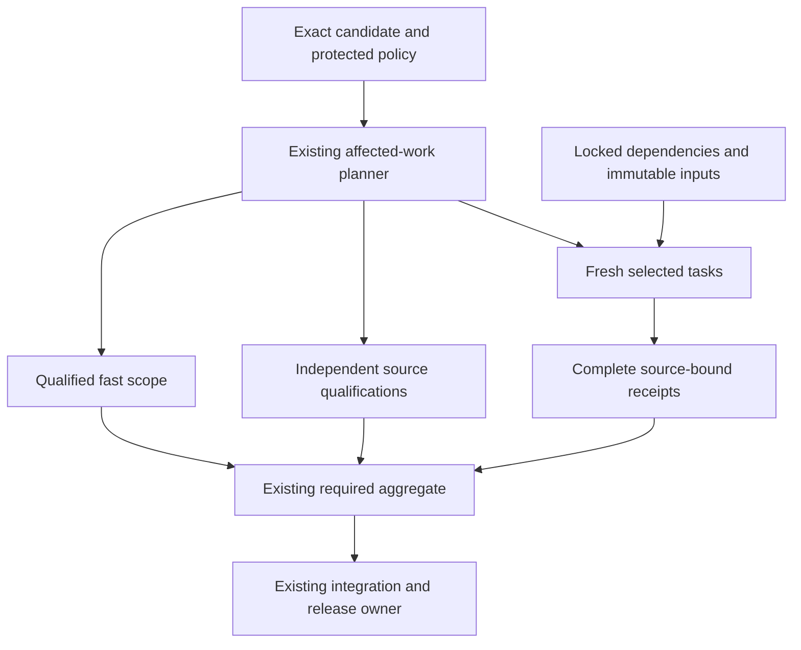

# MastermindX lightning CI architecture and execution plan

Updated: 2026-11-08, protected architecture and Terminal capture acceptance milestone. Engineering latency targets remain unachieved.
Programme: existing Mastermind #917 / #1607, Macro #6351 and WS:CI-MERGE-CONTROL-PLANE.

The architecture is accepted through [#2191 / accb4a6b](https://github.com/mastermindx-market-intelligence/Mastermind/pull/2191) and [#2251 / b230c2b0](https://github.com/mastermindx-market-intelligence/Mastermind/pull/2251). This is the next ordinary continuation of the same source document after #2251's protected merge; both merged branches are retired. The unattached prepared commit57b19290 is historical preparation, not an accepted source revision.

Verified procedure pin: protected **66780ab7e3e9fdbfd40713bb5791fb1888529f7c**, INDEX **b69d45de68d1f1c31d12dcf5203037122c694711**, skillpack1.0.1 / bootstrap1. Complete protected-source censuses through **b230c2b07db4c895dcccb16a3b0f0822eefc3a6b** preserve compatibility: latest1890→b230 contains one commit and only this architecture path. Current Mastermind delivery guide19a13a3b was read; Macro AGENTS3d18585b and delivery guide220d23a9 remain unchanged on the inspected source. Terminal root AGENTS08c5a252 at ec21ec04 requires the ordinary native queue route without branch deletion; it supersedes older nested wording.

These are inspected boundaries, not a claim that protected branches stopped advancing. The current durable execution frontier is the existing Agent OS [#10841](https://github.com/mastermindx-market-intelligence/macro/pull/10841), published **0ec827b657c826d38e09618df46091485d38f140**; later exact merge receipts below extend its00:03 snapshot.

This extends P3.O3 / Phase4 of the existing [delivery-turnaround task tree](superpowers/plans/2026-11-02-delivery-turnaround-execution.md).

The decision is to keep the three incumbent CI systems, remove repeated work,
make the largest tasks independently schedulable, and qualify enough isolated
capacity for a five-minute fresh full verdict. Existing scope and proof owners
remain authoritative. Caches, parallel workers and runner upgrades each need
their own measured contribution to the complete workflow.

This revision replaces the long rolling status narrative with a current plan
and compact evidence frontier. The complete intake research, rejected experiments,
source receipts and earlier implementation history remain immutable in
[the 16:00 source-linked evidence record](https://github.com/mastermindx-market-intelligence/Mastermind/blob/8b549d74e3977e7e37749b623a224e30423c75d6/docs/CI_LIGHTNING_ARCHITECTURE.md).
The preceding milestone is also immutable at
[980429a1](https://github.com/mastermindx-market-intelligence/Mastermind/blob/980429a1ffdc30fac79c36f87e7d766539967ee0/docs/CI_LIGHTNING_ARCHITECTURE.md).
The accepted [20:00 architecture milestone](https://github.com/mastermindx-market-intelligence/Mastermind/blob/accb4a6bcc1f721b93b10f43881cda67eca104ea/docs/CI_LIGHTNING_ARCHITECTURE.md) retains the preceding full frontier.
Those historical statuses do not supersede the current disposition below.

## Outcome and completion criterion

Make ordinary engineering feedback feel immediate while completing full consequential
validation quickly and predictably across Mastermind, macro and mastermind-terminal.
Optimize final source revision to required green, and separately eligible revision to
protected merge. Preserve the exact selected tests, meaningful integration checks,
source identity, current trust boundaries and original product outcomes.

An implementation is complete only after its existing workflow consumes it, a
representative natural cohort demonstrates the target by risk class, required failure
cases remain red, and its source/evidence/rollback are recoverable. A cache hit,
local test, isolated runner canary, green workflow or plan is evidence at its own layer.

## Current disposition

**The master architecture is protected-merged. Terminal's validated capture-return improvement is also protected-merged. Mastermind's market-view optimization has successful focused native CI and a native queue entry. Macro's freshness repair and full-only execution-input foundation are published and still running their natural full proof. The three-repository speed upgrade remains incomplete.**

The remaining programme is to shorten the largest execution units, remove repeated acquisition/construction, qualify complete execution inputs and sufficient isolated capacity, and prove the whole natural delivery path. A faster command or one green PR does not establish the programme's latency target.

| Lane | Current result | Remaining work |
| --- | --- | --- |
| Master architecture [#2251](https://github.com/mastermindx-market-intelligence/Mastermind/pull/2251) | Protected-merged **b230c2b0**, accepted file54efbd8d. | Execute the ordered work below; retain the existing source and lifecycle owners. |
| Mastermind [#2065](https://github.com/mastermindx-market-intelligence/Mastermind/pull/2065) | Exact native parity: **2,374 modules / 72,084 completed cases**, identical collection/outcome hashes across required and RWE profiles. | Required **25m05**, RWE **34m43** are different profiles. Reduce the 427s readiness wait and long execution tail; preserve H1/Gateway/initializer holds and unarmed state. |
| Mastermind market view [#2256](https://github.com/mastermindx-market-intelligence/Mastermind/pull/2256) | One genuine doctrine load with fresh deep copies preserves54cases/130assertions. Local profile76.34→4.69s. Natural focused CI **89s**, CodeQL green. Ordinary exact-head native entry verified00:02. | Consume original queue and postimages. Native six-second step combines market-view and pytest-policy; it is not isolated timing, a full-suite result or p95. |
| Macro freshness [#10764](https://github.com/mastermindx-market-intelligence/macro/pull/10764) | **796305a6** retains725-pass public-evidence repair and closes the one native catalog omission. New contract-delta passes. | Final natural semantic gate, freshness and ordinary ArmLast remain. #10788 is sequenced after protected merge. MOG absent, merge-blocked retained. |
| Macro FIF / narrowed packs [#10658](https://github.com/mastermindx-market-intelligence/macro/pull/10658), [#10752](https://github.com/mastermindx-market-intelligence/macro/pull/10752), [#10788](https://github.com/mastermindx-market-intelligence/macro/pull/10788) | Existing proofs retained; #10788's120FIF modules all execute once across44/37/39siblings. #10658 has a live controller refresh at **aec6664a**. | Preserve the live refresh lease and incumbent MOG requests. #10788 remains unarmed until #10764 merges. Prove natural narrowed-consumer latency; no bulk arming/cap changes. |
| Macro census [#8094](https://github.com/mastermindx-market-intelligence/macro/pull/8094) | Complete natural proof:319jobs/692passedsteps, clear, zero infrastructure findings. | Draft/unarmed original hold remains. Automatic approval review rejected its specific hold-release action; explicit user authorization is needed for that release, then ordinary freshness. Earlier benchmark denial remains fenced. |
| Macro W4 [#10843](https://github.com/mastermindx-market-intelligence/macro/pull/10843) | **d7715d01** binds exact committed input identities and validates strict full-only declarations in the actual common loader. **61 focused contracts pass**. Natural contract/planner pass; twelve packs executing at00:02. | Protected consumer adoption; complete execution closure; authoritative plan/profile integration; verified acquisition/restoration; exact parity and full base replay; only then candidate enrollment. |
| Terminal readiness [#1338](https://github.com/mastermindx-market-intelligence/mastermind-terminal/pull/1338) | Protected-merged69c38931 with original journeys. | Accepted; do not redo. |
| Terminal capture [#1341](https://github.com/mastermindx-market-intelligence/mastermind-terminal/pull/1341) | Full native19/19green; repaired tablet journey has no reported flake. Protected-merged **c7b0dd09** at00:08:59. All three accepted source blobs match. | Capture still650s in the measured native unit path. Partition import-dependent consumers and qualify capture work/runtime isolation. Whole browser run retained one unrelated retry-pass flake. |
| Terminal Ticker [#1344](https://github.com/mastermindx-market-intelligence/mastermind-terminal/pull/1344) | Exact local21-case parity and74→57navigations. Full native19/19green **58m03**, with two other retry-pass flakes. Its original native queue entry is verified. | Consume original queue/postimages; no second enrollment. Desktop1 still57m28. Preserve held #1223 surfaces. |
| Terminal import barrier / topology / fleet | Exact three-consumer partition is designed. New source-workspace acquire failed; no edits were made. #1223 original effect remains uncertain; #1306 owns fleet qualification. | Material canonical-source/binding recovery before that source lane resumes. Workflow activation must preserve #1223's held Node-discovery tail. No restricted-fleet activation through a denied action. |

Execution remains within existing source, planning, proof, delivery and admission owners. No new scheduler, queue, worker daemon, result authority or materialization programme is introduced.

## Historical intake baseline

These intake observations explain the original design. Current source disposition is above:

| Repository | Default revision | Current implementation |
|---|---|---|
| Mastermind | 615146aac6a1b0c0933bc9b815517a2fd285ed4a | Trusted scope -> fast/smoke or six canonical pytest shards -> required test; merge-group scope from merged #2129; same-SHA postmerge reuse and existing ci-profile consumer |
| macro | 72c249a2e1967d1ec6dcf6179a7a8728f3305e44 | Existing semantic ci-plan -> selected ci-pack -> ci-gate; incumbent merge-on-green, proof freshness and adaptive admission |
| mastermind-terminal | dd49fa9bd4746d283bfc12581153463629de2b4e | Three stable required contexts; 12 PR browser shards; merged #1320 avoids duplicate merge-group browser matrix; merged #1324 scopes responsive verification |

The [latest native measurements](https://github.com/mastermindx-market-intelligence/Mastermind/issues/917#issuecomment-6702164981)
report Mastermind merge-group-created to required-green STANDARD/smoke n=8
p50 1m53.5s / nearest-rank p95 3m10s; FULL n=6 p50 40m47.5s / p95 43m57s.
STANDARD merge-group-created to merge p95 was 29m44s, so a fast check is not
necessarily a fast release. These selected cohorts are not a causal speedup experiment.

The [Terminal full PR cohort](https://github.com/mastermindx-market-intelligence/Mastermind/issues/917#issuecomment-6700311570)
has n=4, workflow-created to complete-green p50 57m22s / p95 58m42s.
The ubuntu0 desktop-1 canary jobs were 16m06s with one worker and 8m08s with
four workers ([four-worker run](https://github.com/mastermindx-market-intelligence/mastermind-terminal/actions/runs/42029519496)),
against an earlier hosted 54m41s comparison. These are one-shard observations,
not matched-source whole-suite or sustained fleet results. The four-worker canary's
whole workflow lasted 17m36s; its 8m08s value is the job clock.

Macro's [FIF split proposal](https://github.com/mastermindx-market-intelligence/macro/pull/10788)
records one pack at 69 minutes while its siblings finished in 10-33 minutes.
Its stale calibration weight was 1,630 seconds. We must not confuse calibrated
model weights with observed wall time. Current proof-refresh scarcity and frequent
check-definition invalidation are independent contributors.

## Architecture decision

Extend the existing GitHub Actions owners with a common evidence contract. Keep repo-specific suites and required-check names.
Treat every run as five separable costs: admission/queue, acquisition/setup,
selected execution critical path, aggregation, and integration/release wait.

1. **Trusted affected-work planner.** Compute changed paths from exact Git identities.
   Use protected policy, explicit dependency closure and conservative invalidators.
   Missing, renamed, dynamic, ambiguous or incomplete dependency evidence goes full.
   Review risk and sufficient test scope remain separate decisions.
2. **Small deterministic tasks.** Split expensive semantic families at natural test
   boundaries, keep stable ownership and prove exact selected coverage once.
   Balance using current measured durations; preserve serial affinity where required.
3. **Cheap hot execution.** Restore locked dependency caches and avoid repeated installation.
   Reuse immutable candidate builds only after their fixture/runtime identity is qualified.
   Terminal retains its development runtime until a nondeployable compiled fixture preserves
   the original auth, data and browser journeys, including cold build/distribution cost.
   Do not ship test flags or widen production authentication bypasses.
4. **Bounded parallelism.** Choose shard count and per-shard workers together, accounting
   for total slots, memory, databases, ports and queue demand. More fan-out can be slower.
   Use ephemeral isolated runners only through the already qualified runner owner.
5. **Trustworthy reuse.** Begin with immutable dependency/build reuse. A reusable test
   result must bind exact task inputs and transitive dependencies, runtime/toolchain,
   platform, lockfiles, command, trusted policy, environment inputs and artifact digest.
   Untrusted candidate writes cannot supply trusted qualification. Unknown means miss.
6. **Stable aggregate.** Each existing required context reports for every admitted event.
   It validates planner identity, complete coverage, expected shard outcomes and result
   provenance. Cancellation, omission, wrong source, partial results and unqualified
   cache hits cannot turn it green.
7. **Existing release owners.** Preserve native queues and Macro merge-on-green.
   Reduce unnecessary invalidation at its existing owner, while retaining actual
   integrated-candidate proof. Never add a second lease, retry or verdict store.
8. **Existing measurement consumer.** Extend ci-profile/semantic timing artifacts.
   Measure failure/timeout/supersession as well as successful latency, by class and
   phase. Report queue delay separately only where the native timestamp semantics
   actually establish it; a job start offset also includes dependencies.

The execution graph keeps fast scope, fresh execution and independent qualification
visible in the same required verdict:

## Target service levels (proposals, not achieved results)

The end state is seconds for inert changes and a few minutes for substantive changes.
A ten-minute broad/full path is an interim milestone; it does not close the final goal.

| Measurement | Interim p95 | Final p95 | Required meaning |
|---|---:|---:|---|
| First actionable static/contract failure | Establish baseline | <=60 seconds | Real failure surfaced to author; successful runs are not counted as failures |
| Verified docs/metadata required verdict | <=2 minutes | <=90 seconds | Trusted inert allowlist; no executable/config/consumed-data escape |
| Ordinary bounded source required verdict | <=5 minutes | <=3 minutes | Relevant unit/contracts and affected integration/browser paths |
| Broad/full canonical required verdict | <=10 minutes | <=5 minutes | Complete assigned assurance; no expanded exclusions or renamed scope |
| Queue delay on intended capacity | <=60 seconds | <=30 seconds | Native queue timestamps; dependency waiting separately classified |
| Aggregate after last dependency | <=10 seconds | <=10 seconds | Stable required context verifies completeness and provenance |
| Eligible source to protected merge | <=20 minutes | <=10 minutes | Includes integration candidate and queue wait; separate from authoring age |

These are engineering targets, not promises established by current hardware or suites.
The five-minute full target requires removing current indivisible work, not just
changing worker counts. Report cold and warm distributions separately, plus their
actual mix. Publish p50/p95, sample size, selected coverage, runner class, attempts,
failures and cancellations. At least 30 successive eligible observations per populated
class provide an initial operational cohort, not a statistical guarantee. Small
canaries retain their observed ranges and explicit sample counts. Do not choose only
green, fast or warm runs to manufacture acceptance. Failed or cancelled runs do not
receive a fast time-to-green; report terminal-verdict latency and qualification
success separately, with retries and unfinished observations visible.

A target is not met if test-step time falls but queueing increases the author's
end-to-end wait, total compute becomes unsustainable, or previously required work
silently disappears. A scope reduction is accepted only when the trusted dependency
contract proves that omitted work is irrelevant.

## Closing the five-minute budget

The allocations are design limits for the whole fresh required path. They include
scheduling, setup, collection/readiness and fan-in. They are not achieved timings.
Upstream scheduling is the cumulative queue delay along the critical path before
the aggregate, not a separate allowance for each job. The aggregate allocation
includes its own runner wait and validation after the last dependency. The separate
queue SLO still applies to the complete critical path; dependency execution is not
misclassified as queue time.

| Repository | Upstream scheduling | Planning | Checkout/environment | Collection/readiness | Longest fresh execution branch | Aggregate | Total |
| --- | ---: | ---: | ---: | ---: | ---: | ---: | ---: |
| Mastermind | 30s | 10s | 40s | 20s | 190s | 10s | 300s |
| Macro | 30s | 15s | 35s | 20s | 190s | 10s | 300s |
| Terminal dev profile | 30s | 15s | 45s | 20s | 180s | 10s | 300s |

Mandatory independent qualification must also finish inside the graph: at most
210s after setup for Mastermind/Macro and 200s for Terminal. New jobs pay their own
queue and setup costs. A compiled browser experiment must include cold build and
distribution; measuring only the subsequent test command is insufficient.

**Task-size rule:** aim for at most 90s per independently schedulable unit on the
admitted runner class. Preserve shared mutable transactions and required fixture
affinity. Use the incumbent planner to pack those units within the execution limit.
A unit above 90s needs legitimate work reduction, an independent affinity split or
qualified faster execution before the branch can close. The unit ceiling is necessary,
not sufficient: total selected work must also fit admitted concurrency, memory and
setup capacity without lengthening the end-to-end queue path.

**Historical sizing evidence:** the complete c854 parallel inventory reported
10,565.219s across 2,326 runtime modules. With unchanged service and 24 equivalent
processes, perfect balancing alone is 440.217s. Fitting 190s under that artificial
model requires about 56.84% less service, or about 55.6 equivalent processes.
Neither is a CPU lower bound or authorization to start 56 processes: grouping,
fixture sharing, contention, package versions and runner class change those costs.
The matched d264 RWE pair now exists, but the parallel trial failed two outcomes;
its elapsed reduction still cannot be accepted as a qualified speedup.

The current composed FIF commands still take 629.906s,820.212s and765.374s; Macro's full run retains a2,742s pack execution tail. Its checkout alone can exceed twenty minutes. Terminal's newly qualified capture is650s and npm-test 307s, while the prior full browser matrix has a53m16s command. These different units independently exceed their design allocations. Work reduction, task granularity, materialization and qualified capacity must close together; they are not additive or causal speed comparisons.

Capacity is chosen only after measuring the fresh graph. Model concurrent runs,
jobs per run and workers per job together; include memory, ports, browser/server
cost, setup and serial affinity. Preserve the existing Fabric and release budgets.
No new runner, scheduler, queue, lease store or admission plane is introduced.

## Preserve and compose the existing work

| Existing owner | Preserve | Concrete composition boundary |
| --- | --- | --- |
| Mastermind merged #2044 / #2129 / #1570 and profiler | Six outer shards, trusted merge-group scope, exact-SHA postmerge reuse and ci-profile | Extend their contracts; do not reconstruct them. |
| Mastermind #2065 | Four prepartitioned child interpreters, exact cover, terminal receipts, observer, RWE adapter, physical capacity-test partition | Complete matched-profile proof, hot-unit work and current required source qualification. |
| Mastermind reserved #1714 | SDK/runtime lane at `47164aef5c1cf928f0618be28996d465c9564efa`, including `pyproject.toml` and both RWE locks | Regenerate lock provenance from the combined inputs when composed. The narrow pytest qualification does not complete this future integration. The reservation alone proves neither a live writer nor a global exclusive fence. |
| Macro #10788 + #10658 | 120 FIF modules; #10788's 44/37/39 split and #10658's one fresh interpreter per file, with at most two files running concurrently | Implemented and native-qualified at 5e7: the existing helper runs each split sibling's own file list. Its path is in all three closures: 1,139 → 1,140 raw entries and 1,135 → 1,136 unique paths each; preserve the four existing duplicates. Declare the helper in the exclusive control-plane owner too. Preserve B's P2/G-pack/Node ownership and ancestor-package additions. |
| Macro #10738 | Historical failed four-worker shared-xdist experiment | It is not a qualified two-to-four-worker progression or fallback for #10658. |
| Macro #10752 | Genuinely narrowed-plan compaction and exact baseline/full/off/shadow fallback | Keep twelve-slot output, selected-job objects/digests/order and real consumer closure. |
| Macro #10735 / #10745 / #10764 | Control-plane family split, replay environment, manifest-scoped freshness | #10755 cap 640 and #10770/#10766 are accepted. Preserve #10674's original uncertainty, then compose #10745 and #10735 through their original owners. |
| Macro #10656 / #10674 | Existing authored/refresh admission programme | Main admission remains OFF. Original proof-preparation process26751 and its unbound publisher disposition stay unresolved; no invented GitHub-mutation identity, alternate continuation or retry. |
| Terminal accepted #1320 / #1324 / #1297 / #1334 | Native browser deduplication, scoped QA, trusted docs scope and accepted News navigation repair | Preserve their selectors, original journeys and required aggregate. #1297 acceptance is `90ddc139`; no redo. |
| Terminal #1306 | Optional lane binder, selected ports/workers, trust/isolation/rollback runbook | Published scoped-CI integration is independent of fleet activation and #1223's held mutation. |
| Terminal #1223 | Already-authored weighted topology, traces, attempt timing and Node discovery | Reconcile its original create-commit. A new implementation on another carrier would duplicate held work. |
| Terminal accepted #1338 | Context-entry repair, actual EN/ZH evidence and strict fixture-startup probe | Merged69c38931; preserve app assertions, runtime, topology, traces and historical evidence. |

## Critical-path evidence and consequences

These are actual completed native measurements. They come from different runs and environments; comparisons are observational unless explicitly qualified.

| Native source/run | Observed cost | Architectural consequence |
| --- | --- | --- |
| Mastermind ce38 [required 42410396607](https://github.com/mastermindx-market-intelligence/Mastermind/actions/runs/42410396607) | Source qualification590s; required verdict15m58 with the cold-compiler failure | Qualification is independently too large. Three explicit lanes are now implemented; new queue/setup costs still count. |
| Mastermind ce38 [RWE 42410396564](https://github.com/mastermindx-market-intelligence/Mastermind/actions/runs/42410396564) | Successful33m15; outer receipt durations1,194.90–1,751.46s; aggregate waited158s, then executed4s | Pytest work and aggregate scheduling remain large constraints after the qualification split. No worker-count inference from wall time alone. |
| Macro #10658 [42408989367](https://github.com/mastermindx-market-intelligence/macro/actions/runs/42408989367) | Contract-delta job 883s:100s checkout and767.4s analysis command | A mandatory independent analysis branch exceeds300s by itself. #8094 addresses one census band, not the entire branch. |
| Macro #10788 [pack 0](https://github.com/mastermindx-market-intelligence/macro/actions/runs/42412023592/job/128522729070) / [pack 1](https://github.com/mastermindx-market-intelligence/macro/actions/runs/42412023592/job/128522729142) | Exact depth-one fetch1,266.824s /850.457s; subsequent checkout63.881s /91.416s; 147,038 paths each | Do not propose depth0→1 as an unimplemented pack optimization. Separate acquisition and materialization; current logs do not split network/remote/local Git cost. |
| Macro #10788 [pack 3](https://github.com/mastermindx-market-intelligence/macro/actions/runs/42412023592/job/128522729066) | Fetch173.013s plus checkout93.552s; 147,038 paths | Object caching can reduce acquisition; a verified execution closure can also reduce worktree writes. Neither saving is yet measured for a qualified W4 profile. |
| Macro #10788 FIF | Three kernel commands629.906s,820.212s,765.374s; original 120 modules all complete | The composed split has a real consumer and preserves module coverage, but each command remains far beyond190s. Do not add concurrent command durations as verdict wall. |
| Macro #10788 last pack 6 | Validate/run step 2,742s; full verdict63m22s | The next command-level owner must be identified from that actual tail. FIF tuning alone does not close the graph. |
| Terminal integrated readiness [42407566693](https://github.com/mastermindx-market-intelligence/mastermind-terminal/actions/runs/42407566693) | Unit1,297s: capture 698s, Vitest 408s, other191s | The independent unit path remains a separate budget constraint after browser reliability improves. |
| Terminal #1341 [unit128529577756](https://github.com/mastermindx-market-intelligence/mastermind-terminal/actions/runs/42414479074/job/128529577756) | Unit1,107s: capture 650s, npm-test 307s, typecheck79s | One redundant composition read is removed and native consumers pass. Further capture and unit graph work is still required. |

For a workflow DAG, latency follows the actual dependency path, including every queue/setup/collection/readiness interval and final aggregation. Summed concurrent durations describe work consumption, not latency. Conversely, serial prefixes cannot be modeled as parallel.

### Why the three Mastermind qualification lanes are needed

The590s source-qualification observation includes approximately 63s setup,2s preflight,31s Paper,179s Fabric,7s compile/shell,215s native bundle,40s capsule and49s Brain acquisition/composition. The native bundle contains 13.95s of unittest prelude plus200.59s of native pytest.

After setup, the approximately 523s of work cannot fit two perfectly balanced lanes inside the210s qualification budget: the idealized split is261.5s per lane before new overhead. The implemented three-lane grouping puts native pytest, Fabric, and the remaining core work on separate jobs; the unittest prelude stays intact in the core lane. This is a dependency-preserving design based on observed components, not a prediction that the new jobs will finish in 201/179/143s. Fresh setup, contention and scheduling must be measured.

The new native run now exercises the split successfully: core 203s, Fabric 254s and native 219s including each job's setup. None is the last dependency. The complete required run still takes1,505s: scope/initial readiness16s, limiting-shard ready-to-start gap427s, that shard's whole job 1,048s, fan-in scheduling5s and aggregate execution9s. All six shards depend only on scope, so the start gap is scheduling/admission time, not a qualification dependency. These records do not isolate its underlying cause. Eliminating that entire gap alone still cannot reach300s; the execution tail must shrink too.

### Amdahl, total work and task granularity

The old788.9s capacity-artifact file has already been physically split into twelve coherent files preserving466 cases. Trend's44 cases have already been divided into17/16/11 complete units. Do not redo those accepted transformations.

The next optimization must remove repeated deterministic construction, shorten legitimate work, separate independent fixture-affinity groups, or qualify faster execution capacity. Timeout increases, retries and assertion deletion do not qualify. Choose concurrent runs × jobs per run × workers per job together, with real memory/ports/browser/server/setup demand and the incumbent admission budget.

The historical10,565.219 module-seconds /24-process440.217s ideal-balance model is not CPU service or a hard lower bound. It does show why placement alone cannot justify the190s fresh-execution budget on an assumed unchanged profile. Actual task demand and admitted capacity must close together.

## Repository implementation design

### Mastermind

Keep the incumbent scope, shard, pytest timing, xdist guard, RWE environment, workflow and postmerge-proof owners.

1. **Consume the current source before changing it again.** Published e673 composes protected 20e17, the cold compiler repair, exact historical observer cohorts and three qualification lanes. Required42419148121 and RWE 42419148128 are the natural consumers. Establish actual tested merge/tree and complete per-module outcomes before accepting current-source correctness or performance.
2. **Keep the current fixed-capacity partition.** Six canonical outer pytest jobs have four independent serial child interpreters, exact once-only module coverage, private diagnostics and terminal receipts. Do not nest another four xdist workers inside them. The separate guarded native qualification keeps its existing four-worker command.
3. **Keep all three mandatory qualification lanes in the required graph.** Core owns Paper/Studio/compile/shell/unittest-prelude/capsule/Brain; Fabric owns the complete Fabric block; native owns the intact guarded pytest block. Each pays setup and queue. All commands remain present exactly once. The aggregate requires all three successes on full scope and all three skips on fast scope.
4. **Use the exact twelve-job postmerge contract.** Scope, fast, six pytest jobs, three source qualifications and aggregate must match exact source/actor/workflow/attempt/freshness and mandatory-step ownership. Missing, duplicate, wrong-job, stale, unknown or old10/11-job proof falls back to full selected pytest. This implementation has791 passing local contract tests; hosted qualification is pending.
5. **Continue measured hot-unit reduction.** Trend's construction/copy isolation and17/16/11 partition, capacity's immutable Git seed plus fresh per-case copies, and current observer identity are already implemented. Consume their native phase receipts; choose the next above90s unit from actual composed-source data. Never cache a security, admission, transport or crash-replay verdict.
6. **Preserve original effect and release holds.** The new bounded H1 diagnostic and fresh successful invocations do not recover the old ATT1/process-settlement receipt. Gateway/initializer release conditions remain separate. The current source work does not install, enroll or activate runtime components.

The cold repair moves three AST-identical pure helper functions to the existing pure entry owner and makes one identical default-root resolution lazy. It preserves updater CLI bootstraps, security joins and canonical symlink behavior. Final composition passes all 15 cold/adoption and122 original purity tests; it does not weaken the cold guard.

### Macro

Keep the existing semantic planner, catalog, dependency inference, pack runner, proof producer, gate and MOG controller.

1. **Deliver the proven FIF composition through existing controls after #10764 merges.** The [existing sequencing ruling](https://github.com/mastermindx-market-intelligence/macro/pull/10788#issuecomment-6674602501) preserves the freshness-before-manifest order to avoid invalidating the armed backlog. #10764 remains open at 99c6f46e with MOG/merge-blocked; no old-author approval ritual is added. #10788's 44/37/39 siblings use #10658's incumbent fresh-interpreter helper, two files at a time within each sibling. Native proof conserves all 120 module starts and completions,4,253 passes/one skip, B's P2/G-pack/Node steps and the complete 321-job/694-step gate. The local missing control-plane helper dependency was fixed and qualified before publication.
2. **Reduce the actual largest remaining command.** The completed run's pack 6 validate/run step is2,742s. Attribute its individual commands before proposing another split. Retain source ordering, semantic IDs, original inputs, cleanup, exact-base replay and all selected work. Existing duration weights are placement inputs, not runtime promises.
3. **Finish the mandatory contract-analysis path.** #8094 performs full manifest validation before limiting one inference census to curated jobs. It leaves the ordinary planner and five other census classes unchanged. Current-source composition is published; the original semantic/data hold and explicit long-benchmark refusal remain. Code-owner success does not mean the separately retained data-health assertions passed.
4. **Implement W4 materialization under #6351.** Use the detailed full-default contract below; selection scopes alone are not execution closures. Do not duplicate #10803's finite provided-action history helper or the accepted object-cache design.
5. **Preserve command settlement and replay.** An expired execution allowance must not remove cleanup's observation allowance. Attempted kill is not descendant settlement. Fresh International proof completes all current commands, including IM14 browser10-pass/zero-skip, but cannot settle the older fixed-path invocation.
6. **Consume narrowed compaction and freshness naturally.** #10752 keeps full/baseline/off/shadow/global-invalidating behavior. Preserve existing MOG enrollment, queue limits and proof freshness. Main admission stays OFF until its own producer/consumer/fairness/cutover acceptance. #10674's original unknown custody is not a reason to abandon independent source work.

#### Contract-analysis decomposition

The completed767.4s command already runs candidate/base work concurrently. Reported stages are closure478/439.2s, probes153.2/131.6s, skip census39.2/39.8s and trigger audit70.2/71.2s. #8094 targets only part of the first stage; existing AST caches are already present.

Even an idealized removal of that entire first stage leaves roughly 405s including the observed checkout. This is explanatory arithmetic from one run, not a measured floor or benchmark claim. After the original permitted natural consumer is consumed, any next source change must identify its exact preserved finding set and current owner. Do not substitute a hosted benchmark for the refused long benchmark.

#### W4: verified execution materialization

**Owner:** existing W-SELFHOSTED-BRIDGE / #6351, with W3 already closed. #6505's P3B-B merged onAugust27; the stale Agent OS next-action sentence has been corrected on its existing carrier. Do not restart that accepted phase or create a parallel programme.

**Why current scope metadata is insufficient:** catalog paths and exclusive scopes decide selection. Exclusive scope can suppress fallback inference; wildcard/initializer coverage has separate census rules; direct-read inference omits some data-marked inputs. A tracked-path inventory proves existence, not bytes. None establishes that an executing pack may safely omit every other file.

**Minimal contract and algorithm:**

- Add a strictly validated optional materialization declaration to the existing catalog; default every unenrolled job to full.
- The existing dependency owner compiles a deterministic execution closure: command/test/helper inputs, transitive first-party imports, package initializers, pytest configuration/conftests/plugins, runner/bootstrap, templates/assets/configuration/goldens/data and declared glob membership.
- Resolve every member against the exact tested Git tree with canonical path, mode and object ID. Bind contract version and member digest inside the incumbent authoritative plan and execution-contract digest.
- Any unresolved dynamic import, subprocess dependency, traversal, unsupported language/command/tree entry or unclassified runtime input selects full before execution. Exclusive scope does not suppress that result.
- For each pack already selected by the current planner, materialize bootstrap union all qualified job closures. If any assigned job requires full, the pack stays full. Do not change eligibility, weights, assignment or pack count to manufacture a favorable closure.
- Full packs retain current unfiltered depth-one checkout. Closed packs acquire and verify every required object offline before unchanged tests start. A malformed/wrong-SHA/incomplete published profile refuses; it must not silently widen after execution starts. Bounded object count is not a byte bound.
- Preserve the same pack union through workspace restoration. Restore tracked members, remove untracked/generated contamination and reverify HEAD/profile. Git repair respects that union or refuses.
- Validate the whole catalog, including unselected jobs, with the existing exact-tree inventory context. Missing unselected bytes must not weaken existing manifest validation.
- Leave history-dependent consumers full initially. Preserve #10803's exact-SHA finite ancestry behavior and holds.
- Keep exact-base failure replay full and independently pinned to the base's own runner/catalog. Never reuse the candidate closure as the base closure.

**Compatibility order:** implement full-default producer/consumer semantics first, including the existing trusted main-owned executor and control-bundle contract; only then opt in a named job. A combined candidate producer/consumer patch does not prove protected-consumer adoption. Preserve the old full-output contract until a backward-compatible consumer has landed, or land that compatible consumer first. Record the actual protected executor/control-bundle identity before any closed-profile enrollment; never point the trusted consumer at candidate code. Unsupported versions refuse. This infrastructure stage earns no speed claim.

**Published prerequisites (#10843):** the exact input identity primitive is implemented in the existing dependency owner. It binds canonical path/mode/object-type/OID records, exact tested commit and root-tree identities, with a deterministic versioned digest and independent expected-commit/path validation. It ignores dirty/untracked worktree bytes and replacement/inherited Git overrides, rejects unsupported selected entries, and performs no lazy acquisition. This proves identity, not closure or local blob availability.

The actual common manifest loader now accepts absence as implicit full and only the exact optional object `{version: 1, mode: full}`. It rejects null, boolean/float/string versions, extra keys, future versions and non-full modes before selection, including unselected and data-gate jobs. Default catalog, plan bytes/digests, selected populations, checkout and execution calls remain unchanged. The61-case focused proof includes copied trusted-control consumption. Natural full proof and actual protected consumer/control-bundle adoption are still required; no job is enrolled.

**Next bounded source phase:** inventory execution seeds in the same dependency owner, without changing selector APIs or its path-only cache. Preserve explicit pytest target order and multiplicity; support only a declared bounded invocation grammar. Node selectors and other unsupported forms remain explicit obligations rather than being silently discarded. Inventory applicable ancestor conftests, package initializers and configuration candidates against the exact Git tree, including recorded absent candidates. Expand declared fixture subtrees to exact committed membership, then bind known inputs with the existing identity primitive. Keep source/reason provenance and unresolved obligations explicit. This analysis remains advisory and full-only.

For the first candidate, `tests/conftest.py` has optional imports whose exceptions are caught, sparse-checkout-induced skips, Git/data/site checks and environment/module guards. Omitting those inputs can change behavior without a collection failure. Eager company-intelligence and earnings-narrative initializers expand imports. The envelope fixture subtree has11tracked files, including six compressed exhibits whose names are computed from Release.file. Existing selector literal-read inference is therefore insufficient. Plugin/configuration/environment resolution, computed reads, transitive imports, runtime Git/subprocess behavior and outside-root inputs must be closed or keep full. A nonempty digest or empty selector-ambiguity list cannot authorize omission.

**First qualification candidate:** earnings-economic-dossier, the sole logical job in completed #10788 pack 2, with 2,740 passes/176 skips and one fixed pytest command. It is not yet proved closed. Establish the complete closure before enrollment; retain full if any dependency remains uncertain. Compare exact collected case identities with multiplicity, phases/outcomes and all 176 existing skip reasons. Preserve commands, dependencies, semantic IDs and job membership. Inject failure to prove full exact-base replay and normal settlement behavior. If future packing places it with an unqualified job, that whole pack remains full.

**Decisive negatives:** opaque/dynamic/exclusive-hidden dependency retains full; omitted initializer/conftest/plugin/template/fixture cannot become an accepted new skip; wrong tree/OID/mode/path escape/duplicate/digest refuses; invalid unselected job still fails; modified tracked or generated/sparse-config contamination is cleared or refused; wrong ancestry and UNKNOWN replay remain unchanged; hosted and trusted consumers agree.

**Existing files:** catalog, ci_scope_dependencies.py, run_ci_pack.py, ci.yml, trusted-ci-executor.yml and their existing pack/workflow/execution-profile contracts. The accepted read-only shared Git object cache can reduce origin acquisition; W4 can additionally reduce worktree writes for qualified packs. Neither replaces the other, and neither alone establishes five-minute delivery.

### Terminal

Keep current scope, Playwright configuration, fixture warmup/readiness, evidence writers/readers and the three stable required contexts.

1. **Retain accepted readiness and scope.** #1338 merged after integrated qualification; #1320/#1324/#1297/#1334 remain accepted. The strict startup probe retains its direct200, fixture provenance, complete schema, one deadline and existing14-route warmup. Do not reopen these slices or claim they explain every later request stall.
2. **Preserve accepted #1341.** It reuses the validated writeComposition return instead of immediately rereading the same composition. All 50 selections,24 PL6/30 VI records, two operations, canonical bytes and downstream reader guards remain. Full native unit/browser and records-mode consumers pass, and protected merge c7b0dd09 preserves the exact validated source. Programme latency remains separate. The removed later producer-only snapshot has an explicit temporal difference; no atomicity claim is made.
3. **Deliver the qualified Ticker first-load consolidation in #1344.** Existing prepare installs isolation/routes without the redundant initial document; existing presentation setup performs the first intended-language document, then all later reloads and visible appearance actions remain. Install case-specific routes before that first document. Preserve21 project cases,14 enabled/seven expected skips,12 presentation cells, CN/HK original headlines, held Apple→MSFT progress and recovery's exactly-one additional snapshot/no-navigation assertion.
4. **Retain the actual74→57 document proof.** Both independent trace counts now confirm13→12 for matrix,6→4 unavailable,15→12 recovery,2→1 grouped,2→1 held-response,3→3 editorial,33→24 CN/HK. Observe main-frame document requests from before first navigation; use the same runtime/fixture/workers for timing attribution. First Chinese language, later language changes, light-specimen cleanup and later symbol transitions must all remain valid. The complete local before/after proof has identical case/outcome/skip multiplicity and zero retries. Seventeen fewer documents does not imply the same percentage runtime improvement. Full native CI now passes; original protected queue completion remains owed.
5. **Partition independent unit work from capture-dependent imports.** The direct PL6/VI consumers call selectedComposition at module import; Options loads its manifest at import. For capture=true, their collection/import must occur in a fresh process only after capture selects and validates the composition. For the legitimate capture=false merge-group route, preserve the planner-authorized legacy environment and checks; there is no composition to await. Failed or unknown planning/capture must not silently turn into a successful legacy route. Partition file paths without importing the deferred readers merely to obtain early case inventory, then reconcile case identities within each legitimate mode. Independent unit work may form another existing-workflow branch. Preserve exact file/case union and propagate either partition's failure. Account for additional setup/queue; same-runner overlap has no demonstrated benefit.
6. **Qualify capture runtime isolation before parallel launch.** PL6 and VI use different ports but the same default .next checkout state, different dev-server environments, and PL6's owned server supplies Options capture. Simple Promise.all or shared-server substitution is unqualified. PL6 also has a module-global immutablePng, so concurrent surface calls can race byte association.
7. **If separate packet jobs are pursued, preserve the present evidence contract.** One complete PL6 job and one complete VI job can still produce exactly two operations. Preserve24/30 execution records,20+30 selected cases, exact run/attempt IDs, source/profile provenance and Options under PL6. Transfer completed immutable records through a verified artifact/materialization boundary; never transplant live writer filesystem custody or strip identities. Compose only after both complete and validate. Per-locale/project packet sharding is a different contract and is not a drop-in change.
8. **Keep compiled fixtures and fleet activation as separately qualified stages.** Development auth/preview seams cannot be broadened into production bypasses. A compiled nondeployable fixture needs coherent existing authority/data contracts and cold build/distribution costs. #1306 owns restricted-runner trust, isolation, capacity and rollback; its hosted proof is not fleet activation. #1223 owns held topology/traces/Node discovery; do not duplicate it.

**Concrete import-barrier implementation:** extend the existing evidence planner and Vitest configuration; do not add a second planner or evidence receipt. The exact deferred files are `lib/__tests__/b_pl_6Batch1Evidence.test.ts`, `lib/__tests__/visualIntelligenceEvidence.test.ts` and `lib/__tests__/optionsLevelAxisEvidence.test.ts`, relative to terminal. Default discovery must remain byte-for-byte compatible. An explicit ordinary partition excludes exactly those three before import; an explicit evidence partition includes exactly those three. The latter accepts only a successful existing plan, with producer success/current records export for capture=true or planner-authorized merge-group capture=false legacy. Missing/malformed/failed planning cannot select legacy. Existing consumers still perform their genuine validation.

Qualification must exercise actual Vitest import behavior with throwing reader fixtures, default and partition discovery union, records and authorized legacy case identities, and negative planner/capture/selector behavior. The three record consumers currently contain1/1/3cases; legacy contains4/10/3. Workflow activation overlaps held #1223's Node discovery after npm test and remains fenced. Original operation `ci-lightning-terminal-unit-evidence-barrier-20261107-c2` has no source edits: acquire returned NOT_APPLIED, one successful canonical census was followed by one same-operation retry with the same technical failure. No further unchanged acquire loop or replacement carrier is authorized by that diagnostic alone.

An idealized overlap of the entire observed307s npm-test phase would still leave650s capture plus approximately 150s other unit work before deferred consumers or new overhead. Unit partitioning is useful intermediate work, not completion. The final plan must reduce capture work or qualify faster isolated runtime as well as address browser task size.

## Common evidence contract and reuse boundaries

This is an additive contract for existing planner/proof/timing artifacts. It does
not introduce a new daemon, registry, scheduler or authoritative database.

| Evidence component | Must bind or establish |
|---|---|
| Source and policy | Repository; PR or merge-candidate SHA; trusted planner/policy revision; verified diff base |
| Selected work | Required task/group identities; test/helper/config/data closure; serial affinity; expected partitions |
| Execution identity | Exact command; dependency locks; runtime/toolchain/browser; OS/architecture; material nonsecret environment inputs |
| Input/build artifact | Content digest; producer source and trusted provenance; fixture mode; compatible consumer; nondeployable test marking where applicable |
| Test outcome | Attempt and runner identity; complete collection/execution; success/failure/cancel state; coverage membership; completion evidence |
| Reuse validity | Matching relevant inputs; trust namespace; accepted freshness rule; policy eligibility; miss reason when unverifiable |
| Performance | Queue/setup/collection/execution/aggregate times; retries; cold/warm state; total compute; source class |

Artifact reuse accelerates a fresh test. Result reuse substitutes an already
qualified assertion and needs the stronger identity above. A passing PR proof is
not automatically proof of a different integrated merge candidate.

Use the accepted trusted merge-group selector and the current repository-specific
composition contract. GitHub's [merge queue](https://docs.github.com/en/repositories/configuring-branches-and-merges-in-your-repository/configuring-pull-request-merges/managing-a-merge-queue)
checks the candidate containing current base and preceding queued changes. Preserve
Terminal's accepted removal of duplicate browser fanout while accurately stating
what its merge-group checks establish; add only the specifically owed composition
proof, not the old blanket matrix by default.

Candidate code cannot select a weaker classifier for itself. Unknown dependencies,
renames, policy changes and incomplete analysis expand validation. Missing,
cancelled, wrong-source or unexpectedly skipped selected work cannot satisfy the
aggregate. A cache hit cannot override an observed failure.

Start result reuse with one deterministic, hermetic task in shadow mode: compare
its reuse decision with actual fresh execution before letting it satisfy an
existing required check. Invalidate on a test/helper/lock/config/runtime/environment
change, evidence tampering or trust mismatch. Preserve the existing broader-run
fallback and rollback at the same owner.

The prior [Vercel CI research](https://vercel.com/blog/introducing-vercel-ci)
provides a useful task-graph/cache/per-task-compute pattern. Its vendor performance
claims are not MastermindX measurements. Adopting a new external CI platform is not
required for this plan and is not authorized by an architecture analogy.

## Falsifiers, rollout and rollback

The strongest counterargument is that narrow selection or proof reuse can hide
dynamic dependencies or interactions between individually passing changes.
The architecture fails qualification if:

- A helper, fixture, lockfile, configuration or policy change incorrectly leaves
  affected work out of the plan or keeps a stale result eligible.
- A candidate changes its own classifier and thereby reduces its required work.
- A selected shard is absent/cancelled/duplicated and the aggregate still passes.
- Individually passing changes violate an owed integrated-candidate behavior.
- A full audit finds a selection false negative.
- Additional fanout improves an isolated test while worsening end-to-end p95 or
  completed delivery throughput under representative load.

Use focused negative tests for these failures, then existing full CI and the real
PR-to-integration path. Keep first-attempt pass rate and retries visible; do not
use retries, longer timeouts or exclusions to hide regressions.

Roll out one material execution dimension per interpretable canary. Preserve the
previous trusted planner/worker/runtime setting for source-level rollback. On
bad selection or invalid proof, fall back to the broader canonical run. On runner
or performance regression, restore the previous admitted execution topology.
Rollback does not replay an uncertain operation or resurrect a stale proof.

## Ordered execution tree

These IDs extend the existing Phase 4 CI work, and are editorial source nodes only.

| ID | Deliverable | Dependency | Acceptance |
|---|---|---|---|
| P4.L1 | Reconciled architecture, current cohort, source/collision map | Current source and #917 evidence | Exact citations and separate observed/forecast/held states |
| P4.L2 | Finish existing parallelism/pack/fast-scope implementations | Original custody and current source | No duplicate PR; actual exact-head coverage and runtime measurements |
| P4.L3 | Terminal browser build/setup critical-path slice | Current workflow/config and no overlapping writer | Same user journeys against immutable candidate; focused failures stay red; real hosted canary |
| P4.L4 | Remove hot Mastermind test/setup overhead | Current measured heavy modules; L2 compatibility | No cached security outcomes; unchanged assertions; Linux proof |
| P4.L5 | Macro split/compact reconciliation, contract-analysis and W4 execution materialization | Existing logical-job/#6351 owners and L2 | Exact selected jobs/cases, full-default compatibility, current weights, bounded acquisition/materialization/execution |
| P4.L6 | Trusted task-result reuse pilot in incumbent planner | Input contract + deterministic hermetic task | Shadow equivalence first; tamper/environment/dependency changes miss; no false green |
| P4.L7 | Qualified runner economics and execution capacity | Full isolation/trust/capacity canary | Whole-matrix benefit, no starvation of Fabric, rollback through same owner |
| P4.L8 | Natural-cohort acceptance and closed migration | Previous slices | SLO distribution, unchanged coverage, failure/freshness behavior, recoverable rollback |

Execute source-disjoint ready work now. No new CI run merely to produce activity;
use natural candidate validation and actual changed-source canaries where needed.
No merge, approval, runner activation or publication of held operations is inferred
from this plan. Source edits and qualified ordinary PR publication are in scope.

## Current evidence frontier

This is the current decision evidence. Complete prior measurements and failed trials remain immutable in the accepted [#2251 source](https://github.com/mastermindx-market-intelligence/Mastermind/blob/b230c2b07db4c895dcccb16a3b0f0822eefc3a6b/docs/CI_LIGHTNING_ARCHITECTURE.md) and the [Agent OS milestone](https://github.com/mastermindx-market-intelligence/macro/blob/0ec827b657c826d38e09618df46091485d38f140/agentos/workstreams/WS-CI-MERGE-CONTROL-PLANE.md). Neither a later pass nor a new implementation changes the recorded result of an earlier attempt.

### Mastermind: full correctness and the next runtime slice

[#2065](https://github.com/mastermindx-market-intelligence/Mastermind/pull/2065) publishes **e6737ba03a254310e5eddb28dbe0839713b72694**. Required [42419148121](https://github.com/mastermindx-market-intelligence/Mastermind/actions/runs/42419148121) and RWE [42419148128](https://github.com/mastermindx-market-intelligence/Mastermind/actions/runs/42419148128) both succeed on actual merge **9c73e295dc2f659db899d4d5dda11734994980c2**, tree **e0363dfd2aa864d6719a79533f763df188749c20**, protected20e17 plus e673; vendored Macro256c757b matches.

Each profile completes **2,374 unique modules, 72,084 collected = invoked = finished cases and 217,753 phase reports**. Every per-module collection/finished identity and outcome hash agrees. There are zero deselections, evidence errors or incomplete modules. All24required child results return0 with valid completion; all six RWE ZIPs match published digests and plan, pass pip-check and have no degraded entries. These are completed cases, not72,084ordinary passes. The native cold guard and all three qualification lanes pass. Earlier local800/271/791/137cohorts and d264/ce38failures retain their exact source attribution.

The required workflow takes **25m05**:16s initial path,427s additional readiness wait,1,048s limiting job,5s final scheduling and9s aggregate. Limiting-child service totals840.89s. The accepted Trend split is not its final tail. RWE takes34m43 under a different locked dependency/runner profile, so this pair proves correctness rather than a controlled process-count speedup. H1/Gateway/initializer release holds remain.

[#2256](https://github.com/mastermindx-market-intelligence/Mastermind/pull/2256) follows the105.34s market-view observation on that limiting child. Published **f308d737924d002d23f5fc7e4a1ae90f6e149f54** changes only the test fixture, blob **24efb2c8cb58e6898e8132a005de0b0e101800d0**. Genuine doctrine is loaded once lazily, then deep-copied on every read. All15existing definitions,130assertions and54case identities are preserved, as are actual view/adapters/build writes/config values/native calendar arithmetic. Independent nested mutation and restoration checks pass.

| Same locked local profile | Before | After |
| --- | ---: | ---: |
| Passed / failed / skipped |54 /0 /0|54 /0 /0|
| Profiled elapsed seconds |76.3377|4.6946|
| Genuine doctrine/YAML reads |1,088|1|

This local attribution used absent-vendor/stub context. The subsequent real Macro engine/lib native consumer [42426020447](https://github.com/mastermindx-market-intelligence/Mastermind/actions/runs/42426020447) succeeds in **89seconds** on merge **5b1997bbd239b810d58bfb5a1a8b72aff1050ddb**, tree **043870640b78c271d48a3a0dc2613362869585c7**, parents1890f608+f308, with the exact fixture blob. Trusted STANDARD smoke selects market-view plus pytest-policy:147passing indicators, no failure/skip/xfail, six-second step/61-second job. Full shards are intentionally skipped; the2,368discovered modules in the aggregate are plan-only. There is no native node/per-module timing artifact. CodeQL42426018219 also succeeds.

One ordinary exact-head native admission returned0 at00:02:24, with independent readback **MQE_lQDOTotz3c8AAAABNlqymM4ABAiKzgPPAKE**, position4 QUEUED, unchanged f308 OPEN/Ready. Preserve that request. The denied protection-detail read remains ended; permitted PR/queue evidence and protected delivery law qualified the distinct normal request. Queue admission is not protected merge or performance acceptance.

### Macro: delivery prerequisite and full-only W4 foundation

[#10764](https://github.com/mastermindx-market-intelligence/macro/pull/10764) now publishes **796305a624e711c5cfacf2904334f2b9d6bfe21c**, parentd39ef2f0, tree **062f2596e7ae0db00159e98236e0791f5e8a20bd**. The real public semantic-loader repair preserves exact source/role/base provenance and complete failed/inherited/not-run/infra inventory, clear-zero versus empty-failure behavior, cache isolation and quota deferral. Its725complete controller/semantic/canary tests include21actual schema-boundary cases;440other definitions remain unchanged.

The d39native differential gate correctly found one introduced closure omission, `tests/__init__.py`. The catalog-only repair adds it to ci-control-plane-contracts:392jobs validate,130owned closure paths, sole before-miss becomes zero, all other definitions/commands unchanged. Catalog blob **94f7d97a87cbdf8b731961ac2bfdb9a18772b9c1**. New [42426026681](https://github.com/mastermindx-market-intelligence/macro/actions/runs/42426026681) actually tests merge **84376a74698026dca80152ea1bea34494c20da0f**, tree **f38bdfde526e5ff0fb268a956b6b6afb143f827c**, parents **1d4708473a4207ea6045fd869990dd3cf5b02ddc**+796. At00:02:58 contract-delta/planner/packs1and2 succeeded,10packs executed, and no final gate existed.319planned jobs are not completed evidence. MOG remains absent under ArmLast; merge-blocked remains.

[#10788](https://github.com/mastermindx-market-intelligence/macro/pull/10788) retains complete [42412023592](https://github.com/mastermindx-market-intelligence/macro/actions/runs/42412023592) success at5e7a585f:63m22,321jobs/694passedsteps, no infrastructure findings. All120FIF modules execute once:44/37/39siblings, respectively1,368passes/629.906s,1,169passes/820.212s and1,716passes+one skip/765.374s. These are module launches, not collected-node parity. It remains unarmed until #10764 protected-merges. Fresh International passes do not settle the older timeout.

[#10658](https://github.com/mastermindx-market-intelligence/macro/pull/10658) has controller-refreshed to **aec6664a07f2ec5b0a80f0a4485f5317e84b37d0** with MOG and merge-refresh-in-flight. Preserve that lease. Its prior dc90proof47m11/97jobs290steps is historical. [#10752](https://github.com/mastermindx-market-intelligence/macro/pull/10752) keeps its original MOG; its prior319jobs691steps/89m20 establishes no five-minute result.

[#8094](https://github.com/mastermindx-market-intelligence/macro/pull/8094), head **372935854f3ec3db858af6e655441937b5db7fc6**, now has [42415102365](https://github.com/mastermindx-market-intelligence/macro/actions/runs/42415102365) SUCCESS319jobs692passedsteps, zero UNKNOWN/inherited/infra findings, authority_changed=true and clear. Tested merge **52fa11da6011ba3c91a25f884a43c7cc47cc5b42**, base **60dbeffbc7100752863572f4e426316cead7e3d6**, semantic evidence **87f1dc6a6f32d9aeaa0ec82a45f399699bb0b0a0ca868279c89f5aeea925baa3**. Historical UNKNOWN/data-health assertions remain historical; the later catalog change still requires incumbent freshness qualification. Automatic approval review rejected the attempted consequential hold-release comment, requiring specific user authorization. No release was posted; Draft/unarmed/original hold6698103282 remain. No indirect body/Ready/label workaround is permitted.

[#10843](https://github.com/mastermindx-market-intelligence/macro/pull/10843) publishes **d7715d018400b74c30b4d4cf0e7f30d66a4d3b71**, parentf0f9315f, on its original input-identity carrier. Identity source **81828c66126d34eef3cd5a85fd8b60cd6d106ae6**, actual common runner **2a2cc2973e15c000dc84695271f43ca13d352672**, tests **bbbfce069a0b10c3bef5c78d0426b95538d52f2c**. The61focused contracts pass with zero failures/skips in13.0377s; log SHA256 **ecda7cb31f23b359efba020f2436442fb1629161db6c16c8b9ce1b8a3821a95f**. All117other production definitions and218incumbent test/helper definitions are conserved. Initial new-fixture failures were repaired and retained; they do not alter the final implementation or erase their results.

Natural [42426766918](https://github.com/mastermindx-market-intelligence/macro/actions/runs/42426766918) tests merge **242552f7b5309be1e4ab0373dec63b9214d49d1f**, tree **f4ad850ce68e0646c5fe9977ea0ba2bd4698ae2f**, parents **d492ab036efb9baa570abce06f8fcf30361afe85**+d771. At00:02:58 contract-delta/planner succeeded and12packs executed; no final semantic gate.320planned jobs are not completed proof. Fences42426766880 and authority42426764589/42426826582 succeed. The API's embedded PR-base field differs from the actual tested first parent; use the latter for evidence binding. Ready/unarmed remains. No non-full materialization, protected-consumer adoption or speedup is claimed.

### Terminal: accepted capture, qualified Ticker and remaining critical path

[#1341](https://github.com/mastermindx-market-intelligence/mastermind-terminal/pull/1341) protected-merged as **c7b0dd093518b4c07ee36c4b2bf5a8f4a0ec971d** at2026-11-08 00:08:59. Independent accepted-source reads confirm all three exact blobs:

| Source | Accepted blob |
| --- | --- |
| capture_ci_evidence.cjs |cb619e04b180748d2e4fb328946937e60469f25c|
| capture_ci_evidence.test.cjs |b002acac2c796e41a3776dab0a01424ee57ba8f2|
| drawing-save-concurrency.spec.ts |01e2398309b3bd20cf47e5bcf12ee1765e5aa05e|

Full natural [42422916742](https://github.com/mastermindx-market-intelligence/mastermind-terminal/actions/runs/42422916742) succeeds19/19 on merge **222d33310cb0d718a0b10f37e535ee389ee898e6**, tree **9eeeec067225de53d77af3b6929ffdf7c9f0de77**, parentsec21ec04+d71c569a. All13execution jobs checked out that source. Repaired tablet1 completes505selected=371passes134skips, no failures or reported flakes. Whole browser4699selected=3699passes999skips1flaky, zero final failures; the retry-pass is a different byte-unchanged drawing-before-pane-GET tool-activation case.

The unit job has20424passes50skips3todo,1158passing files/six skipped. Its actual planner selects capture=true/full-pr-proof and current-run records composition before the genuine consumers. Required aggregate128567995931 confirms full event-required success. Earlier42414479074 remains FAILURE; its verified trace explains the premature fixture poll, not product loss. Six local cross-project repair cases pass without retries.

The accepted capture change reuses the writer's validating return and retains the canonical-byte/export boundary plus downstream fresh reads. It does not claim atomicity through export. Original measured native unit stages are npmci15.907s, tsc78.478s, Chromium22.726s, capture650.299s and npmtest307.309s **including** Vitest305.95. Do not attribute307s to npmci or double-count Vitest. Eliminating one redundant traversal does not resolve the650s capture branch.

[#1344](https://github.com/mastermindx-market-intelligence/mastermind-terminal/pull/1344) remains published **78047d04b20dbd2bf0366ddf9252411e8a7cff4e**, ticker blob **2a927447d9b91fb8d993eb4a8de1baaee01b9604**. Complete local before/after proof preserves21case/project identities,14passes/seven identical expected skips, zero retries,78other assertions and all relevant policies/helpers. Actual network documents and navigation actions both fall74→57;497.216→448.966s is one ordered local observation, not native causal attribution.

Full natural [42422373914](https://github.com/mastermindx-market-intelligence/mastermind-terminal/actions/runs/42422373914) succeeds19/19in58m03 on merge **bb428b35e9785f772332ed5044f49c39365a8066**, tree **1862faf372d15ba01aaedaba4152bcae6562aefa**, parentsd839705+780. Browser4699selected=3698passes999skips2flaky, zero final failures;14invocations use one worker. Desktop1 takes57m28. Unit20424passes50skips3todo. The retry-passes are TabletK1keyboard accessibility and Mobile symbol-wheel drawer detent, both held #1223 surfaces.

Another assigned root enrolled this original PR once; [receipt6714703797](https://github.com/mastermindx-market-intelligence/mastermind-terminal/pull/1344#issuecomment-6714703797) records MOG23:56:32 and native23:56:34. Independent00:02readback verifies **MQE_lQDOTOzwKM8AAAABNlX8rs4ABTs-zgPO_Sc**, then position2 AWAITING_CHECKS. Preserve that entry; no relabel, replacement carrier or repeat admission. The full five-minute outcome remains unachieved.

### Continuity and authority

Agent OS [#10841](https://github.com/mastermindx-market-intelligence/macro/pull/10841) publishes **0ec827b657c826d38e09618df46091485d38f140**, file **56ef78b60c9848a6bee67905928b1c18bae87d32**. Structured comparison changes only the existing acceleration-wave note; root next action and other fields remain intact. Validation2258records/zero errors/198existing overdue-review warnings; commit/push APPLIED and exact canonical readback. MOG stays absent for this necessary source update. Prior2127native42425541269success is historical, not proof for the new head.

The earlier queued architecture update created immutable objects but never changed #2251's ref. That original queue subsequently protected-merged b230c2b0; this document continues only after that settled outcome. No queue guard was bypassed.

Web review waiver applies; actual protected/CODEOWNERS/security/release rules bind. Paid labor roots are exhausted/blocked; recorded attended-parent work continues, with native children limited to bounded read-only judgment. No Slack/email transport, denied-action replay, extra Fabric roots, fleet activation, source-unknown publication or daemon claim is implied.

## Held effects and exact next controls

| Hold | Preserved original identity | Required next evidence |
| --- | --- | --- |
| Terminal #1223 create-commit | Original operation `mastermind-queue-clearance-20261104-c1`; tree `8a95165da4779cbbee961f6fc903de02afd1e27f`; parents `e34862900a09bfbcf124397ffe0db02a4f509a49` and `3d02d79a2d7c49dcd157976f09d720851f40906f`; actor MastermindX1 / 318945197; original remote disconnect | Original service invocation/commit-object receipt. Earlier bounded object reconciliation is exhausted. Unchanged refs do not prove no commit object exists. |
| Macro #10788 delivery sequence | [Existing ruling](https://github.com/mastermindx-market-intelligence/macro/pull/10788#issuecomment-6674602501): #10764 protected-merged before arming the FIF manifest change | #10788 native checks pass. #10764 now publishes796305a6 with its real-evidence reader repair and catalog closure fix; new natural CI has a successful differential contract and is still executing. MOG was removed under ArmLast, merge-blocked retained. Complete that original carrier, then reconcile and enroll #10788 once. This does not block independent source work or require a historical named reviewer. |
| Macro #8094 release disposition | Original semantic/source-release hold6698103282; attempted scoped release comment rejected by automatic approval review on November7, no comment posted | Explicit user authorization for releasing this particular source-release/merge-admission hold. Keep Draft/unarmed; no rephrased or indirect release. New319-job/692-step native success is recorded but does not grant that authorization; existing freshness and benchmark-denial fences remain. |
| Macro #10674 | Original C4 proof-preparation process26751 under root github-pr-sweep-2028-c4, with an unbound original publisher-effect disposition; existing #10745 → #10735 dependency order | Original tool-session/action binding is not established. The bounded lookup is closed; the existing Source OS recovery-interface commission has no qualified installed return. Reconcile original custody, terminal/quiescence and publisher disposition before forward action. Do not relabel the process as an identified GitHub mutation or repeat endpoint/account/archive searches. |
| Mastermind earlier H1 positive fixture | Run 42394477066/job 128468846887, ATT-1; receipt absent, rc75, REMOTE_SUB_ADMISSION_REFUSED; fixture settlement unknown | Original owned settlement evidence or legitimate source-owner resolution. Docker --rm/tmpfs and absent diagnostic upload do not prove a surviving recovery namespace. |
| Macro International timeout | Run 42390957332/job 128458803087; original command group and fixed dossier paths | Original descendant/whole-tree settlement or disposal evidence. Attempted process-group kill and generic Actions cleanup are insufficient; no workspace restoration/base replay was done. |
| Mastermind earlier release holds | Gateway release HOLD6704040875; initializer four-process qualification failure; actuator journal cause unproved | Preserve their existing accepted conditions; local fixture or ACL tests do not release them. |
| Repository-rule visibility | Prior Macro/Terminal and latest Mastermind protection-detail reads returned403 | Rule visibility through those connections is unavailable. This does not establish that an unspecified merge/release operation requires an administrator. Preserve actual rules and do not replay the denied reads through another account or carrier. |
| Terminal fleet action | The previously attempted Terminal administrative action returned403 | Its exact external control remains unavailable through that connection. Obtain the specific authorized control for any required fleet activation; do not replay the denied action or infer that source publication is blocked. |
| Review/communication | Web review waiver applies; repository-mandated formal approval still binds. Prior #2065 comment write was denied. | Obtain eligible non-author approval only where actually mandatory. No self-approval/self-merge or comment replay; source/PR-body updates remain the permitted evidence carrier. |

These holds are lane-local. They do not bar independent source work, permitted
diagnostics, original-carrier integrations or the separate RWE profile experiment.
No CI run alone is described as a durable autonomous worker.

## Ordered next execution and acceptance

The immediate execution order minimizes overlapping source churn while preserving each original carrier.

| Priority | Next deliverable | Exact exit condition | Current dependency |
| --- | --- | --- | --- |
|1|Finish original delivery of qualified slices|#2256/#1344 original queue outcomes plus accepted postimages; #10764 exact final semantic proof and ordinary freshness/ArmLast; then #10788 enrollment after its prerequisite merges|Original natural CI/queues. #1341 is already accepted; do not redo it.|
|2|Adopt the full-only W4 consumer|#10843 current native semantic gate, ordinary protected delivery, then actual protected control_sha/control-bundle consumption without changing default plan semantics|Published source is not protected adoption.|
|3|Compile conservative execution inputs|Exact command/implicit-input/fixture seeds with provenance; transitive import/config/plugin/data/runtime closure; unresolved inputs keep full|Existing dependency owner; seed analysis may be prepared without altering the running candidate.|
|4|Qualify one materialized Macro job|Authoritative plan/profile compatibility, object availability, exact modes/content, full pack-union fallback/restoration, unchanged commands and exact case/outcome/skip parity; full independent base replay remains|Only after protected compatible consumer and complete closure; first candidate earnings-economic-dossier.|
|5|Reduce remaining Mastermind long units and readiness delay|Source-bound measured hotspot, unchanged case/assertion/outcome semantics, focused negatives and actual Linux consumer; evaluate total work and ready-queue delay together|Use completed #2065 correctness and #2256 fixture evidence. Preserve H1/Gateway/initializer holds.|
|6|Split Terminal unit imports and shorten capture/browser tasks|Default/ordinary/evidence discovery union; genuine import barrier and valid records/legacy behavior; capture isolation and full product journey parity; bounded tasks target≤90s|Canonical source-workspace recovery; #1223 workflow overlap remains held. Independent design is complete.|
|7|Reduce mandatory Macro analysis and pack tails|Exact current findings/case inventory preserved; stage-level attribution for closure/probe/skip/trigger work and real logical-job tail|#8094 specific release authorization and normal freshness; no refused benchmark substitute.|
|8|Qualify isolated capacity and proof reuse|Cold/warm trust, setup, total demand, representative contention, consumer provenance, negative reuse cases and rollback|Existing #1306 / Mastermind postmerge owners; unavailable fleet controls remain exact gates.|
|9|Accept complete natural delivery|At least30successive eligible observations per populated class, including retries/failures/cancellations/unfinished work and compute cost; source→required verdict and eligible source→merge measured separately|Interim full p95≤600s, then full≤300s; ordinary≤180s; docs≤90s.|

These are dependencies and acceptance tests, not an invented calendar promise. Maintain original target definitions, journeys and assertions. A source phase can advance when independent of a held effect; a running or green CI workflow alone is not a durable autonomous execution claim.

Original held effects require their existing owner evidence: #10674's qualified original-binding interface, #1223's original invocation/commit receipt, H1/International settlement and Gateway/initializer conditions. Exhausted searches are not repeated. The single current human authorization request is the explicitly rejected #8094 hold disposition; it does not grant blanket release of other holds.

**Named reuse pilot:** incumbent Mastermind ci_postmerge_proof binds the exact tested merge SHA to its protected push using the current **twelve-job, three-qualification-lane contract**. Wrong source/actor/workflow/attempt, stale proof, missing/duplicate/wrong-job steps or unknown results run full selected pytest. Source qualifications still execute. Broader cross-revision reuse needs a named logical task, complete transitive inputs, trusted producer and conservative-miss qualification.

**Durable ownership:** GitHub owns source/PR/CI/evidence; Agent OS owns existing WS-CI-MERGE-CONTROL-PLANE continuity; Executive OS owns runtime/admission. Linear and Slack remain projections/transport. No second lifecycle, state, publication, materialization programme, queue, scheduler or watcher is introduced.

Completion requires truthful source/input bindings, useful original product journeys, complete consequential validation, natural cohort targets and recoverable rollback across all three repositories. Current lifecycle: **MORE_WORK_EXISTS**.
