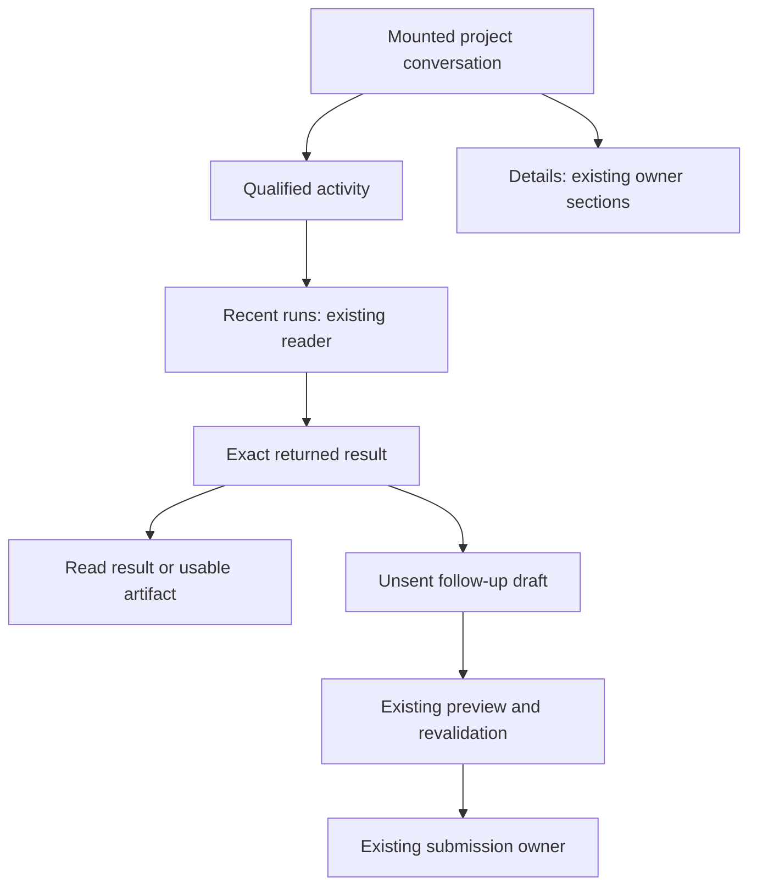

# Paper workflow and buildability audit — 8 November 2026

This is a scoped amendment and evidence appendix to [the existing Daily Flow specification](MASTERMIND_OS_DAILY_FLOW_SPEC.md), not a new product, task registry, runtime, or design system.

## Assignment and acceptance

Chairman assignment: audit and improve Paper designs, feature viability, architecture, navigation, clarity, illustrations/motion and implementation instructions; consolidate or retire obsolete material where justified.

DONE_WHEN for this audit pass: inspect the design portfolio and representative current journeys; compare selected designs with actual source; apply useful, source-compatible improvements in Paper; inspect desktop/mobile screenshots; retain exact design identities and concrete builder contracts. Unvisited screens and unproven software behavior must remain explicitly unverified. This design commission does not deploy software or arm runtime controls.

Procedure: Mastermind protected master `5c3d3885234358aefb97ecdbc59be0864df14f8b`, skillpack 1.0.1 / bootstrap 1. Product doctrine and visual system: Macro main `0a0e48e48f6f2f9ca7548e1f0fdc5dc838d9d964`. Canonical product contract: `app/mastermind_os/README.md`, `app/mastermind_os/docs/project-team-execution.md`, `src/projects/ProjectWorkspace.tsx`, `src/projects/ProjectDetailsNavigator.tsx`, `src/conversations/ProjectExecutionHistory.tsx` under `app/mastermind_os`.

Design carrier: Studio Direct C2 Business guarded Paper actions. Current OS file `01M3NRCX55B452A12819WNE1RH`; exact-target edits only. No canvas work has been delegated. Native child architecture_audit performed read-only architectural judgment; findings consumed. Direct design reason: PRINCIPAL_JUDGMENT and LOWER_TOTAL_OVERHEAD for coupled visual/behavior decisions. WHY NOT FABLE: bounded design synthesis uses the current principal without another management layer.

## Existing work preserved

- Five primary destinations: Today, Projects, Inbox, Conversations, Knowledge.
- Canonical Atelier pages 12–12D and page 13 builder guides.
- Simplified project conversation with Files and Details, not the old seven-tab default.
- UX18 (`XGI-0`) already records current November source capabilities; do not repeat its October census.
- Existing owner commands/readers, exact project/run/result references and mounted composer.
- Existing source-reader unknown effects: `mm-knowledge-flow-added-state-shells-20261004-001` on SPU-0/STU-0 duplication and `mm-knowledge-guide-mobile-chrome-amendment-20261004-001` on T0J-0 remain fenced. This audit will not touch those targets or settle them by inference.
- Recent separate work in market files is preserved. File recency is not proof of a live writer; edits will be target-disjoint and preceded by exact reads.

## Bounded phases

| Node | Change | Acceptance |
|---|---|---|
| P1 | Portfolio inventory and source/design comparison | Exact file/page identities, representative screenshots, concrete gaps without stale capability claims. |
| P2 | Project active-work and outcome discovery, desktop/mobile | Who is working, current task, observed status and result path are recognizable; conversation/draft remains primary; no fake progress or authority. |
| P3 | Project details and orchestration illustration | Clear contextual destinations; compact hierarchy/return illustration using existing owner semantics, with readable narrow-screen reduction. |
| P4 | Builder implementation and motion contract | Existing source seams, meaningful states, event rules, accessibility, return/follow-up semantics and ordered proof are specified. |
| P5 | Cross-product clarity and canonical cleanup | Representative market designs checked; safe concrete copy/navigation corrections applied where grounded; duplicate/legacy dispositions recorded without unsupported deletion. |
| P6 | Visual verification and durable readback | Changed targets re-read, desktop/mobile captures reviewed, owned working indicators released; actual effects distinguished from software acceptance. |

## Initial architecture findings

1. ProjectExecutionHistory already exposes read/open/reply for at most eight original-principal project runs. A compact recent-result entry is viable. Do not promise complete history or create a new store.
2. A completed-result follow-up creates a new run under the same project, linked to the verified prior result. It does not reopen a terminal root.
3. ProjectDetailsNavigator already supplies Direction, Plan, Work controls, Standing instructions, Project permissions, and History and sources. These belong in Details.
4. Durable versus attended execution changes whether a user may close the app. Show the consequence from qualified owner data near active work or Start preview.
5. AutonomyPanel reads existing limits; it is not an editable permission grant. No new slider, auto-resume authority or allocation control is implied.
6. Today attention is selected-task scoped. Avoid company-wide all-clear claims from partial coverage.
7. A graph is a projection of existing parent/child/run/result data. No new lifecycle, queue, event log or scheduler.

## Evidence status

Initial plan saved before substantive canvas effects. Source inspection is not deployed proof. Paper inventory returned 39 resources including folders, archived copies and tool-acceptance files; this is not 39 audited products.

Results, exact edits, verification and the remaining implementation acceptance contract are recorded below. This branch is a reviewable source amendment, not protected adopted law. PLAN_NOT_ORG_LINKED: no unique existing design workstream identity established; no substitute workstream was invented.

## Applied milestone — project journeys

Guarded Paper edits returned APPLIED_RESPONSE_OBSERVED for the following targets:

| Journey | Desktop | Mobile | Effect |
|---|---|---|---|
| Active project | MHD-0 | N29-0 | Replaced the vague progress card with a compact coordinator/task hierarchy, activity destination, attended-execution consequence and recent-run entry. |
| Returned result | XLQ-0 / AT35 | XT2-0 / AT35M | Added a concrete result state with artifact inspection, explicit follow-up draft entry and contextual run details. |
| Project details | XYO-0 / AT34 | Y60-0 / AT34M | Added the six current source destinations with a focused return path and a concise project goal. |

All are on OS page p-H-0. Active and result desktop/mobile screenshots were reviewed; the result mobile composer and safe area remain visible. The first Details screenshot caught a Paper text-inheritance contrast defect; explicit token colors repaired all 26 affected labels, and final desktop/mobile screenshots were visually checked. Old hidden mobile details W8B-0 and its new-screen clones were marked REF ONLY rather than silently retaining competing extraction guidance.

One rename attempt returned DOCUMENT_CHANGED before application. Exact target XYO-0 was read back with its original name; the same carrier prepared the original OS file and a newly planned exact-target operation succeeded. No unknown effect or cross-carrier replay was introduced.

The team illustration is an example state, not proof that these named agents are running. The actual coordinator identity, descendant status, dependency and execution mode must be supplied by qualified existing owners. Without task-level facts, show a root-level summary and partial coverage, not invented roles. The returned-artifact action requires a qualified usable destination; otherwise the current result reader is the fallback. Continue from result opens an unsent draft; the existing preview/submission path revalidates the parent witness and creates a new same-project self-root.

### Source comparison clarified

ProjectWorkspace currently renders Files/Details disclosures after the mounted composer. AT34/AT34M depict the focused/scrolled Details content, not a replacement route, new modal authority or remounted workspace. Close/Back returns to the actual Details opener. ProjectDetailsNavigator changes presentation selection only and keeps its supplied owner sections mounted while navigating. Use its six sections; do not restore the old default seven-tab workspace.

### Cross-product audit findings accepted

A read-only representative audit found eight obsolete decorative colored inset rails in Intelligence Hub, cryptic ranking/desk labels, News teasers exceeding the current R3 two-line contract, and old News references visually preceding the current composition. Sector's new Explore routes, source-basis distinctions and keyboard-focus outline are useful current work and must be preserved. The bounded repairs and verified mappings are recorded below.

## Applied milestone — market clarity and reference organization

### Intelligence Hub · file 01M2VWK62FA5S4VVF6G7SBPE5J

Eight decorative inset accent rails were removed using the supported clone-and-replace composition path. Exported JSX was compared before/after: after ignoring changed node IDs and the removed boxShadow, all eight subtrees were identical. This preserved values, ordering, source caveats and existing layout. Exact replacements: 13H-0 → 6ZT-0; 1K0-0 → 703-0; 58F-0 → 70G-0; 21P-0 → 70T-0; 2DZ-0 → 716-0; 2PU-0 → 6ZG-0; 3FY-0 → 71J-0; 4LK-0 → 71W-0.

Current mobile lists 2OW-0 and 3F0-0 now have Company / Research index column labels (729-0 and 72D-0). The existing build board 6S-0 records the presentation amendment. All 30 records, the 17 price-covered + 13 missing-price grouping, valid zero values, listing identity, source date and filter/return rules remain. Neutral elevation effects and actual keyboard-focus treatment were not altered.

Fresh reads showed desktop headers already improved to Opportunity / Edge index and Desk readings, so they were preserved. No ranking, score blending or trade authority was introduced.

### News · file 01M5EXPMQTSBFBAM8KKG83FTZH

This pass first moved R3 composition 27K-0, preserving identity, onto the first page p-2-0 and marked four older fullscreen compositions REF · R2. A subsequent concurrent cleanup separated product, states and build content. Final readback shows p-2-0 **00 · Product · News** first, p-1-0 **01 · States & user help**, and p-3-0 **02 · Build & design rules**. The product rail is now 27L-0 on p-2-0; 27K-0 is **BUILD · News R3 architecture and tokens** on p-3-0. Those concurrent improvements were preserved and are not attributed to this pass. The five teaser treatments survived the move and were re-read. Note 27Y-0 was updated to the actual final page names. Existing access, recovery, responsive, localization and claim-comparison material remains intact.

Five teasers now use the frozen R3 two-line 12.5/18.5 ellipsis treatment while retaining full source text. Replacement wrapper / text nodes: 29C → 2FU / 2FV; 29X → 2FX / 2FY; 2BF → 2G0 / 2G1; 2C5 → 2G3 / 2G4; 2CP → 2G6 / 2G7 (all IDs end in -0). Screenshot readback confirmed the visible two-line treatment and unclipped evidence ladders. Row-anatomy note 28K-0 now names the exact rule and no-motion requirement; 27Y-0 points to the current product, states and build pages.

Primary source: Macro pin / research/product_intelligence_local_delivery/NEWS_RAIL_R3_SPEC_2026-10-22.md. R3 owns presentation; R2 retains behavior. Dark ships in the source law; light remains specimen-only. This audit does not release News.

### Sector Intelligence · file 01M6FAXA774QT1VRDMAG7DFQ2W

On FB7-0, FEO-0 now reads: “Energy’s price is holding up while its cycle has turned down.” The exact 21-session ETF and 20-session member-basket bases remain in their controls/charts/table, along with contradictions and model/prior distinctions. FEE-0 was already “Link to this view” on fresh read and was not rewritten. The recent GM1-0 audit notes, G4P-0 canary, market-map study layer and real focus outline were preserved. This is a copy-density improvement, not new market analysis.


## Applied milestone — Terminal consistency

Terminal file `01M3NSZGE8JWN2EZCSF0DT05RM` contained obsolete colored navigation underlines and colored container edges inconsistent with the current design doctrine. This pass repaired **28 navigation selections** and **14 connected-driver containers**. The selection now uses a quiet panel fill, stronger existing label and an 8 px radius; its existing 44/48 px control height remains. Connected-driver cards use neutral borders while retaining selected fill, numbered markers, evidence labels, dashed hypothesis patterns and all source wording.

All 28 navigation child subtrees were identical before/after after normalizing changed node IDs; the root's decorative edge was replaced with the prescribed fill/padding. All 14 container child subtrees were likewise unchanged; only the intended root border styles changed. A final current-page query found no remaining 3 px bottom borders in the inspected navigation population. Dark English, light Chinese and connected-driver screenshots were visually checked. The final connected-driver screenshot was taken after the additional container repair.

This is visual consistency work. It does not change research classifications, graph relationships, metrics, causal claims or trading authority. Real focus outlines, actual chart/relationship marks and semantic colored text remain. The localization-held board `189S-0` was outside these targets and remains untouched.

### Navigation replacement map

| Original node | Replacement node | Existing artboard |
|---|---|---|
| 8N0-0 | 1YHI-0 | 8M8-0 |
| 95N-0 | 1YHB-0 | 94K-0 |
| KUK-1 | 1YHT-0 | KQJ-1 |
| LSB-1 | 1YHW-0 | LOA-1 |
| V42-0 | 1YHZ-0 | V37-0 |
| 117Z-0 | 1YI2-0 | 1141-0 |
| 10RA-0 | 1YI5-0 | 10NC-0 |
| WFK-0 | 1YI8-0 | WBM-0 |
| 129T-0 | 1YIB-0 | 126W-0 |
| 12LA-0 | 1YIE-0 | 12I6-0 |
| 164Y-0 | 1YIH-0 | 15YJ-0 |
| 16BJ-0 | 1YIK-0 | 165P-0 |
| 15XH-0 | 1YIN-0 | 15UK-0 |
| 16FP-0 | 1YIQ-0 | 16CL-0 |
| 16KS-0 | 1YIT-0 | 16GR-0 |
| W6P-0 | 1YIW-0 | W2R-0 |
| VY9-0 | 1YIZ-0 | VUB-0 |
| 15JL-0 | 1YJ2-0 | 15FN-0 |
| 15TI-0 | 1YJ5-0 | 15PE-0 |
| 15OC-0 | 1YJ8-0 | 15KN-0 |
| 17P0-0 | 1YJB-0 | 17JT-0 |
| 8CS-0 | 1YJE-0 | 8BO-0 |
| 8IB-0 | 1YJH-0 | 8HJ-0 |
| 8OE-0 | 1YJK-0 | 8NK-0 |
| 16PT-0 | 1YJN-0 | 16LU-0 |
| 16TJ-0 | 1YN0-0 | 16QJ-0 |
| UVJ-0 | 1YN7-0 | UUO-0 |
| 15EL-0 | 1YNA-0 | 1580-0 |

### Connected-driver container map

| Original node | Replacement node | Theme | Change |
|---|---|---|---|
| 10FL-0 | 1YQO-0 | light | Uneven colored edge → even neutral border |
| 10FS-0 | 1YR7-0 | light | Uneven colored edge → even neutral border |
| 10G6-0 | 1YRF-0 | light | Uneven colored edge → even neutral border |
| 10FZ-0 | 1YRU-0 | light | Selected border → neutral; fill and label retained |
| 10GD-0 | 1YSR-0 | light | Hypothesis border → neutral; dashed pattern retained |
| 10GR-0 | 1YSX-0 | light | Hypothesis border → neutral; dashed pattern retained |
| 10JR-0 | 1YT4-0 | light | Builder separator → neutral |
| 1638-0 | 1YTV-0 | dark | Uneven colored edge → even neutral border |
| 1631-0 | 1YU3-0 | dark | Uneven colored edge → even neutral border |
| 162N-0 | 1YUI-0 | dark | Uneven colored edge → even neutral border |
| 162U-0 | 1YV2-0 | dark | Selected border → neutral; fill and label retained |
| 162I-0 | 1YVA-0 | dark | Hypothesis border → neutral; dashed pattern retained |
| 1625-0 | 1YVM-0 | dark | Hypothesis border → neutral; dashed pattern retained |
| 15YL-0 | 1YVX-0 | dark | Builder separator → neutral |

The 14 containers belong to the existing light/dark connected-driver artboards `8M8-0` and `15YJ-0`. No replacement navigation system or component owner was introduced.

## Product and architecture decisions

### What users should understand immediately

The OS workspace leads with three things: the subject of the work, its observed state and the next useful action. Active work shows a compact hierarchy only when the existing owner can supply the actual coordinator and descendant facts. A result changes the primary action to inspecting the returned work, followed by an explicit draft-only next step. Files, permissions, history and implementation context remain available without competing with the conversation.

The four added boards complete two missing desktop/mobile pairs rather than adding global destinations:

- **AT34 / AT34M:** the focused Project details disclosure, using the six current source sections.
- **AT35 / AT35M:** a returned result, its usable artifact destination or reader fallback, and Continue from result.
- The existing **AT03 / AT03M** active project is improved in place.
- The index's Project workspace row now lists Active, Details and Result with the corresponding board numbers. UX18 carries the build and proof contract.

These designs preserve the distinction between an observed result and acceptance of that result. “Result returned” does not mean accepted, published or deployed. The example coordinator, task names and artifact are illustration fixtures, not claims about a running system.

### Existing owner, required integration and proof

| Feature | Existing source capability | Required implementation work | Acceptance in the composed App |
|---|---|---|---|
| Workspace and Details | ProjectWorkspace composes supplied owner slots; the composer remains mounted. ProjectDetailsNavigator has six current sections. | Apply the hierarchy and visual treatment without replacing component instances or moving reads into presentational components. | Navigate each section and Back; preserve draft text, selection, pending operation, owner state and contextual focus. |
| Active team illustration | Existing execution/supervision owners supply qualified run observations. | Resolve this exact project/root and actual coordinator. Project descendants only when supplied with their relationship and status. Provide a root-only fallback. Task-level descendant availability was not established by this inspection. | Current, partial and absent task facts remain truthful. No hardcoded production “Sol,” inferred Review queue, progress percentage or fabricated worker. |
| Recent runs | ProjectExecutionHistory reads at most eight original-principal project runs and supports exact result reading/reply. | Add compact entry points and honest coverage wording. Preserve execution status separately from read quality. | Zero, one and eight returned records; partial coverage; exact project/principal/run selection; correct opening and return. No complete-history promise. |
| Result and artifact | Existing result reader and completed-run context are present. | Bind a usable artifact destination only when actually supplied and authorized. A typed, qualified design-destination integration was not established here; otherwise use Read result. | Missing, stale, restricted or wrong-project destinations cannot present a misleading Open designs action. Unreadable content does not undo completed execution. |
| Continue from result | Existing owner supplies a closed nine-field parent witness and revalidates it in preview/submission before one new same-project self-root. | Wire the compact action into the incumbent path. Preserve the exact witness, original operation and existing substantive draft. | Witness changes/missing data invalidate preview; current replay and competing-successor protections remain. No terminal-root reopening or second submission path. |
| Attended/durable consequence | Existing preview/admission differentiates the modes. | Project the qualified mode for this exact run. Use unavailable when it is unknown; retained mode wording must remain historical. | Installed behavior matches the displayed consequence. A fixture selector or configured service is not proof of durable execution. |
| Read states and accessibility | Existing readers and the reference presentation model provide meaningful states. | Keep lifecycle, read quality, coverage and access separate; integrate actual lifecycle updates, announcements and conditional focus recovery. | Failed reads retain known facts. Unchanged updates do not announce/animate again. Keyboard and reduced-motion users receive the same facts and actions. |
| Market repairs | Existing Macro templates, source populations and product specs remain authoritative. | Apply neutral container treatment, clearer index headings, the exact News teaser contract and concise Sector copy in the current components. | Values, order, zero/missing distinctions, source bases, evidence controls and real focus styling remain correct. |

Primary source links at the inspected Mastermind SHA:

- [ProjectWorkspace.tsx](https://github.com/mastermindx-market-intelligence/Mastermind/blob/5c3d3885234358aefb97ecdbc59be0864df14f8b/app/mastermind_os/src/projects/ProjectWorkspace.tsx)
- [ProjectDetailsNavigator.tsx](https://github.com/mastermindx-market-intelligence/Mastermind/blob/5c3d3885234358aefb97ecdbc59be0864df14f8b/app/mastermind_os/src/projects/ProjectDetailsNavigator.tsx)
- [ProjectExecutionHistory.tsx](https://github.com/mastermindx-market-intelligence/Mastermind/blob/5c3d3885234358aefb97ecdbc59be0864df14f8b/app/mastermind_os/src/conversations/ProjectExecutionHistory.tsx)
- [Project team execution contract](https://github.com/mastermindx-market-intelligence/Mastermind/blob/5c3d3885234358aefb97ecdbc59be0864df14f8b/app/mastermind_os/docs/project-team-execution.md)
- [News R3 specification](https://github.com/mastermindx-market-intelligence/macro/blob/0a0e48e48f6f2f9ca7548e1f0fdc5dc838d9d964/research/product_intelligence_local_delivery/NEWS_RAIL_R3_SPEC_2026-10-22.md)
- [Macro design doctrine](https://github.com/mastermindx-market-intelligence/macro/blob/0a0e48e48f6f2f9ca7548e1f0fdc5dc838d9d964/docs/DESIGN_DOCTRINE.md)
- [Master product design system](https://github.com/mastermindx-market-intelligence/macro/blob/0a0e48e48f6f2f9ca7548e1f0fdc5dc838d9d964/research/MASTER_PRODUCT_DESIGN_SYSTEM_V1.md)

### Composition and command boundary



The diagram describes UI composition and user actions, not a new runtime. App.tsx supplies qualified readers/commands. ProjectWorkspace renders those supplied surfaces. A local navigation selection does no read, send, admission or grant by itself. The current source owners continue to control identity, authorization, persistence, effect reconciliation and execution.

The parent witness must be passed intact from the owner; do not reconstruct it from a root ID and result label. The current contract binds the prior root/creation evidence, project source, private input, completed attempt, aggregation and terminal receipt. Preview and submission re-prove the complete object. The existing transaction resolves same-key replay and prevents a distinct competing successor. The successor is a new self-root in the same project; the previous root and its original input/result evidence remain unchanged.

## Read states, processes and recovery

Production must model these as separate concerns, using the existing owner types:

1. **Execution lifecycle:** what the run is known to have done.
2. **Read quality and time:** whether the displayed observation is current, retained, stale or unavailable.
3. **Coverage:** what this reader returned and what remains outside its coverage.
4. **Access and action qualification:** which content/destinations/commands are usable for the current principal and source binding.

Do not collapse these into a single status enum that overwrites a known completed result when a network read fails. A partial list can contain a known working run; an unreadable artifact can belong to a completed run; an uncertain operation can coexist with an already established run identity. The UI should preserve those distinctions with short visible labels and contextual detail.

The prototype has nine **independent scenarios**, not a universal sequential state machine. Its controls say Scenario / Load scenario. Switching fixtures does not simulate event ordering or prove retained-result transitions. The unknown-request fixture deliberately has an original operation and no current run identity; it is not a general rule that unknown effects erase run identity.

| Example scenario | Primary presentation | Legitimate next step | What must not be implied |
|---|---|---|---|
| Current working | Coordinator and supplied tasks; qualified mode consequence | View activity or recent runs | Timed progress, guessed descendants or durable operation from appearance |
| Returned result | Result/artifact card | Inspect; open an unsent follow-up draft | Accepted, published, deployed or automatically continued |
| Stale | Last-observed wording and source time | Refresh/read existing context | Current worker state |
| Disconnected read | Retained facts with failed-read status | Recover the existing read | That a worker stopped, failed or reverted from completed to working |
| Partial coverage | Known root/task facts and a visible coverage limit | Inspect available activity | Complete team or company coverage |
| Result content unreadable | Known completion with unavailable content | Read the existing result again | A new run, resend or loss of completed status |
| Original effect unknown | Original operation and any established identity | Inspect/reconcile the original operation | Automatic retry, replacement effect or a second carrier |
| Initial loading | Reading state; no invented current run | Await the existing reader | Live execution before an observation exists |
| Empty reader | No runs returned within this reader's scope | Inspect coverage or current existing start path | No activity anywhere, or fabricated example history |

### Required transition cases for the builder

| Transition or event | Expected behavior |
|---|---|
| Known working → stale/disconnected | Keep the last qualified payload and time, qualify the wording, stop any reveal motion. |
| Known returned result → failed refresh | Retain the returned result and completion status with stale/read-failure qualification. Do not replace it with a historical working fixture. |
| Completed run → unreadable content | Keep completion; offer read recovery for the exact result. |
| Current task facts → partial coverage | Remove unsupported descendant claims; retain known root/task facts and expose the coverage limit. |
| Qualified result → parent witness no longer current | Preserve the user's draft; mark any open follow-up preview unqualified. Require explicit fresh preview through the existing owner. A later result does not silently requalify the old preview. |
| Existing nonempty draft → Continue from result | Preserve the draft and explain the available next step; do not overwrite it. |
| Original operation becomes uncertain | Keep its operation key and any known run identity; use original-effect reconciliation. Do not resend. |
| Files/Details/owner-section navigation | Keep composer and supplied owner panels mounted, with draft/selection intact. Return to the available exact opener. |
| Focused action disappears on refresh | Move focus to a stable contextual project heading. If its element remains available, preserve focus and cursor selection. Do not move focus for a mere announcement. |
| Project/principal/source binding changes | Invalidate stale references and action qualification; apply the existing private-draft/owner-change policy. Sign-out or owner change must not leak private drafts into another scope. |
| Unchanged source update | No repeated announcement or motion, no fabricated new activity. |

## Illustration, motion and visual treatment

The new illustration is an original, compact vector hierarchy: coordinator → supplied tasks, followed by an original device/result icon. It communicates ownership and a concrete returned artifact. It introduces no decorative autonomous-agent theatre, animated queue or fabricated progress. The mobile version reduces the hierarchy while preserving the meaning and next action.

Atelier retains its charcoal surfaces, ivory text, champagne actions, Manrope/Inter hierarchy and quiet neutral containers. The institutional market products retain their existing light/dark Macro token families. They are not restyled into one theme.

Motion contract for OS:

- One opacity/4 px transform reveal of **180 ms** for a newly observed material working/result change.
- No recurring pulse, timer-driven progress, automatic step advancement or animation on a settled result.
- Stale, disconnected and unknown states rest; motion never launders read uncertainty into a live claim.
- Cancel prior reveals before a new eligible update.
- Respect both the system reduced-motion preference and the reference's explicit toggle. Every fact and action remains available without animation.
- Announce material changes once through a polite status region; preserve available focus. Recover deliberately only when the focused target disappears or becomes unusable.
- News R3 retains its separate **no-motion** rule.

Interactive destinations should meet the existing touch/focus contract. Verify the real keyboard focus outline; do not replace it with a persistent selected border. In News, the evidence ladder is the control: wrap at step boundaries, preserve its coarse-pointer target, and never clip it to satisfy the teaser treatment.

## Builder sequence

### 1. Preserve the current composition

Start in the existing App/ProjectWorkspace/ProjectDetailsNavigator seams. Style the six supplied sections and the Files/Details disclosure. Keep the composer instance and pending-operation owner stable. Use current design tokens and shells; market navigation remains the canonical site/public navigation templates from the existing component inventory.

Acceptance: all six Details sections open and return without remounting the composer or losing draft, cursor selection, owner state or pending work. Selection itself creates no backend request or permission.

### 2. Add the read-only activity projection

Adapt qualified existing owner data into the compact active-work card and recent-run entry. Use the exact project and root references. Display actual coordinator/task names only when supplied; otherwise use the root-level summary and coverage limit. Keep lifecycle, freshness and coverage independent. No new poller, event store, queue, scheduler, retry service or execution controller.

Acceptance: controlled owner fixtures cover current, retained, partial, absent and denied/unavailable observations. Read quality cannot overwrite known execution facts. Today-level attention remains selected-task scoped.

### 3. Connect exact result reading and usable destinations

Reuse the existing result reader and retained input/result evidence. Make artifact navigation contingent on a usable owner-supplied destination with current access and matching scope. “Open designs” is an example of that qualified action; the unconditional fallback is not an invented URL, but the current Read result path.

Acceptance: current, wrong-project, stale, missing and restricted artifact destinations each have the correct state. Reading content or opening a destination cannot imply acceptance or deployment.

### 4. Connect draft-only continuation

Wire Continue from result to the incumbent reply/preview/submission owners. Pass the complete parent witness unchanged. Do not treat the reference's `state === 'result'` fixture condition as authorization. Preserve existing draft and pending-operation identity. Let the current owner revalidate and handle replay, competing successors and original-effect recovery.

Acceptance: no submit occurs from the card. The new draft is unsent, an existing draft survives, a stale witness invalidates preview, and the original completed root remains immutable. A real submission creates only the authorized new same-project self-root.

### 5. Apply interaction and motion

Implement the one-shot reveal, stable disclosure focus, exact-opener return with contextual fallback, announcement deduplication and reduced-motion parity. Long result/draft text preserves intentional line breaks. Loading/empty/unknown inspector views must not fabricate run IDs.

Acceptance: actual browser checks count animation creation and live-region changes, preserve textarea node identity/selection, and exercise updates while a disappearing action has focus. Mere zero currently running animations is insufficient proof that no animation was incorrectly started.

### 6. Port the market corrections through current components

Apply the neutral container/selection treatment in the existing Terminal and Hub components, preserving semantic marks. Keep all 30 Hub records, the 17 + 13 grouping and valid zeros. Add the two mobile index headings. Apply News's exact two-line teaser wrapper while keeping full text and the evidence ladder reachable. Use the concise Sector introduction without altering the 21-session ETF / 20-session member-basket calculations.

Acceptance: before/after data and order remain identical; full-source content and detail actions still work; current English/Chinese and light/dark variants retain their intended meaning. Do not arm the held localization board or change News's release status.

### 7. Prove the composed consumer

Verify the mounted App with controlled real-owner responses, then the exact installed build where execution claims are involved. Capture desktop/mobile behavior, source and build identities, and receipts for actual preview/admission/execution/result/follow-up separately.

The decisive path is: open exact project → inspect qualified activity → read verified result → open unsent follow-up → preview through existing owner → authorized submission → observe the resulting new run. Include Details/Back, owner change, stale/failed read after completion, original-effect recovery, reduced motion and keyboard at narrow widths. A Paper screenshot, model pass, accepted request or green CI does not establish that complete path.

## Deliverables and verification

### Source package

- [Interactive design reference](prototypes/project-activity.html): self-contained HTML, CSS, SVG and JavaScript; no external assets, dependencies, network requests, automatic runtime or submit action.
- [Pure presentation-model verifier](prototypes/verify_project_activity_model.cjs): extracts the actual inline model and checks the nine independent scenarios across three mode examples.
- [Browser verification suite](prototypes/verify_project_activity.py): prepared for an authorized browser environment; covers geometry, draft/focus, state/history identity, continuation preview invalidation, actual animation creation, announcement changes and reduced motion.
- [Exact Paper component extracts](prototypes/paper-journey-extracts.json): seven visual-reference JSX fragments with node identity and source pin. These contain composition, not production event handlers, authorization or runtime logic.

Exported component identities:

| Component | Paper node |
|---|---|
| Active desktop | XJZ-0 |
| Active mobile | XL0-0 |
| Returned result desktop | XXG-0 |
| Returned result mobile | XXT-0 |
| Details desktop | YAE-0 |
| Details mobile | YAQ-0 |
| UX18 journey build contract | YD2-0 |

Use these as visual implementation references inside the existing components. Do not ship Paper IDs as runtime identity, hidden legacy groups as new tabs, the reference's fabricated run values as actual data, or its fixture mode controls as a product setting.

### Checks actually completed

| Check | Observed result | Limit |
|---|---|---|
| Active/result/Details desktop and mobile Paper screenshots | Visually checked; the Details text-contrast defect was found and repaired; composer/safe area retained | Design composition, not browser or production behavior |
| OS full index and UX18 screenshots | Readable; current board mapping and source/build pointers present; focus contract visually checked after its final change | Not an interactive navigation proof |
| Intelligence Hub JSX comparison | 8/8 replacements preserve the subtree except node IDs and removed decorative shadow | Selected targets, not every product node |
| Terminal navigation comparison | 28/28 preserve children; selected root style matches the neutral-fill contract | Selected current navigation population |
| Terminal container comparison | 14/14 preserve children; neutral borders confirmed | Connected-driver targets only |
| Terminal representative screenshots | Dark EN, light ZH and connected drivers reviewed; final driver capture after container repair | Not a full localization/browser audit |
| News final readback | Five clamps still present after concurrent page organization; product and build screenshots checked; ladder remains visible | Frozen R3 presentation, no runtime/release proof |
| Prototype JavaScript syntax and Python AST | PASS after final edits | Syntax only |
| HTML structural inspection | 66 unique IDs, 15 HTML accessibility references, 86 literal JS element references; no dangling references or external assets | Static structure, not rendered accessibility |
| Actual inline model | **PASS: 27 scenario/mode cases** | No DOM, browser, witness validation, history-owner limit or installed runtime is executed |
| Static text/token contrast | Primary 16.88:1, secondary 9.44:1, tertiary 6.18:1 on panel; champagne 9.72:1; primary-button text 9.63:1 | Token math, not a rendered accessibility audit |
| GitHub file readback | Exact source content matched after updates | Reviewable branch content, not merged adopted law |

Run the pure model check with:

```sh
node docs/design/prototypes/verify_project_activity_model.cjs
```

The Python browser suite was **not executed successfully** in this session. Local Chromium failed before tests could run because its required socket operation was not permitted. The connected browser then explicitly rejected data-URL navigation under its protocol policy. That action was stopped; it was not retried through another browser, indirect hosting or a different carrier. No browser geometry, focus, animation-performance or production acceptance claim is made.

The suite uses a fresh run directory and a current RUNNING/PASS/FAIL receipt so a failed later run cannot leave an older PASS looking current. It is supplied for a future authorized environment, not as evidence that those checks passed here.

The independent architecture return was consumed as bounded reasoning, not a GitHub approval or a release authorization. The review's substantive corrections—independent scenarios, retained-result semantics and conditional focus recovery—are reflected in this source package.

## Portfolio disposition and cleanup

| Product family | Inspection and disposition |
|---|---|
| Mastermind OS | Source comparison plus current index/workspace/Details/result/build journeys; active pair improved and four new boards added. Existing navigation, owners and unknown-effect fences retained. |
| Intelligence Hub | Current desktop/mobile/list and build contract inspected; eight rail repairs, two mobile headings and a build note applied. |
| News | R3 product/contract and R2 references inspected; five teaser repairs, initial reference organization and final current-page pointers applied. Concurrent product/states/build split preserved. |
| Sector Intelligence | Representative comparison/market-map work inspected; one concise introduction applied. Recent audit, source-basis distinctions, canary and focus treatment retained. |
| Terminal | Representative research/connected-driver layouts and light/dark EN/ZH navigation inspected; 28 navigation and 14 container corrections applied. Held localization target untouched. |
| PROPHET | Representative Opportunity study SYI-0 in file 01M3NT5Y3G5HTJHVR0K5W2MDJM inspected. Ready/near/wait/stale/unassessed/unavailable distinctions preserved; no speculative redesign applied. |
| Global Macro Intelligence | Representative 61M-0 in file 01M5H6EARN9YHQV17JC6ZG9BRY inspected. Theme → dated documented product connection → company evidence and explicit coverage retained. |
| Market Memory | Representative 1-0 in file 01M6PXFEP1E1T59M2B3N673PMG inspected. House observation versus vendor vintage kept distinct; missing values were not replaced with invented plots. |

This is a substantial representative audit of **eight product families**, with changes in **five Paper files**. The 39-resource inventory also includes folders, recovery/canary material and copies. It is not an exhaustive audit of every screen, behavior, locale or product. Market Guide, Macro Policy, International Markets, Ontology, AI, Options and other catalog material not covered here remain unverified in this pass.

Cleanup favored clear authority and extraction boundaries over destructive removal:

- Twenty-one already hidden legacy heading/tab/overview/journal groups across active/result/Details boards were renamed REF ONLY after confirming their CSS `display: none`. Three old mobile Details containers were also marked REF ONLY.
- Current exported components exclude those hidden legacy groups. Paper's generic visible flag was not used as proof of CSS visibility.
- Four News R2 fullscreens are reference-only; useful states, localization, access and behavior guidance were preserved.
- Stale OS index counts and the old seven-tab builder wording were replaced. The active/result/Details mapping is now discoverable from the Project workspace entry.
- UX18 points to this real source amendment and the actual prototype. The previous Macro candidate path was absent at the inspected Macro pin; that does not claim it is absent at every branch or future revision.
- No standalone delete or archive operation was used. No tool-schema hold, denied action, inherited unknown effect or live-writer target was bypassed.

## Final Paper release and continuation boundary

Exact-target edits were made through the same Studio Direct C2 Business carrier and read back. The original document-change rejection was reconciled before a newly planned same-carrier edit. No new uncertain Paper effect remains from this pass.

Owned working indicators were released with explicit target lists, each returning APPLIED_RESPONSE_OBSERVED and OK:

| File | Exact file identity | Released roots | Receipt |
|---|---|---|---|
| news | 01M5EXPMQTSBFBAM8KKG83FTZH | 27K-0, 1-0, 9B-0, H3-0, M3-0 | APPLIED_RESPONSE_OBSERVED |
| terminal | 01M3NSZGE8JWN2EZCSF0DT05RM | 8M8-0, 94K-0, KQJ-1, LOA-1, V37-0, 1141-0, 10NC-0, WBM-0, 126W-0, 12I6-0, 15YJ-0, 165P-0, 15UK-0, 16CL-0, 16GR-0, W2R-0, VUB-0, 15FN-0, 15PE-0, 15KN-0, 17JT-0, 8BO-0, 8HJ-0, 8NK-0, 16LU-0, 16QJ-0, UUO-0, 1580-0 | APPLIED_RESPONSE_OBSERVED |
| hub | 01M2VWK62FA5S4VVF6G7SBPE5J | 10M-0, 1IN-0, 1UX-0, 20C-0, 2CM-0, 2OW-0, 3F0-0, 4KM-0, 6S-0 | APPLIED_RESPONSE_OBSERVED |
| sector | 01M6FAXA774QT1VRDMAG7DFQ2W | FB7-0 | APPLIED_RESPONSE_OBSERVED |
| os | 01M3NRCX55B452A12819WNE1RH | MHD-0, N29-0, XLQ-0, XT2-0, XYO-0, Y60-0, XGI-0, KSB-0 | APPLIED_RESPONSE_OBSERVED |

A final focus-contract amendment to UX18 was then re-read, visually checked, re-exported, and released separately on XGI-0 with the same observed receipt state. Other sessions' new News pages/product artboards and the Terminal held target were not globally released.

Design outcome: the bounded Paper audit and source-compatible design improvements are proven at the canvas/composition level, with exact source extracts and a concrete implementation plan. The source package is a reviewable GitHub change. Implementation, browser acceptance, provider execution and deployment are separate future build outcomes and have not been claimed. The original inherited unknown-effect operations remain fenced exactly as recorded above.


## Continuation — direct implementation links and full portfolio coverage

Chairman continuation on 8 November 2026: link implementation notes directly into Paper and continue improving the design portfolio across all files and pages autonomously. The prior pass is merged in PR #2306 (merge 7c12da6857e3d97f3bafa746c85ba02527b939e6); its accepted changes and outstanding proof boundaries remain.

This continuation uses protected Mastermind pin 1d0579c0540f5281e52faf069dd7dba2f480c7c6 and Macro design-source pin b5674d8ef898e503d6164922654f5ff89be9981c. The applicable continuing-execution, reliability, delegation, continuity, delivery and review laws are byte-identical to the previously loaded pin. Macro doctrine now explicitly includes Product / States & user help / Build / Archive separation. No old result is reclassified as production proof.

Current exact inventory: 82 resources, comprising 80 files and two folders, with no truncation flag. Many are migrated studies, archives, copies, safety canaries or recovery material. The inventory is a coverage input, not 80 distinct live products.

### Continuation acceptance

- Account for every discovered file and page with an explicit current-product, state/help, build, study, archive, fixture/recovery or other-purpose disposition.
- Inspect active journeys and their builder references, compare source owners where behavior is changed, and repair useful concrete clarity, workflow, navigation and visual defects.
- Replace plain implementation-path mentions with usable, named source hyperlinks where needed. Keep full implementation depth in a Build destination; product frames stay concise.
- Provide a discoverable implementation destination for each current product family/page group, with exact frame and source references. Existing working links are retained rather than duplicated.
- Preserve original requirements before simplification; retained archives and immutable regression/recovery material receive coverage records rather than cosmetic mutation.
- Verify changed nodes by readback and screenshot, and distinguish link binding from browser-click or shipped-product acceptance.
- Save milestone deltas and the complete page-coverage evidence in this existing audit's source package, then continue to the next ready cohort in the same healthy turn.

### Execution lanes

1. Inventory all exact files/pages and identify current authority, useful studies and protected historical material.
2. Link the already merged OS audit/build reference into Paper with actual named hyperlinks.
3. Audit current product workflows in complementary cohorts; principal owns canvas effects while bounded native reasoning children assess architecture, visual hierarchy and viable feature processes.
4. Patch verified defects and source-link builder destinations through the accepted direct Mastermind Paper carrier, with exact-target pre-read, stable operation ID, post-read and visual inspection.
5. Reconcile portfolio navigation and documentation coverage; release only owned working indicators and preserve explicit unresolved boundaries.

Design judgment and coupled canvas edits remain principal work (PRINCIPAL_JUDGMENT / LOWER_TOTAL_OVERHEAD). Native children have bounded read-only reasoning roles; they do not create canvas writers or substitute for Fabric build labor. WHY NOT FABLE: direct coupled design judgment plus bounded peer analysis does not justify another principal management layer.

New logical mutations use the accepted direct Mastermind Paper route. Every prior applied Studio mutation was reconciled; the inherited unknown-effect operations on SPU-0/STU-0 and T0J-0 remain fenced and untouched. No denied browser action is reopened. No Paper runtime, permission, account, tunnel, token schema or held writer is modified by this commission.

PLAN_NOT_ORG_LINKED remains explicit: no unique existing organizational workstream identity was established, and no substitute registry is introduced.


### Continuation milestone 1 — source access, navigation and migration clarity

The current portfolio census returned 82 resources: 80 catalog entries typed as files and two folders. Seventy-nine files returned readable design metadata, containing 502 pages before this continuation added an AERLOR start page. The remaining entry, Others (01M3NSWX6SGTY4Z5DKBN4YP60M), behaves as a container: exact-file basic info reports no open design, while listing its children succeeds. It is recorded as a catalog/container anomaly, not an uninspected product. The page census is not an exhaustive visual audit.

**Observed linking limitation.** Both supported composition paths were exercised on useful OS source references: inline anchors in set_text_content and a top-level anchor in write_html. Both preserved text but exported plain Text/div/span nodes without href. Visible full source URLs are therefore labeled “copy source URL”; no clickable hyperlink or click-through proof is claimed. No unsupported link API, browser workaround or runtime change was attempted. The direct app’s paper_prepare helper separately reported “No module named prepare”; exact-file get_basic_info returned write_binding_ready and guarded paper_edit subsequently succeeded through the same direct carrier. The unchanged helper error was not retried.

Applied continuation work so far:

- OS: implementation and motion source URLs in UX18/YDT-0 and a source entry ZM6-0 in canonical index Q9I-0. Readback confirms the URLs; the source panel screenshots fit. The final labels explicitly describe copying URLs.
- News: 2JI-0 now carries actual R3 presentation and R2 behavior/state source URLs; 2JJ-0 carries the design doctrine; 2J8-0 describes the preserved requirements. Exact JSX and screenshot readback confirm the source references and no clipping.
- Hub: 73D-0 names the existing Paper research-list build contract and current scripts/build_china_intel.py owner; 73E-0 carries the doctrine URL. Existing 30-record, zero/missing, filtering and recovery contracts are retained.
- GMI: 73R-0 carries the existing build plan’s selected-relationship/return contract and evidence-motion reference; 73S-0 carries the doctrine. These link to current-main source and do not claim a newly implemented GMI journey.
- Sector: GOL-0 connects the local R4M1 and Explore reference pages. GOM-0 names existing D05 candidate PRs #10703 and #10707 with Draft/HOLD qualification. Current PR heads were read; no production or model qualification was promoted.
- Market Breadth migrated file 01M6Y3CRMC345RTB3ZDP3XSYRP: global Overview 9-0 was replaced by inactive 2H0-0; global Markets C-0 by selected 2H4-0 using a neutral fill/border. The local Overview tab remains untouched. Screenshot readback shows the corrected global selection.
- AERLOR: mobile text 5UX-1 and 5WW-1 now identifies “Project list · 0”; planner preview 5U3-1 now says “Project stage,” matching its visible field. A new first page p-A-0, root 6M0-0, distinguishes R5 source-backed design, later R7–R9 directions, retained references, existing source owners and R9 implementation acceptance. AERLOR source was independently read at c6f7deee41b9d941182130d9bfb95c1e84f8a319. No later-design deployment is claimed. Header and initial map/contract screenshots are readable.
- D06 migrated file 01M6Y1NJ2SKGG89DZ13E4NVAE2: WB-0 and WG-0 are named incomplete migration references and now contain exact completion/source destinations in WV-0 and X2-0. The complete Terminal p-18-0 boards 1XGS-0, 1XGT-0 and 1XGU-0 were freshly located; the full desktop was visually inspected. No allocation/model data was invented or copied into the incomplete frames. The phone redirect screenshot fits.

**Concurrent-work conservation.** The child review initially found stale Bot Portfolio IDs. Root’s fresh 1-0 read showed all twelve IDs and footer already corrected by concurrent work; those changes were preserved and are not credited to this continuation. A later additive source-note operation paper-portfolio-bot-sources-20261108-44569e75-023 returned DOCUMENT_CHANGED / retry_allowed=false. The exact original 27-0 target was then read; the attempted new source block is absent. No retry, replacement carrier or effect claim was made. This target is left to its current writer while independent portfolio work continues.

The three bounded read-only cohort returns are accepted as reasoning, not GitHub approval: architecture (9 files/30 pages; selected content and 8 screenshots), navigation (41 files/130 pages; 12 JSX boards and 2 screenshots), and product clarity (7 files/72 pages; 13 JSX boards and 8 screenshots). All distinguish metadata coverage from deep visual and interaction proof. Their stale Bot finding is explicitly superseded by root readback. Terminal’s additional focused Heatmap/portfolio reasoning identifies source-link and retained-clock clarity work; it does not establish a new accounting defect.

Remaining safe work in this same mission: finish exact readbacks and screenshots of all applied panels, add the independent central builder directory, connect the remaining qualified family sources, repair the Heatmap’s missing retained observation-time disclosure, persist the complete file/page disposition and effects register, and deliver one reviewable source amendment. All inherited unknown effects, localization holds, browser denials and archive/reference boundaries remain intact. This is a saved progress milestone, not parent completion.
