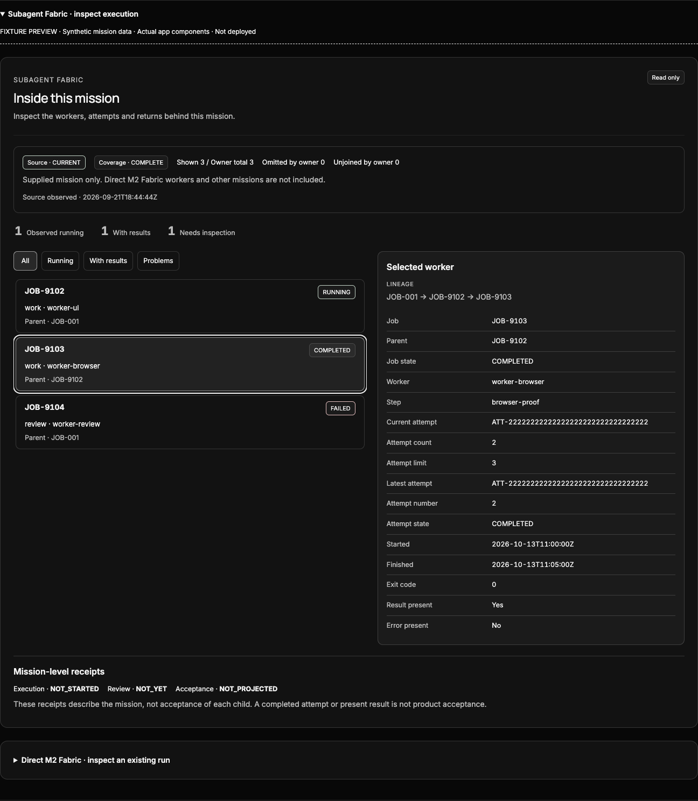
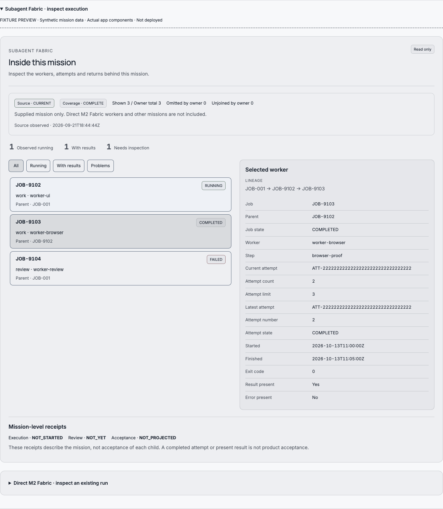
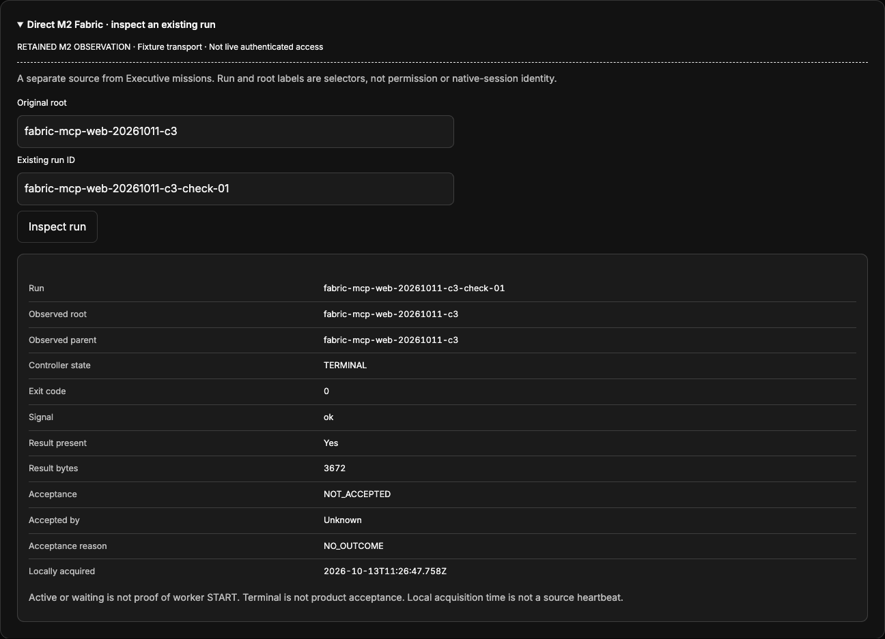

# Fabric interiors — qualification evidence

Status: **BUILT_NOT_PROVEN for production**. The app source has a real selectable Mission inspector and an optional direct-Fabric status consumer. This evidence does not establish a live authenticated M2-to-OS binding, all-worker discovery, production installation or parent mission acceptance.

## Verification

The final app suite passed **1,395 tests in 57 files**, with one existing skipped test and no failures. `npm run build` passed (TypeScript and Vite). It retains a large-chunk warning and the mixed static/dynamic Tauri import warning; no dependency or asset was added. `verification.json` binds each owned source file to its SHA-256 and records log hashes and compact output.

The first full run exposed an introduced extra-auth-observer regression in `App.operation-reopen.test.tsx`. A pristine base comparison passed the isolated case. The direct inspector was repaired to register no authentication observer when no reader is mounted, and a regression assertion was added. The previously failing complete 25-case file and final complete app suite then passed. Earlier failing runs are not represented as green.

Playwright exercised the **actual MetaCeoOffice components**, keyboard selection, 390px mobile and desktop layout, both app theme contexts, and a retained real M2 status through a fixture transport. No horizontal overflow or page errors were observed. Screenshots contain fixture/retained-observation watermarks.

The real read was `fabric_task.py status fabric-mcp-web-20261011-c3-check-01`. It reported terminal rc0/ok, an available 3,672-byte result, and **NOT_ACCEPTED**. No result content, prompt, credential, output stream or acceptance operation was fetched or changed. Its original owner remains responsible for the run. `m2-source-receipt.json` preserves the actual adapter and response digests.

## Screenshots

[Mobile fixture screenshot](fabric-mobile-dark.png)

## Reproduction

Use the same source revision and app lockfile. The `.fixture` files are deliberately outside the app build entrypoints. On an owned local workspace only, copy `preview.html.fixture` to `app/mastermind_os/fabric-proof.local.html`, `preview.tsx.fixture` to `app/mastermind_os/src/fabric-proof.local.tsx`, and `m2-status.json` to `app/mastermind_os/src/fabric-proof-status.local.json`. Start the existing Vite development command on loopback 127.0.0.1 port5199. With the existing Python Playwright environment, run `browser-proof.py`. The script performs no source writes, launch, cancellation, acceptance or production action. Its screenshots and receipt overwrite only its own evidence-directory output. Remove all three temporary app files and stop that owned preview after verification. Never publish the fixture entrypoints as authenticated app access.

The full source suite is `vitest run --maxWorkers=2`; the production build is `npm run build`. No repeat paid worker is needed to reproduce this evidence.
