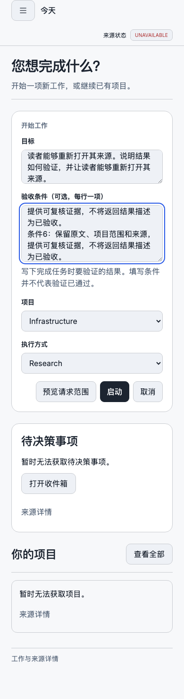
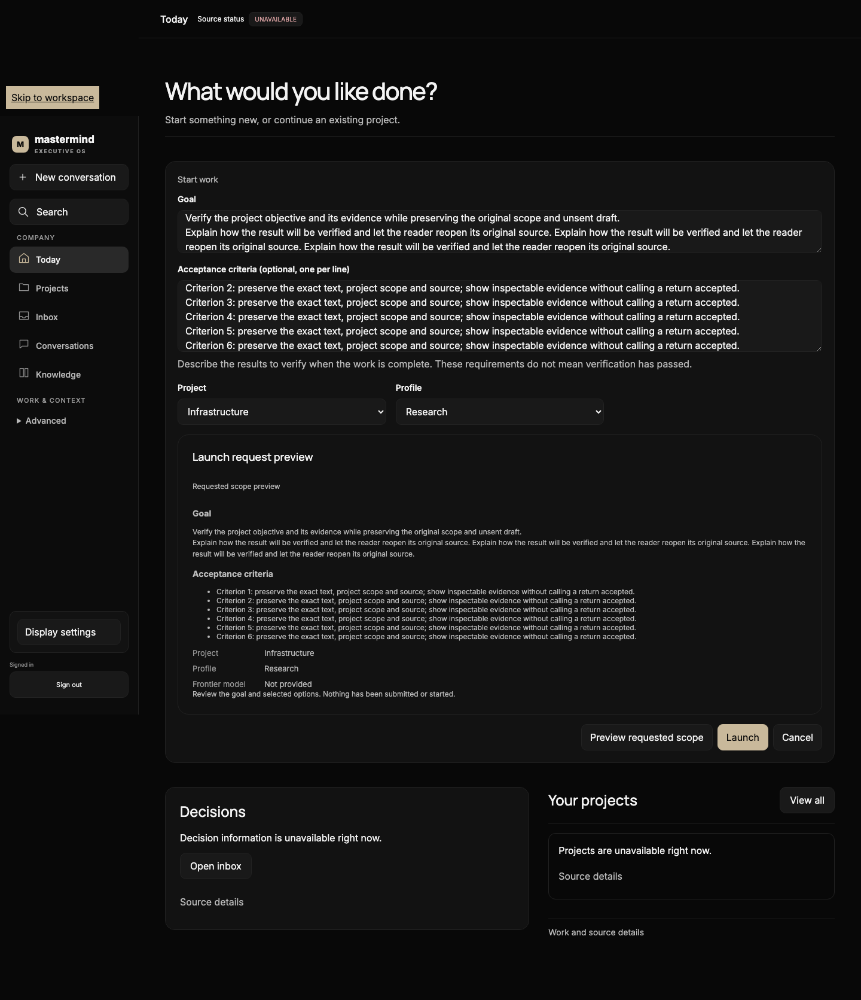

# S6 source and user-path verification — 7 November 2026

**Capability: BUILT_NOT_PROVEN. Mission complete: false.**

Carrier: `organization-live-experience-20261107-c3`, existing [PR #2193](https://github.com/mastermindx-market-intelligence/Mastermind/pull/2193). Baseline `6f367bc43cad6a4a7e9c85fc3282a1178ed2308c`; protected law pin `5f8c13da926011fb5fdc8cea21287b532ac968db`. The commit containing this evidence and the PR handoff bind the final candidate.

## What changed

- Configured reporting is explicitly labeled as role charters with session enrollment unobserved. Execution lineage remains separate.
- Current task, supplied next step, reported execution error and required pending review are visible without exposing internal receipts as primary content.
- Missing child observations render an unknown count. Counts remain scoped to the selected operation.
- Job/Attempt details use a disclosure. Back/Escape returns focus to the selected row; reopening the same row works.
- A qualified refresh retains search and deliberate selection. A disappearing or filtered selection is withheld with a notice, rather than silently replaced with another job.
- EN/ZH status labels and locale typography remain within the existing design rules.
- Current S0 and #2180 receive exact alternative mount patches; neither incumbent worktree was modified.

## Executed checks

| Check | Observed result | Limit |
| --- | --- | --- |
| Initial navigation regressions before fixes | 6 failed / 1 passed | Controlled consumer regressions over the existing producer export |
| Added selected-row/review regressions before fixes | 7 failed / 1 passed | Unknown review requirement already behaved correctly |
| Final organization suite | **86 passed, four files**, Vitest 5.43 s; process 6.71 s | Component/adapter proof, including jsdom keyboard interactions |
| TypeScript | Exit 0; process 1.52 s | Source compilation |
| Production build | Exit 0; process 1.93 s | Not load/navigation performance; chunk-size and ineffective dynamic-import warnings remain |
| #2180 exact mount | Git apply check passed; 286 root / 460 source files; zero diagnostics | Read-only virtual composition at `d7d5bfdb4bc656473a7e940dee07d0b437aed40d` |
| S0 exact mount | Git apply check passed; 290 root / 465 source files; zero diagnostics | Read-only virtual composition at `26604f550b42505808ea1b7ca2816be771aee5f5` |
| Existing S0 composer matrix consumed | Eight recorded FUNCTIONAL_PASS cases; 390/1440px × EN/ZH × light/dark | Retained fixture artifacts, not a fresh run or changed-O3 layout proof |

Both mount compositions used identical package-lock bytes to the existing installed dependencies. The exact file preimages, patch hashes, composition digests, test receipts and retained-image hashes are in [s6-qualification.json](s6-qualification.json). The concise executed log is [s6-checks.log](s6-checks.log).

The one intermediate 85/86 run failed because the Chinese test selected the text “审查” ambiguously; scoping the assertion to Operation progress resolved the test query. No production behavior was weakened to pass it.

Hosted CI on `18167126468567ddbfc31caa807d606aedf92e5b` found one new blank line at EOF in `s6-checks.log` ([run 42347539779](https://github.com/mastermindx-market-intelligence/Mastermind/actions/runs/42347539779), job 128328496014). The prior local diff check did not include then-untracked files. The log whitespace was repaired on the same branch; production source, tests and mount patch bytes are unchanged. The repair is checked across the complete PR change range.

## Reused visual artifacts

The original S0 matrix records 44px project/profile controls, no undersized targets, viewport-sized document geometry, retained unsent drafts, reachable submit controls, keyboard goal/criteria/preview flow, no raw acceptance marker, and empty captured error/blocked arrays in all eight cases. These are the producer's recorded results, not measurements of the new organization component.

The two images below were inspected and copied byte-for-byte from S0's existing `affected-view-dda7-01a1a4bf` evidence. Their source screen explicitly has unavailable live source data. They establish the retained composer presentation only.

### Existing 390px Chinese/light controls

### Existing desktop English/dark preview

## Actual authenticated and installed-path status

The Browser attempted the deployed OS origin but **automatic approval review denied origin access before navigation**. Its stated reason cited the missing originating browser connection and the previously closed Chrome recovery/credential path. The action stopped. No alternate browser surface, raw CDP, proxy, credential recovery or rephrased origin attempt followed.

Consequently, no page loaded in this turn. **Actual O3 load/navigation timings are unmeasured; page errors are unobserved.** There is no fresh authenticated browser, provider-turn or retained-result receipt.

A read of the installed macOS bundle's public Info.plist still reports source `fca92d5a3cef710932b46082eef98a258079f806` / build `mmos-project-teams-fca92d5a-20261106-sol-002`. That observation does not install the candidate or prove login/reopen. #2177's DeepSeek route remains unqualified; #2180's current source does not prove the newly packaged/authenticated native path. No new canary was sent.

## Acceptance still owed

| Journey | Current boundary | Required evidence |
| --- | --- | --- |
| Find project → current task/role/work | Qualified component and exact minimal mount | S0 composes the current app and opens a real selected project |
| Configured charter → actual enrolled session | Existing producer; host association missing | Owner-qualified session/viewer/Mission binding, without a new lookup or fabricated revision |
| Work → retained result → return | Existing exact result callback; App switches routes and unmounts Office | Nonfirst row + nonempty query survive result return with focus; auth revocation withholds old data |
| DeepSeek/Hermes chat, draft/history and reopen | Separate source candidates | Actual route/provider/session evidence from the qualified installed environment |
| Empty/denied/stale/partial | Consumer regression proof | Mounted app behavior under the real host |
| O3 EN/ZH, light/dark, keyboard, 390px and desktop | Source styles and jsdom interactions | Browser/native layout and keyboard evidence for the changed view |
| Assignment/worker execution | No S6 execution attempt | S2/S3 real-path proof |
| Native/web/mobile | Native metadata only; web origin denied; responsive fixture evidence | Explicit per-surface qualification; no native mobile claim |

## Exact continuation and recovery

S0 applies **one** matching patch from [the integration contract](../../../app/mastermind_os/src/organization/INTEGRATION.md) to its existing shared composition, preserves its accepted presentation fixes and native provider work, and closes external Result Back through the existing navigation owner. Then verify the original acceptance journey when the backend and access are qualified. The operator guide is [OPERATOR_RUNBOOK.md](../../../app/mastermind_os/src/organization/OPERATOR_RUNBOOK.md).

No shared App/Office/native source, provider configuration, runtime, protected original09b result, deployment or merge was changed. #2173 stays DO_NOT_REDO. Existing Paper/Chrome refusals and original runtime effect holds remain intact. The read-only adviser received ACCEPTED / STOP; no watcher or durable runner was created.
