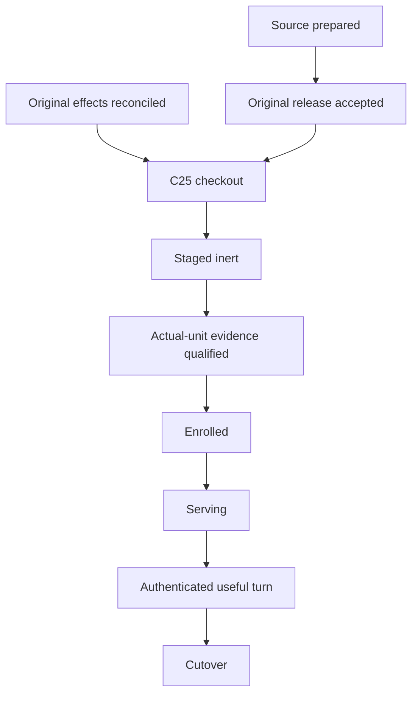

# H24-11: Control transition and role qualification readiness

## Scope and result

This source-only compiler makes the next **original-owner evidence read** finite.
It does not install, enable, reload, start, stop or modify anything. It neither
opens credentials nor clears the denied canary, serving/provider, credential or
cutover holds. The assignment owns only this document,
`ops/executive_os/hermes_p0_readiness.py` and
`tests/test_h24_hermes_p0_readiness.py`.

Implementation base: `b54cb10e4abdd3766c62d4088f6a576ecfe80437`.
Branch: `sol/h24-11-role-readiness-20261106`.
Procedure pin: protected Mastermind
`88a8b103a5a69e4b4e870a184655dde9fd5875c3`; compatible
`mastermind.sol_skillpack.v1`, version `1.0.1`, bootstrap major `1`.
The source-only assignment permits concurrent construction without a soft wave
seal. No PR #2120 integration file or C25–C34 exclusive source is changed.

The existing authority boundaries remain: GitHub owns source/release evidence;
Executive OS owns installation/admission; the incumbent Control installation
owner owns C25; the existing Ubuntu1 role/security owner owns C26; native
principal/issuer/provider owners own enrollment. H24-11 owns no durable state,
queue, identity, retry, signature, receipt publisher or runtime decision.

`READY_FOR_AUTHORIZED_NEXT_STEP` means that the **selected evidence boundary**
has been satisfied by authenticated injected receipts. It grants no permission
and predicts no later phase. An unqualified/missing source is not installed;
inert staging is not qualification; qualification is not enrollment; a process
is not an authenticated useful turn; none of those is cutover.

| Closed state | Meaning |
| --- | --- |
| `MISSING` | A required original receipt has not been supplied. |
| `INCOMPLETE` | Some evidence exists, but a required observation, accepted result or authentication proof is missing. |
| `REFUSED` | Identity/source/custody drift, invalid input, a real failed isolation observation, denial, live writer or unresolved original effect. |
| `READY_FOR_AUTHORIZED_NEXT_STEP` | All prerequisites for the selected evidence boundary are satisfied; authority remains with the original owners. |

Aggregation is conservative: REFUSED takes precedence over INCOMPLETE, then
MISSING, then READY. Partial results are returned alongside the verdict, with
named slots, fixed reason codes, blocked dependencies and a next permitted read.
Failure does not produce a command to retry or install.

## What is actually known at this checkpoint

These are retrieved owner reports, not H24-11 live-host observations or
machine-authenticated inputs to the compiler:

| Boundary | Retained evidence | Remaining original receipt |
| --- | --- | --- |
| Source/release | [PR #2120](https://github.com/mastermindx-market-intelligence/Mastermind/pull/2120) read open, unmerged, at the immutable assignment head. | Exact original PR release outcome and accepted selected commit/ancestry. Auto-merge intent is insufficient. |
| C25 | [Original clone diagnostic](https://github.com/mastermindx-market-intelligence/Mastermind/pull/2120#issuecomment-6678697126): sealed release, unrelated bad-tree clone failure, absent admin target, incumbent services unchanged. | Original effect reconciliation and a qualified checkout/stage/normalization receipt. Never retry the stale clone from this report. |
| C25 source repair | [Parent continuation](https://github.com/mastermindx-market-intelligence/Mastermind/pull/2120#issuecomment-6682039892): repair source commit `241f18bf1107a104d49afe8ae59c7aed35a0842f`, 39 focused cases reported passing. | Source repair is not evidence of installed checkout or selected Control. H24-11 does not adopt or modify this separately owned repair. |
| C26 permission | [Original bounded decision](https://github.com/mastermindx-market-intelligence/Mastermind/pull/2120#issuecomment-6678953137): credential-free A1/B1/A2 in actual units only, with external witnesses and exact restoration. | Any new actual-unit effect still requires current original-owner authority and reconciled source/host state. This compiler supplies neither. |
| C26 actual result | [Original A1 return](https://github.com/mastermindx-market-intelligence/Mastermind/pull/2120#issuecomment-6679238494): `INCOMPLETE`, 8 PASS / 5 UNAVAILABLE, native exit 78, provenance/context recheck false. Report SHA-256 `8122e98295cbaa6c77e791da98a30f6558f88defa9fc247dd9e48acedf6b1994`. | Missing same-child FD/inode listener witnesses and stable source/context; B1 and A2 were not run. Separate external positives do not repair this report. |
| C26 cleanup | The same return reports exact A1 override removal, restored original properties, no role PID/job and four sockets closed. Journal SHA-256 `62ac3f7408eb99c1d5095cb2d90c13306409a9c322d3e70b225118c57b787c0c`. | Retained authenticated cleanup bytes and fresh, source-bound observation before any future action. A failed/exit78, disabled unit remains non-serving. |
| Follow-on work | The parent continuation reports C29/C34 returned for review; C30 unaccepted; C31/C32 remote effects still uncertain. | Actual acceptance, enrolled principal, current issuer/source/provider entitlements and original worker-effect reconciliation. Terminal local controller cleanup does not establish remote worker completion. |
| Serving/useful turn | No installed native serving proof in these receipts. | Actual role processes, edge/proxy metadata, authenticated native result and browser acceptance; explicit cutover and rollback evidence afterwards. |

The supplied packet's newer Ubuntu1 observation says Secretary loaded/failed,
MainPID 0, last status 78, disabled; Meta loaded/inactive, PID 0, disabled.
H24-11 does not independently refresh that observation. Disabled describes
enable-on-boot policy; it is **not** a process-health observation. A legitimately
running but disabled unit can satisfy serving only with separate actual-process
and release evidence. A live role in an inert-stage receipt is refused.

## Input and trust contract

`compile_readiness(receipts, expected=..., verify=..., now=..., target=...)`
accepts an in-memory dictionary of original retained **bytes**. There is no CLI
path reader, host adapter, URL fetcher, subprocess, socket, service command,
secret reader or clock read. `now` is an explicit integer UTC epoch supplied by
the caller. No input or output is written or persisted by the checker.

`ExpectedSource` carries the independently pinned implementation SHA, protected
law SHA, original #2120 head, accepted upstream SHA and issuer fingerprint.
These expectations must come from the original owners; never learn them from
the candidate receipt being checked. A changed source or issuer requires
requalification under its existing owner, not a string substitution here.

It also carries `receipt_bindings`, an independently selected map of each slot
to `ReceiptBinding(source_ref, raw_sha256)`, and `original_operations`, the exact
original `origin`, `workers`, `c25` and `c26` operation identifiers. Every supplied
receipt needs its own expected original reference and byte digest. Matching two
identifiers supplied by the candidate is insufficient: another authentic C25
success cannot replace reconciliation of the original failed/unknown operation.
Missing independent selection stays INCOMPLETE. A different reference, digest
or original operation is REFUSED. Do not derive this map from untrusted input or
mistake C25's later source-repair commission for the earlier live-clone carrier.

The mandatory `verify(slot, raw_bytes)` callback represents the **existing
owner's non-effectful authentication/custody verification of already acquired
evidence**. It returns `ReceiptVerification(owner, source_ref, raw_sha256,
signature, custody_verified)`. The checker matches the exact slot owner,
independently expected reference and raw-byte hash. Signature is `VERIFIED`,
`NOT_APPLICABLE` for genuinely unsigned
original root-custody evidence, or invalid (refused). Custody must be verified.
No default permissive verifier exists. A `verified: true` property in untrusted
JSON cannot authenticate itself. Missing verifier evidence stays INCOMPLETE;
verifier failure, wrong owner/hash, invalid signature or custody stays REFUSED.

This module does **not** implement a new signing service or authenticate a host
on its own. The test suite uses a clearly fake HMAC authority solely to exercise
this boundary. Shipping those test receipts or that fake verifier as live proof
is invalid. Integration requires existing owners to provide their real retained
verification results; that collector integration is outside H24-11.

JSON is UTF-8, duplicate-key and nonfinite-number rejecting, depth/size bounded.
Booleans do not count as numeric process/identity facts. Each C26 report is at
most 256 KiB; other receipts at most 1 MiB; the complete bundle at most 4 MiB.
Validation errors do not echo private document values or verifier exceptions.
The compiler reports original-byte SHA-256 values for reproducible comparison.

### Receipt slots and owners

Native manifests and reports are parsed in their actual existing schema.
The other slots below are **local projections of retained original-owner
receipts**, not new canonical schemas or writable records. A projection must
retain its exact authenticated origin; a manually asserted summary is not a
substitute. The fake fixture builder documents executable examples of every
field, including real v2 output from the incumbent report producer.

| Slot / owner | Required contents |
| --- | --- |
| `source` / release-owner | Independently qualified immutable implementation/tree/law/upstream/issuer pins; original expected manifest/inventory hashes; probe source/loaded-code hashes; both role UID/GID, state path, profile/fragment/ExecStart/image hashes. |
| `release` / github-release-owner | Original PR metadata (`number`, `head_sha`, `merged`, `state`, `merge_commit_sha`), selected commit and protected acceptance. A distinct selected ancestor requires explicit accepted frozen-ancestor proof. |
| `effects` / original-operation-owner | Exact original `origin`, `workers`, `c25`, `c26` operation IDs and reconciled/terminal/no-effect states, no active writer/denial on the contemplated edge. Historical denied canary remains a separate hold; do not reinterpret it as authorization. |
| `c25` / control-installation-owner | Original operation/effect, clone diagnosis and accepted repair, unmodified `stage-admin-checkout-only` result and `mastermind.executive_admin_checkout_normalization.v1` result. The stage must report no service/config/selection/receipt/transaction change. |
| `manifest` / release-owner | Original `mastermind.executive_release_manifest/v1` bytes, exact tree/commit, entries and frozen `mastermind.hermes_runtime_installation/v1` roles. The existing manifest owner remains responsible for full sealed-closure/custody validation. |
| `installation` / control-installation-owner | Expected AND observed manifest/inventory hashes, sealed and inert-stage evidence for the exact implementation. |
| `incumbents` / control-installation-owner | Fresh before/after Control and Worker PID, birth, boot, invocation, implementation, config and running identities; unchanged throughout staging. |
| `units` / role-host-owner | Fresh host/boot and both exact PID1 unit identities; root fragment and ExecStart hashes; no transient/drop-ins/reload/job; disabled, zero MainPID/ControlPID, inactive or honest failed state. |
| `A1`, `B1`, `A2` / role-host-owner | Unmodified `mastermind.hermes_role_isolation_qualification.v2` bytes. Role order is Secretary / Meta / Secretary; each complete 13-case matrix is independently checked. |
| `qualification` / role-host-owner | Original operation/qualification ID, host/boot/netns/kernel, exact probe sources; each run's raw report hash, PID/birth, distinct invocation, start/end, unchanged fragment, actual unit start/terminal records, external brackets; explicit original host acceptance of the separate qualification evidence only. |
| `cleanup` / role-host-owner | Same operation/boot and all three report hashes; terminal processes, no residual children, closed external sockets, exact override removal, restored properties, untouched credentials and no serving start. |
| `enrollment` / enrollment-owner | Exact source/upstream/issuer, accepted C29/C30/C31 receipts, genuine enrolled principal and issuer entitlement, distinct role credential metadata/provider binding and accepted source/provider/credential entitlements. No credential contents. |
| `edge` / edge-owner | Fresh exact-source C34 acceptance, original proxy identity, edge metadata hash, TLS, vendor CONNECT ACL and cross-role denial proof. No synthetic edge inference from a role PID. |
| `serving` / role-host-owner | Separately authorized release, current boot/issuer and exact edge/enrollment hashes, fresh before/after actual role PID/birth/invocation/UID/GID/image/manifest/fragment/ExecStart. Secretary additionally requires its incumbent v3 main-only `{host, port, inode}` witness and exactly one matching kernel listener; no Meta v3 witness is invented. |
| `useful_turn` / native-session-owner | Same enrolled principal/source/issuer, exact serving receipt hash, role/invocation/native session, authenticated original operation/result digest, useful-result and actual browser-path acceptance. |
| `cutover` / cutover-owner | Same source and accepted useful-turn operation/hash, explicit authorization, actual completed incumbent transition, acceptance and proven rollback. |

`source_ref` means the exact retained object used by the incumbent verifier,
including its revision/hash as appropriate. Merely naming the owner or linking
to a PR discussion does not verify a receipt.

## The A1 → B1 → A2 rule

The [final-role qualification runbook](FINAL_ROLE_QUALIFICATION.md) owns the
actual 13-case protocol. [Role isolation](ROLE_ISOLATION_REPAIR.md),
[Ubuntu1 deployment](DEPLOY_UBUNTU1.md) and the
[native backend](NATIVE_SESSION_BACKEND.md) retain their existing boundaries.

The current v2 probe cannot itself establish the two outside-cgroup address
positives or current peer-file existence. Those three cases remain UNAVAILABLE
and the raw aggregate remains INCOMPLETE. H24-11 checks separate original-host
acceptance and the actual negative observation; it never changes a raw status.

1. **A1, Secretary bootstrap:** all ten locally provable cases must pass,
   guards/context/source/cleanup must be stable, and address negatives need
   their own outside-cgroup brackets. The bootstrap peer read may honestly be
   unattempted/unavailable because no earlier Meta report exists. A1 contributes
   only earlier Secretary own-file evidence; it does not prove peer isolation.
2. **B1, Meta final direction:** all ten local cases must pass. Both address
   negatives need exact same-socket outside-cgroup positives before/after. The
   peer-file denial must bind the unchanged A1 report and both fixtures' current
   root-observed metadata/marker digest before/after.
3. **A2, Secretary final direction:** independently satisfy the same ten local
   cases and three external cases, binding B1 as the earlier peer observation.
   Secretary never inherits Meta's tests. Missing B1/A2 cannot be filled with
   reports from another qualification, role, boot, profile or source.
4. **Restore:** retain the original reports and qualify no-residual cleanup and
   exact property restoration. Never start serving as cleanup.

Each outside listener bracket includes the same PID/birth/socket FD/inode,
exact IP/port, root owner, outside-role cgroup, successful connections and a
time interval enclosing that exact invocation/attempt. A wildcard or foreign
socket cannot substitute. Peer fixture brackets include both exact synthetic
paths, device/inode/UID/GID/0600/single-link/size/mtime/ctime and fixed marker
digest; unchanged copied-report hashes are also required. No real key is read.

EACCES/EPERM is required for the local Landlock/peer-file negative. For the two
address cases only the incumbent probe's EPERM/immediate or EAGAIN/ETIMEDOUT
timeout shape is eligible for separate acceptance. ECONNREFUSED, unrelated
errors, generic timeouts and missing listeners never become policy proof.
A successful forbidden connection/read is REFUSED even if later evidence claims
acceptance. Missing local FD/inode proof stays INCOMPLETE: the original 8/5 run
cannot become the good documentation scenario.

The checker currently requires the supplied observation set to be no older than
900 seconds and not future-dated; serial A1/B1/A2 and external brackets must fit
their exact time bounds. This conservative readiness freshness check grants no
authority to repeat an expired operation. Read original retained evidence and
the existing owner's current invalidation decision first.

Digest equality and freshness also do not establish causal order. The compiler
requires the inert preflight before the sequence; terminal cleanup after the
last invocation and before qualification acceptance; enrollment acceptance
after that qualification; service-release authorization after enrollment and
cleanup; and each production invocation after its release authorization.
The useful turn must fall inside the exact serving observation interval, with
the same release/role/invocation/session. Completed cutover must follow the
accepted useful turn and final serving observation. Enrollment, cleanup,
serving and useful-turn original-byte hashes bind the successive receipts.
An old serving observation invalidated by later cleanup cannot remain READY
merely because every receipt is still within the freshness window.

## Ready/blocked dependency graph

The output returns this graph with each node's current closed state and reasons.
An omitted later receipt does not erase an already satisfied earlier boundary.



## One finite sequence for the current authorized incumbent owner

This is an evidence sequence, not a host execution script. Each row has one
next permitted **read**. The exact current assigned successor may consume the
incumbent owner's records after lawful custody/effect reconciliation; an
archived author is not an approver or a reason to wait.

| Order | Read and decision | Stop/permission boundary |
| --- | --- | --- |
| 1 | Read original #2120 release metadata and existing release-owner pin/manifest records. Compare exact head, selected commit, tree and source expectations. | Open PR or unaccepted selected ancestry stays INCOMPLETE. No merge/arming action from H24-11. |
| 2 | Read original C25 effect/diagnostic and existing accepted repair return, then its retained checkout stage/normalization result if present. Read original worker/effect outcomes. | Missing checkout stays missing. Unknown, denied or active operation stays on its original carrier. No retry of the failed clone or uncertain worker. |
| 3 | Read retained installed expected/observed hashes and fresh incumbent Control/Worker and role-unit observations through their existing read owners. | Drift/live role stops the affected transition. No Control/Worker modification, unit overlay or proxy effect. |
| 4 | Read the original C26 A1 bytes, journal and cleanup. Check 8/5 and failed context honestly. Read B1/A2 only if the original owner has actually produced them. | The known A1 cannot qualify. No fabricated missing reports, replay of the old canary or new unit start. |
| 5 | If an independently authorized original operation later supplies a complete same-run A1/B1/A2 set, read its exact external brackets, actual unit invocation receipts and no-residual restoration. Compile `target="actual_unit_qualified"`. | READY permits review of the next retained enrollment evidence only; it does not authorize a fresh qualification or serving effect. |
| 6 | Read actual C29/C30/C31 acceptance, source-bound enrolled principal, current issuer and each role's source/provider/credential metadata entitlements. Compile `target="enrolled"`. | Unaccepted C29 or changed issuer/upstream remains blocked. No key content access, identity creation or provider provisioning. |
| 7 | Read accepted C34/edge metadata and a separately authorized service release's actual process/listener observations. Compile `target="serving"`. | Disabled/inert/service-loaded/source-ready labels cannot substitute for actual serving proof. No service activation by this compiler. |
| 8 | Read the original authenticated native operation/result and browser acceptance, then explicit cutover/rollback receipts. Compile the corresponding last two targets. | Preserve incumbent Grok Secretary until the existing cutover owner has actual accepted evidence. No message, trade or cutover is initiated here. |

The immediate next read at the grounded checkpoint is original #2120 release
state plus C25's retained checkout/effect result. The next role-specific read is
the original C26 A1 report/journal and exact restoration receipt. H24-11 does
not suggest a self-install or a new executor.

## Offline API example and verification

```python
from ops.executive_os.hermes_p0_readiness import ExpectedSource, compile_readiness

# All variables below are already acquired, authenticated owner inputs.
result = compile_readiness(
    retained_receipt_bytes,
    expected=ExpectedSource(
        implementation_sha=accepted_implementation_sha,
        protected_law_sha=verified_law_sha,
        original_pr_head=original_pr_head_sha,
        issuer_sha256=accepted_issuer_fingerprint,
        receipt_bindings=independently_selected_original_receipt_bindings,
        original_operations=independently_selected_original_operation_ids,
    ),
    verify=existing_owner_verification_of_retained_bytes,
    now=owner_observation_time_epoch,
    target="actual_unit_qualified",
)
```

Focused verification (no installs, services, real sockets or secret reads):

```sh
python -m unittest discover -s tests -p test_h24_hermes_p0_readiness.py -v
python -m py_compile ops/executive_os/hermes_p0_readiness.py tests/test_h24_hermes_p0_readiness.py
git diff --check
```

The tests use the actual incumbent `_build_report` v2 producer with synthetic
inputs; production guard execution and filesystem metadata collection are
replaced by explicit test doubles. They prove reducer behavior, not real C26
qualification. Negative cases cover 8/5, missing/ABA socket evidence, stale boot/
invocation/source/profile, fragment drift, missing C25, live roles, original
effect uncertainty, invalid authentication/custody, issuer/upstream drift,
unaccepted C29, disabled-versus-serving, absent edge metadata and peer-role
inheritance. I/O traps fail the test if the reducer attempts a file, process,
socket or secret read. The local environment has no pytest; the standard-library
suite is directly runnable and also collectable by pytest when already present.

Direct bounded implementation basis: `LOWER_TOTAL_OVERHEAD` on this explicitly
assigned three-file source leaf. Native advisory work is limited to boundary
judgment; it is not a paid Fabric worker, formal review or GitHub approval.
No production completion, actual-unit success or host change is claimed.
