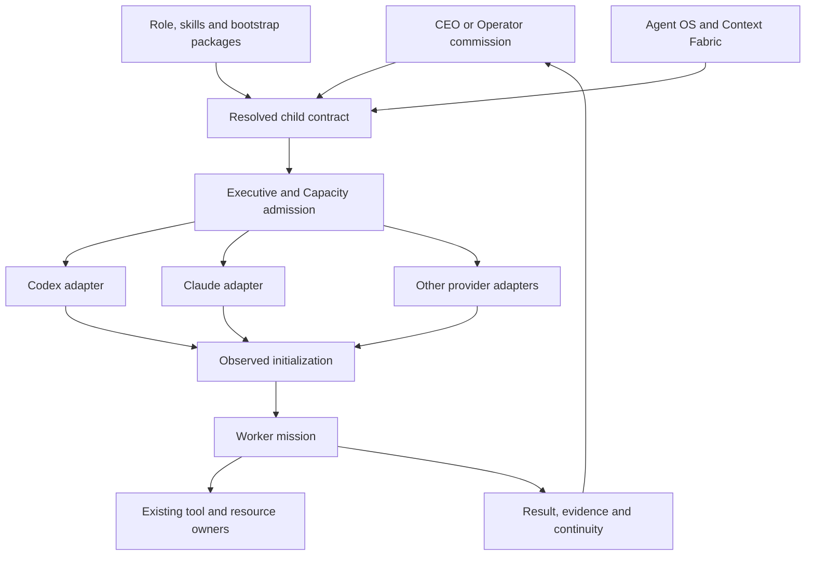

# Rich worker environments: end-to-end implementation master plan

**Date:** 11 October 2026 UTC

**Commission:** `worker-harness-parity-research-20261011-astra-001`

**Initial source baseline:** `326c8469a21d7f50fc9ecb1848196bf1c6e66685`

**Publication source refresh:** `e67d9d2566de73ccc0ec7a5c6f86da79f7780c94`; merged #1145 remote-transport changes incorporated

**Integration parent:** [#600](https://github.com/mastermindx-market-intelligence/Mastermind/pull/600)

**Companion evidence:** [Census and decision](../../../research/worker_harness_parity/2026-10-11/CENSUS_AND_ARCHITECTURE.md) · [Exact observations](../../../research/worker_harness_parity/2026-10-11/EVIDENCE.json)

## 1. Intended outcome and completion ruler

A fresh fabric worker should arrive with the knowledge, methods, tools and working autonomy needed for its assignment. An engineer can inspect the relevant repositories, understand current architecture and ownership, edit and run code, install permitted project dependencies, use a browser, investigate failures, repair the result and return reviewable work. A researcher can retrieve company context, browse primary sources, inspect data, compute and produce attributable findings. A designer can inspect and modify the commissioned design through the real design tools. A coordinating Operator can commission, follow up, consume results and make progress without relaying every ordinary decision to its CEO.

The orchestrator chooses the role, bootstrap, domain context, required capability families and delegation budget. Rich capability is the default. Deliberately smaller profiles remain selectable for simple or specially bounded tasks.

**Done means:** an admitted Operator automatically obtains the intended rich environment, commissions a worker and an independent reviewer through the existing fabric, consumes their returns, performs useful repair, resumes correctly, and delivers accepted work to the original parent. Evidence binds the exact skills, context, tools, resource identities and source generation throughout. A second provider and the required remote/browser lanes pass the same outcome-level contract before those tuples are advertised as supported.

This plan is an implementation commission specification. It does not claim that the target profiles, proposed fields or rollout already exist.

## 2. Architecture



### Ownership

| Concern | Existing owner to extend | Boundary |
|---|---|---|
| Job/Attempt lifecycle, lineage and parent returns | Executive and current fabric integration | One authoritative lifecycle |
| Placement, reservations and cumulative work | Capacity and incumbent pool/remote owner | One admission and accounting path |
| Role/skill assets | CapabilityPackageGeneration and current skill/package owners | Source-pinned asset closure |
| Effective execution profile | ExecutionCapabilityRegistry / Operator Harness contract | Compose package identities with resource grants |
| Company knowledge and accepted memory | Agent OS in Macro | Canonical organizational state |
| Navigation, task context and workspace overlays | Context Fabric / Project Atlas | Derived evidence with invalidation |
| Browser/profile/tab ownership | Existing Browser/Runtime owners and #1259 | Exact resource and effect reconciliation |
| Studio/Paper/native-computer transport | #1217 plus #1302's bounded facet | Reuse gateway, identity and effect owner |
| Source workspace and release | Existing managed workspace/repository/release owners | Exclusive write custody and reviewable publication |

Capability packages must not become a new execution registry or memory database. They carry immutable instructions/assets. Existing manifests bind the applicable filesystem, data, browser, principal and runtime resources.

Rich profile/context selection extends the incumbent internal execution-plan, admission and adapter contracts. Preserve the current authenticated Executive MCP/CeoIngress ingress. This plan adds no generic public spawn, provider-selection or raw-shell delegation API. Historical first-vertical tool counts are not a substitute for the current installed interface.

## 3. The default environment

### 3.1 Common capabilities

Every rich worker receives:

1. **A concise operating kernel:** mission, role, root and parent identity, expected result, current source/ownership facts, permitted autonomy, budgets, stop/resume rules and how to report uncertainty.
2. **Company and project knowledge:** Agent OS retrieval, current architecture and source links, Context Fabric discovery, active decisions and relevant continuity.
3. **Filesystem and computation:** read access across the authorized project/information universe; full working access to its assigned repository, scratch and artifact roots; shell, interpreters, tests and task-appropriate project dependencies.
4. **Web and browser use:** public-source discovery plus a callable browser lane appropriate to the mission. Browser automation is part of the standard environment for work that benefits from it.
5. **Domain tools and data:** applicable databases, data catalogs, APIs, analytical runtimes, design/document tools and application connectors under existing account/resource authorization.
6. **Skills:** the core role method plus requested domain methods, with complete referenced-file closure and discovery of further authorized skills.
7. **Continuity:** durable result and checkpoint references, exact session continuation, attributable memory proposals and explicit unfinished work.
8. **Working autonomy:** authority to investigate, implement, test, repair and return within the commissioned mission without repeated permission requests for ordinary covered work.

Full host filesystem and administrative shell authority should be available to engineering/system-operator missions that actually require it. The chosen profile must state the real authority and enforcement mechanism. An unsandboxed shell cannot truthfully be described as limited to a path merely because a prompt lists that path.

Source custody prevents concurrent workers from overwriting each other. It does not imply withholding the information they need. Multi-repository missions receive all commissioned workspace roots together. Shared datasets remain at their canonical mounted/cataloged locations, with task outputs written to owned destinations.

### 3.2 Role overlays

Start with a small set of execution compositions and reusable role overlays. Avoid creating a separate runtime framework for every job title.

| Role overlay | Methods and context loaded | Additional capability emphasis | Expected autonomy |
|---|---|---|---|
| Researcher / analyst | Research method, evidence quality, relevant company/domain decisions | Web, authenticated knowledge, data queries, Python/SQL, document artifacts | Investigate alternatives, check calculations, synthesize and return |
| Engineer | Product/architecture context, coding and verification method | Repository writes, shell/tests, dependency tooling, browser verification, relevant services | Build, test, diagnose and repair |
| Data scientist | Data definitions, point-in-time assumptions, evaluation method | Data OS/catalog, governed datasets, compute/storage, plotting | Inspect data quality, implement experiments, evaluate and report limitations |
| Designer / frontend | Design system, product constraints, visual review method | Paper/Figma, screenshots, browser, image/document assets and frontend tools | Produce and inspect the commissioned design and implementation |
| Browser / system operator | Exact resource scope, operational procedure and effect handling | Authenticated browser tabs, native computer tools, host/service tools as commissioned | Complete the approved operational workflow and reconcile effects |
| Independent reviewer | Acceptance criteria, adversarial method and exact candidate evidence | Broad reads, browser, tests and a disposable reproduction workspace | Reproduce defects and verify claims; source changes follow assigned custody |
| Coordinating Operator | Commission/progress/decision/return workflows, task decomposition | Existing Executive interfaces and admitted child capabilities | Delegate, consume results, revise the plan and finish the mission |

An independent reviewer can write tests, scripts and reproductions in its own workspace. Review independence should not be confused with inability to compute or verify.

### 3.3 Orchestrator controls

The orchestrator should select:

- A versioned role overlay and execution capability profile.
- Required and optional capability families.
- Bootstrap/context mode: fresh task, continuation, delegated branch, review or incident.
- Domain skill packages and canonical knowledge/data references.
- Workspace set, filesystem authority and output destinations.
- Browser mode: isolated context, authenticated task profile, attached existing tabs or native desktop.
- Model/pool preference or an existing hard override.
- Child concurrency, depth, cumulative effort and reserved review/repair budget.
- Return schema and acceptance owner.

Default selection should infer a rich profile from the task, then make the resolved choices visible. Explicit orchestrator choices override inference within the existing root authorization. Required capabilities must constrain provider compatibility **before** placement. An unavailable explicit model or capability produces a precise prelaunch gap; it must not silently start a weaker worker.

Routine discovery of a needed capability already covered by the mission should be handled by the orchestrator through the existing owner. Actual account enrollment, platform trust, TCC and previously denied resource access remain their real gates. This task's broad-access instruction does not make those mechanisms disappear.

## 4. Compile one exact child contract

### 4.1 Contract contents

Extend the existing `ExecutionCapabilityProfile.capability_manifest()`, OHF request and admission structures. Final field names and schema versions belong to that owner. The following are **proposed semantic fields**, not currently accepted configuration:

| Field group | Required meaning |
|---|---|
| Identity | Mission/root/parent/child Job, Attempt and fence; source release; intended actor |
| Role | Role-profile ID, version and digest; trusted procedure vs task/evidence separation |
| Bootstrap | Bootstrap-profile ID/version/digest, required closure, materialization mechanism |
| Skills | Package generations, raw `skill_capabilities`, resolved `profile.skills`, exact effective closure |
| Context | Projection ID/digest, canonical references, observed revision/time, invalidators and refresh policy |
| Execution | Capability profile identity; required/optional/forbidden capabilities; actual sandbox, network and approval mode |
| Resources | Repositories, workspaces, read/write roots, datasets, browser/computer handles, principal and effect scope |
| Delegation | Existing root budget reference, permissible child envelope, depth and reservation policy |
| Continuation | Verified checkpoint/continuation references; exact native session/thread bindings remain adapter-private and are resolved by the incumbent runtime owner |
| Return | Artifact/evidence destinations, acceptance criteria, parent consumption and uncertainty disposition |

Do not encode live browser state or mutable memory as package files. Do not claim a provider natively loaded a skill when the adapter supplied an equivalent admitted bootstrap mechanism. Record that mechanism explicitly.

Illustrative orchestration intent, subject to the existing schema owner's implementation:

```yaml
role: engineer
environment: rich-worker
required_capabilities:
  - source.read
  - workspace.write
  - shell.execute
  - knowledge.retrieve
  - web.research
  - browser.automate
bootstrap: fresh-task
context_refs:
  - current-project-architecture
  - accepted-parent-checkpoint
browser_mode: task-authenticated
delegation:
  budget_ref: existing-root-reservation
return:
  artifacts: [patch, verification, continuity]
```

### 4.2 Resolution and launch sequence

1. Read the existing root commission, delegated authority, placement constraints and resource ownership.
2. Resolve profile/package/context identities. Validate closure, source generation and required capability compatibility.
3. Materialize the trusted operating kernel and role method. Keep retrieved/task content separate from trusted procedure.
4. Resolve the commissioned workspace, data, browser/computer and principal bindings through their incumbent owners.
5. Generate a provider-specific configuration in the designated execution home. Deliberate isolation from ambient CEO configuration remains useful.
6. Admit and dispatch through the existing Job/Attempt/Capacity/remote chain exactly once.
7. Collect observed initialization: loaded skill closure, actual tool schemas/catalog generation, authenticated status, effective permission/sandbox/network, workspace and resource bindings.
8. Compare required versus resolved versus observed capabilities before substantive work. Deferred discovery is a distinct state; force discovery when it concerns a required capability.
9. Begin useful work. Record one relevant benign initial operation and then task evidence; a tools/list receipt alone is insufficient.
10. Revalidate changed authority or resource generations during work and on resume. Preserve the existing effect-unknown and cleanup rules.

A successful process start with missing authentication, ignored configuration, an empty required skill list or the wrong resource identity is a blocked initialization, not an admitted rich worker.

### 4.3 Capability changes and resume

Keep each Attempt's sealed requested profile and admitted environment identity immutable. Revalidate refreshed context and resource observations within that envelope. A capability change requires a separately reviewed canonical migration supported by the lifecycle and resource owners; provider-native tool-update support is insufficient. Otherwise use the existing reconciled replacement/new-admission path. Sending a new role label to a resumed process is not proof that its tools changed.

On resume, the incumbent adapter privately reconciles the exact conversation ID with verified continuation references, current source/workspace, package and context generations, grants, browser ownership and unfinished effects. A saved transcript does not restore filesystem or browser state. Compaction recovery must preserve mission, authority and continuity references.

If a mutating call's result is lost, reconcile through the existing effect owner. A transport retry suggestion or a new connection is not permission to replay the operation.

## 5. Provider implementation

### Codex

Extend the current App Server/native adapters and skill-canary seams. Materialize required skills explicitly, observe the exact list/closure, and inspect actual effective MCP and permission state. Qualify the installed App Server schema. Native helpers must enter canonical lineage/accounting when enabled. Keep current sealed profiles usable while adding reviewed write/skills/browser/helper combinations.

### Claude

Implement supported native/SDK configuration, explicit role context, skill loading, tool exposure and effective permission observation. Plugin text cannot substitute for agent-specific fields that the provider ignores. Do not rely on `allowedTools` as an exposure boundary or on a callback that earlier approvals can bypass. Explicitly configure vendor memory as disabled, derived cache or attributable proposal output; it must not silently become a second organizational memory store.

### GLM, MiniMax, Grok, Cursor and OpenCode

Reuse the installed wrapper seams, especially trusted developer-instruction injection with unchanged task evidence. Carry the same normalized contract through the versioned support bundle. Each adapter reports whether skill behavior is native, compiled bootstrap, or unavailable. Required tools must pass actual authentication and semantic execution. A provider that cannot satisfy a profile remains unavailable for that profile while continuing to serve supported work.

### Browser and computer use

Broaden #1217's actual catalog under the existing owner. Keep Browser's distinct catalog/plugin design in #1259; reuse the common transport where supported. Integrate #1302's bounded native-computer facet through existing gateway dispatch, principal and resource bindings.

Support authenticated existing tabs when the mission requires them. Isolated contexts are the normal concurrency option, not a universal restriction. Shared profiles, tabs and external application records require explicit coordination. Browser and native-computer disclosure/interaction permissions must be observed under the intended actor and exact host.

## 6. Work packages and dependency order

The packages below are a proposed commission sequence. Existing source owners retain their files. Related carrier numbers are dependencies, not an assignment or release approval.

### WP0 — Establish the integration baseline

**Owner:** Existing #600 integration owner.

**Inputs:** This plan, census and current source/runtime receipts.

**Work:** Refresh protected source and active heads; record exact source custody and supported tuples; map installed pool support files to their canonical tracked release source. Preserve current source/runtime lanes and existing remote/browser owners. Consume merged #1145's Attempt-bound remote worker adapter and trusted endpoint binding in incumbent service composition; its merge is completed source work, not an installed-admission claim.

**Deliverable:** One integration dependency ledger and acceptance matrix under the parent.

**Done when:** Every implementation path has one writer, one consuming owner and a concrete acceptance result. Stale comments and historical leases are not treated as current admission.

### WP1 — Close the three known prerequisite defects

**Owners:** #1272, #1267 and #1216 incumbents; installer changes through their existing owner.

**Work:**

- Apply and independently review #1272's bounded Agent OS subprocess and installation/import-closure repair. Keep the current owner-provided repair capsule and tests as evidence, not as already-landed code.
- Repair #1267's package closure/size mismatch and validate the real installed artifact.
- Resolve #1216's test-module collision and validate authenticated context resolution and source-bound results.

**Deliverable:** Reviewed, integrated, exact-source bootstrap/role/context components with clean required CI.

**Done when:** Exact repaired components pass independent source review, owning tests, required CI and disposable staged-package/import-closure validation. Fresh installed-session consumption is an additional WP4/WP9 gate, avoiding a dependency cycle between prerequisite repair and rich-environment qualification.

### WP2 — Add rich execution compositions to the existing registry

**Owner:** Capability/HF1 and Executive supervisor owner.

**Touchpoints:** `control_plane/executive_agent_capabilities.py`, `executive_operator_supervisor.py`, `operator_harness_contract.py`, `operator_harness_orchestrator.py`, capability configuration and package-generation integration.

**Work:** Add reviewed profiles admitting the required skills + writes + shell/network + browser + bounded-helper combinations. Extend schema validation and observed attestation. Preserve `capability_packages` / `skill_capabilities` / `profile.skills` naming. Keep sealed compatibility profiles stable.

**Deliverable:** Versioned rich-worker and rich-operator execution compositions with reusable role overlays.

**Done when:** Structural tests accept valid rich combinations and reject unsupported/unauthorized ones; effective authority is enforced through actual controls even under broad parent modes.

### WP3 — Implement common materialization and launch propagation

**Owners:** HF1 plus existing pool/remote source owner.

**Touchpoints:** `ops/fabric_launch/` candidate seams; `fabric_task.py` request boundary; `remote_sub_helpers.py` propagation; versioned support bundle; `remote_sub_exec.py`; provider wrappers.

**Work:** Carry the normalized contract from commission to process. Stage verified packages, context and provider config. Preserve task packet bytes separately. Observe actual runtime initialization and bind its receipt to the Attempt. Use merged #1145's trusted `remote_worker_binding_source` seam, preserving exact endpoint/UID/adapter pinning and refusal of local fallback when remote binding is uncertain.

**Deliverable:** One compiler/materializer contract, adapters and versioned release bundle.

**Done when:** Changing a required role, skill, resource or tool generation changes the resolved identity; missing/drifted content blocks before work; no alternate launch path bypasses the incumbent broker.

### WP4 — Qualify Codex and Claude rich environments

**Owners:** Existing provider adapter owners.

**Dependencies:** WP1–WP3.

**Work:** Implement write/skills/browser/context compositions, explicit memory behavior, native helper accounting, startup status and exact resume. Test provider-specific ignored fields and inheritance.

**Deliverable:** Supported-version matrix and successful meaningful missions for both providers.

**Done when:** Each completes a substantive independent task, applies its role method, uses required tools, repairs a seeded failure and returns accepted evidence. Configuration render and mock tests alone do not close this package.

### WP5 — Connect knowledge and data end to end

**Owners:** Agent OS / Context Fabric / existing Data OS and data owners.

**Dependencies:** WP1–WP3; can proceed alongside WP4.

**Work:** Provide project/domain discovery and bounded refresh; resolve commissioned data and external-storage roots; define attributable memory proposals and accepted updates.

**Deliverable:** Knowledge/context/data bindings and continuity flow.

**Done when:** A fresh worker finds a current decision and a real task dataset, verifies their revision/meaning, uses them correctly, and returns a useful continuity update through the canonical owner. Stale context and unavailable data produce explicit gaps.

### WP6 — Qualify the complete browser and computer lanes

**Owners:** #1217, #1259, #1302 and incumbent Browser/Runtime owner.

**Dependencies:** WP2–WP3.

**Work:** Expand actual exposed tools; integrate Browser and native-computer facets; qualify isolated, authenticated, attached-tab and desktop modes where required. Bind host, actor, resource reservation and effect disposition.

**Deliverable:** Versioned tool catalogs and resource-mode acceptance receipts.

**Done when:** An admitted worker performs a real authorized browser journey and, where selected, a desktop journey. Parallel sessions do not collide; another worker cannot steal a tab/profile; lost replies and cancellation preserve uncertainty and ownership.

### WP7 — Extend the remaining providers and remote hosts

**Owners:** Existing adapter/pool/remote owners; consume merged #1145 source with installed Linux/fleet acceptance under #1144.

**Dependencies:** WP3 plus the relevant WP5/WP6 capabilities.

**Work:** Implement normalized bootstrap and tool projection for GLM, MiniMax, Grok, Cursor and OpenCode as supported. Verify exact installed versions and support-bundle hashes per host.

**Deliverable:** Host × harness × effective-profile qualification matrix.

**Done when:** Every advertised tuple has a real useful mission and correct refusal/resume behavior. Unsupported tuples remain explicit; another provider's result does not qualify them.

### WP8 — Add orchestrator selection and whole-workgraph accounting

**Owners:** #600 orchestration and existing Capacity/model-routing owners.

**Dependencies:** WP2–WP4.

**Work:** Add optional per-step profile/context selection through current execution-plan semantics; infer a rich default; enforce required capabilities before placement; preserve #1113's hard model narrowing. Account for children, grandchildren, resumes, reviews and repair through existing lineage/reservations.

**Deliverable:** Operator-facing selection and observed environment preview.

**Done when:** A coordinator chooses different useful environments for engineer, researcher and reviewer, consumes their outputs and stays within the root budget. No hidden provider-native child escapes accounting.

### WP9 — Prove integrated parent return and progressive rollout

**Owner:** Existing #600/#1143 parent integration and release owner.

**Dependencies:** WP4–WP8 for the first supported tuples.

**Work:** Run the integrated journeys below, install exact approved releases, canary the first host/provider set, then expand the supported matrix. Publish real outcomes and known exclusions.

**Deliverable:** Accepted end-to-end root mission, release manifest, installed observations and rollback record.

**Done when:** Parent consumption, useful quality, continuity, cleanup and capability receipts all pass. Only then mark the corresponding environment generally supported.

### Parallelization and critical path

WP1's three repairs can proceed under their disjoint existing owners. WP2's contract work can proceed while they are repaired, using explicit provisional inputs. After WP3, provider, knowledge and browser work can run in parallel under their owners. The critical path is prerequisite correctness → rich contract → propagated materialization → real provider mission → integrated Operator/parent return.

Start with Codex and Claude to establish parity with the CEO families named in the commission, then qualify the economical/provider-specific lanes. This is sequencing for faster proof, not a permanent capability hierarchy. Use the same outcomes and capability requirements across providers.

## 7. Acceptance program

### 7.1 Required real journeys

| Journey | Discriminator | Required evidence |
|---|---|---|
| Engineering | Fresh worker reads current architecture, edits an owned repository, runs a meaningful test, diagnoses and repairs a seeded failure | Source/role/context identities, patch, command results, repair and parent acceptance |
| Research/data | Worker retrieves canonical context and primary sources, queries a real commissioned dataset, checks a calculation and explains uncertainty | Citations, dataset/version semantics, computation and attributable conclusion |
| Design/frontend | Worker applies the design system, uses actual design/browser tools and inspects the resulting interface | Tool calls, design/artifact identity and visual verification |
| Browser/operator | Worker uses the selected authenticated or attached-tab lane to complete a commissioned workflow | Actor/resource binding, before/after evidence, effect disposition and cleanup |
| Coordinator | Operator launches complementary workers and an independent reviewer, consumes results and integrates repairs | Canonical lineage, reservations, useful returns and final parent consumption |
| Continuation | Stop/resume or context reconstruction occurs during useful work | Verified continuation/checkpoint, privately reconciled native session, refreshed observations, retained uncertainty and completed result |

Use at least two independent providers for the common rich environment. Qualification is per materially distinct host/harness/profile combination; select targeted tests rather than repeating the full suite after unrelated documentation changes.

### 7.2 Adversarial and failure discriminators

- Wrong or stale bootstrap conflicts with the current commissioned role.
- A required skill is present on disk but omitted from loaded discovery.
- A plugin path is missing; an MCP connection is pending or needs authentication.
- A required service receives an expired token, a token for another audience, or credentials for the wrong intended actor/resource. Initialization or the affected operation fails before substantive work, without account fallback.
- The requested browser tool is absent from the actual catalog.
- A broad parent permission mode would invalidate a claimed child restriction.
- An unauthorized sibling workspace, dataset, account, tab or tool is requested.
- The package/source changes between preparation and launch.
- A capability is revoked or its resource lease changes during the mission.
- A resumed process retains an old tool set despite a newly supplied profile label.
- A worker launches a native child, resumes a helper or forks around the apparent concurrency limit.
- A mutating tool result is lost, cancellation is incomplete or process absence cannot be proved.
- Remote endpoint, UID, adapter or certificate identity drifts during recovery/physical observation; refuse before consuming mismatched evidence.
- An exact LOST/requeued Attempt enters status-only PROOF_RECOVERY. Preserve its immutable Runtime/Capacity join without reviving its claim, cancel authority or cached absence evidence.

Expected outcomes are precise refusal, replan, blocked continuation or effect-unknown handling under existing owners. A denied operation must not be replayed through another provider, host or interface.

### 7.3 Metrics and acceptance thresholds

Record the baseline and candidate on comparable missions, source/data snapshots and model classes. Separate tool/environment benefit from changing to a stronger model.

Hard gates:

- All required capabilities observed and task-proven for the advertised tuple.
- No unexplained authority widening, missing lineage or unowned shared resource.
- Exact artifact and parent-consumption evidence.
- Correct resume, cancellation and effect-unknown handling.
- No claim of a native skill/plugin when only bootstrap emulation was used.

Track useful performance measures:

- Accepted task completion and first-pass reviewer acceptance.
- CEO interventions, especially missing-context/tool requests.
- Time to first useful action and total completion time.
- Repair success, avoidable retries and stranded capacity.
- Tool failure, authentication failure and bootstrap-miss rates.
- Cost and tokens per accepted result, rather than per model call.
- Role-method quality and evidence completeness.
- Coverage of supported host/provider/profile tuples.

Set numerical rollout thresholds after collecting a representative baseline; do not invent a universal quality percentage before observing the work.

## 8. Installation, rollout and rollback

1. **Source-ready:** exact reviews, CI and compatibility checks pass; live arms remain separate.
2. **Installed candidate:** immutable release/package/support-bundle identities recorded on the selected host.
3. **Observed candidate:** fresh session proves the loaded environment and required benign operations.
4. **Accepted pilot:** substantive mission and independent review pass.
5. **Integrated pilot:** coordinator/worker/reviewer/parent-return journey passes.
6. **Expanded support:** additional hosts/providers/resource modes qualify individually.
7. **Default rich environment:** orchestrator inference selects the accepted composition automatically.

Keep each in-flight Attempt pinned to its admitted environment. New releases apply to new admissions unless an explicitly qualified migration exists. A failed rollout stops new admission to the affected tuple, preserves in-flight effect/cleanup ownership, and restores the previous accepted generation through the existing release owner. Do not delete evidence or reinterpret uncertain effects as failed/no-op.

Compatibility lanes remain available for their supported tasks. Rich-profile failure should be visible to the orchestrator, not silently downgraded to a sealed/read-only lane.

## 9. Evidence and closeout contract

Each accepted mission should return:

- Root/parent/child/Attempt identity and source release.
- Requested, resolved and observed environment identities.
- Package/skill/bootstrap/context closure and loading mechanism.
- Effective tools, authentication and resource bindings.
- Files changed, artifacts, verification and independent review.
- Child/delegation and capacity accounting.
- Effects performed, unfinished/uncertain effects and cleanup proof.
- Continuity and proposed canonical knowledge updates.
- Parent consumption and final disposition.

Publish one support matrix distinguishing **specified, source-tested, installed, initialized, callable, task-proven and parent-accepted**. Avoid collapsing those stages into “enabled.”

The implementation is complete when rich access is the normal supported experience for the advertised roles and providers, and a fresh orchestrator can choose the right environment, delegate substantial work, recover it and accept its result without reconstructing the worker's missing harness by hand.
