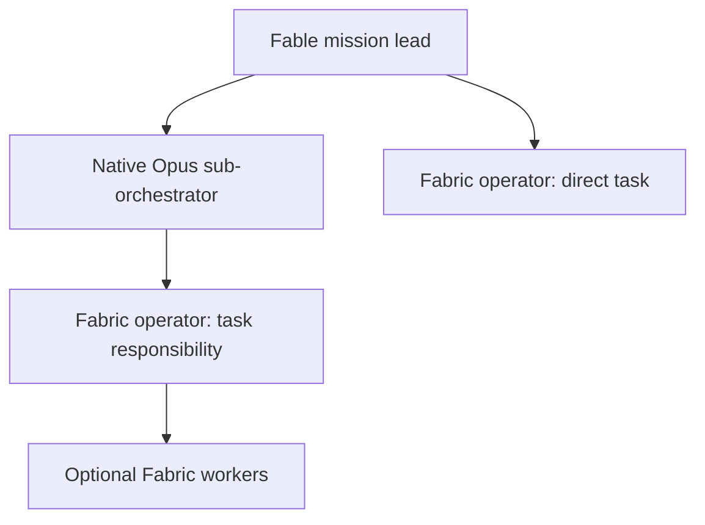

# Mastermind Fabric Role Hierarchy — Assessment and Implementation Masterplan

**For:** the local Codex CEO responsible for the Fabric, with Fable as the requested native execution lead.

**Assessment date:** 11 October 2026.  
**Status:** assessment complete; implementation proposal and handoff, not deployed policy.  
**Operation:** fabric-role-hierarchy-assessment-20261011-sol-001.  
**Protected source examined:** 94bae30d53aee81a6430dcec75915b1c73ba86e1.  
**Related parent programs:** [#600](https://github.com/mastermindx-market-intelligence/Mastermind/pull/600) and [#1144](https://github.com/mastermindx-market-intelligence/Mastermind/issues/1144).

## 1. Decision

**Proceed with a selective responsibility hierarchy: Fable may use native Opus sub-orchestrators; those sub-orchestrators commission Fabric operators; operators execute directly or delegate bounded work through the Fabric.**

The architecture is appropriate for separable, substantial work. It should be a maximum supported structure, not a mandatory chain for every task. A straightforward task should go directly to a qualified operator. A difficult worker can use a stronger model without becoming an operator. An operator handling routine work can use an economical model without losing responsibility for the result.

The current system supports important pieces, but **does not yet prove the complete role-aware, capability-enforced, model-differentiated chain**. The installed attended pool has task-class and model-tier policies; the protected Executive has a separate sealed-worker path; pending work adds nested planning, launch preparation, and native context. These evidence layers must remain distinct.

The implementation should connect these pieces through their existing owners. It must not create another router, scheduler, worker compiler, memory system, authority store, or results bus.

### Answers to the original questions

| Question | Assessed answer |
|---|---|
| Can the proposed hierarchy work? | Yes, with explicit native-to-Fabric identity, admission, budget, capability, and return bindings. Its complete operation was not demonstrated in this assessment. |
| Are operators automatically frontier models? | No. An installed operator task class points toward full GLM, but complexity, explicit model, pool allowlists, economic checks, and launch path affect the result. A role is not a model guarantee. |
| Are workers GLM Flash, Qwen Flash, and MiniMax? | These are configured economical worker candidates: GLM-5.3-Flash, qwen3.8-flash, and MiniMax-M3. That is a configuration finding, not a served-model receipt. |
| Is Qwen Max already an operator? | The inspected installed Qwen/Bailian task allowlists permit review uses but exclude operator, architecture, and domain_orchestration. Qualification and policy changes are needed before declaring Qwen Max an operator route. |
| Is spawning driven by role, difficulty, or effort? | Several independent mechanisms exist today: task-class labels, C0–C3 complexity, model tiers, explicit model requests, and provider-specific effort. They are not one normalized role contract. |
| Do sessions know their role and spawning rights? | The inspected wrappers do not universally inject and verify a canonical role-and-delegation envelope. Other packets and project instructions may convey roles. Consistent awareness and actual enforcement remain unproven. |
| Does a task operator currently start work and then freely spawn workers? | Not under the candidate Executive v5 hierarchy. Descendant-owning coordinators must still be queued and unstarted. Direct execution and delegation need distinct admitted modes. |
| Will four levels maximize token efficiency? | There is no evidence for that claim. Savings depend on useful decomposition, context size, model fitness, coordination overhead, review, repairs, and accepted quality. Measure total cost per accepted outcome. |

## 2. Ready-to-use commission for the local Codex CEO

The following is the operational handoff. It is proposed work under the existing Fabric ownership and admission rules.

> Own this implementation end to end within the existing Fabric program. Bootstrap against current protected source, compare it with this assessment's source pin, and reconcile incumbent work before editing. Treat this report as an implementation proposal, not new authority.
>
> Use the existing Fable-led Claude surface for mission integration where available. Ask Fable to create native Opus sub-orchestrators for independently useful workstreams. Explicitly select and verify Opus in the actual native launch configuration; do not assume an agent name selects a model. The local Codex CEO remains the implementation owner, not an extra compulsory runtime layer.
>
> Give each native Opus sub-orchestrator a narrow workstream, acceptance criteria, source custody, an authenticated parent/root binding, and a bounded grant. Have it use the Fabric's admitted operators for task execution. Operators may execute directly or delegate to bounded Fabric workers through the existing coordinator phases. Choose that mode before admission. Do not relabel a started work Job as aggregation.
>
> Prefer qualified economical operator candidates according to task difficulty and tool requirements. Full GLM and Grok are existing operator-oriented candidates; Qwen Max needs explicit operator qualification because the inspected allowlist excludes it. Prefer GLM Flash, Qwen Flash, and qualified MiniMax profiles for suitable bounded work. Stronger worker models remain permissible when justified without granting broader authority.
>
> Implement a normalized responsibility-role contract, separate from execution phase, task class, C0–C3 complexity, risk, model profile, and reasoning effort. Share the normalization between the existing selector, direct launch guard, launch compiler, and Executive plan validation. Fix the domain_orchestration disagreement and unknown-role handling. Preserve compatible legacy task classes without granting them new delegation rights.
>
> Reuse #1327 for bounded hierarchy semantics; #1272 and its incumbent dependencies for launch preparation and worker bootstrap; #1273 for AgentOS context; #1228 for managed orchestration policy. Preserve #633/#1143 and related owners for the native return boundary. Coordinate changes through their current carriers rather than replacing their systems.
>
> Bind native sessions to existing responsibility, RuntimeBinding, admission, Job/Attempt, and lease records. The adapter must derive and validate authority from the caller's verified binding. Caller-supplied root or parent strings, role prompts, and environment variables are not authority.
>
> Enforce task-scoped tool, filesystem, service, effect, and delegation grants through the actual harness and service owners. Produce an effective startup manifest. Each actor must know its role, mission, mode, permitted children, remaining allowance, evidence duties, escalation path, and exact return target. Attach this acknowledgement to an existing pickup/start event rather than adding a separate model conversation.
>
> Preserve one original responsibility budget across native and external work. Account for planners, coordinators, workers, review, repair, retained terminal jobs, tokens, provider costs, and native overhead without double counting. Under the examined #1327 candidate policy, if adopted, the stated four-level reviewed structure reserves 14 descendant slots for one leaf and 23 for two against a limit of 16. Verify the effective admitted policy during reconciliation. Either accept its capacity or propose a reviewed policy version; do not bypass it by removing reviews or creating fresh roots.
>
> Prove direct operator completion, delegated operator completion, the actual Fable → native Opus → Fabric operator → Fabric worker return path, model selection receipts, capability denials, shared-budget races, cancellation, restart, and uncertain-result handling. Separate attended foreground proof from autonomous original-desktop-parent return proof.
>
> Run a small matched evaluation of direct, shallow, and selectively nested execution. Count each native/external call and billable tool charge exactly once, using phase tags for coordination, context, execution, review, and repair. Compare total cost across all attempts per accepted original work item, with the same original acceptance unit across topologies. Adopt the least expensive qualified pattern that meets acceptance and latency requirements. Do not promise a savings percentage before measurement.
>
> Finish with reviewed code and rules, focused test evidence, host/version-specific startup and served-model evidence, real parent consumption of accepted results, rollback instructions, and an accurate owner/status closeout. Preserve unresolved EFFECT_UNKNOWN attempts and existing approval boundaries. Do not report source fixtures or a prepared launch packet as installed operational proof.

## 3. Evidence basis and confidence

This assessment combined protected-source reads, immutable candidate PR reads, direct read-only inspection of the installed M2 attended kit, selected native settings and CLI versions, isolated pure-function evaluation, official vendor documentation, research literature, and an independent adversarial architecture review.

### What was actually verified

| Evidence class | Verified here | Limits |
|---|---|---|
| Protected source | Bootstrap/source laws, routing addendum, subscription profiles, worker launcher restrictions, identity boundaries | A source configuration is not a host rollout receipt. |
| Installed attended kit | Pool entrypoint, model-tier table, selector and economic guard, launch wrappers, projected MCP configuration, root/lease transport | Read-only source inspection does not attest current capacity or every running process. |
| Pure classification | Literal label outputs from isolated model_tier.resolve; additive cost-policy cases from inspected pure functions | No complete pool selection, broker admission, lease, provider inference, or accepted return was executed. |
| Native host census | Claude Code 2.1.296; Codex CLI 0.159.3; selected M2 user settings | Command-line, project, managed, and process-specific overrides can differ. |
| Pending hierarchy | #1327 documentation, policy arithmetic, hierarchy checks, cycle behavior and tests at an immutable candidate | Test results reported by the PR author were not independently rerun here. |
| Public documentation | Current native subagent configuration, permissions, provider model/API behavior | Public capability does not prove private subscription, host, realm, or Fabric qualification. |
| End-to-end hierarchy | Not exercised | Remains an implementation acceptance requirement. |

### Source and procedure custody

The protected source pin was 94bae30d53aee81a6430dcec75915b1c73ba86e1. The Sol skillpack INDEX declared schema mastermind.sol_skillpack.v1, version 1.0.1, bootstrap version 1; INDEX blob 38a18571229e487f525b1c9780f7993220a5da93.

The bootstrap, active execution, session reliability, web CEO delegation, closeout, executive routing addendum, chat-native hierarchy law, and authority boundaries were read at that pin. The existing laws already distinguish topology from difficulty and reserve ownership to the ModelRouter, Capacity, Executive, AgentOS, GitHub, and RuntimeBinding. The design below extends those boundaries rather than replacing them. [S1–S4]

The final source check found master at b2cdceae14c37df18807c56850d933571a93a7e7, one commit ahead of the assessment pin. The compared delta is #1324's launch-choice UI recovery change, limited to three frontend files; it does not change the protected procedures or Fabric source cited here. The six pinned PRs #1327, #1272, #1273, #1228, #633, and #1275 were rechecked and remained open at the same heads. Implementation must still refresh source and ownership at its own start.

## 4. Current census: there are two materially different execution paths

### 4.1 Protected Executive subscription-worker path

The protected subscription profiles configure routine, fast, and subagent defaults together. The validator requires the subagent model to equal the routine model; hierarchy position does not select a separate stronger model. The inspected GLM profile uses GLM-5.3-Flash for routine/fast/subagent and GLM-5.3 for hard work. Qwen uses qwen3.8-flash versus qwen3.8-max. MiniMax uses MiniMax-M3 throughout. [S5]

The sealed Claude-compatible worker launcher exposes Read, Glob, and Grep, with Write/Edit only where allowed. It denies Bash, Agent, Task, Skill, notebook editing, web tools, and MCP tools; its system instructions expressly bound the worker to its workspace and forbid children. The exported CLAUDE_CODE_SUBAGENT_MODEL therefore does not imply permission to spawn. [S6]

The protected executive route configuration is production-unarmed and disables the inspected non-Codex autonomous routes. This is a source fact about that path. It does not establish that the separately installed attended M2 pool is unusable. [S7]

### 4.2 Installed attended pool on M2

The inspected entrypoint is the local user's .local/bin/pool. Its configured kit contains ext/sub.sh, ext/pick.py, ext/model_tier.py, orch/fabric/pools.yaml, native/remote wrappers, the lease broker, and a Studio client projection.

**pool run does not automatically call pool pick.** The entrypoint forwards pool, prompt, workspace, and optional exact-model arguments to the launch wrapper. Selection is a separate command. Therefore selection policy and direct-launch policy must agree explicitly; agreement cannot be assumed from a successful selector result. [L1]

The inspected metadata includes POOL_TASK_CLASS, POOL_TASK_COMPLEXITY, POOL_ESCALATION_REASON, POOL_ORCHESTRATOR_ID, POOL_PARENT_RUN_ID, and context/turn controls. These carry classification and correlation. They are not, by themselves, a server-authenticated role grant.

### 4.3 Configured/requested model differentiation

Every model name in this table is a configured default, selector candidate, or launch request. **No actual served-model identity was established by this table.**

| Family or surface | Installed/configured use | Material qualification |
|---|---|---|
| GLM | Operator/reviewer-oriented full model glm-5.3; bounded executor glm-5.3-flash | GLM/glm-codex economic handling can select Flash for C0–C2 when an exact model is omitted. An operator label does not override the rest of admission. |
| Qwen/Bailian | Worker qwen3.8-flash; review-oriented qwen3.8-max | Inspected task allowlists exclude operator, architecture, and domain_orchestration. A cost-filter pass is not role admission. |
| MiniMax | Bounded executor MiniMax-M3 | No MiniMax Flash profile was configured in the inspected kit. This is not a claim that the provider has no Flash model. |
| Grok | Operator/reviewer/domain-coordination candidate; fallback request grok-4.6 | Requires suitable task/economic admission. Public catalog evolution does not automatically update this private route. |
| Claude native | Seat-level orchestration/adjudication; picker fallback claude-opus-5 and native default opus | The actual native definition and effective launch must select Opus explicitly; a role name alone is insufficient. |
| Fable | Observed main Claude user setting fable | A main-session setting does not attest an Opus child. |
| Codex native | Native default gpt-6.1-sol | It is a distinct surface with separate settings and remote restrictions. |

Installed policy lists include execution preference order minimax, glm-flash, bailian, go, grok, cursor; judgment order glm-5.3, grok, cursor, codex-native, claude-native, fable; and an escalation order. These lists are policy inputs, not proof of available capacity, admitted suitability, or successful inference. [L1–L4]

### 4.4 What happens to the literal role labels?

The following outputs came from isolated evaluation of the installed model-tier function. The labels were supplied as task classes—the equivalent classification input represented by POOL_TASK_CLASS. Ordinary prose in a prompt is not thereby parsed into a role contract.

| Task-class input | Recognized by the inspected tier table? | Isolated classification |
|---|---:|---|
| sub-orchestrator | No | leaf-labor / GLM Flash default |
| sub_orchestrator | No | leaf-labor / GLM Flash default |
| worker | No | leaf-labor / GLM Flash default |
| domain_orchestration | No | leaf-labor / GLM Flash default |
| operator | Yes | frontier-labor / full GLM |
| executor | Yes | leaf-labor / GLM Flash |
| orchestration | Yes | orchestrate / Claude pool, without a specific model from that function |

These outputs do **not** mean all unknown labels will successfully launch Flash. Other guards reject unknown classes. Full selection can also depend on capacity, role allowlists, explicit model requirements, and earlier gates.

The concrete inconsistency is that domain_orchestration is declared in installed pool policy and selector logic but is missing from the shared tier table. The pool policy itself calls it a selection class and denies any implication of recursive authority. The canonical mapping needs repair; a caller must not route around a refusal. [L2–L4]

### 4.5 Difficulty, model, and effort are not interchangeable

For GLM/glm-codex, the installed additive economic guard treats C0, C1, and C2 as bounded complexities. With no exact model supplied, that branch selects Flash. An explicit full-GLM request in that branch requires nontrivial escalation text. C3 full-GLM requests likewise require a frontier witness string.

The inspected witness helper chiefly validates text shape and minimum substance, not an independently verified failure receipt, frontier qualification, approval, or capability grant. It cannot serve as the entire proof of escalation authority. An operator class without an explicit complexity can take a different branch from operator plus C2. These are isolated cost-policy findings, not complete launch verdicts. [L3]

Protected law separately says C2 is complex bounded work that can justify a hard/strong workhorse. Reconcile the installed guard with that policy explicitly. Do not relabel every hard C2 task as C3 merely to obtain a suitable model. [S2]

Provider effort is a separate control. For example, the inspected Grok remote path requests high reasoning effort; this does not assign responsibility or spawning rights. Current GLM-5.3 documentation specifies reasoning levels low, high, and max. Its profile should validate supported values instead of translating a generic role name into effort. [L5; V6]

## 5. Native orchestration and role awareness

### 5.1 Observed local settings

The selected M2 user settings and harmless version checks showed:

| Surface | Observed value |
|---|---|
| Claude Code version | 2.1.296 |
| Main Claude model setting | fable |
| Claude concurrent native-subagent cap | 12 |
| Claude native spawn-depth setting | 1 |
| Claude subagent-model override / force | Unset in the inspected user settings |
| Codex CLI version | 0.159.3 |
| Main Codex model / effort | gpt-6.1-sol / xhigh |
| Codex agents enabled | true |
| Codex maximum concurrent threads per session | 16 |
| Codex default subagent model / effort | gpt-6.1-sol / high |

These are selected user configuration observations. They are not universal managed-policy values, a census of all hosts, or effective-runtime attestations. A pending PR proposing smaller caps is not proof that those caps are installed. [L9; C4]

One native layer is sufficient for Fable → Opus. External Fabric delegation from that Opus child is a different control boundary; increasing native spawn depth is not the first required change.

Current Claude documentation supports explicit subagent model, prompt, effort, and tool configuration. Its current nesting behavior is version-sensitive. The Agent(type) allowlist applies to the main agent and is ignored inside subagents; do not use it as the sole child-scope boundary. Native children may use exposed MCP tools, subject to actual configuration. [V1]

Current environment-variable precedence is also version-sensitive. Pin the native definition, launch arguments, applicable override settings, and observed effective model instead of assuming a main Fable session automatically creates Opus children. [V2]

### 5.2 The installed remote worker wrappers are not the native CEO surface

The inspected native-remote launch source explicitly requests:

- Codex: ephemeral execution, ignored user configuration, features.multi_agent=false, no interactive approvals, a workspace sandbox, and projected MCP configuration.
- Claude: empty settings sources, Agent and Task denied, strict projected MCP configuration, and a bounded turn allowance.
- OpenCode: native subagent depth zero and task delegation disabled.

These are concrete launch requests. Their effective enforcement must still be checked against the installed CLI version and actual startup/tool manifest. They are not proof that every possible alternate delegation path is impossible. [L5–L6]

Consequently, copying the CEO's user settings is not sufficient to make a remote operator recursively delegate. Conversely, disabling a native Agent tool does not automatically remove a separately authorized external Fabric tool. The required implementation should expose exactly the admitted external delegation path and test alternate paths.

### 5.3 Role awareness must be explicit and verified

The inspected wrappers predominantly forward a task prompt and selected settings. They do not universally inject and verify a canonical statement of role, responsibilities, current grants, and child rights. Task packets, native agent definitions, project instructions, or other startup systems may already supply part of this context.

Make role awareness a property of every supported launch boundary:

1. Compile a concise role capsule from protected rules and admitted task data.
2. Bind it to immutable source, contract, capability, and runtime identities.
3. Show the actor its actual effective tools and scope.
4. Include a brief role/mode/return acknowledgement in an existing pickup/start event.
5. Reject a required tool or grant mismatch before effects begin.
6. Verify the resulting behavior, not merely the actor's claim that it understands.

SDK subagents do not universally inherit the parent's full history, system instructions, and tool results. Parent context therefore cannot substitute for an explicit bootstrap. [V3]

## 6. Refined architecture in plain language

There are three different structures to keep separate:

| Structure | What it answers | Why it matters |
|---|---|---|
| Responsibility and authority tree | Who owns the outcome, and who may commission which children? | Determines scope, delegation, accountability, and budget inheritance. |
| Work dependency graph | Which results must exist before other work or integration can complete? | Allows parallel work and explicit dependencies without creating extra authority layers. |
| Event and return transport | Where do pickup, progress, completion, cancellation, and uncertain results go? | Ensures the right parent receives and consumes the current result after retries or restarts. |

A worker can produce an artifact used by two workstreams without acquiring two authorities or creating a new root. A reviewer can inspect a builder's artifact without becoming that builder's manager. An event relay is not another agent. This separation follows the existing hierarchy law. [S3]

### Recommended shape



The Fable → direct operator path handles bounded work. Add an Opus workstream owner when decomposition, ambiguity, integration, or independent parallel streams justify it. Add workers when an operator can provide bounded, independently verifiable tasks. The diagram describes responsibility; an operator responsibility may require several existing Executive phase Jobs.

### Role contract

| Responsibility role | Owns | Normal behavior | Delegation envelope | Reserved decisions |
|---|---|---|---|---|
| principal | Original mission, allocation, final synthesis and acceptance under existing authority | Chooses workstreams and resolves cross-stream tradeoffs | Admitted sub-orchestrators and/or operators | Existing CEO/user approval boundaries remain applicable. |
| sub_orchestrator | A coherent workstream and its integrated result | Plans, commissions operators, checks evidence, resolves workstream conflicts | Scoped operators; direct bounded work when appropriate | Does not acquire global policy, deployment, or final mission authority from the role name. |
| operator | A concrete task, environment, effects, verification, and recovery | Executes directly or coordinates bounded children in an admitted mode | Workers only when granted through the Fabric | Coordination does not grant independent-review acceptance or merge authority. |
| worker | A bounded task result or artifact | Executes, verifies within scope, and returns evidence | Leaf by default; any exception requires explicit admitted contract support | Cannot expand scope, become a reviewer of its own work, or create children by self-description. |

Review is an independent phase or capability requirement, not a mandatory fifth prestige level. A reviewer may use a stronger model where warranted, and review must be tied to the current artifact revision and acceptance contract.

### Keep these axes independent

- **Responsibility role:** principal, sub_orchestrator, operator, worker.
- **Execution phase:** existing plan, work, review, repair, aggregation.
- **Task classification:** domain and kind of work; legacy task-class mapping where needed.
- **Complexity:** C0–C3, with explicit ambiguity and evidence where policy requires.
- **Business impact and execution risk:** separate values; importance alone does not establish C3.
- **Model policy:** qualified candidate profile, exact requested model, hard requirement versus preference, actual resolved/served model.
- **Provider effort:** validated per provider and model.
- **Capabilities:** tools, paths, services, effects, and permissible delegation.
- **Budget and identity:** original root, parent, runtime binding, scope, reservations, and return target.

Use a new responsibility-role field through the existing schema owner. Do not overload orchestration_role, which already identifies lifecycle phases.

Keep these hierarchy roles separate from Craft's task-method roles as well. An operator or worker may apply a backend, research, design, or verification method without changing its authority or hierarchy position. Select the applicable method through the existing compiler.

## 7. Admission, model selection, and immutable role contracts

### 7.1 One normalization path

Extend the current policy/compiler ownership so selector, direct launch, native preparation, and Executive plan validation consume the same normalized task contract. This is a shared contract and validation function, not a replacement ModelRouter.

New role-aware requests should reject unknown responsibility roles before launch. Normalize documented aliases such as sub-orchestrator to sub_orchestrator once, at the boundary. Keep legacy task-class behavior versioned; a legacy class must not silently receive new delegation authority.

Resolve the domain_orchestration mismatch. Test the same normalized request through selection and direct-launch guard to prevent divergence. Direct exact-model requests still require all suitability, capability, role, budget, and admission checks.

### 7.2 Model routing policy

The existing router should first determine eligible model/harness profiles from task needs, difficulty, capabilities, permissions, and qualification. Capacity chooses among eligible placements. Economic preference ranks suitable options; it cannot manufacture missing tools or authorize an excluded role.

Proposed starting policy:

| Work | Preferred qualified route | Escalation condition |
|---|---|---|
| Native workstream integration requested here | Explicit native Opus profile in the Fable surface | Return a precise unavailable/unsupported condition if Opus is a hard requirement; do not silently serve Fable or another family. |
| Routine bounded operator task | Cheapest qualified capable route, potentially a Flash or MiniMax profile | Missing capabilities, failed acceptance, or a documented task-suitability reason |
| Complex bounded operator task | Suitable hard/workhorse route, including full GLM or qualified Grok; Qwen Max only after operator qualification | Concrete evidence that the admitted route is inadequate |
| Routine leaf worker | GLM Flash, Qwen Flash, or qualified MiniMax according to task and harness | Same quality/capability evidence; role remains worker |
| Difficult leaf or independent review | Stronger qualified profile as needed | Existing C3/frontier policy when applicable |

A hard model requirement must fail clearly if unavailable. A model preference can allow a policy-defined alternative before effects, with the resolved route recorded. After uncertain effects, provider substitution must follow existing recovery rules rather than replaying the task opportunistically.

Do not interpret nontrivial escalation text as a verified failure receipt. Where existing law requires evidence, admission should validate the referenced evidence through the current owner.

### 7.3 Pin contracts at admission

Record the effective role-contract version, task interpretation, bootstrap generation, model profile, capability grant, budget policy, allowed mode transitions, and return contract through existing immutable admission/runtime records.

Admitting under contract A and later publishing B must not widen an existing actor's authority on resume. Current revocations can narrow or block execution. They do not justify silently replacing an old admission with a broader contract.

Preserve the candidate hierarchy's policy-digest behavior and explicit migrations. Do not add a parallel role-state database.

## 8. Granular access and startup envelope

### 8.1 Grant calculation

The effective child grant is bounded by:

**the original responsibility's authority ∩ the parent's delegatable envelope ∩ the role's permitted scope ∩ the admitted task's needs ∩ actual harness/service enforcement.**

The parent's visible tool list and its delegatable authority are not necessarily identical. A coordinator can be allowed to commission a scoped browser task without loading the browser tool itself. That authority must come from its admitted envelope, not from prompt text.

| Capability dimension | Required granularity | Enforcement owner |
|---|---|---|
| Repository/files | Exact workspace, allowed paths, read/write scope, custody and artifact revision | Existing sandbox/workspace and source owners |
| Shell/processes | Commands/effects allowed by the actual harness, subprocess scope, lifecycle and egress constraints | Runtime/harness and host/service owners |
| Browser/research | Allowed surface, account, action class, read versus mutation, required evidence | Existing browser/service gateway and task policy |
| External services | Named capability, resource scope, allowed operation, current authorization | Service/API gateway and capability authority |
| Delegation | Allowed child roles, mode, model profile constraints, depth and reservation scope | Existing admission/Executive/lease owners |
| Publication/deployment | Explicit effect authority and applicable approval requirements | Existing approval and publication owner |
| Return/continuity | Exact parent, original responsibility, binding generation, accepted result revision | RuntimeBinding, Executive and incumbent result transport |

Workers should have the tools necessary to finish their bounded assignment, including scoped browser, vision, editing, or execution where appropriate. Cheap models are not a reason to strip useful tools. Broad, unscoped shell access is also not a substitute for explicit capability enforcement.

The installed Studio projection currently distinguishes a design projection from a general Fabric read projection. This is useful machinery, but not a complete role-by-task capability system. Reuse its gateway owner and projection mechanism. [L8]

Native SDK permission controls require care: allowedTools can preapprove calls rather than define an exclusive tool universe, and a callback may not run for an already approved action. Test the effective harness and service behavior, including alternate delegation tools. [V4]

### 8.2 Required capsule

The existing compiler should produce, at minimum:

- Responsibility role and execution mode.
- Original responsibility, parent scope, admitted Job/Attempt or initiating-surface binding.
- Source pin, role-contract version and capability/bootstrap digests.
- Mission, explicit DONE WHEN, task boundaries, and current artifact/input revisions.
- Required and observed tools, resource scopes, effect permissions, and unsupported requirements.
- Allowed child roles and remaining granted allowance, or an explicit leaf declaration.
- Model requirement/preference, effective model profile, and validated effort.
- Evidence, review, escalation, cancellation, and uncertain-effect duties.
- Immediate return target and original parent recovery target.

Do not inject an entire CEO transcript or a whole policy corpus into every small worker by default. Use the existing Craft/compiler and AgentOS context mechanisms to supply the applicable method and required laws with progressive disclosure. Any change to mandatory boot rules belongs to their existing owner; context trimming must preserve required constraints.

### 8.3 Illustrative contract, not current tool syntax

The following describes the information to represent through existing schemas. It does not claim that these exact fields or endpoint arguments already exist.

```json
{
  "contract_status": "PROPOSED",
  "responsibility_role": "operator",
  "execution_mode": "coordinate",
  "task": {
    "kind": "bounded_implementation",
    "complexity": "C2",
    "done_when": "Accepted artifact and required independent review"
  },
  "model_request": {
    "policy": "qualified_hard_workhorse",
    "preferred_family": "glm",
    "requirement_strength": "preference",
    "effort": "provider_validated"
  },
  "authority_binding": {
    "resolution": "server_resolves_verified_caller_binding",
    "original_responsibility": "existing_record",
    "coordinator_scope": "existing_admitted_scope",
    "contract_digest": "pinned_at_admission"
  },
  "capabilities": {
    "grant_ref": "existing_capability_grant",
    "required_tools": ["task_scoped_edit", "task_scoped_verification"],
    "allowed_child_roles": ["worker"]
  },
  "budget": {
    "source": "original_responsibility",
    "reservation": "existing_policy_computes_and_reserves_before_launch"
  },
  "return": {
    "target": "existing_parent_binding",
    "requires_artifact_revision_and_evidence": true
  }
}
```

## 9. The important execution-mode distinction

PR #1327 introduces execution_plan/v5 with an original root, two nested coordinator levels, and leaf workers. Its hierarchy validation allows descendant ownership only for aggregation Jobs. Admission requires the relevant coordinator and ancestors to remain QUEUED with no current Attempt and attempt_count zero. A planner phase creates child work before the coordinator's aggregation executes. [C1]

Therefore there are two supported concepts to implement:

| Operator mode | Meaning | Existing lifecycle representation |
|---|---|---|
| execute | The operator performs the concrete task itself | A work Job carrying operator responsibility and the proper work-result/review contract |
| coordinate | The operator responsibility decomposes work, commissions children, then integrates accepted results | Existing coordinator planning, child Jobs, and aggregation phases; not a started work Job that changes type |

If an executing operator discovers a need for workers after START, define an explicit supported response: checkpoint and return the newly discovered need to the existing parent, or implement a separately reviewed lifecycle transition under the same original scope, allowance, and effect state.

Do not silently relabel work as aggregation. Do not let an aggregation envelope stand in for a direct work result.

Uncertain effects freeze the affected operation and dependent descendants. Do not replay that operation, change its carrier, or create new identities to obtain the refused or unresolved effect. The existing owner may progress an already-reserved independent read-only branch when its current dependency, custody, authority, and reservation checks establish independence. Preserve the original uncertain Attempt and return obligation. The candidate's test_independent_coordinator_progresses_while_sibling_return_is_unknown exercises this distinction. [C1]

### Native-to-Fabric binding

A native Fable or Opus session is not automatically an Executive Job. For each supported launch surface, the implementation must decide and document whether it is:

1. An admitted executable Job/Attempt with a native RuntimeBinding; or
2. A verified initiating native surface attached through existing responsibility, binding, admission, and lease records.

The bridge must resolve the caller's authorized root/coordinator scope from that binding. Accepting arbitrary root_job_id, coordinator_job_id, or parent strings from the caller would confuse correlation with authority.

Capture native agent/session/tool-call identifiers in the existing records needed for correlation and evidence. Do not create an independent native mission ledger. Stale and sibling bindings must fail scope checks.

## 10. Budget arithmetic, concurrency, and depth

Three limits must remain separate:

1. **Native runtime limits:** concurrent child processes and native spawn depth.
2. **Fabric reservation limits:** total descendant Jobs and subtree grants.
3. **Original mission economics:** cost, token, expansion, latency, and applicable subscription/capacity allowances.

The observed native cap of 12 or Codex cap of 16 is not a Fabric mission budget. Each native Opus child must not receive a fresh implicit allowance.

### What the pending 16-descendant policy actually permits

The candidate v5 policy counts planner, coordinator, work, review, repair, and retained terminal Jobs against the original root's total descendant allowance. A reviewed leaf reserves nine slots:

**(one initial work attempt group + two repair rounds) × (one work result + two review attempts) = 9 reserved slots.**

For the complete Executive root → coordinator → coordinator → reviewed-leaf structure, there are three planners and two coordinator Jobs before the reviewed leaf reserve:

| Reviewed leaf tasks | Planner slots | Coordinator slots | Reviewed leaf reserve | Total descendants reserved |
|---:|---:|---:|---:|---:|
| 1 | 3 | 2 | 9 | 14 |
| 2 | 3 | 2 | 18 | 23 |
| 3 | 3 | 2 | 27 | 32 |
| 4 | 3 | 2 | 36 | 41 |

These are reservations, not simultaneous agent counts or a claim about exact model calls. Under a 16-slot allowance, one such reviewed leaf fits; two do not. Even a flat root with two reviewed leaves requires one planner plus eighteen leaf slots, or nineteen.

The candidate's eleven-leaf nested example uses unreviewed leaves. It does not prove comparable capacity for independently reviewed material implementation. Completed Jobs retain their accounting charge. [C1]

This arithmetic applies to that Executive plan and policy. A hybrid native/attended path must define how native activity maps to the existing root's accounting; it must not blindly copy these counts or omit native costs.

### Required policy decision

First implement honest admission and reporting for the effective admitted policy verified during Phase 0. Model the examined #1327 candidate separately before adoption. If useful acceptance cases require more capacity, commission an explicit versioned budget-policy change through the incumbent owner. Model its review/repair reservations and rollout effects before adoption.

Do not remove required reviews, discard retained Jobs, mint successor roots, or introduce untracked native helpers to make a plan appear to fit. Keep concurrent capacity reservations atomic across simultaneous Opus requests. Existing deterministic scheduling should manage waits and backpressure; do not spend model turns repeatedly polling.

## 11. Return, evidence, recovery, and acceptance

Every child result must be attributable to the actual admitted task and current source/artifact revision. Through the existing result envelope and transport, preserve:

- Original responsibility, immediate parent, Job/Attempt, native binding when applicable, and policy/contract generation.
- Requested and resolved model, with actual served-model evidence when the provider exposes it. Use unknown when it does not; never infer actual identity from the request alone.
- Bootstrap/capability evidence and the observed effective tool manifest.
- Artifacts, content digests or source revisions, verification commands/results, and independently observed versus self-reported evidence.
- Review state, remaining obligations, blockers, and effect certainty.
- Correlated completion and proof that the intended parent consumed the current result.

The parent integrates accepted current child revisions. A persuasive summary does not supersede missing evidence or unresolved descendants.

Cancellation must propagate under existing lifecycle rules. Duplicate callbacks must be idempotent. A late result for an old Attempt cannot complete a newer Attempt. Uncertain effects retain their original carrier and must not trigger an automatic alternate-provider replay.

Original desktop-parent return remains a separate proof boundary from attended foreground execution. Preserve #633's authentication uncertainty and the #1143 return owner. This work should progress independently where it can, while accurately reporting any unresolved autonomous return boundary. [C5–C7]

## 12. Reuse map: incumbent source and pending work

Statuses below are the assessed snapshot, not permission to merge or install. Re-resolve current heads and ownership before implementation.

| Carrier | Assessed state and pin | Reuse / integration responsibility |
|---|---|---|
| #1327 | Open, unmerged; cc35e857f366a061b40c9c0a69f38496fbc2fa64 | v5 bounded hierarchy, immutable grants, subtree validation, cycle/aggregation, cancellation, migration. Does not by itself establish native adoption or role routing. |
| #1272 | Open draft; 5dd709865d16f3c74da9b3590bef6647ad3235ef | Launch readiness, Craft/compiler method ownership, context/tool observations, worker bootstrap, preparation statuses and doctor. Preserve its separate #587/#588 dependencies and original launch/admission ownership. |
| #1273 | Open; f517fa575a4b4a0422b69fd4dce3be09eabb09b2 | AgentOS workstream context through ceo_boot_packet.py and native-context startup runbook. Fix budget hygiene through this owner. |
| #1228 | Open; d2f73a8fbd360f2cfbcb39e67ff2dece1bde403c | Managed orchestration policy, native caps, task classes and root correlation. Candidate settings are not the observed M2 settings. |
| #633 | Open draft; d347248b119379ab12f62e7f749d8dcc5ccd3f9d | Native Codex-to-Executive client and its original return/authentication boundary. Preserve existing uncertainty. |
| #1275 | Open candidate at cae7ee877677b8327df0089ca3183978650d7c3f | Containment/repair around the incumbent authentication uncertainty. Source repair does not erase the original EFFECT_UNKNOWN attempt. |
| #1143 / related #1323 | Existing return ownership | Integrate exact parent return through that owner; do not replace the bus. |
| #1312 | Merged at the protected source pin | Metadata/topology work already present. Do not equate metadata with complete native queue/return proof. |
| #600 / #1144 | Existing parent programs | Use their workstream ownership and accepted routing/frontier work; avoid a duplicate Fabric program. |

The #1272 preparation states expressly distinguish PREPARED_NOT_ADMITTED, execution_authority=false, and native skill attestation. Preserve these distinctions.

The #1273 evidence includes a requested 4,000-token context budget producing an estimated 18,423 tokens, with 43 omissions, three degradations, and empty important continuity sections. That is a documented candidate result, not a new measurement here. It is a concrete reason to test context budgeting and completeness rather than declaring efficient bootstraps from a requested limit. [C2–C3]

### Ownership and likely change surfaces

| Existing owner | Candidate source surfaces | Work to integrate |
|---|---|---|
| Router/profile policy | control_plane/model_router.py; subscription_provider_profiles.py; config/subscription_provider_profiles.v1.json; installed picker/tier policy's tracked source owner | Canonical role/task interpretation, qualification, C2 suitability, requested-versus-served identity, provider effort |
| Launch compiler / Craft | #1272's ops/fabric_launch/, worker-bootstrap skill and tests | Role capsule, required tools, effective observations, admission linkage |
| Native context / AgentOS | scripts/ceo_boot_packet.py; docs/runbooks/native-context-startup.md; existing AgentOS compiler | Workstream/source context, actual budget and omission handling |
| Executive / hierarchy | executive_coo_hierarchy.py, executive_coo_policy.py, executive_coo_cycle.py, executive_runtime.py, executive_supervisor.py, executive_orchestration_result.py | Role-to-phase mapping, immutable scopes, direct/coordinate modes, reservations, cancellation and replay |
| Runtime / lease / gateway | Existing native/remote launch wrappers, lease_broker.py, fabric_client_projection.py and their protected source owner | Verified caller binding, scoped capabilities, native-to-external admission and receipts |
| Managed source law | Existing routing addendum, hierarchy law, worker bootstrap/role methods, orchestration-policy carrier | One consistent set of executable rules and actor instructions |
| Return owner | Existing #633/#1143 boundary and related repair/integration carriers | Actual parent consumption, late return, idempotency and uncertainty preservation |

Do not edit a detached installed kit as the sole implementation. First identify its tracked source and release/install owner, then ship through that path with an installed digest receipt.

## 13. Implementation sequence and bounded workstreams

### Phase 0 — Reconcile source, owners, and acceptance cases

**Owner:** local Codex CEO; Fable performs mission integration through its existing admitted surface.

Re-read current protected bootstrap/source law. Refresh listed PR heads and statuses. Build a small tracked census manifest with source pins, installed digests, native versions, effective launch profiles, supported paths, and unresolved boundaries. Choose concrete acceptance cases that include direct work, nested work, independent review, and required tools.

**Exit evidence:** agreed owner map and scoped changes; no duplicated compiler/router/queue; baseline capability and routing observations; explicit budget-policy decision.

### Phase 1 — Normalize roles and routing without provider effects

**Suggested workstream:** bounded policy/compiler integration; native Opus coordination only if the change spans owners.

Add responsibility role and execution mode through the existing schema owner. Normalize aliases and reject unknown new roles. Repair domain_orchestration. Reconcile pick versus direct launch, C2 policy, pool allowlists, explicit model requirements, and provider effort validation.

**Exit evidence:** deterministic matrix tests; legacy compatibility; invalid requests fail before lease/provider effects; unsupported Qwen Max operator requests remain explicit until qualification changes.

### Phase 2 — Compile role awareness and effective capabilities

**Suggested workstream:** launch/compiler owner, integrating #1272 and #1273.

Produce the role capsule from admitted data. Add effective tool and scope observations, exact source/contract identity, current context budget accounting, and required-tool refusal. Attach role acknowledgement to existing startup receipts. Configure native Opus definitions in the actual supported scope.

**Exit evidence:** startup manifest for each supported harness; role understanding and leaf/delegation declarations; missing capability causes a preflight failure; context budget measurements preserve mandatory constraints.

### Phase 3 — Bind hierarchy, native identity, and shared budgets

**Suggested workstream:** Executive/runtime owner, integrating #1327 and incumbent lease/binding work.

Map native surfaces to existing responsibility and admission. Support direct and coordinating operators through proper lifecycle phases. Enforce immutable ancestry and child grants. Include native overhead in the original economic envelope. Add atomic shared admission across simultaneous native requests.

**Exit evidence:** valid native binding can admit only within its scope; forged/sibling/stale bindings fail; correct direct/coordinate results; reservation examples and cancellation/restart behavior pass.

If adopting the candidate store migration, follow its explicit stopped/quiesced v5-to-v6 procedure with backup and restore/quarantine behavior. Do not upgrade a live store merely by opening it. [C1]

### Phase 4 — Prove actual cross-runtime behavior

**Suggested workstream:** runtime verification owner; use bounded Fabric operators and workers under real grants.

Run the smallest meaningful real path: Fable creates a native Opus child; it commissions an admitted operator; a coordinating operator responsibility commissions a worker; evidence returns through each actual parent boundary. Separately prove a direct operator can finish without a worker.

Verify each configured provider/harness boundary needed for rollout, including requested/resolved/served model evidence, tool availability, source custody, native and Fabric IDs, exact result acceptance, and cancellation.

**Exit evidence:** complete correlated receipt set and actual parent consumption. Source-only fixtures, self-reported model names, or a successful standalone provider response do not satisfy this phase.

### Phase 5 — Evaluate economics and failure behavior

Run matched direct, shallow, and selective-hierarchy cases with the same task inputs, acceptance criteria, review requirements, tools, and comparable context. Include both separable work and strongly sequential work. Start with a small representative cohort and repeat cases where variance affects the decision.

Count total input/output/reasoning tokens where available, cache usage, native plus external usage, provider spend or subscription quota units, coordination and waiting, review, repairs, completion quality, and latency. Deduplicate individual usage charges through existing records. Compare total cost of all attempts per accepted original work item, with a fixed original acceptance unit across topology variants; phase tags explain cost without adding overlapping subtotals.

**Exit evidence:** a recorded choice of default topology by task class, observed tradeoffs, and unresolved uncertainty. No blanket savings claim or prestige-based routing.

### Phase 6 — Install rules, stage rollout, and close the real loop

Integrate the reviewed rule clauses into their incumbent source files and generated actor instructions. Ship through current install/release ownership. Re-read actual installed digests and startup behavior. Preserve existing admissions and revocations across contract versions.

Close the local implementation with source, tests, installation receipts, real path evidence, economic results, rollback steps, and honest remaining autonomous-return status.

**Exit evidence:** each declared supported path meets its acceptance gates; the user-facing description matches installed behavior.

### Parallelization and workspace discipline

The policy/compiler, bootstrap/context, and Executive/binding workstreams can proceed in parallel only with explicit file ownership and interface agreement. Shared schema changes must be integrated before consumers make incompatible assumptions. Use isolated workspaces where repository procedures require them.

Use economical workers for deterministic fixture updates, bounded source census, documentation cross-checks, and isolated verification when qualified. Let operators perform cohesive tasks themselves when delegating would merely duplicate context. Reserve native Opus attention for decomposition, cross-owner decisions, integration, and evidence review.

## 14. Proposed normative rules

These clauses are **PROPOSED**. They must be adopted through the existing protected-source owners and compiled into applicable actor instructions. They are not current executable authority merely because they appear here.

**R1 — Orthogonal roles.** Responsibility role MUST be represented separately from execution phase, task class, complexity, risk, model profile, and reasoning effort. A role label MUST NOT itself grant a model, capability, child, or approval right.

**R2 — Selective hierarchy.** The principal MAY commission work directly or through useful sub-orchestrators. Additional coordination layers MUST have a concrete decomposition or integration purpose. No task MUST traverse all four roles merely to satisfy a naming convention.

**R3 — Canonical normalization.** New role-aware requests MUST pass one versioned normalization contract consumed by existing selection, launch, compiler, and admission paths. Unknown roles MUST fail before effects. Legacy interpretation MUST remain explicit and MUST NOT confer new authority.

**R4 — Qualified models.** The router MUST choose among task-appropriate qualified profiles. Exact model requirements, preferences, supported effort, and actual model evidence MUST be distinct. A requested label MUST NOT be reported as a served-model fact.

**R5 — Enforced authority.** Child authority MUST be derived from verified existing bindings and admitted delegatable scope. Prompts, mutable environment values, caller-provided ancestor IDs, and self-reported roles MUST NOT expand authority.

**R6 — Effective capabilities.** Required capabilities MUST be checked against actual harness/service enforcement before effects. Actor tiers MAY receive all task-scoped tools necessary to complete their work. Missing required tools MUST NOT be disguised as a model-quality failure.

**R7 — Explicit startup.** Every supported actor launch MUST receive a versioned role capsule and effective tool/scope manifest. Its existing startup receipt MUST establish role, mode, child rights, source, mission, and return target without introducing a separate ceremonial model turn.

**R8 — Correct operator phases.** A direct operator MUST use the work lifecycle and proper result contract. A delegating operator responsibility MUST use admitted coordination phases. A started work Job MUST NOT be relabeled as aggregation to obtain children.

**R9 — One original budget.** Native and external activity MUST remain inside the original responsibility's authorized envelope. Descendant reservations, native concurrency/depth, and economic usage MUST be accounted for distinctly and correlated without omission or double counting.

**R10 — Immutable admissions.** Role, capability, model-profile, budget-policy, transition, bootstrap, and return-contract semantics MUST remain attributable to their admitted version. New global templates MUST NOT widen existing admissions. Current revocations MUST still be honored.

**R11 — Evidence and review.** Completion MUST be tied to current accepted artifact revisions and required verification. Coordination MUST NOT grant self-review or merge authority. Missing or uncertain child outcomes MUST prevent false aggregate completion.

**R12 — Continuity.** Cancellation, retries, late returns, parent death, and resume MUST preserve original responsibility and effect state. EFFECT_UNKNOWN MUST remain with its original owner and MUST NOT be converted into permission to replay.

**R13 — Existing owners.** The implementation MUST reuse existing routing, capacity, lifecycle, memory, compiler, custody, gateway, and result-transport owners. It MUST NOT create a parallel operating system to encode the role hierarchy.

**R14 — Operational claims.** Prepared packets, source tests, configured model names, and installed files MUST be distinguished from admitted launches, effective grants, actual provider execution, accepted results, and verified parent consumption.

**R15 — Measured efficiency.** Topology and model defaults SHOULD be selected using total cost per accepted outcome subject to quality, latency, and authority constraints. A mandatory four-level chain MUST NOT be justified by an unmeasured promise of token savings.

## 15. Acceptance matrix

These are targeted implementation tests tied to concrete remaining risks. They are not a request for broad redundant test expansion.

| ID | Case | Required observable result |
|---|---|---|
| A01 | New role aliases and unknown role | Documented aliases normalize; unknown role fails before broker/provider effects. |
| A02 | Selector versus direct launch | Same normalized requirements produce compatible eligibility decisions; no direct-launch policy bypass. |
| A03 | Role × C0–C3 × explicit model matrix | Routine operator can use an economical route; difficult worker can use a stronger route while remaining a leaf. |
| A04 | GLM C2 and escalation evidence | Suitable hard/workhorse behavior matches protected policy; a filler witness cannot satisfy a required verified evidence reference. |
| A05 | Qwen Max operator | Refused under current exclusion; allowed only after explicit qualification/policy adoption and real-path proof. |
| A06 | Unsupported effort or hard model pin | Clear pre-effect refusal; no silent provider/model/effort substitution. |
| A07 | Effective native Opus launch | Actual definition, launch overrides, CLI version, native child identity, and resolved/served evidence agree with the requirement. |
| A08 | Role capsule and required tool missing | Actor receives the correct source/role/mode/return scope; missing tool refuses startup instead of limping into execution. |
| A09 | Native child with native Agent disabled | Only the explicitly admitted external Fabric delegation path works; alternate exposed spawn tools cannot broaden authority. |
| A10 | Forged role or ancestor IDs | Server resolves binding and denies spoofed root/coordinator/parent authority. |
| A11 | Sibling/stale native binding | Cannot dispatch within another coordinator's scope or reuse an obsolete binding generation. |
| A12 | Filesystem/service/delegation escape | Scoped denial remains effective through shell, alternate tools, delegated actors, and retransmission. |
| A13 | Direct operator | Produces a proper work result and required review; no unnecessary worker launch. |
| A14 | Delegating operator | Planner admits bounded children; aggregation waits for accepted current descendants. |
| A15 | Post-START conversion | Started work cannot become aggregation or acquire children without a separately supported reviewed transition. |
| A16 | Envelope substitution | Work and aggregation result envelopes are not interchangeable. |
| A17 | Four-level reviewed budget | One reviewed leaf reserves 14; two require 23 and fail atomically under the 16-slot policy with no partial batch. |
| A18 | Simultaneous Opus admission | Shared original allowance is conserved across requests; native children do not receive independent implicit budgets. |
| A19 | Review/repair and retained terminal accounting | All required reservations and historical charges persist; completion does not erase allowance consumption. |
| A20 | Cancel, parent death, restart | Correct propagation and durable recovery; no orphaned authorized work or new root created to continue. |
| A21 | Duplicate/late/uncertain result | Idempotent return; stale Attempt cannot finish a newer one; uncertain effects retain the original carrier. A separately reserved independent read-only branch can progress only through the existing owner's dependency, custody, authority, and reservation checks. |
| A22 | Admit A, publish B, resume A | Old contract semantics remain attributable; widening does not apply; revocation can narrow or stop. |
| A23 | Provider removed/model profile changed | Existing admission is handled by current revocation/recovery policy, not silently reinterpreted. |
| A24 | Actual native-to-Fabric chain | Fable → Opus → operator responsibility → worker returns correlated accepted evidence to the real parent at every boundary. |
| A25 | Independent review | Builder cannot approve itself by changing role; review is of the current artifact and evidence. |
| A26 | Context budget | Measured context fits the admitted policy or reports a clear degradation/refusal; required source and continuity constraints survive. |
| A27 | Matched economic comparison | All native/external overhead, review and repair counted; topology selected from accepted quality/cost/latency evidence. |
| A28 | Rollout and old admissions | Installed digests match reviewed source; old roots retain their policies; rollback is demonstrated on the supported boundary. |

### Minimum real canary set

Use concrete authorized tasks with small, reversible effects where appropriate:

1. One direct operator completing a bounded task with the tools it needs.
2. One nested Opus → operator responsibility → worker chain with exact parent consumption.
3. Two simultaneous native coordinators requesting bounded work against one original allowance.
4. One independently reviewed material task, with a deliberate invalid-result or repair case.
5. One denial case and one interrupted/late-return case.

The allowance must fit the actual canary. Do not admit an impossible two-reviewed-leaf plan under the 16-slot policy merely because the proposed graph looks small.

## 16. Token and cost strategy

The hierarchy can reduce expensive context replication by moving bounded work to suitable economical models. It can also increase total usage by creating planners, duplicating instructions, summarizing between layers, and repairing low-quality outputs. Treat the outcome as an empirical routing problem.

Anthropic's research-system account reports an internal research-quality improvement from its multi-agent design, alongside much higher token use than ordinary chat. That example supports specialized parallel research, not a universal efficiency claim for four layers. [V8]

A later study of 260 agent configurations across six benchmarks found architecture benefits depended on task structure. Its findings do not establish one universally optimal hierarchy or a transferable production break-even threshold. RouteLLM supplies evidence for quality/cost-aware model routing, with generalization limitations; it does not validate recursive Fabric operators. [V9–V10]

### Optimize for an accepted outcome

Measure:

**Total mission cost = the sum of unique native-model, external-model, and tool/resource charges attributable to the original mission, each counted exactly once.**

Use existing usage records and stable event identities to deduplicate charges. Tag them by preparation, coordination, primary execution, integration, review, repair, or abandoned work for analysis; do not add phase subtotals on top of an already inclusive external-work total.

For comparisons, define an accepted outcome as the same original task or mission unit across every topology. Do not divide by accepted child artifacts, because a deeper tree can manufacture a larger denominator. Attribute all unsuccessful and abandoned attempts to their original work item. Report acceptance rate alongside total cost per accepted original item; no accepted items means no demonstrated successful completion, not zero-cost success.

Use real provider billing where available and separately record subscription quota/capacity consumption. Do not equate zero marginal cash billing with zero scarce capacity or zero tokens.

Useful topology choices:

| Task shape | Starting topology | Reason |
|---|---|---|
| Small cohesive edit or deterministic check | Principal → operator | Additional handoffs often duplicate more context than they save. |
| Several independent bounded tasks | Principal or one sub-orchestrator → parallel operators/workers | Parallelism has clear boundaries and acceptance criteria. |
| Complex workstream with independent components and integration decisions | Native Opus → operators → optional workers | Workstream judgment can be separated from bounded execution. |
| Strongly sequential debugging | Direct strong operator, targeted scouts only when useful | Each extra handoff may lose evolving state and add coordination. |
| Cross-cutting review | Separate reviewer phase on pinned artifacts | Independence and current evidence matter more than a fixed role tier. |

Keep task packets concise and self-contained. Share immutable artifacts rather than full transcripts. Load only applicable methods and necessary tool schemas, subject to mandatory source law. Avoid model-driven polling. Let an operator finish a cohesive task itself. Escalate based on observed task fitness and acceptance failures, not title or prestige.

### No preclaimed savings

The report deliberately provides no percentage savings forecast, new default spend limit, or universal concurrency target. Those would require current provider economics, authorized task envelopes, and matched internal measurements. The acceptance experiment should report uncertainty and failure cases, not just a favorable average.

## 17. Rollout, rollback, and completion definition

Stage changes through the existing source and installation owners:

1. Normalize and validate without changing live authority.
2. Produce prepared packets and effective manifests.
3. Before canary effects, bind the canary to an explicitly accepted source release, versioned contract/policy, compatible store schema, and current admission/grant. Prepared packets and this proposal are not that admission.
4. Exercise the admitted attended canaries under those accepted semantics.
5. Complete broader protected-rule adoption and fleet rollout after successful bounded canaries.
6. Verify each supported installed host/harness.
7. Advance autonomous claims only when the original native parent boundary is proven.

Rollback must restore the previous policy/profile/compiler version through the supported install path, stop new incompatible admission, and preserve existing roots, evidence, and uncertain effects. Apply the candidate store's explicit backup/migration/restore procedure if adopted. Do not erase lifecycle records to simplify rollback.

### Definition of done

The hierarchy is complete only when the local implementation owner can present:

- Reviewed source and rules under the correct incumbent carriers.
- The shared normalized role contract and compatibility behavior.
- Actual native Opus selection and canonical role awareness.
- Task-scoped enforced capabilities and immutable delegation grants.
- Qualified operator/worker model routes with truthful model evidence.
- Correct direct and coordinating operator lifecycle behavior.
- Original-root accounting across native and Fabric work, including realistic reviewed capacity.
- Accepted current child results consumed by their actual parents.
- Focused failure, cancellation, replay, versioning, and denial evidence.
- Installed source digests, host/CLI/profile receipts, rollout and rollback evidence.
- Measured topology/model tradeoffs and an accurate list of unsupported or unresolved boundaries.

This assessment delivers the plan and evidence map. It does not itself certify that implementation, installation, or the complete production path is finished.

## Appendix A. Installed-source evidence inventory

The following digests identify the read-only M2 snapshot. KIT means the directory resolved by the installed pool entrypoint; locate it from that entrypoint rather than assuming a checkout or copying a stale personal path.

| Evidence | Installed file | SHA-256 |
|---|---|---|
| L1 | local-user .local/bin/pool | 95dad5ac680d605200252f7152ecc80b77a767016874028288822a98b2b72c78 |
| L2 | KIT/ext/model_tier.py | 460ac5f740c4ac53c63cea2f3f5c173c431728ee7233a37cdb63a7f22cc45aff |
| L3 | KIT/ext/pick.py | 0482c77d44e2f056054ecb430166294bc6e4ed55066a09e47fbbabe6528d0550 |
| L4 | KIT/orch/fabric/pools.yaml | 489b803867dda091f8b9cd46b62917f0b33b1d5602602e7681729ce0a060ae13 |
| L5 | KIT/ext/native_remote.py | 788c7575a5b72a72ada4c17f30ada2b8cdf47d7873cc47142ec8a16b918afd00 |
| L6 | KIT/ext/remote_sub.sh | 62700551334cf40179ae1178e6ac8a670ea2e662d20b7852504de3a3e456e340 |
| L6a | KIT/ext/remote_sub_helpers.py | 057d2c04cc1bfef13135560600099b027f4b4bde62b4d69b257af9786db7053e |
| L7 | KIT/ext/lease_broker.py | ff6fe4b949d6be7d985370d4629c407b5f6fe9ad638170224a55aa902d85d364 |
| L8 | KIT/ext/fabric_client_projection.py | 96017f511fbf2e3f70c2d87787fc12f4043e7e95d95fbfc17d28b5d60c63292c |
| L10 | KIT/ext/sub.sh | a34bbf58831947bc525ed2f425216655f572f7b9b10919f4eb142e8567663ccf |
| L11 | KIT/ext/qwen_exec.sh | 17fad1b03bf9291146ac1af869449a7ec99bb0d413a425c42397481aa201f1dd |

**L9:** selected fields from the M2 Claude and Codex user configuration, plus exact CLI version output, read on the assessment date. No credentials or complete private configuration are reproduced.

### Useful source locations within the installed snapshot

- pool: lines 8–12 resolve the kit; 38–42 dispatch run/remote; 52–53 dispatch selection separately.
- model_tier.py: lines 9–72 define class/tier maps; 105–129 resolve unknowns and model defaults.
- pools.yaml: GLM role model map near 273–278; selection and escalation policy near 419–452; domain coordination declarations near 503 and 525–527.
- pick.py: domain class/allowlist near 99–103 and 1238–1251; additive launch guard near 1999–2130.
- sub.sh: economic filter wiring near 16–20 and 439–459; context/turn controls near 180–247; prompt forwarding near 724–735.
- native_remote.py: raw prompt and native launch options near 95–124; OpenCode task restrictions near 177–182.
- remote_sub.sh: correlation-versus-authority distinction near 737–742.
- remote_sub_helpers.py: parent/root environment transport near 45–48; scoped identity checks near 51–62.
- lease_broker.py: required root near 533–552; root derivation near 1256–1264.
- fabric_client_projection.py: gateway authority boundary near 1–6 and task projections near 88–121.
- qwen_exec.sh: prompt-file forwarding near 513–520.

These line locations accompany content digests and are snapshot aids. Refresh the actual installed and tracked source before implementation.

## Appendix B. Protected source references

All S references use the protected pin 94bae30d53aee81a6430dcec75915b1c73ba86e1.

- **S1 — Bootstrap/index and procedure law:** [INDEX](https://github.com/mastermindx-market-intelligence/Mastermind/blob/94bae30d53aee81a6430dcec75915b1c73ba86e1/docs/sol_skills/INDEX.md), [COLD_START](https://github.com/mastermindx-market-intelligence/Mastermind/blob/94bae30d53aee81a6430dcec75915b1c73ba86e1/docs/sol_skills/COLD_START.md), [ACTIVE_EXECUTION](https://github.com/mastermindx-market-intelligence/Mastermind/blob/94bae30d53aee81a6430dcec75915b1c73ba86e1/docs/sol_skills/ACTIVE_EXECUTION.md), [SESSION_RELIABILITY](https://github.com/mastermindx-market-intelligence/Mastermind/blob/94bae30d53aee81a6430dcec75915b1c73ba86e1/docs/sol_skills/SESSION_RELIABILITY.md), [WEB_CEO_DELEGATION](https://github.com/mastermindx-market-intelligence/Mastermind/blob/94bae30d53aee81a6430dcec75915b1c73ba86e1/docs/sol_skills/WEB_CEO_DELEGATION.md), [CLOSEOUT](https://github.com/mastermindx-market-intelligence/Mastermind/blob/94bae30d53aee81a6430dcec75915b1c73ba86e1/docs/sol_skills/CLOSEOUT.md).
- **S2 — Routing and difficulty:** [Executive Worker Routing Chairman Addendum](https://github.com/mastermindx-market-intelligence/Mastermind/blob/94bae30d53aee81a6430dcec75915b1c73ba86e1/docs/EXECUTIVE_WORKER_ROUTING_CHAIRMAN_ADDENDUM.md).
- **S3 — Native hierarchy and graph separation:** [Executive Chat-Native Sol Hierarchy Law](https://github.com/mastermindx-market-intelligence/Mastermind/blob/94bae30d53aee81a6430dcec75915b1c73ba86e1/docs/EXECUTIVE_CHAT_NATIVE_SOL_HIERARCHY_LAW.md).
- **S4 — Ownership:** [Authority boundaries](https://github.com/mastermindx-market-intelligence/Mastermind/blob/94bae30d53aee81a6430dcec75915b1c73ba86e1/plugins/mastermind-sol/references/authority-boundaries.md).
- **S5 — Subscription profiles:** [Configuration](https://github.com/mastermindx-market-intelligence/Mastermind/blob/94bae30d53aee81a6430dcec75915b1c73ba86e1/config/subscription_provider_profiles.v1.json) and [validator](https://github.com/mastermindx-market-intelligence/Mastermind/blob/94bae30d53aee81a6430dcec75915b1c73ba86e1/control_plane/subscription_provider_profiles.py).
- **S6 — Sealed worker harness:** [claude_subscription_worker.py](https://github.com/mastermindx-market-intelligence/Mastermind/blob/94bae30d53aee81a6430dcec75915b1c73ba86e1/control_plane/claude_subscription_worker.py).
- **S7 — Executive routing state:** [executive_worker_routes.json](https://github.com/mastermindx-market-intelligence/Mastermind/blob/94bae30d53aee81a6430dcec75915b1c73ba86e1/config/executive_worker_routes.json).
- **S8 — Existing router and identity:** [model_router.py](https://github.com/mastermindx-market-intelligence/Mastermind/blob/94bae30d53aee81a6430dcec75915b1c73ba86e1/control_plane/model_router.py) and [executive_delegation_identity.py](https://github.com/mastermindx-market-intelligence/Mastermind/blob/94bae30d53aee81a6430dcec75915b1c73ba86e1/control_plane/executive_delegation_identity.py).

## Appendix C. Candidate references and proof scope

- **C1 — #1327:** [PR](https://github.com/mastermindx-market-intelligence/Mastermind/pull/1327); immutable [hierarchy design](https://github.com/mastermindx-market-intelligence/Mastermind/blob/cc35e857f366a061b40c9c0a69f38496fbc2fa64/docs/EXECUTIVE_COO_HIERARCHY.md), [policy](https://github.com/mastermindx-market-intelligence/Mastermind/blob/cc35e857f366a061b40c9c0a69f38496fbc2fa64/control_plane/executive_coo_policy.py), [hierarchy checks](https://github.com/mastermindx-market-intelligence/Mastermind/blob/cc35e857f366a061b40c9c0a69f38496fbc2fa64/control_plane/executive_coo_hierarchy.py), and [cycle tests](https://github.com/mastermindx-market-intelligence/Mastermind/blob/cc35e857f366a061b40c9c0a69f38496fbc2fa64/tests/test_executive_coo_hierarchy_cycle.py). Candidate reports source tests; this assessment independently inspected source and arithmetic, not a deployed hierarchy.
- **C2 — Launch readiness:** [#1272](https://github.com/mastermindx-market-intelligence/Mastermind/pull/1272), head 5dd709865d16f3c74da9b3590bef6647ad3235ef. Reported staging/preparation is not admission or universal native startup adoption.
- **C3 — Native context:** [#1273](https://github.com/mastermindx-market-intelligence/Mastermind/pull/1273), head f517fa575a4b4a0422b69fd4dce3be09eabb09b2.
- **C4 — Managed policy:** [#1228](https://github.com/mastermindx-market-intelligence/Mastermind/pull/1228), head d2f73a8fbd360f2cfbcb39e67ff2dece1bde403c.
- **C5 — Native client:** [#633](https://github.com/mastermindx-market-intelligence/Mastermind/pull/633), head d347248b119379ab12f62e7f749d8dcc5ccd3f9d.
- **C6 — Authentication containment:** [#1275](https://github.com/mastermindx-market-intelligence/Mastermind/pull/1275), head cae7ee877677b8327df0089ca3183978650d7c3f.
- **C7 — Return ownership:** [#1143](https://github.com/mastermindx-market-intelligence/Mastermind/issues/1143) and [#1323](https://github.com/mastermindx-market-intelligence/Mastermind/pull/1323).
- **C8 — Existing parent programs:** [#600](https://github.com/mastermindx-market-intelligence/Mastermind/pull/600) and [#1144](https://github.com/mastermindx-market-intelligence/Mastermind/issues/1144).

## Appendix D. Official documentation and research

Retrieved on 11 October 2026. Vendor descriptions are capability documentation, not internal qualification or availability evidence.

- **V1 — Claude native subagents:** [Create custom subagents](https://code.claude.com/docs/en/sub-agents). Relevant topics: model/tool/effort configuration, nesting, Agent restrictions, MCP and plugin-specific configuration behavior.
- **V2 — Claude configuration precedence:** [Environment variables](https://code.claude.com/docs/en/env-vars). Check the actual installed version and launch/configuration scope.
- **V3 — SDK context and child behavior:** [Agent SDK subagents](https://code.claude.com/docs/en/agent-sdk/subagents).
- **V4 — SDK enforcement semantics:** [Agent SDK permissions](https://code.claude.com/docs/en/agent-sdk/permissions).
- **V5 — Codex native model configuration:** [Codex subagents](https://learn.chatgpt.com/docs/agent-configuration/subagents). Named roles do not themselves guarantee an economical model; explicit configuration and receipts remain necessary.
- **V6 — Model capabilities:** [GLM-5.3](https://docs.z.ai/guides/llm/glm-5.3); [Qwen model catalog](https://www.alibabacloud.com/help/en/model-studio/text-generation-model); [Grok models](https://docs.x.ai/developers/models). The current public Grok catalog lists 4.7 while the inspected installed fallback requested 4.6; requalification belongs to the model/profile owner.
- **V7 — MiniMax:** [Model catalog](https://platform.minimax.io/docs/guides/models-intro) and [Anthropic-compatible API](https://platform.minimax.io/docs/api-reference/text-anthropic-api). The public catalog includes M3.1-Flash-Preview; that does not make it an installed Fabric route. The compatibility API supports tools but ignores mcp_servers, so the harness must supply any actual MCP integration.
- **V8 — Multi-agent research experience:** [Anthropic engineering account](https://www.anthropic.com/engineering/multi-agent-research-system). Research-specific quality results and token overhead should not be generalized into a four-level efficiency guarantee.
- **V9 — Agent scaling study:** [Towards a Science of Scaling Agent Systems, version 3](https://arxiv.org/html/2512.08296v3). Heterogeneous tasks and experimental limits preclude treating its results as a universal routing threshold.
- **V10 — Model routing research:** [RouteLLM, version 3](https://arxiv.org/html/2406.18665v3). Relevant to quality/cost model selection; not direct validation of recursive native-to-Fabric delegation.

## Appendix E. Assessment closeout and remaining implementation work

The read-only census and architecture assessment are complete. The handoff includes the requested current-state answers, a refined hierarchy, granular authority design, a role/bootstrap contract, existing-owner map, implementation phases, proposed rules, reservation arithmetic, and acceptance tests.

This assessment used native research assistants for read-only analysis and adversarial review. It did not launch paid Fabric/provider workers, change production configuration, merge incumbent PRs, clear uncertain authentication attempts, or establish a served-model receipt. Those actions and proofs belong to the local implementation owner under the existing mission and admission boundaries.

The next concrete action is **Phase 0 followed by Phase 1**, with the existing hierarchy, compiler, context, policy, and return owners reconciled. The user does not need to redesign the graph; the implementation owner has the concrete contracts, corrections, and proof obligations needed to finish it.

