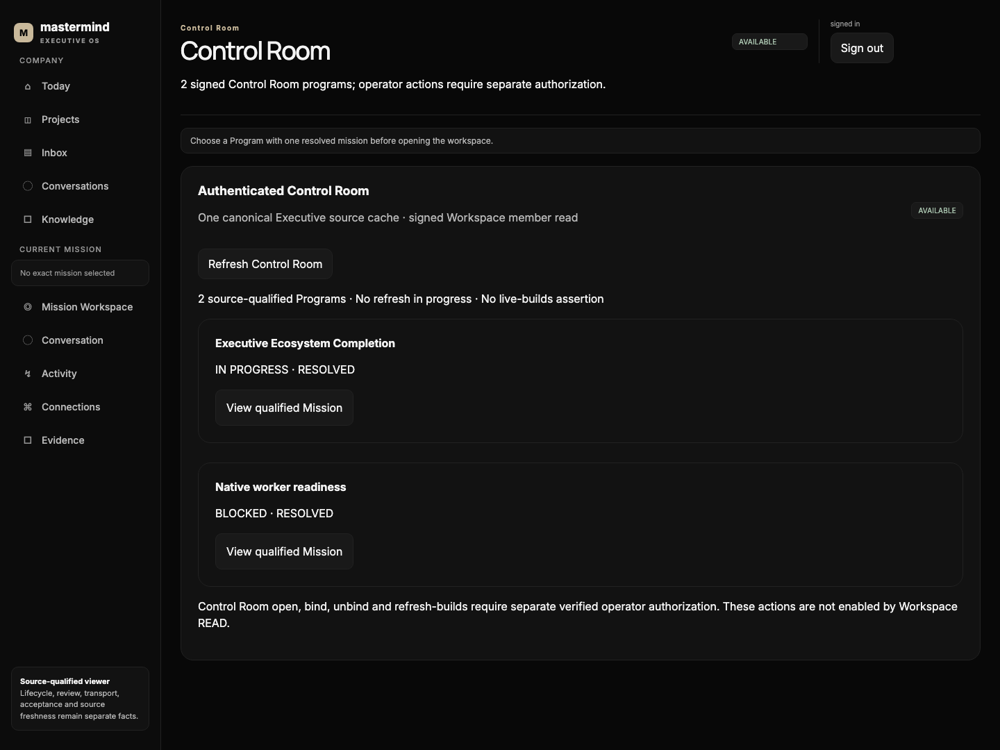
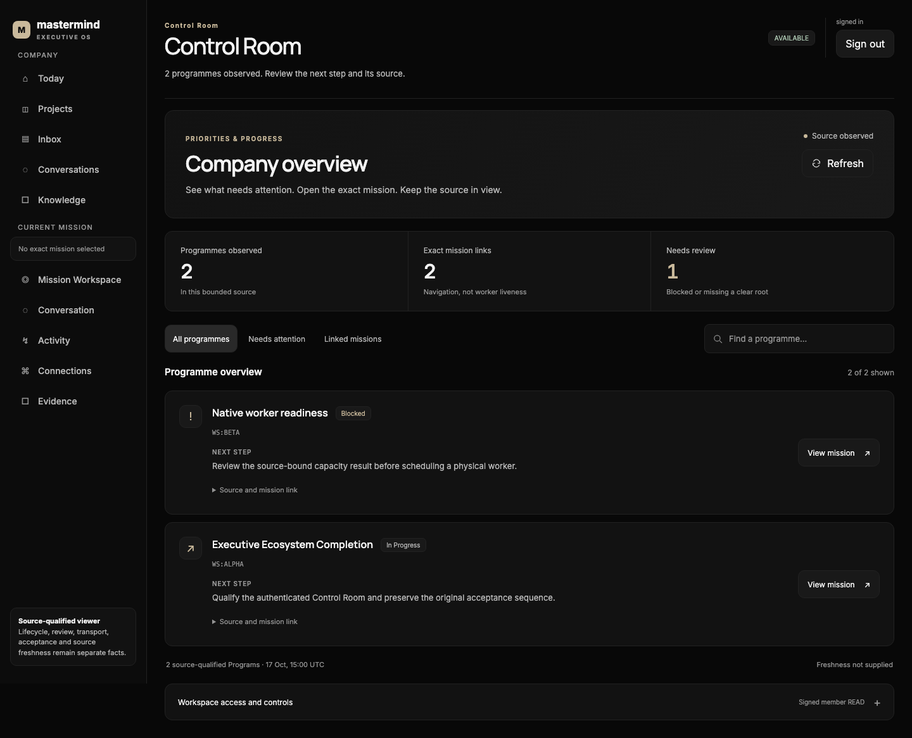
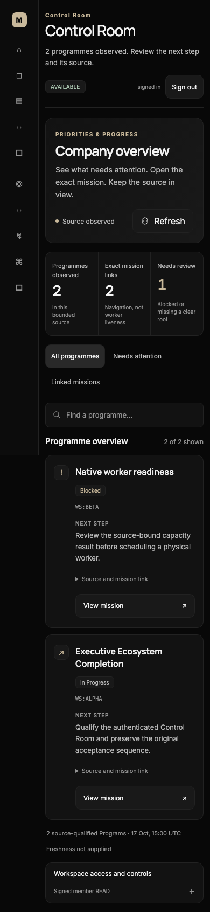

# Control Room — Pro audit and implementation, 17 October 2026

**Original carrier:** Mastermind PR #1515, operation `fabric-control-room-cache-no-tcp-20261015`, branch `sol/fabric-control-room-cache-no-tcp-20261015`. This record is implementation/review evidence, not a competing capability ledger. The Executive Ecosystem programme (#1571) and its R1 host-release owner remain unchanged.

**Disposition:** SOURCE IMPLEMENTED / DRAFT / NOT INSTALLED. Neither an attractive screen nor green tests prove live OAuth enrollment, all six operator routes, host acceptance, Worker START or original-parent answer consumption.

## Chairman decision and scope

The current Chairman instruction is “allow all to access” and “admin@mastermind-x.com is the main account.” Apply this to authenticated enrolled workspace members, not anonymous internet users. The main account must ultimately join to the existing issuer-verified subject and client; an email string, screen label or `primary_profile` designation is never authentication and does not mint an administrative scope.

This pass preserves the original cache-only implementation and unfinished same-owner read presenter. It improves the actual application and its current authentication owner rather than creating another application, cache, policy service, identity directory, installer or queue. No production credential or root-owned configuration was changed.

## Audit findings and repairs

| Finding | Implemented correction | Proof boundary |
| --- | --- | --- |
| Dense technical prose obscured the work and next action; the page repeated its title and a mission-only instruction. | Dedicated `ControlRoomPanel`, programme counts, exact mission links, attention-first ordering, local search/filters, compact mobile header, expandable source details. Removed the irrelevant “choose a mission” notice only on the Control Room route. | Counts are projected programmes and links, not physical workers or live capacity. |
| The decoder accepted refresh errors and arbitrary timestamp text while reporting AVAILABLE. | Reject non-null `state_refresh_error`, malformed timestamps and incomplete envelopes; keep error details out of the UI. Detach/freeze the programme projection. | Source freshness is unknown unless the original validity metadata supplies its publication reference; no global LIVE inference from per-card proofs. |
| The canonical membership document had exactly two slots. Multiple people sharing the same OAuth public client could not be represented. | Add opt-in `mastermind.workspace_acquisition_bindings.v2` to the **existing** `validate_workspace_bindings`/`workspace_authorizers` owner. Permit 1–128 individually enrolled subject/client profiles, same public client across distinct verified subjects, unique exact principal pairs, per-member revocation and receipt rotation. | V1 stays exactly `web`/`mac` with its previous client uniqueness. No installed v2 enrollment has been performed. |
| Main-account designation risked becoming a raw-email authentication shortcut. | V2 `primary_profile` references an existing enrolled profile but is not used in the authorization predicate or token scopes. Keep signed-subject/client/resource/issuer and permission receipt checks. | Test rejects a bare `admin@mastermind-x.com`, forged email/role fields, unbound subjects and elevated scopes. |
| The JWT edge suite had previously not run because the M2 test interpreter lacked PyJWT. | Use an isolated test environment with the repository-pinned `PyJWT==2.13.0`; execute actual signature-verification and existing read-edge tests. Add three independently signed member JWTs sharing a public client, with targeted revocation. | Keys, JWTs and transport in these tests are fixtures. No live Auth0 account, credential or enrollment request. |
| A READ-only service could be mistaken for permission to operate legacy controls. | The UI explicitly states discovery and four mutations are not connected yet. Existing backend read/action separation and default discovery refusal remain. | No READ-to-SEND or READ-to-operator privilege promotion; former #1473 F2 source-action refusal remains in force. |

## UX and design

Use the existing Paper Atelier Noir/Champagne tokens, font families, light-theme aliases, spacing and focus colors. The programme list puts source-reported blocked work and unresolved roots first. Users can search by programme title, work reference, state or next step without another source request. No-result filtering is distinct from a genuinely empty source. Each navigation uses only the exact resolved original mission root.

Desktop, tablet and 390 px mobile were exercised in a real headless Chromium instance. The work rail is preserved; the layout wraps without horizontal overflow. Native disclosure elements support keyboard Enter; visible focus and reduced-motion behavior are retained. No external network requests or page errors occurred. These are **synthetic-data renderings of actual application source**, not a claim of signed live production data.

### Before / after

Before: preserved independent earlier WIP source, rendered against the same two-programme fixture.

After: actual audited source, attention-first layout, same synthetic fixture.

The browser check record is in `review_evidence/control_room_pro_2026-10-17/browser-verification.json`.

## Architecture decision

Keep one flow: authenticated Workspace app → existing private App-peer route → original `WorkspaceReadService`/`ExistingControlRoomPresenter` → original `HostedControlRoom.current_owner()` and its `ServerConfig.state_cache`. Continue to qualify the permission stamp and source owner before and after reads. The v2 membership document lives in the same existing sealed configuration and is reloaded by the same authorizer; it is not a cached ACL or a second member database.

Rejected alternatives: a second Control Room HTTP service, another state cache, anonymous access, trusting the admin email as a principal, silently suppressing missing operator controls, granting mutations from the existing read scope, and turning a browser rendering into a parent-consumed acknowledgement.

### Next implementation edge: operator actions

The Chairman's access decision resolves **who should ultimately have workspace access**. It does not supply an issuer subject or make an unconnected route functional. Discovery, Open, Bind, Unbind and Refresh builds must be composed through their incumbent navigation/binding/build owners and the original verified member/action grant. Use exact binding/work/target selectors, deny unknown fields, qualify source and membership before the irreversible step, and preserve the original operation after any uncertain response. Do not auto-retry mutations.

Bind and Unbind retain the existing atomic surface-bindings writer. Refresh builds retains the existing Macro compiler and generation ordering. Open retains the original navigation owner and never marks `last_verified_at` without its real accepted return. Host installation, acceptance maintenance, protected-SHA prepare/install race and Worker activation remain Fable R1/original release-owner operations.

## Verification and rollout

The new decoder/UX tests were initially 10/10 RED on the previous WIP. The multi-member positive contract/revocation tests initially failed on the two-slot validator; legacy refusal tests already held. Fixes are covered by both focused and full application tests. The complete frontend run passed **1,558 executed tests / 1 inherited skip across 69 files**, plus TypeScript checking and the production Vite build. The affected backend read/cache/member/JWT tests passed; the final exact totals and immutable source head are recorded in the original PR receipt after source publication.

The earlier WIP-to-current-protected merge proof was explicitly refused. This pass does not replay it or claim new protected-base integration. Retain the original branch and submit it for independent code/security review and exact-head CI. Do not release cache-only hosting until the six-route authenticated real-browser journey and zero privileged Control/Worker TCP are independently accepted.

Preserve: original CODEX-01 issuer `codex01-due10-incident-issuer-20261013-01a104e6` is `EFFECT_UNKNOWN / DO_NOT_RETRY`; original Business `fabric-parent-native-operator-proof-01a11e90-v1` is `NOT_SUBMITTED`. No model/provider call, physical Worker startup or canonical original-parent consumption is claimed by this audit.
