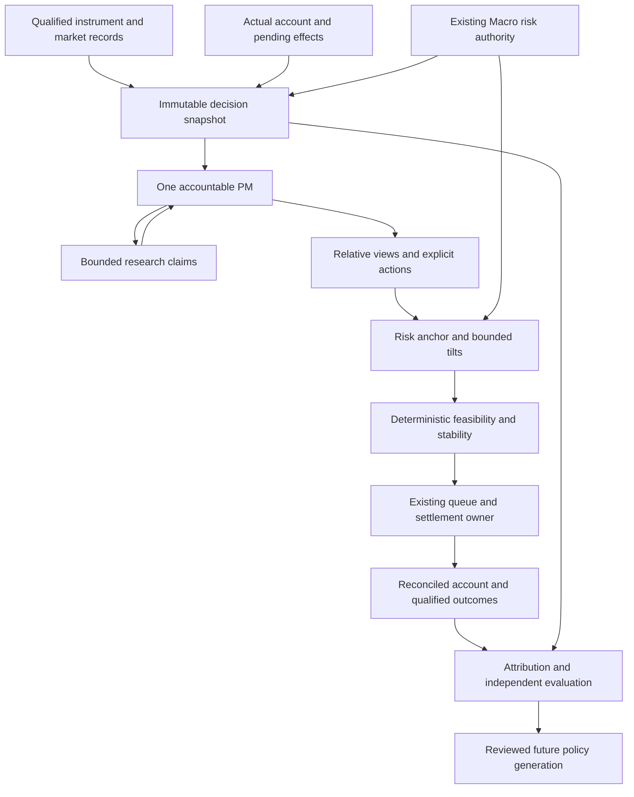

# Mastermind Portfolio Bot
# Recensus, Economic Audit, and Fable CEO Rebuild Masterplan

**Version:** 1.0 — proposed execution charter and evidence-based program design  
**Audit date:** October 21, 2026, America/Chicago  
**Live evidence window:** approximately 11:15–11:39 p.m. CDT, October 21; 04:15–04:39 UTC, October 22, including the later historical decision-case capture  
**Performance cutoff:** the stored October 21 observations; the overnight US October 22 duplicate is excluded  
**Product:** https://bot.mastermind-x.com  
**Protected source inspected:** `mastermindx-market-intelligence/Mastermind` at `c9cbee5569ba50e30e28715d930809061a169517`  
**Document status:** AUDIT COMPLETE WITH EXPLICIT EVIDENCE LIMITS / REBUILD PLAN PROPOSED / NO IMPLEMENTATION OR CUTOVER PERFORMED

This is the newly requested Fable CEO masterplan. It consolidates the current evidence and adds a complete delivery and investment-validation program. It preserves the approved September V3 architecture, the August V2 cohort, and incumbent repair ownership. It does not represent a new active trading book, an admitted executive job, a deployment, or a claim of demonstrated alpha.

**Navigation:** [Executive decision](#1-executive-decision) · [Account results and decision cases](#2-what-the-accounts-actually-show) · [System recensus](#3-current-system-recensus) · [Defect register](#4-defect-and-hypothesis-register) · [Prior plans and ownership](#5-reconcile-prior-research-and-existing-ownership) · [Mandate](#6-investment-mandate-and-definition-of-better) · [Target architecture](#7-target-architecture) · [Execution](#8-realistic-regional-paper-execution) · [Validation](#9-research-and-investment-validation-program) · [Product and runtime](#10-runtime-reliability-and-product-overhaul) · [Delivery program](#11-fable-ceo-delivery-program) · [Migration](#12-migration-rollback-and-completion) · [CEO charter](#13-ready-to-use-fable-ceo-charter) · [Evidence](#appendix-a-evidence-method-and-limitations).

## 1. Executive decision

**Rebuild the bot around verified investment facts, qualified portfolio economics, dependable operation, and measured investment decisions. Finish and strengthen the existing V3 architecture while preserving useful protections and testing every added source of complexity.**

The user's concern is justified, but the diagnosis needs correction. The inspected records do not show every book losing money or failing to beat its benchmark. They show different results by market and starting date, concrete errors and inconsistencies in accepted investment reasoning, several material accounting and simulation weaknesses, an interrupted manager pipeline, and insufficient evidence to decide whether the current investment policy has durable skill.

Four conclusions govern this plan:

1. **Accepted investment reasoning contains actionable defects.** MU's October 2 entry memo used a future earnings date contradicted by already-published company releases and price levels on an unreconciled scale relative to its eventual fill. Later rationale described it as lacking a thesis although its entry had one. A China entry labeled weak, single-source evidence a reason for a measured starter while taking a 12% target. These cases require fact checks, thesis continuity, and an explicit connection between uncertainty and risk. They do not, by themselves, establish the cause of all subsequent losses. [R9][X6]
2. **The existing performance verdict is not trustworthy enough.** Recorded results need price, session, cash-flow, corporate-action, cost, and benchmark qualification. Hong Kong additionally fails an elementary historical inventory replay against its current account.
3. **The system has an operating-continuity problem.** Recent US management has resumed with queued decisions. China and Hong Kong still have no accepted manager decision after October 9 in the inspected records. A running service, a generated explanation, an accepted target, and an actual fill are different events.
4. **The investment architecture needs completion and empirical testing.** The current allocator compresses conviction into three categories and preserves held weights. That is a testable design limitation, not proof that a more complicated optimizer or a more expensive model will earn higher returns. The already approved V3 risk anchor, bounded tilts, claims, and sequential experiments are the right starting framework. [S1][S2][S3][P3]

The rebuild has three independent success verdicts:

| Verdict | What must be demonstrated | What it does not establish |
|---|---|---|
| Operationally correct | Every due cycle and accepted instruction has an accountable disposition; account, fills, receipts, and displayed state reconcile | Investment skill |
| Economically qualified | Returns use defensible prices, income, costs, currencies, sessions, and benchmark conventions | Persistent outperformance |
| Investment value demonstrated | A frozen policy adds useful net value against declared controls with sufficient unseen evidence | Guaranteed positive returns or permanent market beating |

The first two are engineering deliverables. The third is an empirical outcome and can remain inconclusive. The program must be willing to retain a simple policy, remove an ineffective feature, or narrow the product's claims if complexity fails to earn its cost.

## 2. What the accounts actually show

### 2.1 Latest common stored date

The following arithmetic uses the October 21 NAV and benchmark values recorded by the bot. Each account's stated starting capital is one million **in its own currency**. These are changes from the seed reference, not certified time-weighted, net total returns. The China history's first stored row is already above its seed, and benchmark rebasing conventions require reconciliation before calling these comparable inception returns. No cross-currency aggregate is calculated. [R1][S1][S3]

| Managed book | Currency | Recorded NAV | Change from 1m seed | Recorded benchmark change from 1m | Arithmetic excess | Actual cash share |
|---|---|---:|---:|---:|---:|---:|
| US / autonomous | USD | 1,003,521.98 | +0.35% | SPY +3.53% | −3.18 pp | 70.02% |
| China | CNY | 944,849.17 | −5.52% | CSI 300 −10.38% | +4.87 pp | 41.20% |
| Hong Kong | HKD | 1,004,800.23 | +0.48% | Hang Seng −7.79% | +8.27 pp | 37.38% |

**Interpretation:** US is approximately flat and behind its recorded broad-market benchmark over this seed-reference history. China has lost capital while declining less than its benchmark. Hong Kong is approximately flat while its benchmark is down. Relative success and positive absolute returns are different objectives.

### 2.2 The August 11 window gives a different verdict

The V2 evaluation marker starts August 11. Using each book's stored August 11 NAV and benchmark NAV as denominators, and October 21 as the endpoint:

| Book | August 11 NAV | Portfolio change | Benchmark change | Arithmetic excess |
|---|---:|---:|---:|---:|
| US | 978,083.19 | +2.60% | +0.30% | +2.30 pp |
| China | 1,006,473.38 | −6.12% | −11.83% | +5.71 pp |
| Hong Kong | 1,018,753.08 | −1.37% | −7.98% | +6.61 pp |

Formula: `100 × (ending NAV / starting NAV − 1)`; excess is the difference between the two percentage changes. This is a descriptive matched-endpoint comparison. It neither reruns nor changes the frozen evaluator's baseline exclusions. Both windows must remain visible; choosing only the better-looking one would be misleading. [R1][R2][P2]

### 2.3 Cash is material, but its cause and value must be tested

Over the 52 raw August 11–October 21 dated observations, average recorded cash was approximately 75.89% US, 42.91% China, and 38.85% Hong Kong. Those dates are not all certified exchange sessions. High cash changes both returns and risk, so outperforming a falling fully invested index cannot, by itself, establish superior stock selection. [R1][R2]

The latest accepted US decision explicitly explains a target of approximately **73% cash**. Its recorded reasons include low-confidence or degraded inputs, elevated perceived drawdown risk, and candidates still awaiting entry triggers. These are the manager's recorded assertions; this audit did not independently certify the underlying macro assertions. The actual account was approximately 70% cash and still held MU, whose removal was queued. Thus the current high cash balance is at least partly intentional, and an instruction to force deployment would be unsupported. [R3]

A useful exploratory check replaces the stock sleeve with the benchmark at the **previous recorded gross exposure**, assumes cash earns `4% / 252` per observation, and compounds the resulting returns. This is a diagnostic approximation using the bot's own cash convention, not an investable or factor-matched control:

| Book | Actual recorded change, Aug 11–Oct 21 | Recorded-exposure cash/benchmark approximation | Exploratory residual |
|---|---:|---:|---:|
| US | +2.60% | +0.65% | +1.95 pp |
| China | −6.12% | −6.76% | +0.64 pp |
| Hong Kong | −1.37% | −4.41% | +3.04 pp |

This challenges the claim that all apparent relative success is simply cash avoidance. It also does not prove stock-selection alpha: gross exposure is not beta; style, sector, timing, data quality, costs, and account adjustments remain uncontrolled. These positive residuals are reasons to investigate and preserve potentially useful behavior. [R2]

### 2.4 Where recorded losses accumulated

The audit replayed all captured fill quantities from an assumed empty seed account and compared them with the current account. It also calculated `sell proceeds − buy costs + ending recorded market value` by security. These calculations use the existing fill values and marks; they do not certify their market correctness.

For US and China, end quantities reconcile within a tolerance of 0.0001 shares, sufficient for the inspected legacy six-decimal fill records. Ending cash plus recorded position values also reproduces each October 21 NAV within one cent. This verifies useful arithmetic consistency, not the completeness of income, corporate actions, fees, or historical price evidence. [R4]

| Book | Recorded security P&L from fills plus ending marks | Non-trade cash residual | Combined change from seed |
|---|---:|---:|---:|
| US, USD | −5,692.53 | +9,214.51 | +3,521.98 |
| China, CNY | −60,933.45 | +5,782.62 | −55,150.83 |
| Hong Kong | Attribution withheld pending inventory reconciliation | Attribution withheld | Recorded NAV change +4,800.23 HKD |

The non-trade cash residual equals actual cash minus seed capital and net fill cash flows. The code has a cash sweep, but **the residual is not independently certified interest**. Dated accrual, external-flow, and adjustment records must explain it. [R4][S3]

Examples of recorded security contributions:

| Book | Security | Recorded cumulative contribution | Relevant qualification |
|---|---|---:|---|
| US | SMH | −17,205.46 USD | Last fill July 13; legacy ETF exposure before the current stock-only V2 evaluation window |
| US | EME | −8,465.77 USD | Last fill July 20; legacy-period loss |
| US | APH | −6,593.29 USD | Last fill July 29; legacy-period loss |
| US | MU | −6,001.87 USD | Entered October 5; includes remaining marked position and prior partial sale; current exit is queued |
| US | XOM | +17,776.09 USD | Entered August 13; a material offsetting winner |
| China | 688062.SS | −22,196.94 CNY | Entered August 13; includes realized and remaining marked effects |
| China | 300308.SZ | −13,672.87 CNY | Spans legacy and current periods; fully closed in recorded fills |
| China | 688411.SS | −13,313.86 CNY | Closed in June; legacy-period loss |
| China | 603301.SS | −12,245.28 CNY | Spans multiple periods and remains held |

These identify loss investigations; they are not evidence that a different entry or exit would have been knowably superior at the time. The program must reconstruct each major loss with the contemporaneous thesis, price path, sizing, source facts, and feasible alternatives. Current-policy judgment must not inherit all legacy losses as though the policy never changed. [R4]

### 2.5 Hong Kong has an unresolved inventory-history discrepancy

Starting from an empty seed account, the full recorded fill replay disagrees with the actual account for six symbols:

| Symbol | Account quantity minus replay quantity, shares |
|---|---:|
| 0700.HK | +0.807253 |
| 0981.HK | −49.600212 |
| 1024.HK | +12.276828 |
| 1929.HK | +43.202567 |
| 3988.HK | +72.563412 |
| 3993.HK | −23.503222 |

The replay also encounters historical sells beyond the replayed inventory for several names. This establishes that **the inspected fill ledger alone does not explain the account**. It does not establish the cause: an opening-balance difference, a corporate action, an explicit repair, an omitted event, or a historical accounting defect could explain some differences. No such reconciling receipt was recovered in this audit. Do not present HK realized-P&L attribution as certified until its existing accounting owner resolves this bridge. Do not round away the discrepancies, invent balancing trades, or reset the account. [R4]

### 2.6 Actual decisions reveal investment-quality defects

These are original stored decisions, not regenerated explanations. They provide a more direct diagnosis than portfolio return alone. The captured sample is targeted at material losses plus an offsetting winner; it is not a random sample from which to estimate the system-wide defect rate. [R9]

**MU: a false catalyst date and unreconciled price basis.** The October 2 accepted entry, `decision.v1.8d700b90434853b846f2ef2e`, specified a 10% target with medium conviction. Its settlement transaction links to the October 5 purchase of 92 shares at a recorded USD 1,069.68, value USD 98,410.56. The memo referred to analyst targets of 130–140, a trailing level around 107.5, and an October 22 earnings catalyst. Its falsifier explicitly treated fiscal Q4 2026 results as due October 22. [R4][R9]

Micron's August 26 announcement scheduled those results for September 30, and its September 30 release reported them. Both preceded the October 2 decision. Thus the particular future earnings-date claim is contradicted by primary evidence. This audit does not determine whether stale upstream data, a faulty summary, or the manager introduced it. Its acceptance demonstrates a failure to reconcile an actionable factual claim before taking risk. [X6]

The quoted targets and trailing level also need an explicit currency, date, split/adjustment, and price-basis bridge to the recorded fill. This is an unresolved cross-basis consistency defect, **not proof that the fill price itself was wrong**. The presence of a trailing number in prose also does not establish that an automated stop used it. The right acceptance check verifies the price and claims together, retaining their original evidence and raising unexplained discontinuities before allocation. [R4][R9]

**MU: thesis continuity is not established.** The next accepted October 5 memo, subsequently executed October 6, changed the principal falsifier to 60-day relative performance or government-support/operating deterioration, and changed its exit conditions. The inspected rows do not contain an explicit old-to-new amendment bridge. The latest queued manager summary calls MU planless and thesis-less and cites `Prophet held_without_active_plan`, despite the stored entry thesis, horizon, falsifier, and exit plan. A missing optional provider plan cannot establish that no local thesis exists. Equally, an old entry memo does not prove that its thesis is still valid or that the queued exit is wrong. The missing explanation is how the original thesis was amended, invalidated, or excluded from the later assessment. Thesis changes can be valid, but they need a durable amendment and coherent retrieval; the audit did not search every possible historical amendment artifact or prove the absence of one elsewhere. Recorded cumulative MU contribution was −USD 6,001.87 at the cutoff. That loss is not a causal estimate of the damage from these defects. [R3][R4][R9]

**688062.SS: “starter” intent was not translated into a demonstrated risk budget.** The August 12 decision assigned a 12% target, medium conviction, and an estimated 62% thesis probability. Its own rationale acknowledged single-source evidence, degraded technical coverage, and an advisory Neural Web signal without FDR clearance. The first recorded purchase on August 13 was 3,716 shares at CNY 32.65. Subsequent memos preserved roughly 12.5% with high conviction while acknowledging the same source limitations. The regional medium-conviction cap is 12%; the record does not demonstrate why that exposure was an appropriate starter for this issuer's uncertainty and downside. [S2][R4][R9]

A 12% position is not universally wrong, and weakly corroborated ideas can succeed. The 62% probability is the manager's assertion, not demonstrated calibration; the reported FDR condition is not an established mandatory veto. The defect is the missing quantitative connection between claimed caution, company-specific risk, evidence quality, and authorized exposure. A defensive sector narrative cannot establish that every company in that sector is low risk. Require an explicit position role, downside/scenario loss budget, event and issuer concentration, and uncertainty-conditioned allocation. Recorded cumulative contribution was −CNY 22,196.94; a matched reconstruction is needed before crediting any proposed alternative sizing with avoidable loss. [R4][R9]

**Preserve a positive control.** XOM's recorded cumulative contribution was +USD 17,776.09. Its original entry and follow-up memos are included so future tests examine useful behavior as well as failures. One winning trade does not validate its reasoning or prove the independence of its claimed confirmations. [R4][R9]

## 3. Current system recensus

### 3.1 Books and authority

| Book or path | Current role | Treatment in rebuild |
|---|---|---|
| `autonomous` | Active managed US common-stock paper book; USD; SPY benchmark | Preserve identity, account, decisions, pending effects, and V2 cohort |
| `china` | Active managed mainland equity paper book; CNY; CSI 300 benchmark | Preserve identity; add venue-specific economic qualification |
| `hk` | Active managed HK equity paper book; HKD; Hang Seng benchmark | Preserve identity; resolve inventory bridge before economic acceptance |
| `flagship`, `heavyweight`, `etf` | Archived managed histories, superseded by autonomous | Read-only reference; never count as active peer managers or resurrect silently |
| `self_directed` | Separate user-managed portfolio product | Respect its separate consumer and benchmark owners; do not mix its results with managed books |
| V3 shadow | Proposed/partially built challenger under approved V3 | Separate shadow storage; no active-registry membership or live settlement authority |

The registry retains a legacy storage default while the dashboard default is autonomous. A caller using the former must not accidentally revive archived behavior. The public bot surface describes a paper account and explicitly says it places no real order. This audit is about simulated investing. [S1][R5]

### 3.2 End-to-end capability inventory

| Layer | Present capability | What remains unproven or needs change |
|---|---|---|
| Market and instrument data | Polygon/Yahoo paths, regional data, FX conversion, vendored Macro artifacts | Source time, adjustment basis, native-currency provenance, corporate actions, and venue coverage must survive every consumer |
| Decision context | Typed context with availability, freshness, source, units, horizons, and risk/context distinctions | Source-quality fields must be enforced and traced into actual decisions; an attractive summary is insufficient |
| Opportunity discovery | Prophet, sector rotation, technical and broader Macro surfaces available to the PM | Discovery coverage, independent contribution, rejected-opportunity costs, and trigger quality lack qualified attribution |
| Manager | One accountable PM submits explicit ADD/HOLD/TRIM/EXIT reasoning | Provider continuity, correct terminal status, calibrated views, and supported abstention |
| Allocation | Deterministic categorical conviction sizing; preservation of held positions; gross targets and caps | Covariance-aware risk anchor, bounded calibrated tilts, explicit constraint/cash waterfall, and stability experiments |
| Risk | Existing safety, exposure, held-risk and Macro risk lanes | Unify consumption and explanations through incumbent authorities; distinguish hard limits from advisory context and soft targets |
| Execution | Market-aware queue, canonical paper account, transaction receipts, recovery and idempotence | Qualify the selected execution price, model feasibility and costs, and close historical ledger gaps |
| Valuation | Canonical mark module, stored position marks, NAV history, benchmark normalization | Residual average-cost NAV fallback, historical eligibility, income/adjustment basis, and current-versus-carried valuation |
| Evaluation | Frozen V2 marker, saved cohort snapshots, entry memo metrics, post-exit records | Insufficient count floors, missing source attribution, unqualified prices, and limited independent outcomes |
| Learning | Lesson links and memo coverage, source-level improvement machinery | Measure whether lessons improve later accepted decisions; protect against retrospective narrative fitting |
| Product | Recent source repairs for account/decision/performance/calendar clarity; evidence inspector candidate | Signed-in production proof not obtained; show actual/queued states and evidence limitations consistently |
| Delivery and inference | Existing renewal and service-inference carriers; recent Fabric repairs | Draft/HOLD source is not installed execution; real admitted completion and consumer proof remain separate gates |

This inventory follows active consumers and current source. The mere presence of a risk-parity, research, or learning module elsewhere in the repository does not prove that the active managed book uses it. [S2][S3][S4][S5][S6][P3][P4]

### 3.3 Live state and installed source

The observed `mastermind.service` was active with PID 179202, started October 21 at 15:55:39 UTC. The canonical data root was the service's bound live-data directory. Read-only file inspection found nine of eleven existing inspected source files matched the protected pin; the two differing files, `portfolio/paper_account.py` and `bot/settle.py`, matched the previously installed `ff16c192…` release exactly by Git blob identity. The requested `portfolio/price_evidence.py` file was absent. This independently supports that the newer #1614 selected-price-context change was not installed on the inspected disk. It does not, on its own, prove every loaded Python module or every service process identity. [R3][R6]

| Book | Latest effective manager record inspected | Latest fill inspected | Present operational interpretation |
|---|---|---|---|
| US | October 22 02:23 UTC, queued; also queued October 21 23:16 UTC | October 9 | Management has resumed; the newest target awaits a future eligible US execution window |
| China | October 9, executed | October 12 | Subsequent inspected daily attempts through October 21 rejected with no submission |
| HK | October 9, executed | October 12 | Subsequent inspected daily attempts through October 21 rejected with no submission |

Recent rejected rows contain the unhelpful error `Claude Code returned an error result: success`. This is evidence of a real failed-manager path and poor diagnostic specificity, not sufficient evidence of its current underlying provider cause. The existing renewal carrier separately records prior revoked OAuth and missing Codex authentication observations. Those must be rechecked through the authorized owner; they cannot be generalized to every present provider now that US decisions have resumed. [R3][R7][P4]

The latest US queue was not overdue at observation time. An after-hours accepted decision should not be mislabeled a failed fill merely because the next US market opening has not occurred.

## 4. Defect and hypothesis register

Severity below describes the rebuild's priority. It is not an instruction that has been applied to the running bot.

| ID | Priority and evidence | Finding | Consequence | Required disposition |
|---|---|---|---|---|
| A01 | P0, direct ledger replay | HK fill inventory does not reconcile to current quantities for six symbols | Historical accounting and realized attribution cannot be certified | Recover opening balances/adjustments; correct through existing ledger owner with immutable lineage |
| A02 | P0, installed source | NAV calculation still falls back to average cost for a missing price | Missing data can erase a position's measured gain or loss | Valuation consumes qualified current or explicitly carried marks; unavailable remains explicit |
| A03 | P0, source | Historical mark selection can use an undated Polygon snapshot; carry age uses an absolute date difference | Later observations can qualify for an earlier cutoff | Complete #726 and related replay consumers; direction-aware known-at checks |
| A04 | P0, live records | Extended no-submission periods; error terminal obscures actual cause | Manager inactivity and intentional abstention are hard to distinguish | Close provider/result/scheduler chain with original run identities and genuine end-to-end proof |
| A05 | P0, source plus runtime identity | Positive scalar fallback can become a simulated execution price without full time/venue qualification | Fill realism and causal timing are uncertain | Retain #1614 provenance, then add a separate explicit executable-price eligibility contract |
| A06 | P1, source and recorded fills | Common whole-share rules, legacy fractional fills, incomplete venue economics | Results are not an executable native-market simulation | Version venue lots, odd-lot paths, settlement, limits, suspensions, and partial fills |
| A07 | P1, source | Cash defaults to 4% annualized for all books; costs and corporate-action income are not explicit in the inspected canonical ledger | Net-return and cross-market conventions are not comparable enough | Reconcile cash and implement versioned native-currency income/cost events |
| A08 | P1, evaluator | 52 raw rows; 27/25/21 accepted effective decisions; 4/5/2 closed positions | Existing V2 review power floors are unmet | Preserve frozen cohort and extend observations; no performance promotion |
| A09 | P1, evaluator | Candidate-source return attribution explicitly unavailable | Cannot identify which research components create value | Build authoritative decision-to-fill-to-outcome attribution |
| A10 | P1, source design | Three conviction categories, fixed posture targets and caps, protected held weights | Rich views and joint portfolio risks are simplified | Test approved V3 risk anchor and bounded tilts against simpler controls |
| A11 | P1, observed narrative plus hypothesis | High cash arises from risk judgment, missing inputs, candidate triggers, and possibly operational constraints | Opportunity cost can be confused with discipline | Separate intended, constraint-induced, and operationally stranded cash; test each |
| A12 | P1, owner-verified source issue | Benchmark consumers can compare different windows or select a sidecar instead of a dated ledger | False benchmark deficits can contaminate explanations or lessons | Close #1432/#1433/#1434 with consumer-specific proof |
| A13 | P2, program/product | Some accepted source repairs coexist with long-lived Draft/HOLD integration | Shipping status can be confused with working capability | One owner map, one critical path, exact installed proof, and real product journeys |
| A14 | P0, original executed decision plus primary company releases | MU's entry used a contradicted future earnings date and price levels without a reconciled basis to its fill | Complete memo fields can still contain false or incompatible actionable facts | Typed date/currency/adjustment facts, primary-event verification, numeric consistency checks, and contradiction disposition before new risk |
| A15 | P1, inspected decision lineage | MU's thesis/exit criteria changed without an amendment bridge in the inspected rows; a later summary called it thesis-less despite a local entry thesis | Monitoring and exits can lose their original economic reason | Persistent position thesis linked to fills, explicit amendments, and separate local-thesis versus optional-provider-plan status |
| A16 | P1, original sizing decision plus allocator source | A single-source, degraded-coverage China idea received a 12% target described as a measured starter | Narrative caution does not establish a controlled downside or concentration budget | Quality-conditioned risk budget, explicit starter role, and matched alternative-sizing evaluation |

### Important qualifications to the defect register

**A02 has a specific remaining hole.** `paper_account.mark()` preserves observed marks in position metadata but computes NAV with `prices.get(ticker, pos['avg_cost'])`. The active bot builders already freeze submissions flagged `account_avg_cost_fallback`. Preserve that safeguard: the audit is not claiming that this same fallback currently authorizes trading through that route. Identify historical affected dates before estimating financial impact. [S2][S3]

**A03 is a code defect, not proof that every backtest is contaminated.** `marks._days_between()` uses an absolute difference, and its Polygon accessor has no historical cutoff argument. Determine actual incidence, preserve the original evidence, and classify corrected histories separately. [S4][O3]

**A05 requires more than adding timestamps.** Both the installed fallback chain and the newer source choose among positive numeric prices. #1614 carries selected source context but explicitly does not certify execution eligibility. A source label such as `polygon_open` cannot establish the correct session, availability time, adjustment basis, or venue by itself. [S5][O2]

**A06 is a declared simplification that now limits the product.** The paper account deliberately avoids venue board-lot enforcement. SSE documentation distinguishes main-board buy multiples from STAR minimum order sizes; HKEX has issuer-specific board lots and a separate odd-lot market. A future simulator must version the applicable rules by instrument and date rather than impose one universal lot. [S3][X3][X4]

**A07 can bias results in either direction.** Missing fees overstate net returns; omitted distributions may understate them; mixed adjustment conventions can do either. HKEX, for example, charges stamp duty on applicable stock trades on both sides, subject to exemptions. The cost model must use the actual product and venue schedule. Do not claim that missing costs explain the observed losses: adding costs usually makes measured returns worse. [S3][X5]

**A10's posture targets are not hard portfolio-wide limits.** The US targets are 80/60/25% for normal/caution/crash; regional targets are 85/65/30%. The allocator assigns ADD increments using 3:2:1 conviction scores while protecting retained holdings. A preserved holding above the nominal add cap is not automatically a clamp bug. Hard risk limits, soft allocation targets, and HOLD/omission semantics must have different contracts. [S2]

**A12 is scoped.** The −105 percentage-point benchmark example in #1433 is a reproduced source counterexample, not an observed current managed-book loss. Its ordinary scheduled agenda impact was explicitly conditional in the owner record. Repair the relevant consumers without claiming that example caused these accounts' losses. [O4]

## 5. Reconcile prior research and existing ownership

### 5.1 What the previous plans already got right

| Prior work | Retain | Update in this masterplan |
|---|---|---|
| July problem audit and fix masterplan | Fail-closed data, explicit exits, one reader/budget/mark owner, separation of additive PM decisions from brakes | Treat their findings as historical; verify today's source before reopening a defect |
| July cycle-veto research | Its reported test found sector-peak exits harmed the tested leadership strategy | Do not revive the veto as a default without a new preregistered hypothesis and independent evidence |
| August 11 V2 evaluation contract | Frozen baseline IDs, policy identity, matched sessions, provenance and material-decision floors | Report underpowered and missing metrics honestly; do not reset to improve appearances |
| September 15 approved V3 | One PM; claims rather than votes; risk anchor; bounded tilts; stability; attribution; sequential shadow experiments | Complete its missing end-to-end delivery and make economic truth a prerequisite |
| October renewal and current #1357 carrier | Snapshot/store/inspector, task-aware research contracts, provider/result and receipt/calendar repairs | Reconcile installed versus source-only status; close real correctness gaps before claiming autonomous renewal |

The July defensive outperformance discussion used only three trading days in one comparison. The July plan itself cautioned against durable-edge conclusions. Its reported sector-peak exit experiment reduced the leadership strategy's CAGR and Sharpe. Those reports are historical reference evidence, not newly rerun experiments. [P1]

The October 21 carrier refers to an October 16 blueprint/evidence amendment. Its current carrier and recoverable October renewal specification were read; a separate standalone copy of that October 16 document was not recovered. This plan does not invent its contents. The user's present request explicitly asks for a new masterplan; prior prose asking not to create a replacement plan does not prevent this new consolidation. Existing source owners and holds remain valid. [P4]

### 5.2 Incumbent delivery map at audit time

| Carrier | Observed state | Required use |
|---|---|---|
| #1357 Bot Renewal | Open Draft/HOLD; head `1e127060b8a034b35853fd23c4be9ed55592728f` | Program integration home for renewal; retain original research/snapshot evidence and blockers |
| #673 V3-S0 | Open Draft/HOLD; head `0b960590c77101b3f3b5545896423f9ad07b7d56` | Reconcile original S0 ownership and later renewal implementation; avoid duplicate snapshot services |
| #1147 service/Fabric inference | Open Draft/HOLD; head `6f192387abdbb96d97ea59e4aa9120a9ffa3da0f` | Existing admission/result transport owner; require genuine completion, not synthetic canaries alone |
| #1614 selected-price context | Merged to `43f83e068ad664a2bf75a21b6952368fa908c626`; absent from inspected installed price path | Finish approved release and consumption proof, then separately qualify prices |
| #824 average-cost decision boundary | Open source proposal | Reconcile with the now-present bot freeze and remaining sizing/valuation holes |
| #726 canonical marks | Open Draft | Own point-in-time mark repair |
| #727 desk A/B as-of; #728 shadow fallback | Open Drafts | Close each historical consumer's cutoff propagation; no alternate mark owner |
| #1432 benchmark selection | Open Draft/HOLD | Own dated-ledger versus sidecar selection |
| Issue #1433 benchmark comparability | Open investigation/HOLD | Own comparison-window contract across affected consumers |
| #1434 common-window arithmetic | Open Draft/HOLD; descriptive helper, no wired consumer | Integrate only after producer/consumer contract qualification |

Recent account/decision, performance, provider diagnosis, calendar, source-time, and receipt-retention repairs must remain in the accepted baseline. A PR's historical test counts do not qualify a different head or current runtime. This audit verified selected installed files and inspected current carrier metadata; it did not rerun all historical suites. [O1][O2][O3][O4][O5][R6]

## 6. Investment mandate and definition of “better”

### 6.1 Preserve the mandate before optimizing it

The initial rebuild retains the existing three long-only, unlevered, common-stock paper mandates. An index or ETF is a comparison tool, not a newly authorized substitute holding. No new derivatives, shorts, margin, real-money execution, or active regional book are introduced by this plan.

The proposed product objective is: **produce defensible net stock-selection value within an explicit regional risk budget, while making every investment and operational outcome explainable.** Capital preservation is measured alongside opportunity cost. Positive absolute return in every market or every short window is not an acceptance promise.

Each book needs a signed, versioned mandate containing its investable universe, primary benchmark, base currency, cash convention, evaluation horizons, allowed instruments, gross and concentration limits, liquidity rules, event-risk rules, and success/failure criteria. Retain the original V2 benchmark histories; introduce improved total-return comparators prospectively or as explicitly labeled reconstructed analyses.

### 6.2 Use a benchmark ladder

| Comparator | Question it answers | Control that prevents misuse |
|---|---|---|
| Predeclared broad regional total-return benchmark | Did the product earn more than broad passive exposure? | Same currency, dates, income basis, and clearly disclosed tracking/implementation convention |
| Investable cash return | Did taking equity risk improve on holding feasible cash? | Currency- and account-appropriate yield, fees, and accrual dates |
| Fixed strategic equity/cash mix | Did active allocation add value over a simple risk budget? | Weights and rebalance rule frozen before outcomes |
| Lagged exposure-matched benchmark | Was relative performance mostly exposure/cash? | Diagnostic only when based on realized exposure; do not call it causal alpha |
| Equal-weight selected stocks | Did the constructor add value beyond the selected set? | Same names, prices, constraints, and costs |
| Simple deterministic selection control | Did discretionary research improve selection? | Point-in-time universe and fixed ranking/eligibility rule |
| Sector/style/risk-matched analysis | Are apparent gains explained by common exposures? | Honest factor coverage, uncertainty, and residual reporting |
| Incumbent frozen V2 policy | Is the proposed full system better than what it replaces? | Simultaneous shadow comparison with separate policy generations |

CFA Institute's benchmark guidance supports relevant, advance-specified benchmarks and consistent total-return comparisons. This is a methodological design choice, not a claim that this product is GIPS compliant. [X1]

### 6.3 Metrics that matter

The primary investment metric should be predeclared net active return over the relevant decision horizon, subject to drawdown, tail-risk, concentration, turnover, and operational-integrity constraints. Report confidence intervals and economic materiality, not just a positive point estimate.

Secondary measures include total return, drawdown and recovery time, volatility, downside and tail behavior, beta, sector/style exposures, information ratio where the sample supports it, cash contribution, security selection, sizing/timing effects, realized implementation costs, and the fraction of performance that remains unexplained.

For the research process, measure forecast calibration, rank usefulness, adverse/favorable excursion on qualified paths, trigger precision, rejected-name opportunity costs, thesis-falsifier response, and model/source incremental value. For the product, measure accountable completed cycles and useful information delivered per unit of research cost.

Do not annualize a short sample into a persuasive marketing claim, infer independent evidence from dozens of correlated names on one day, or change the winning metric after inspecting results.

## 7. Target architecture

### 7.1 Authority and data flow

The diagram describes logical responsibilities. It does not create new services, ledgers, routers, risk authorities, or permission layers. Extend the existing owners and versioned V3 contracts. Shadow targets terminate in isolated shadow storage until a separately accepted cutover.

### 7.2 Instrument and market-data foundation

Create or complete the existing instrument record with stable security identity, venue, currency, share class, active/delisted status, lot and tick rules, corporate-action basis, and effective dates. A display ticker is not a sufficient durable identity. Preserve regional distinctions, dual listings, symbol changes, and benchmark lineage.

Every load-bearing observation needs:

- The instrument and units it measures.
- Event or market time, publication/availability time, retrieval time, and recording time.
- Applicable trading session and timezone.
- Source and source-generation identity.
- Raw versus adjusted price basis, and FX quote identity where used.
- Freshness and coverage status, plus correction references.
- Authority: valuation, research context, risk input, or executable observation.

A valid hash proves byte identity; it does not prove source authenticity, market correctness, or permission to execute. A fresh retrieval can contain an old market observation. A portfolio mark date must never be relabeled as an exchange timestamp.

Keep native prices in native currency through regional execution and accounting wherever the existing contract permits. Where a USD conversion is necessary, retain both conversion legs, direction, rates, and effective times. A native→USD→native round trip must not hide a mismatched FX generation.

### 7.3 Canonical economic ledger and valuation

Extend the existing account/receipt owner to represent all economic events needed for the mandate: fills, fees, taxes, cash accrual, deposits/withdrawals if any, dividends, splits, spin-offs, mergers, symbol changes, and explicitly authorized corrections. Do not build a parallel account writer.

The economic identity is:

`ending wealth = opening wealth + external flows + market P&L + income − costs`

The quantity identity is:

`ending shares = opening shares + buys − sells + corporate-action adjustments`

Every unexplained residual remains visible. An adjustment needs an event type, reason, evidence, effective time, recorded time, and reviewer; it must not masquerade as a trade. Preserve the original ledger and corrections rather than overwriting inconvenient history.

Valuation consumes the canonical qualified mark record. A carried mark may support an explicitly estimated NAV, with age and affected exposure displayed. It must not automatically qualify a new trade or a performance observation. Missing current prices never become acquisition cost, zero return, or zero holdings. Define precise behavior for fully unpriced positions and qualified versus provisional portfolio totals.

Corporate-action and return-basis handling must prevent double-counting dividends through both adjusted prices and cash credits. Use raw executable prices for transaction simulation and an explicit total-return accounting method for analysis. Reconcile splits to share quantities before comparing old prices with new holdings.

### 7.4 Decision snapshots and opportunity research

Finish V3-S0 through #673/#1357 before granting richer research authority. Each immutable snapshot binds the actual account, pending effects, qualified market inputs, macro context, candidate universe, source coverage, and cutoff. Missing sources stay missing. Corrections create new linked records rather than rewriting what a previous manager could know.

Use a broad but measurable candidate funnel:

1. Apply point-in-time instrument, venue, liquidity, and data-eligibility rules.
2. Generate candidates from a small declared set of independent economic hypotheses.
3. Rank research priority by expected decision usefulness, uncertainty, and existing portfolio exposure.
4. Investigate finalists and vulnerable holdings, including contrary evidence.
5. Produce relative views, explicit entry conditions, horizons, falsifiers, and alternative uses of risk.
6. Record rejected candidates and reasons, including whether the candidate was never eligible or merely unattractive.

Start with three hypothesis families: durable operating/earnings improvement, sector or industry leadership/rotation, and a specific measurable catalyst. These are candidate hypotheses to evaluate, not assumed alpha. Technical timing can help implement a supported thesis but should not create false independence when it reuses the same price history as several other signals.

The PM remains accountable. Specialists return bounded claims with evidence and uncertainty, not votes or final weights. Preserve the existing limit on bounded research fan-out unless a measured cost/benefit case changes it. The PM should be able to decide “no change” successfully without manufacturing a trade or exhausting a fixed research quota.

### 7.5 Evidence reliability and independence

Implement the approved V3 reliability and R-ORTH boundaries. Track whether a claim's source was correct, timely, incremental, and calibrated for its market and horizon. Shrink sparse reliability estimates toward a declared prior; do not assign a model a high credibility score from a few wins.

Group correlated evidence by underlying source family. Several dashboards derived from one price series do not count as several independent confirmations. Distinguish a company's primary filing, a data vendor's derived metric, a news summary, and a model's interpretation. A repeated story should not increase conviction merely because multiple agents restated it.

Required PM view fields include a relative preference or bounded strength, horizon, plausible upside/downside conditions, entry readiness, invalidation, data limitations, and what would change the decision. Do not treat a language model's exact expected return or scenario probability as an empirically calibrated numeric input at birth.

Before a claim can support new risk, qualify its instrument, currency/unit, period, publication time, available-at time, price/adjustment basis, and original source. Reconcile dated catalysts with primary event releases; an already-reported result cannot remain a future entry catalyst. Compare price targets, invalidation levels, current marks, and proposed execution basis for unexplained scale differences. A discrepancy must be explained with evidence or the affected risk-increasing claim must remain ineligible. Missing advisory coverage need not block an otherwise supported hold or authorized risk reduction. These checks must catch the captured MU case without assuming which component caused the error. [R9][X6]

### 7.6 Risk-first construction and bounded tilts

Use the approved V3 risk-first architecture, with the simplest viable risk anchor as a real competitor. Compare equal weight, volatility-scaled allocation, and a defensible correlation/factor-aware anchor on the same selected set. Hierarchical methods are candidates, not automatic winners.

The risk model needs point-in-time returns, minimum history and coverage rules, robust or shrunk estimates, and an explicit fallback when estimation is weak. Do not invert an unstable covariance matrix or invent missing correlations. Include issuer, sector, economic theme, liquidity, and event concentration; apparent name diversification can still be one correlated bet.

Apply bounded PM tilts only after the anchor is feasible. Tilt intensity should fall with weak calibration, correlated evidence, missing data, or unstable weights. At each step, expose an interpretable weight waterfall:

`risk anchor → relative-view tilt → hard risk constraints → trading feasibility → final target`

Connect the declared role—starter, established thesis, or risk-reduction position—to issuer/event exposure and a defined portfolio loss budget under documented adverse scenarios. Quantitative probability statements require calibration before they influence allocation. The China 688062.SS case must have an explainable eligible weight under both the categorical control and proposed constructor; neither a sector label nor the word “starter” establishes safety. Test whether uncertainty-conditioned budgets improve outcomes after costs rather than choosing caps to fit this known loss. [R9]

Keep the current categorical allocator as a control. Separate preservation of held decisions from hard risk remediation. Soft posture targets must not be described as enforceable limits, and omission must not become an implicit sale. Existing risk brakes retain their distinct authority; research context cannot quietly acquire a veto.

Test weight stability under small changes in return windows, candidate inclusion, claim strength, quote perturbations, and covariance estimates. If small benign changes cause large turnover, reduce tilt or revert to the simpler qualified anchor. A valid optimizer status is not enough.

### 7.7 Cash as an explicit decision

Every target records a cash waterfall:

| Cash component | Example | How it is evaluated |
|---|---|---|
| Intentional risk cash | Deliberate macro or event-risk reduction | Compare with a preregistered strategic allocation alternative |
| Opportunity cash | No candidate clears the declared hurdle | Compare accepted and rejected opportunity sets without hindsight |
| Constraint cash | Lot sizes, caps, liquidity, or unavailable instruments prevent intended exposure | Attribute to the feasibility projection and test alternative feasible construction |
| Operationally stranded cash | Provider failure, missed deadline, expired target, or settlement failure | Attribute to the lifecycle failure and an original-intent counterfactual |

Each intentional high-cash decision has a re-entry condition, review date, evidence basis, and opportunity-cost discussion. A trigger requiring every input to become simultaneously perfect can create permanent underinvestment; test that hypothesis instead of weakening safeguards by assertion.

Cash yield uses a declared native-currency investable convention, not an unexplained universal 4%. If only a modeled yield is available, label it modeled and apply the same assumption consistently to appropriate controls. Research/vendor operating costs remain separately visible unless the investment-account mandate explicitly includes them.

### 7.8 Entry, monitoring, and exit discipline

Separate the research horizon, thesis-review clock, execution clock, and portfolio-risk clock. A long-horizon thesis should not be churned by every daily headline; a material falsifier should not wait for a convenient research cycle.

An entry needs a supported thesis, an observable why-now condition, a feasible order, a horizon, an invalidation condition, and a defined position role. A missing optional context source is not identical to an invalid core price or account state.

Monitor price behavior, thesis facts, event outcomes, and portfolio role separately. Review large losses against the original decision, not a reconstructed narrative. Explicit EXIT remains a distinct instruction with evidence. Holding protection must not block a necessary authorized risk action; missing data must not silently liquidate a name.

Store a durable thesis record for each position episode, linked to its actual entry fills. It retains the original why-now claim, dated facts, horizon, falsifiers, exit conditions, and position role. Amendments record old and new conditions, reasons, supporting evidence, effective time, and accountable decision ID. A revised thesis must not retroactively redefine an earlier failed prediction. Retrieval must show local thesis status separately from any Prophet or other optional source-plan status. The MU entry, amendment, and later planless-description case is a required regression case for this contract. [R3][R9]

Compare hold, trim-and-trail, time-based review, and thesis-falsifier exits on matched entries with realistic implementation. Do not select the best exit after observing the future path. Preserve the prior finding that a particular sector-peak veto harmed its tested strategy unless new evidence overturns it. [P1][P3]

## 8. Realistic regional paper execution

The simulator must answer: “Could this declared strategy have obtained these positions, at these times and prices, under the chosen account convention?” It must also distinguish observed data from modeled implementation assumptions.

| Area | Required behavior | Acceptance case |
|---|---|---|
| Decision cutoff | Bind target to inputs available at the decision time | A later bar or correction cannot enter the original snapshot |
| Session eligibility | Use the existing market-calendar authority, including holidays, half-days, and breaks | Closed session produces no fill; a valid next session can settle once |
| Price eligibility | Validate instrument, venue, currency, session, source time, adjustment basis, and allowable age | A positive but stale/wrong-session scalar is rejected or explicitly deferred |
| Order state | Accepted, queued, eligible, partial, filled, rejected, expired, and superseded have distinct meanings | Every accepted target has a final or explicitly pending disposition |
| Native quantities | Apply instrument- and date-specific lot, tick, and minimum rules | Main-board and STAR examples differ correctly; HK odd lots are modeled as a distinct path |
| Tradability | Respect suspensions, limits, auction/continuous-session choices, and applicable share availability | A quote alone cannot force a fill in an unavailable market |
| Liquidity and slippage | Estimate spreads/impact and cap participation under a declared model | Insufficient liquidity creates partial fills or delay, not an idealized full fill |
| Costs and income | Book applicable commissions, venue fees, taxes, distributions, cash accrual, and FX costs | Fee and corporate-action events reconcile with cash and holdings |
| Recovery | Reuse canonical receipts, locks, target identities, and recovery semantics | Crash/retry at each transaction boundary creates no duplicate economic effect |
| Corrections | Preserve original records and distinguish corrected data from counterfactual simulation | A correction cannot masquerade as contemporaneous source evidence |

SSE and HKEX documentation are examples of why the common whole-share abstraction is inadequate for an execution-realistic product. The implementation owner must verify effective rules for every covered venue and instrument class, including Shenzhen; this audit did not certify the full rulebook. [X3][X4][X5]

Begin with one simple declared execution policy and a conservative cost model. Test no-trade bands, staged entry, and staged exit only after selection and target weights are held fixed. Historical comparisons using a different simulator must have a different simulator generation; do not silently blend their returns into V2.

For each policy, report both strategy P&L after market implementation costs and research/service cost economics. A paper account with profitable simulated trades can still be an uneconomic product if it consumes excessive model/data resources.

## 9. Research and investment-validation program

### 9.1 Research registry before experimentation

Every experiment receives an immutable protocol with hypothesis, owner, policy and data versions, universe, dates, cost model, primary metric, economic minimum, risk limits, train/validation/test division, comparison family, sample floors, and stopping rule. Record failed trials and abandoned variants as well as winners.

Bailey and López de Prado's Deflated Sharpe Ratio work addresses performance inflation from selection across trials and non-normal returns. Use multiple-testing-aware inference where its assumptions and inputs are available; a favorable statistic does not replace clean data or prospective evidence. [X2]

Use chronological walk-forward evaluation. Avoid random train/test splits for time-dependent investment decisions. Purge or separate overlapping labels and use appropriate embargoes where information or holding periods overlap. Respect point-in-time membership, delistings, release lags, revisions, and corporate actions. A current model prompted with a historical date can still contain later knowledge; classify such retrospective LLM exercises as exploratory unless knowledge contamination is convincingly excluded.

Historical replay is valuable for accounting, feasibility, stress behavior, and deterministic policy comparisons. The decisive evidence for adaptive model research comes from prospective snapshots and outcomes that were genuinely unseen when decisions were made.

### 9.2 Sequential experiments

| Experiment | Hold fixed | Compare | Main falsifier |
|---|---|---|---|
| E0: economic truth | Captured decisions and existing fills | Original records versus qualified accounting and labeled correction analyses | Unexplained reconciliation, source-time, or currency difference |
| E1: constructor | Selected names, inputs, execution assumptions | Current categorical allocator; equal weight; risk anchor; anchor plus bounded tilt | Complexity adds instability, concentration, turnover, or cost without useful incremental value |
| E2: research | Qualified constructor and execution | Snapshot-only PM; bounded specialist claims; source-family ablations; deterministic control | Extra research changes prose/cost but does not improve selection or calibration |
| E3: cash and timing | Comparable opportunity and risk sets | Incumbent cash policy; declared simpler allocation; trigger/confirmation variants | Cash or entry rules systematically reject useful feasible exposure without compensating protection |
| E4: exits | Same entry cohorts and contemporaneous evidence | Hold/review control; explicit thesis exits; trail/trim variants | Frequent intervention degrades net outcomes or relies on hindsight |
| E5: execution | Names and targets | Next eligible execution; no-trade bands; staged variants | Apparent benefit disappears after costs, delays, or eligibility rules |
| E6: full system | Simultaneous markets and declared evaluation conventions | Frozen V2 incumbent versus complete V3 shadow | Benefit is explained by cash/style, vanishes out of sample, or cannot survive reliable operation |

E1, E2, and E5 preserve the approved V3 ordering. Cash/exit investigations can begin as retrospective diagnostic work but cannot promote parameters ahead of the relevant upstream evidence gates.

**Common economic model is mandatory for the policy comparison.** Run the frozen incumbent reference policy and challenger through identical qualified price, corporate-action, cash-yield, fee, currency, trading-unit, and execution conventions using the same contemporaneous information availability. Preserve the actual V2 account and frozen cohort as a separate observed series. Version both policy and simulator, and disclose any reference-policy reproduction limits. Attribute changes from corrected economics separately; a new simulator must not receive credit as investment-policy improvement. [P2][P3]

### 9.3 Loss-and-opportunity attribution

Trace `snapshot → claim → PM view → target → feasible order → receipt → fill → position episode → outcome`. Attribution follows real execution effects; proposed or queued actions remain unexecuted until their receipts say otherwise.

Decompose performance into market exposure, cash/risk allocation, sector and style exposure, security selection, sizing, entry/exit timing, implementation costs, and unresolved residual. Maintain an explicit bridge for measurement corrections. Use more than one attribution lens where the decomposition is order-dependent, and disclose interaction effects.

For operational missed opportunities, compare against the original accepted intent using prices and feasibility available at its intended window. Do not compare against the best trade now visible in hindsight. For candidate-source attribution, preserve source and selection identity at decision time; a later narrative label cannot establish provenance.

### 9.4 Statistical discipline

Calculate uncertainty using units appropriate to the strategy: clustered decision dates, overlapping holding horizons, issuer exposures, and regimes. Report the effective independent sample as well as nominal counts. Cross-market observations can be correlated and must not be automatically pooled.

Use paired differences when strategies share the same dates and conditions. Predeclare block/bootstrap choices or other dependence-aware inference, include the experiment family in multiple-comparison control, and stress plausible costs and execution delays. Decide the minimum economically useful improvement before unblinding results.

A positive result must survive sensitivity to reasonable implementation assumptions and avoid dependence on one name, one episode, or one favorable market condition. A negative or inconclusive result is a valid program outcome. Do not spend another cycle merely searching for a statistic that rescues a favored feature.

### 9.5 Preserve existing review gates

The captured V2 evaluator reports 52 raw dated observations in each book, 27/25/21 effective accepted decisions, and 4/5/2 closed positions for US/China/HK. “Effective” includes accepted queued decisions. Closed-position count is not material-decision count. Entry memo fields report 100% coverage on their own applicable samples; that does not establish factual correctness or independent source support. Candidate-source return attribution is explicitly missing. [R2]

V2's existing first-review floor requires at least 60 exact matched portfolio/benchmark sessions, 40 effective PM decisions, 12 material-change decisions, at least 95% applicable accountability/provenance/memo coverage, and no unresolved integrity defects. A churn ruling additionally requires 30 authoritative full-close episodes. These floors are currently unmet. Extend under the existing rule; do not reset the marker or quietly redefine its statistics. [P2]

V3 retains its approved ladder:

| Checkpoint | Permitted conclusion |
|---|---|
| First real vertical | Snapshot, claim, target, receipt/isolated shadow, and display operate as specified |
| 20 eligible sessions | Operational quality, reproducibility, authority isolation, and attribution completeness; no alpha claim |
| 60 eligible sessions | Behavior, stability, turnover, cash, and initial falsification; no annual-horizon claim |
| 126 eligible sessions | Earliest serious paper-policy review, conditional on at least 20 material decisions, matured 21/63-session episodes, at least 8 independent date clusters, more than one meaningful condition, and complete attribution |
| 252 eligible sessions | Earliest review for annual-horizon claims; still conditional on evidence quality and statistical power |

These are earliest review opportunities, not automatic promotion dates. The new plan adds an explicit power/economic-materiality analysis on top of the approved minimums. A generation with too few independent decisions remains inconclusive even after a year. [P3]

## 10. Runtime reliability and product overhaul

### 10.1 Dependable manager lifecycle

Every scheduled opportunity records one of: not due, deliberately disabled, started, explicit accepted no-change, accepted change, rejected, failed, or incomplete/uncertain. Keep this as a projection of the existing lifecycle rather than a second runtime state machine.

Preserve the original provider request, run, decision, target, and receipt identities across their authorized transitions. A terminal transport label containing “success” must not hide a failed semantic result. Classify failures by credential/availability, quota, transport, tool contract, schema, stale evidence, deadline, and application error.

Prove provider capability and authenticated admission through the existing routing owners. Do not rotate after an ambiguous partially effective turn merely to obtain a successful answer. Retries require evidence of what may already have happened. Reconcile preserved submissions before any authorized continuation. A provider outage should yield an explicit failed management cycle and the existing safe account behavior, not a silent story that the PM intentionally held.

Suggested operational objectives, to be ratified before measurement:

- **100% accountable cycles:** every due cycle has a timely visible outcome or explicit incident.
- **Zero duplicate economic effects:** retries and recovery cannot double fills, cash events, or target application.
- **100% traceable accepted targets:** eventual disposition links to the same target identity.
- **Zero silent freshness or authority downgrades.**
- **At least 99% timely scheduled processing over a rolling qualified 20-session window**, with legitimate explicit abstentions counted as successful decisions and provider failures reported separately.
- A declared decision deadline, settlement window, escalation delay, and data-freshness budget for each venue; no universal invented latency target.

The reliability percentage is a proposed service target, not an observed result. It does not justify trading with bad data to improve a success count.

### 10.2 Product acceptance

The product should answer five questions immediately: What do I actually own? What has the manager decided? What is pending? How has the account performed on a defensible basis? What evidence supports the decision and its limitations?

| View | Required content |
|---|---|
| Portfolio overview | Actual holdings, cash, current/estimated valuation, valuation timestamp and meaningful limitations |
| Manager decision | Latest accepted decision, explicit actions, compact rationale, horizon, invalidation, and unchanged-book explanation |
| Pending activity | Queued target, next eligible session, expiration/supersession, and final disposition |
| Performance | Same-window portfolio/benchmark curves, total-return/cost basis, drawdown, cash and attribution, qualified/provisional status |
| Opportunities | Researched finalists, rejection reasons, entry readiness, and source coverage |
| Position review | Original thesis, actual fills, subsequent factual changes, loss/gain contribution, and next review condition |
| Operations | A clear delayed/failed/partial status when relevant; full technical detail available to operators separately |

A natural-language explanation cannot overrule the actual account. A queued MU exit must show as a pending change while MU is still held. An unavailable benchmark displays unavailable rather than zero. Do not visually reward a missing-price flat line as low volatility or a tiny closed-position sample as a winning strategy.

Browser acceptance must cover authenticated production journeys on desktop and mobile, stale/partial/error/closed-market states, authorization and cache isolation, and consistent numbers across API and rendered views. This audit observed the Pro entitlement gate and did not obtain that acceptance proof. [R5]

## 11. Fable CEO delivery program

### 11.1 Executive ownership

**Fable CEO owns the integrated outcome:** a reliable paper investment product with qualified economics and a falsifiable path to improved investment value. Fable resolves cross-domain tradeoffs, sequencing, exceptions, and final acceptance. It should not become the routine coding or polling layer.

Use admitted economical delivery operators for bounded implementation work and independently assigned reviewers. Assign one accountable domain owner for economic truth, one for runtime/inference, one for investment research/construction, and one for product integration when concurrency and access justify it. These are proposed roles, not claims that workers have already been admitted or assigned.

Existing owners retain their files and carriers. In particular, accounting, mark, benchmark, snapshot, provider, and service-inference work must not be implemented by competing writers. Path-disjoint work can proceed in parallel; changes to `paper_account.py`, settlement, shared API/auth, or a common contract need one integration owner and explicit serialization.

Program-level decisions and independent final adjudication remain with the principal. Builder tests, independent review, installed proof, product proof, and investment evidence must not self-certify one another. Follow the current protected Fabric program-CEO guidance rather than inventing a new execution estate. [G1]

### 11.2 Ordered work packets

| Packet | Outcome and scope | Dependencies and incumbent route | Acceptance evidence |
|---|---|---|---|
| W0 — commission and baseline | Adopt this audit, reconcile current owners/heads, preserve data/source identities, publish one integrated issue and risk register | Existing #1357 program and V3-S0 ownership; no repeated full archaeology | Concrete manifest, bounded scopes, preserved markers, next executable tasks, and exact unresolved holds |
| W1 — account truth | Reconcile HK's six quantity bridges; explain all cash residuals; validate seed/opening balances and corporate-action/repair history | Existing paper-account/receipt owner; serialize overlapping ledger work | Per-book quantity/cash/wealth bridge; attributable corrections; unresolved legacy intervals explicitly bounded |
| W2 — prices and replay | Complete #726/#727/#728 and reconcile #824 with installed freezes; eliminate cost-as-market NAV; install/consume #1614 through its owner when release is authorized | Existing mark and settlement owners; source provenance precedes qualification | Future/stale/wrong-session/FX/adjustment counterexamples rejected; source-to-selected-price-to-receipt trace; no numeric changes hidden as diagnostics |
| W3 — economic simulator | Add declared native-currency cash/income/cost events, corporate actions, trading units, and feasible fills | W1/W2 contracts; same canonical account and settlement writers | Reconciled venue fixtures, realistic partial/rejected fills, fee/income accounting, versioned simulator and comparison baselines |
| W4 — reliable management | Resolve no-submission failure chain; preserve genuine provider outcomes and original identities; prove recovery and accepted no-change | Existing provider/result/scheduler and #1147 owners; no duplicate router | Real admitted request/completion/consumer chain; next eligible natural-cycle dispositions; negative ambiguous-retry and no-effect proofs |
| W5 — V3-S0 evidence | Close remaining snapshot/producer correctness failures; bind actual account and source facts into immutable point-in-time records | #673/#1357; W1/W2 interfaces and current source-capture holds | One real qualified snapshot-to-inspector journey; missing/future/forged/changed context cannot become complete evidence |
| W6 — PM views and claims | Complete bounded claims, fact/date/unit checks, source independence, durable thesis/amendments, and calibrated action contracts | W5; #1357 research consumer and #1147 execution | MU fact and thesis cases handled; original request/snapshot identity survives; no voting/direct numeric authority; costs and coverage recorded |
| W7 — construction | Implement approved risk anchor, uncertainty-conditioned risk budgets, bounded tilts, feasibility and stability in shadow | W3/W5/W6; approved V3-S2/S3/S4 | Same-set categorical/equal-weight controls; explain every weight and starter/downside budget; China case, perturbations and constraints handled |
| W8 — outcomes and experiments | Complete fill/episode/source attribution, factor/cash bridge, trial registry, paired evaluation and corrections | W1/W3/W5 contracts; may develop isolated analysis alongside W6/W7 | Reproducible net outcomes; declared missingness; original decision-to-fill lineage; no lookahead or trial-selection laundering |
| W9 — coherent product | Finish real actual/decision/pending/performance/research views and failure states | Existing #1572/#1580/#1586 consumers and benchmark owners; truthful partial versions can ship earlier when authorized | Authenticated API/browser agreement across books, desktop/mobile, permissions, partial data and closed markets |
| W10 — prospective shadow | Run the challenger and frozen incumbent reference on upcoming snapshots through the same qualified economic simulator; preserve actual V2 separately | W3–W9; explicit shadow activation boundary | Same price/income/cash/cost/lot/execution assumptions; separate storage, zero live effects, natural sessions, immutable policy/simulator versions and protocols |
| W11 — investment review and cutover | Decide whether the challenger earns limited paper-policy authority; migrate only the qualified version | Sufficient W10 evidence, independent review, existing approval boundary | Positive useful net increment and selection evidence, acceptable risk/cost, proven rollback, explicit disposition |

W1 and W4 can begin in parallel under separate owners. W2 and W5 can also advance on isolated contracts, but neither may fabricate missing upstream evidence. W3's accounting mutations must be integrated serially with W1/W2 where paths overlap. Product truth repairs need not wait for alpha research. Investment promotion must wait for both qualified economics and adequate prospective evidence.

### 11.3 Critical-path gates

| Gate | Required ruling | Failure behavior |
|---|---|---|
| G0: owned baseline | Current source/data/owner identities and task boundaries are known | Resolve the specific uncertainty before overlapping mutation; continue unaffected read-only work |
| G1: account and valuation truth | Cash, quantity, economic-event, and valuation bridges reconcile or have explicitly bounded unsupported history | No certified return/attribution claim for the affected interval; do not manufacture balancing events |
| G2: execution realism | Selected prices and orders are eligible under the chosen venue/simulator contract | Hold or reject affected simulated orders; retain intent and reason |
| G3: evidence and inference | Real point-in-time snapshot and genuine research completion reach the intended consumer | Partial/failed research remains explicit; it cannot become a valid PM claim by relabeling |
| G4: shadow construction | Feasible stable targets and attributable outcomes work with zero active-book effects | Reduce complexity or repair the original owner; no live route to bypass the gate |
| G5: product/runtime | Natural cycles, recoveries, and authenticated product journeys meet operational criteria | Correctness repair and continued observation; no “finished” claim from source tests alone |
| G6: investment evidence | Predeclared materiality, uncertainty, risk, and increment criteria hold under a common qualified simulator; economic-model corrections are separated | Retain incumbent, extend if justified, simplify, or reject the challenger |
| G7: migration | Accepted exact version, state continuity, rollback and required cutover authority are present | Remain shadow; preserve current accounts and pending effects |

If legacy HK history cannot be reconstructed, the accounting owner may propose a prospective shadow opening checkpoint with an explicit uncertainty boundary while preserving the original account/history and V2 cohort. Enumerate its cash, quantities, qualified opening marks, pending orders/targets, unresolved corporate actions, and any unsupported historical cost basis. For each component, distinguish independent corroboration from an adopted assumption; comparing the account file to itself is not independent verification. If cash or quantities cannot be corroborated, label the opening inventory assumed. Record the disposition of all pending effects so they cannot be counted twice.

Prospective shadow P&L begins at that declared opening valuation, with all subsequent economic events reconciled. Unsupported legacy cost basis cannot become certified realized P&L. This permits bounded future learning; it does not repair the past, reset the actual account's losses, or support a lifetime-performance claim. An assumed opening checkpoint must remain visible in every affected evaluation.

### 11.4 Conditional schedule

These are planning ranges, not delivery promises. They assume a small number of admitted operators, prompt owner access, and no unresolved permission or upstream-data block.

| Period from commissioning | Target deliverable |
|---|---|
| First 1–2 working days | W0 accepted; HK/cash reconciliation and MU fact/thesis cases opened with evidence; China sizing case, runtime failure chain and critical source gaps assigned |
| Weeks 1–2 | Core account/price and runtime blockers resolved or bounded; honest performance/operation status visible |
| Weeks 2–4 | Qualified economic simulator, snapshot vertical, comparison protocols, and initial attribution |
| Weeks 4–6 | Risk-anchor/tilt challengers and source-research comparisons working in isolated shadow |
| Weeks 6–8, extending where required | Coherent authenticated product and complete prospective shadow operation |
| Subsequent eligible market sessions | 20/60/126/252-session reviews under the preserved ladder and power requirements |

Engineering can deliver the testable system in weeks if dependencies cooperate. It cannot manufacture a year of unseen market evidence in that time. A correctness repair can be accepted promptly without waiting for an alpha verdict; a trading-policy promotion cannot borrow confidence from unrelated test passes.

### 11.5 Cost and capacity discipline

Budget the program by accepted domain result and downstream rework, not by raw model call count. Use low-cost approved extraction and implementation capacity for bounded routine work; reserve frontier judgment for consequential ambiguity, architecture, and independent adjudication. Research calls must have a question whose answer can change a decision.

Track engineering spend, ongoing data/model cost, complete-cycle cost, failed-attempt cost, and incremental research benefit. Preserve failed worker returns and original request identities. Escalate when evidence, authority, or risk changes—not because ordinary status is inconvenient. Avoid unlimited retries, a permanent investment committee, or parallel writers to the same economic state.

In this audit, one bounded Fabric request failed root validation, reported that execution absence was not proven, and explicitly disallowed retry. A same-identity status check did not resolve it. No replacement root or request was created, and no worker result is claimed. The native independent reviewer supplied methodological critique only. A future CEO must use a genuinely admitted current program carrier; this document is not that admission. [R8]

## 12. Migration, rollback, and completion

### 12.1 Preserve continuity

Keep current book IDs, accounts, ledger history, fills, V2 marker, baseline exclusions, lessons, and archived histories. Every change to prompt, model, data, allocator, risk policy, or economic simulator gets a distinct version. Observations from materially different generations cannot be pooled as a single unchanged strategy.

Shadow reads use immutable snapshots and independent output storage. They have no registry membership, pending-target route, account recovery side effect, or live settlement permission. Prove those properties with meaningful negative cases and one real natural-session journey.

For any later authorized paper-policy cutover:

1. Resolve active receipts, pending targets, scheduled work, and current policy identity through their original owners.
2. Capture immutable pre-change state, source/config identities, and an executable rollback plan.
3. Install and verify the exact accepted composition, including dependencies and loaded service identity where relevant.
4. Observe the first natural cycle and final account/receipt/product state; do not treat an API acknowledgment as completed execution.
5. Preserve old and new policy boundaries in evaluation, and continue monitoring operational and investment metrics separately.

Rollback stops new challenger decisions and restores the accepted software/policy route. It does **not** reverse legitimate already-recorded fills by restoring an old account file. Reconcile any completed economic effects through the canonical ledger and original receipts.

### 12.2 Completion definition

The rebuild is complete as an engineered paper system when the three active books have qualified current economics, accountable manager cycles, realistic execution assumptions, reliable snapshot/claim/target/outcome lineage, authenticated product proof, isolated experiments, and a documented incident/rollback path.

The investment upgrade is accepted only for the tested scope when its predeclared evidence criteria are met. If PM tilts fail, remove or narrow them. If specialists add no incremental value, remove them. If a simple anchor is more robust, retain it. If a credible edge remains unproven, communicate that fact and keep the product's value proposition limited to supported research, disciplined simulation, and decision accountability.

## 13. Ready-to-use Fable CEO charter

The following charter is prepared for commissioning. It has not been sent to Fable or another external agent.

> **Mission**
>
> Own the end-to-end rebuild of Mastermind Portfolio Bot into a reliable, economically qualified paper investment system with independently tested incremental investment value. Use this October 21 audit as the initial evidence baseline. Preserve the approved September V3 architecture, August V2 cohort, existing managed book identities, and incumbent source owners.
>
> **Executive diagnosis**
>
> Do not begin from the claim that every book loses or cannot beat its benchmark. The stored record is mixed by market and period. The immediate issues are contradicted investment facts and incoherent thesis retrieval, uncertainty not translated into an explicit risk budget, HK inventory-history reconciliation, remaining NAV and historical-price qualification holes, incomplete realistic economics, interrupted manager completion, insufficient evaluation power, missing source attribution, and a partially delivered V3 program. High cash is partly intentional and must be tested, not forcibly eliminated.
>
> **First deliverables**
>
> 1. Reconcile current owners/heads against #1357, #673, #1147, #1614, #824, #726/#727/#728, and #1432/#1433/#1434. Continue their accepted work rather than creating competing writers.
> 2. Produce an account-truth ruling for all three books, including HK's six symbol discrepancies and dated explanations for non-trade cash residuals.
> 3. Close the remaining cost-as-market NAV path and historical/selected execution-price eligibility gaps through the existing mark and settlement owners.
> 4. Establish an accountable manager lifecycle and genuine provider completion; distinguish failed cycles, intentional no-change, queued targets, and fills.
> 5. Finish the V3 snapshot-to-claim-to-shadow-target-to-outcome vertical, with realistic venue economics and complete attribution.
> 6. Resolve the original MU event-date/price-basis/thesis cases through typed facts and persistent amendments, and the China starter-size case through an explicit evidence-conditioned risk budget. Preserve the captured records and avoid selecting thresholds to fit their known losses.
>
> **Delivery organization**
>
> Retain cross-domain judgment and final acceptance. Use admitted economical domain operators for bounded work, independent reviewers for consequential returns, and the current protected execution framework. Track exact artifacts, original identities, uncertainty, and remaining falsifiers. Respect current holds and ambiguous effects; a new carrier must never be used to replay a blocked or uncertain action.
>
> **Investment program**
>
> Preregister the mandate, benchmark ladder, costs, primary metric, minimum useful improvement, comparison family, sample/power rules, and stopping criteria. Compare constructor quality before attributing research quality; compare execution only with selection and targets held fixed. Preserve point-in-time inputs, all trials, independent outcome units, and prospective shadow evidence. Treat model claims as evidence-bearing proposals; deterministic code owns feasibility and economic state.
>
> Run the frozen incumbent reference and challenger through identical qualified price, corporate-action, cash, fee, trading-unit, and execution conventions with the same information availability. Preserve actual V2 separately; version both policies and simulator. Economic corrections are not policy alpha. Any prospective HK opening checkpoint must disclose corroborated versus assumed cash/quantities/marks, pending effects, corporate actions, and unsupported cost basis; future P&L begins at the declared valuation without certifying the past.
>
> **Required reporting**
>
> Maintain three separate verdicts: operational correctness, qualified economics, and demonstrated investment value. Each program report states what capability changed, its exact accepted evidence, what remains uncertain, the responsible owner, and the next bounded action. A source merge, large test count, synthetic canary, or elapsed time cannot stand in for the missing verdict.
>
> **Completion and stop rules**
>
> Complete the working paper product and its honest evaluation surfaces. Promote a challenger only after the existing review ladder and new power/materiality requirements are satisfied, with required cutover authority and rollback proof. Simplify or reject features that fail to add value. Preserve histories and pending effects throughout. No real-money trading, account reset, hidden benchmark substitution, or unsupported profit claim is authorized by this charter.

## Appendix A. Evidence, method, and limitations

### Evidence classifications

- **Direct observation:** read-only current runtime files, source bytes, public browser state, or exact API metadata inspected in this audit.
- **Reproduced arithmetic:** calculations from those captured records using the included standard-library script.
- **Owner record:** prior tests, incidents, or acceptance statements reported in an incumbent PR/plan; not rerun here.
- **Inference:** a proposed explanation or implication with its uncertainty retained.
- **Recommendation:** future design or acceptance criterion; not a claim that it is implemented.

### Runtime evidence index

The companion evidence archive contains the captured JSON, arithmetic, and a reproducible calculation script. It contains no credentials. Repository sources remain referenced by immutable commit instead of being copied into a replacement repository.

| Ref | Files/evidence | Coverage |
|---|---|---|
| R1 | `live_books.json`, `nav_and_forward.json` | Accounts, NAV rows, selected decision/fill state and file hashes |
| R2 | `calculated_performance.json`, `reproduced_performance.json`, `nav_and_forward.json` | Matched-endpoint arithmetic, descriptive cash/exposure diagnostic, saved evaluator counts/metrics |
| R3 | `runtime_qualification.json` | Installed file identities, selected manager rationale, evaluator date-basis and input identities |
| R4 | `full_fills.json`, `ledger_reconciliation.json`, `reproduce_audit.py` | Full inspected fill records, quantity replay, security cash-flow contributions and cash residuals |
| R5 | Browser observation recorded in this report | Pro entitlement gate; paper-only description; no authenticated dashboard acceptance |
| R6 | `audit_manifest.json`, `calculated_performance.json` | Protected source pin, installed blob identities, exact PR states and audit limitations |
| R7 | `provider_error_tags.json`, `full_fills.json` | Recent failed/accepted states and bounded stored errors; no secret inspection or live provider run |
| R8 | Audit limitation record in `audit_manifest.json` | Failed Fabric admission/status boundary; no claimed delegated execution result |
| R9 | `decision_case_studies.json`, `decision_case_verification.json`, `external_fact_checks.json` | Original MU, XOM and China 688062.SS decisions; MU receipt-to-fill link; bounded primary-source event-date verification; thesis and sizing cases |

Key preserved fingerprints:

| Evidence | SHA-256 |
|---|---|
| V2 start marker | `75d5182d55ffc7e569f50008d9293682cadf56130d42b00eaba23412e2e8585c` |
| US captured NAV history | `a61e03ceeaa2c40d6a33829a1ee82812b6410bea8e88e7a8ff21cf6537dec918` |
| China captured NAV history | `c137d2f105b049cae786659ed7a8735515469e4fc5ed50bdc1da9431624990f7` |
| HK captured NAV history | `509b7e1a95c0338c6fd061b807b304664681824d90172d3676c16b9911314ac7` |
| US captured fills | `778f2846e0e9e527b314a91e0cf105604186c8f081085c0b543a63da54df0a91` |
| China captured fills | `ed5f35b9d22c1630a25f696611d2152578afa464037cdb75bd4ed483919ee5a7` |
| HK captured fills | `e37be161fd3f39371160c785142d798ee32edf1568c3a4da1c090a40f7617f93` |

### Calculation and scope qualifications

1. The live evidence is a sequence of bounded read-only captures, not a globally atomic database backup. Captured fill hashes agree across the relevant reads, and October 21 account/NAV arithmetic reconciles within rounding for the inspected endpoint. Future events can change the runtime after this audit.
2. The October 22 US NAV repeated October 21 values before the next US open. It was excluded from the common endpoint rather than counted as another completed session.
3. Seed-reference returns assume the stated one-million reference and do not certify external flows or common inception. The August comparison uses each book's own August 11 stored endpoints, not a fresh definition of the V2 cohort.
4. The exposure approximation uses recorded lagged gross, the recorded benchmark, and a hypothetical 4%/252 cash step per raw observation. It is intentionally exploratory, with no causal or factor-adjusted-alpha claim.
5. Inventory replay assumes an empty initial account and no unrecorded share adjustments. Its HK failure is evidence that these inputs are insufficient to reconstruct the account, not proof of a specific missing event's cause.
6. Security cash-flow contributions include legacy and current periods. Hong Kong realized attribution is withheld because replay is unreconciled. The residual cash component is not labeled certified interest.
7. The account, settlement, marking, allocator, provider, scheduler, evaluator, benchmark, context, and key research/plan owners were inspected across the end-to-end path. This was a risk-focused economic and architecture audit, not a claim of line-by-line verification of every repository file or an exhaustive security assessment.
8. Independent historical quote certification, full corporate-action reconstruction, all source-feed health checks, current provider credential validation, authenticated production browser proof, and future investment outcomes remain open. No performance figures in this document are certified executable net total returns.
9. No trading policy, order, account, credential, service, source branch, PR, or deployment was changed. No provider turn was launched by the audit. The new masterplan is a prepared deliverable, not an executed rebuild.
10. Decision case studies are a targeted sample, not a system-wide error-rate estimate. Primary-source verification establishes the particular MU earnings-date contradiction, not the correctness of every quoted fact or fill. Changed thesis text does not establish that no amendment exists anywhere; the inspected decision rows do not supply the required bridge. These defects are actionable without pretending that their counterfactual return impact has been measured.

## Appendix B. Source register

### Current source

- **S1 — Registry:** [portfolio/registry.py at protected audit pin](https://github.com/mastermindx-market-intelligence/Mastermind/blob/c9cbee5569ba50e30e28715d930809061a169517/portfolio/registry.py).
- **S2 — Decision boundary and allocator:** [brain/decision_submission.py](https://github.com/mastermindx-market-intelligence/Mastermind/blob/c9cbee5569ba50e30e28715d930809061a169517/brain/decision_submission.py); [US active builder and persona](https://github.com/mastermindx-market-intelligence/Mastermind/blob/c9cbee5569ba50e30e28715d930809061a169517/bot/autonomous.py); [China builder](https://github.com/mastermindx-market-intelligence/Mastermind/blob/c9cbee5569ba50e30e28715d930809061a169517/bot/china.py); [HK builder](https://github.com/mastermindx-market-intelligence/Mastermind/blob/c9cbee5569ba50e30e28715d930809061a169517/bot/hk.py).
- **S3 — Installed paper-account source:** [paper_account.py at ff16 release](https://github.com/mastermindx-market-intelligence/Mastermind/blob/ff16c192cc7b932e59c28c4fe30aeaf27bcb7595/portfolio/paper_account.py); [protected newer source](https://github.com/mastermindx-market-intelligence/Mastermind/blob/c9cbee5569ba50e30e28715d930809061a169517/portfolio/paper_account.py). Cash sweep, quantity rules, transaction accounting and NAV fallback were read directly.
- **S4 — Canonical marking:** [portfolio/marks.py](https://github.com/mastermindx-market-intelligence/Mastermind/blob/c9cbee5569ba50e30e28715d930809061a169517/portfolio/marks.py).
- **S5 — Settlement:** [installed bot/settle.py](https://github.com/mastermindx-market-intelligence/Mastermind/blob/ff16c192cc7b932e59c28c4fe30aeaf27bcb7595/bot/settle.py); [newer protected source](https://github.com/mastermindx-market-intelligence/Mastermind/blob/c9cbee5569ba50e30e28715d930809061a169517/bot/settle.py).
- **S6 — Evaluation and context:** [portfolio/forward_evaluation.py](https://github.com/mastermindx-market-intelligence/Mastermind/blob/c9cbee5569ba50e30e28715d930809061a169517/portfolio/forward_evaluation.py); [brain/decision_context.py](https://github.com/mastermindx-market-intelligence/Mastermind/blob/c9cbee5569ba50e30e28715d930809061a169517/brain/decision_context.py); [brain/provider_waterfall.py](https://github.com/mastermindx-market-intelligence/Mastermind/blob/c9cbee5569ba50e30e28715d930809061a169517/brain/provider_waterfall.py); [brain/autonomous_mcp.py](https://github.com/mastermindx-market-intelligence/Mastermind/blob/c9cbee5569ba50e30e28715d930809061a169517/brain/autonomous_mcp.py).

### Previous plans and current carriers

- **P1 — July audits:** [Problem audit for Fable](https://github.com/mastermindx-market-intelligence/Mastermind/blob/c9cbee5569ba50e30e28715d930809061a169517/research/MASTERMIND_PROBLEM_AUDIT_FOR_FABLE.md); [fix masterplan](https://github.com/mastermindx-market-intelligence/Mastermind/blob/c9cbee5569ba50e30e28715d930809061a169517/research/MASTERMIND_FIX_MASTERPLAN.md).
- **P2 — V2 evaluation contract:** [August 11 forward-evaluation specification](https://github.com/mastermindx-market-intelligence/Mastermind/blob/c9cbee5569ba50e30e28715d930809061a169517/docs/PORTFOLIO_V2_FORWARD_EVALUATION_2026-08-11.md).
- **P3 — Approved V3 architecture:** [September 15 risk-first autonomous manager design](https://github.com/mastermindx-market-intelligence/Mastermind/blob/c9cbee5569ba50e30e28715d930809061a169517/docs/superpowers/specs/2026-09-15-mastermind-portfolio-v3-risk-first-autonomous-manager-design.md); [architecture PR #658](https://github.com/mastermindx-market-intelligence/Mastermind/pull/658).
- **P4 — Renewal:** [current #1357 carrier](https://github.com/mastermindx-market-intelligence/Mastermind/pull/1357); [renewal specification at inspected head](https://github.com/mastermindx-market-intelligence/Mastermind/blob/1e127060b8a034b35853fd23c4be9ed55592728f/docs/superpowers/specs/2026-10-11-bot-autonomy-fabric-renewal.md); [renewal implementation plan](https://github.com/mastermindx-market-intelligence/Mastermind/blob/1e127060b8a034b35853fd23c4be9ed55592728f/docs/superpowers/plans/2026-10-11-bot-autonomy-renewal-execution.md).
- **O1 — Snapshot and inference owners:** [#673](https://github.com/mastermindx-market-intelligence/Mastermind/pull/673), [#1147](https://github.com/mastermindx-market-intelligence/Mastermind/pull/1147), and P4.
- **O2 — Selected price context:** [#1614](https://github.com/mastermindx-market-intelligence/Mastermind/pull/1614).
- **O3 — Mark and replay repairs:** [#824](https://github.com/mastermindx-market-intelligence/Mastermind/pull/824), [#726](https://github.com/mastermindx-market-intelligence/Mastermind/pull/726), [#727](https://github.com/mastermindx-market-intelligence/Mastermind/pull/727), [#728](https://github.com/mastermindx-market-intelligence/Mastermind/pull/728).
- **O4 — Benchmark owners:** [#1432](https://github.com/mastermindx-market-intelligence/Mastermind/pull/1432), [issue #1433](https://github.com/mastermindx-market-intelligence/Mastermind/issues/1433), [#1434](https://github.com/mastermindx-market-intelligence/Mastermind/pull/1434).
- **O5 — Current repair composition:** the dated evidence and exact source identities in P4, checked against R6. Historical claims remain scoped to their stated heads.
- **G1 — Program CEO guidance:** [protected Fabric program-CEO reference](https://github.com/mastermindx-market-intelligence/Mastermind/blob/c9cbee5569ba50e30e28715d930809061a169517/skills/mastermind-fabric-orchestration/references/program-ceo.md).

### External primary methodology and venue sources

- **X1 — CFA Institute:** [Guidance Statement on Benchmarks, 2021](https://www.gipsstandards.org/wp-content/uploads/2021/03/benchmark_firms_gs_2021.pdf). Used for comparison design, not a compliance claim.
- **X2 — Bailey and López de Prado:** [The Deflated Sharpe Ratio, 2014](https://www.davidhbailey.com/dhbpapers/deflated-sharpe.pdf). Used for the multiple-testing and selection-bias research requirement.
- **X3 — Shanghai Stock Exchange:** [Stock Trading Mechanism](https://english.sse.com.cn/start/trading/mechanism/) and [STAR Market trading comparison](https://www.sse.com.cn/star/en/gettingstarted/features/trading/). Examples of instrument/board-specific quantity rules; effective full rules remain the implementation authority.
- **X4 — HKEX:** [Securities Market Operations FAQ](https://www.hkex.com.hk/Global/Exchange/FAQ/Securities-Market/Trading/Securities-Market-Operations?sc_lang=en). Board lots and odd-lot trading distinctions.
- **X5 — HKEX:** [Securities transaction fees](https://www.hkex.com.hk/Services/Rules-and-Forms-and-Fees/Fees/Securities-(Hong-Kong)/Trading/Transaction?sc_lang=en). Venue costs and applicable stamp duty/exemptions.
- **X6 — Micron primary event dates:** [August 26 announcement of September 30 fiscal Q4 results](https://investors.micron.com/news/press-release/2026/Micron-Technology-to-Report-Fiscal-Fourth-Quarter-Results-on-September-30-2026/default.aspx), [September 30 fiscal Q4 and full-year results](https://investors.micron.com/news/press-release/2026/Micron-Technology-Inc--Reports-Record-Fiscal-Fourth-Quarter-and-Full-Year-2026-Results/), and [SEC-hosted results release](https://www.sec.gov/Archives/edgar/data/723125/000072312526000018/a2026q4ex991-pressrelease.htm). These establish that the specific October 2 memo's future October 22 fiscal-Q4 catalyst date was incorrect.

[S1]: https://github.com/mastermindx-market-intelligence/Mastermind/blob/c9cbee5569ba50e30e28715d930809061a169517/portfolio/registry.py
[S2]: https://github.com/mastermindx-market-intelligence/Mastermind/blob/c9cbee5569ba50e30e28715d930809061a169517/brain/decision_submission.py
[S3]: https://github.com/mastermindx-market-intelligence/Mastermind/blob/ff16c192cc7b932e59c28c4fe30aeaf27bcb7595/portfolio/paper_account.py
[S4]: https://github.com/mastermindx-market-intelligence/Mastermind/blob/c9cbee5569ba50e30e28715d930809061a169517/portfolio/marks.py
[S5]: https://github.com/mastermindx-market-intelligence/Mastermind/blob/c9cbee5569ba50e30e28715d930809061a169517/bot/settle.py
[S6]: https://github.com/mastermindx-market-intelligence/Mastermind/blob/c9cbee5569ba50e30e28715d930809061a169517/portfolio/forward_evaluation.py
[P1]: https://github.com/mastermindx-market-intelligence/Mastermind/blob/c9cbee5569ba50e30e28715d930809061a169517/research/MASTERMIND_FIX_MASTERPLAN.md
[P2]: https://github.com/mastermindx-market-intelligence/Mastermind/blob/c9cbee5569ba50e30e28715d930809061a169517/docs/PORTFOLIO_V2_FORWARD_EVALUATION_2026-08-11.md
[P3]: https://github.com/mastermindx-market-intelligence/Mastermind/blob/c9cbee5569ba50e30e28715d930809061a169517/docs/superpowers/specs/2026-09-15-mastermind-portfolio-v3-risk-first-autonomous-manager-design.md
[P4]: https://github.com/mastermindx-market-intelligence/Mastermind/pull/1357
[O1]: https://github.com/mastermindx-market-intelligence/Mastermind/pull/673
[O2]: https://github.com/mastermindx-market-intelligence/Mastermind/pull/1614
[O3]: https://github.com/mastermindx-market-intelligence/Mastermind/pull/726
[O4]: https://github.com/mastermindx-market-intelligence/Mastermind/issues/1433
[O5]: https://github.com/mastermindx-market-intelligence/Mastermind/pull/1357
[G1]: https://github.com/mastermindx-market-intelligence/Mastermind/blob/c9cbee5569ba50e30e28715d930809061a169517/skills/mastermind-fabric-orchestration/references/program-ceo.md
[X1]: https://www.gipsstandards.org/wp-content/uploads/2021/03/benchmark_firms_gs_2021.pdf
[X2]: https://www.davidhbailey.com/dhbpapers/deflated-sharpe.pdf
[X3]: https://english.sse.com.cn/start/trading/mechanism/
[X4]: https://www.hkex.com.hk/Global/Exchange/FAQ/Securities-Market/Trading/Securities-Market-Operations?sc_lang=en
[X5]: https://www.hkex.com.hk/Services/Rules-and-Forms-and-Fees/Fees/Securities-(Hong-Kong)/Trading/Transaction?sc_lang=en
[X6]: https://investors.micron.com/news/press-release/2026/Micron-Technology-Inc--Reports-Record-Fiscal-Fourth-Quarter-and-Full-Year-2026-Results/
[R1]: #appendix-a-evidence-method-and-limitations
[R2]: #appendix-a-evidence-method-and-limitations
[R3]: #appendix-a-evidence-method-and-limitations
[R4]: #appendix-a-evidence-method-and-limitations
[R5]: #appendix-a-evidence-method-and-limitations
[R6]: #appendix-a-evidence-method-and-limitations
[R7]: #appendix-a-evidence-method-and-limitations
[R8]: #appendix-a-evidence-method-and-limitations
[R9]: #appendix-a-evidence-method-and-limitations

