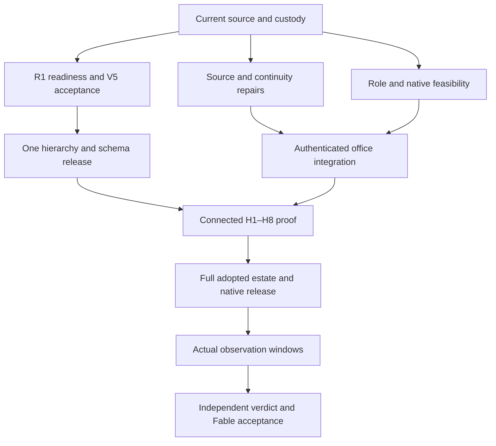

# Mastermind OS, Executive OS and Agent OS
## Estate audit and end-to-end completion master plan for Fable Meta-CEO

**Prepared:** October 21, 2026. User-facing date is America/Chicago; evidence timestamps retain UTC.

**Assignment:** census the entire operating-system estate, review the master plans, identify remaining fixes/upgrades/execution, and prepare Fable to lead completion through Opus suborchestrators and bounded Subagent Fabric work.

**Source frame:** Mastermind protected `master` at `d010b161386853586198a43f9ea9f535bbebb377`; Macro `main` at `b9b0759af6b8f347a7d729e3b13b8925857c5f8f`. Mastermind Skillpack v1.0.1, schema `mastermind.sol_skillpack.v1`, bootstrap major 1 verified. Open PRs and current owner checkpoints were inspected separately; they do not become protected source law merely by being newer.

**Final material refresh:** before publication, Mastermind advanced to `2151a89f7ea3a340ec04932cbcfdf6a838df79b1`: #1662's refusal-provenance clarification and #1661's original packet-retention repair are now merged. The changed law and relevant repair were read; unchanged bootstrap/closeout/reconciliation/dialogue law was verified at that same compatible pin. Macro advanced to `562fc7dd02a95792c1a3f59dee2e147f5ffddf20` through changes disjoint from the audited OS/compiler paths. `FINAL_SOURCE_REFRESH.md` records the exact delta and controls where earlier audit snapshots describe these two PRs as open.

**Programme continuity:** reuse `WS:EXECUTIVE-ECOSYSTEM-COMPLETION` and its relationship to `WS:EXECUTIVE-AUTONOMY-V1-CLOSURE`. Agent OS lives in Macro. This document is an audit and proposed execution overlay, not a competing current-state registry or a new root.

## 1. Executive assessment

**The estate has substantial foundations. Its dominant remaining work is integration, release convergence, trustworthy continuity and real product acceptance.** A new agent-platform build would duplicate accepted work and increase the very coordination problems this programme is meant to solve.

There is an integrated October 17 programme, an October 12 Meta-CEO R2 architecture, an accepted Agent OS V1, merged app foundations, a merged Fabric facade and inspection UI, merged Context Fabric code, and numerous pending integration candidates. The gap is that these parts do not yet establish one coherent, authenticated Chairman-to-outcome operating experience. [S01–S06]

Five findings determine the next sequence:

1. **Runtime recovery must start from the retained current lineage.** The latest recorded R1 return says Control release `80f384b8f58b7ca46422d9783aa5c0613c7bf4b2` was prepared and installed; Gate B was independently accepted. It remains recorded as DISARMED / UNARMED / STOPPED. The next authorized renewal refused before inference on `credential_identity_changed_during_probe`; no new canary, acceptance or service start occurred. The old October 17 instruction to rotate credentials and prepare a new release is stale. The first release task is exact drift and custody reconciliation, preserving `JOB-003`, the descriptor and the existing receipt. [S07–S08]
2. **Different installed components are on different generations.** An October 21 Office preflight reports an active Executive MCP process still pointing to `91c1cac5…`, with OS executive transport disabled, required resource/commission configuration absent and `reference_tools.py` absent. That is a different observation from the installed Control release. A single estate-wide “installed SHA” conceals the integration problem. [S09]
3. **The requested management hierarchy is ahead of the protected runtime graph.** Protected COO policy fixes depth 1, fanout 8 and 16 total children. Four-level coordination is a pending candidate. Both #1327 and #1600 propose a V5→V6 migration through shared Runtime/backup/migration files, while #1482 already combines hierarchy and rich Worker Skills. This is one architectural integration decision, not three independent merge tasks. [S10–S13]
4. **Recovery can select the wrong handoff.** An isolated reproduction of current Macro source shows that two valid October 19 handoffs are associated with the same workstream, but the compiler ranks their date-plus-suffix filenames lexically because its date parser only recognizes a date at the end. It selects the earlier “installed” handoff and drops the later “acceptance failed” handoff as older. The workstream itself retains the failure, so a fresh session can receive contradictory guidance. [S14; verification/handoff-selector-result.json]
5. **The UI and continuity foundations are substantially built but not complete consumer paths.** Original reply candidates #1473/#1542 have strong reported source-composition tests but remain draft and review-gated. Control Room #1515, Fleet Health #1425, and recent Fabric runs #1426 have unresolved source conflicts. Context Fabric's former integration stack is already adopted through #1490; production service/adoption and its benchmark remain separate. Agent OS V1 is accepted and must stay in maintenance. [S04–S06, S09, S15–S20]

The recommended strategy is to finish one connected vertical outcome, then extend it across the remaining qualified domains and surfaces. Keep the broader R2 office/native-Chat vision visible; a successful core milestone is not the full programme's completion claim.

## 2. The intended finished product

The Chairman gives Fable a meaningful objective in Mastermind OS and sees an understandable plan, current work, decisions that actually need attention, and the resulting product. Fable resolves strategy and cross-system questions. Opus domain owners decompose and integrate the work, using the paid Subagent Fabric for bounded tasks. Workers produce exact artifacts and evidence. Independent review challenges the result; the correct original parent consumes it. Corrections, failures, logout, interruption, quota pressure and session replacement preserve the same logical work and its effects.

The finished experience must support:

- **A usable office:** persistent conversation, original answers, references, ordinary decisions and multiple concurrent programmes without forcing the Chairman to shuttle messages.
- **Truthful execution:** authenticated assignment, real admission, economical placement, correct root/parent accounting, bounded review/repair, explicit cancellation and reconciliation.
- **Useful operational views:** planning, live progress, Fleet/Capacity, Fabric jobs, source-qualified results, current blockers and decisions that agree with their owners.
- **Recoverable knowledge:** Agent OS decisions/discoveries/handoffs, context that respects source/audience and actual consumer limits, and reliable cold recovery without a transcript dump. Distinguish a requested compilation target from a hard delivery ceiling; mandatory-context overruns must be reported and handled, never silently truncated or described as compliant.
- **A maintained product:** authenticated web and native clients, signed releases and tested update/rollback, source links, accessibility, responsive layouts, and meaningful empty/stale/error states.
- **Measured learning:** reproducible behavior and cost comparisons, separation of runner/provider/host effects, and prospective evidence before changing routing or declaring improved performance.

### Two milestones, one full completion obligation

**Core operating milestone:** one real multi-domain programme completes the existing H1–H8 campaign through the installed web/native consumer, current runtime, paid workers, independent review, original-parent consumption and durable recovery. No essential capability in that journey may be substituted by fixtures or hidden manual message relay.

**Full programme completion:** the other adopted R2 capabilities are qualified or receive an explicit decision from their actual scope owner: native Project Chat, multi-programme operation, eligible additional Dots, Secretary interaction where needed, intended host/surface coverage, natural-time reliability observation and operational support. The R2 §17 architecture is listed as accepted work by the October 17 ledger; this does not enroll accounts, grant provider permissions, or prove all six Dots. Fable must track the required native-Chat capability separately. A core-only release must be described as core-only, and the broader programme remains open until its adopted obligations are satisfied. [S02–S03]

## 3. Estate and canonical ownership

| Area | Existing owner and source | Audit state | What remains |
|---|---|---|---|
| Mastermind OS app | Mastermind `app/mastermind_os/`; web/Tauri, existing app and operation controllers | PARTIAL; app foundations and Fabric inspection are merged | Complete conversation/replies/decisions, authenticated producers, live execution views, source navigation, release and consumer proof |
| Executive OS lifecycle | Mastermind `control_plane/`, installed control services and owner APIs | PARTIAL; substantial source and historical runtime proof | Reconcile retained readiness refusal; current acceptance; role-specific arming and connected programme proof |
| Release/installation | Existing `ops/executive_os/` install, acceptance and publication owners | PARTIAL; multiple recorded service generations | Per-component installed/selected/accepted map; coherent reviewed release and rollback |
| CEO/COO authority | Existing CeoIngress, ExecutiveAuthorityPolicy, role-specific gateways | PARTIAL; role-specific source paths exist | Qualify Fable/Opus operational roles without borrowing Web-CEO submit authority |
| Hierarchy and budgets | Existing COO policy, Runtime and Capacity | PARTIAL; current protected depth 1 | Integrate held hierarchy/physical schema candidates; prove true parentage and conserved root accounting |
| Paid Subagent Fabric | Existing admitted adapter, pool/lease/result owners | Adapter visibility available in this audit; worker admission/start UNPROBED | Actual admitted bounded runs, independent review, complete result collection, parent consumption and cleanup |
| Fleet and physical resources | Capacity/physical admission and installed telemetry owners | Source policy UNQUALIFIED; live availability unknown | Qualify exact pools/limits, resource pressure, host identity and data freshness; finish Fleet consumer |
| Provider/native parity | Existing registry, adapters, Workforce plugin, Claude hardening | PARTIAL | Role-correct package release, installation, fresh-load proof, selected-provider behavior and normal auth recovery |
| Dialogue, Wake and returns | Existing Company Dialogue, RuntimeBinding, Wake and result owners | PARTIAL / BUILT_NOT_PROVEN by route | Exact original reply/parent consumption; separate foreground continuation from idle wake; real correction/repair cycle |
| Agent OS V1 | Macro `agentos/`, schema/validator/compiler/handoff protocol | Accepted bounded V1, maintenance; all 11 waves recorded done | Preserve acceptance; fix new recovery/compiler defects and separately scoped expansion |
| Context Fabric | Existing Mastermind Context owner and merged #1490 stack | BUILT_NOT_PROVEN for full installed consumer | Production service and client adoption, retrieval/grounding quality, budget/omission correctness, eight-family benchmark |
| Evaluation and learning | Existing Agent Eval and Outcome Learning owners | PARTIAL | Reconcile stale records; prospective runner/provider ruling; shared readiness; real evidence, no retroactive causal claims |
| Portfolio projection | Agent OS → existing Linear projector | PARTIAL | Dedicated app actor MAS-64; projects-only MAS-66; semantic managed-block projection and separate apply decision |
| Public OS edge | Existing public launch/Caddy/tunnel owner | Current health not observed in this audit; latest checkpoint reports /os 525 | Establish current owner/capability, repair exact existing route if authorized, prove authenticated external path |
| Full R2 Dot/native office | Accepted architecture directions plus scoped eligibility owners | PARTIAL / SPEC_ONLY for unqualified capabilities | Stage-0 route/principal/native qualification, full office loop, then safe account/Secretary scaling |

The Macro directory census found **103 workstream, 516 decision, 552 discovery and 747 handoff Markdown files: 1,918 authored records** at the audit pin. This is file inventory, not a claim that every record is valid or that all 103 workstreams were semantically audited. The detailed review covered the OS programme and its material dependencies. [S21]

### Evidence quality and limits

Protected source, current PR metadata, exact comments and selected Linear records were directly read. The audit ran one isolated source-extracted handoff-selector reproduction; it did not rerun large existing test suites. Reported historic test counts remain attributed to their actual source revisions.

The Executive state reader returned `backend_unavailable` before sending its request. Studio workspace discovery returned a connection error. The separate Fabric capability read succeeded, advertising its adapter and at most three pre-task quota-continuity attempts, while explicitly leaving worker admission/start unprobed and reporting no native parent wake or background execution. Public web inspection of the exact `/os/` URL was unavailable through the information tool. These are action-specific observations, not proof that every runtime/host/worker is down or that a future local Fable session lacks its own authorized native tools.

## 4. Existing plans: preserve the architecture, update the frontier

The execution package follows this order:

1. **Current protected source law and current Chairman intent** govern actions. The audit pin is reusable until a material invalidator changes a relevant constraint.
2. **October 17 Executive Ecosystem programme and capability ledger** supply the existing delivery model, E/F/G/A/C/H identities and acceptance journeys. Update only rows changed by later evidence.
3. **October 12 R2 office architecture** supplies the accepted direction, full user experience and original-intent acceptance. Its proposed provider/account details remain qualification work.
4. **Current exact owner checkpoints** supersede dated host next-action instructions. The October 21 #1621 and #1542 comments are necessary to avoid replaying old release steps.
5. **Domain contracts** remain controlling for their scope: accepted Agent OS V1, Context Fabric, Claude H1–H7 hardening, native Fabric parity, public launch/signing and source-custody laws.
6. **Open proposals** such as #1256's unified OS production plan, #1327's graph and #1600's schema are candidates. They need current-base reconciliation and acceptance; they are not automatically current law.

`PLAN_AND_PR_CROSSWALK.md` gives the retained carriers. In particular, the July `MASTERMIND_CONTROL_PLANE_MASTERPLAN.md` concerns investment-engine governance and is adjacent historical context. Do not turn market-engine work into this OS mission merely because a document title contains “control plane.”

### Work that must not be restarted

- Agent OS V1's accepted closure, W4 report-only capture and calibration.
- Context Fabric implementation already adopted through #1490. #1216 is closed unmerged as superseded; its old component drafts are not new missing features.
- Merged MMOS foundations #1222/#1225 and Fabric inspection/facade #1411/#1359.
- Accepted original release preparation/installation/Gate B evidence for `80f384b8…`, absent a material invalidator.
- The original `JOB-003` acceptance root or existing queued roots as replacement jobs.
- Merged policy source #1228/#1643 and merged #692 structural evidence locks. Installation, behavioral adoption and causal evidence are distinct remaining work.
- Completed source-composition tests for #1473/#1542 unless code, relevant dependencies or proof requirements change.
- Existing source branches, retained results, watchers or controllers as replacements because an old chat is no longer available.

## 5. Fable and Opus operating structure

**WHY FABLE:** this programme crosses runtime authority, source/release identity, a schema migration collision, native and web execution, continuity and product acceptance. It requires persistent arbitration of evidence and architecture, with one accountable owner for the Chairman's actual experience. These are concrete C3 duties, not routine implementation volume.

Fable is the Meta-CEO for the commissioned mission. It owns the outcome, integration order, cross-domain decisions, source/effect conflicts, original-intent review and final acceptance. It may directly solve difficult strategic or technical problems. It does not shadow-build work already delegated to an active owner.

| Opus owner | Domain result | Fable/Opus-reserved work | Typical bounded Fabric labor |
|---|---|---|---|
| **O1 — Executive release and runtime** | A current accepted release, valid role-specific arms and recoverable lifecycle | Readiness identity drift, acceptance lineage, privileged-effect sequencing, hard release debugging | Provider-free regression tests, source/receipt comparison, scoped release checks and documentation |
| **O2 — Fabric hierarchy, capacity and economics** | Admitted nested coordination with one budget/root and reliable paid-worker results | #1327/#1600/#1482 schema composition, root accounting and hard concurrency decisions | Migration fixtures, route/catalog checks, bounded collector fixes, quota/refusal and cleanup tests |
| **O3 — Mastermind OS product and release** | A coherent signed-in web/native office with live planning, replies, decisions, Fleet and Fabric | Product architecture, interaction design, authenticated consumer integration and difficult frontend/native issues | Existing UI completion, contract wiring, accessibility, targeted visual/functional tests, signed-release preparation |
| **O4 — Agent OS, context and continuity** | Accurate cold recovery and useful context under real limits | Latest-handoff semantics, canonical-record reconciliation, retrieval/evaluation design and correction propagation | Selector regression repair, scoped compiler work, source navigation, record validation and context benchmarks |
| **O5 — Principal authority and native adoption** | Qualified Fable/Opus/native roles, dialogue and original-parent return on intended surfaces | Role admission, native identity, principal ruling semantics, hard auth/transport composition | Package manifests, source parity checks, tool-loading probes, exact reply correlation, bounded native-client tests |
| **O6 — Independent product acceptance and learning** | A trustworthy integrated acceptance verdict and measured operating quality | Adversarial original-intent judgment, experiment validity, causal attribution and release acceptance | Independent code reviews, falsifier execution, browser proof, evidence normalization and cost/latency calculations |

These are **accountability domains, not six automatically admitted simultaneous Jobs**. A currently valid route and conserved grant decide how many may execute. Use the shallowest route that supports each domain. Opus can directly commission paid Fabric workers; a qualified GLM/Grok delivery operator may manage routine work beneath an Opus domain when that reduces total overhead and fits the actual graph. Neither an organizational title nor native Agent/Task availability establishes paid Fabric execution.

Before routine work, each child gets a complete scoped packet and a complexity classification. C0/C1 tasks go to the least-scarce qualified worker; C2 tasks to a capable bounded worker; C3 ambiguity stays with Opus/Fable until decomposable. Fable/Opus direct execution is appropriate for principal judgment, hard debugging, unique authorized access or a concrete critical-path shortcut. An author cannot label its own consequential changes independently reviewed.

### Admission and return rules

- Preserve the original root, true immediate parent, attenuated grant and budget. Reserve review, repair and integration capacity before adding builders.
- Protected depth 1 is a source fact, not an instruction to pretend an Opus native session is a Runtime parent. Qualify the mixed native/Fabric binding or finish the existing graph upgrade. Do not reset roots or hide intermediate coordinators.
- Fable's role-specific operational route must be proven. The source Claude adapter does not grant COO mutation merely because transport exists; borrowing CEO `intent.submit` is expressly rejected. This does not block independently authorized reasoning or source work. [S22]
- Missing quota is unknown, not zero or unlimited. A disabled source alias is not proof every attended pool is unavailable; inspect the selected route through its actual owner.
- Mid-task effect uncertainty cannot trigger provider/account failover. The exposed quota-continuity path permits only its qualified pre-task rejection sequence.
- Returned work includes exact revisions, actual validation, independent-review disposition, remaining gaps, effect state and a next decision. Full logs remain with the existing result owner.
- A response that says queued or delivered is not START. A retained result is not parent consumption. Active return is not idle wake. No Web turn is described as a daemon.

## 6. Execution sequence and gates

The diagram shows delivery dependencies, not an admitted runtime graph or a grant of concurrency.

### Stage 0 — Recover the true frontier and make the programme executable

Fable reads this package, the existing workstream and the exact latest release/Office checkpoints. It verifies the compatible protected pin, current writer/lease/effect state, and its own role/tool envelope. The next assigned session owns this recovery; a historical owner name is not a reason to wait indefinitely.

O1 reconstructs the **per-component** source/installed/selected/accepted map and the original R1 renewal refusal. O4 repairs the recovery inconsistency through the existing compiler/records owners. O2 freezes the common migration/interface decision. O3/O5 reconcile their existing source carriers, reviews and missing consumer bindings. O6 establishes the original-intent acceptance matrix using existing H1–H8.

Fable/O5 also begin **R2 Stage 0B native Project Chat eligibility now**, alongside principal and decision-seam qualification. Determine whether the actual account/project/mode/context/continuation/result path exists and is authorized before committing to its implementation. Do not defer this existential feasibility question to the final packaging phase. A held native lane can leave the core milestone executable while the full programme remains open.

**Exit:** exact current actions are available or lane-locally blocked with evidence; no uncertainty is hidden behind “ready.” The records show current original carriers and one next recovery action. No new production effect is performed merely to probe availability.

### Stage 1 — Complete retained runtime acceptance and source integration in parallel

O1 reconciles the `credential_identity_changed_during_probe` event through the same issuer/receipt controls, with no secret disclosure or weakening of identity checks. Changed metadata alone does not prove credential continuity or explain the writer. Apply only the legitimate current recovery path and permission envelope. Reuse accepted prepare/install/Gate B results; obtain fresh readiness/acceptance only when its real prerequisites allow it. Arming is separate and receives the proportionate independent security review required by the existing owner.

While that lane proceeds, O3 resolves the real source conflicts in #1425/#1426/#1515 and completes #1473/#1542's review disposition. O4 fixes the confirmed handoff selector and prepares its context service/adoption checks. O5 rebuilds the role package from the accepted #1228/#1643 source through #1650 and the existing plugin owner. These source tasks do not require a healthy optional Web state reader.

Preserve the more specific Claude adoption evidence: the October 18 #1236 checkpoint records the M2 `mastermind-executive` plugin 0.2.0 installed with all four cache blobs verified, with fresh-session consumption still owed. Its separate legacy local MCP adapter exposes the wrong CEO profile, receives an HTTP sign-in URL rejected by Claude, and points to an installed generation without `/mcp/coo`. Do not reinstall the plugin as though absent or swap the new COO adapter into that old backend alone. Deliver the coherent accepted backend/policy/adapter generation, role-correct HTTPS/issuer challenge and normal authorized OAuth ceremony. [S22]

**Exit:** current V5 acceptance is proven at the actual installed revision; source candidates have exact review/CI/custody outcomes. Any continuing privileged/auth gate affects only its dependent work.

### Stage 2 — Qualify the hierarchy and release composition once

O2 resolves the overlapping migration vector for #1327/#1600 and the pre-existing #1482 composition. The decision names the authoritative successor schema, compatible release order, backup/restore and rollback contract, and how source conservation is verified. Do not merge competing migration-six definitions independently. Respect #1327's current-V5 acceptance prerequisite.

O1 owns installation and acceptance of the chosen successor through the existing release owner. O5 proves role-correct principal/coordinator loading and actual ancestor/root/grant binding. O6 tests boundary cases, including budget consumed by coordinators, reviewers and repair, stale grants, foreign parents and uncertain descendants.

**Exit:** the requested Fable→Opus→Fabric accountability has an actually admitted execution mapping, with no hidden second root or multiplied allowance. Until then, use only the supported graph for independently safe work.

### Stage 3 — Close one complete Chairman-to-outcome product loop

O3 connects the existing app to its real authenticated producers. The Control Room must reuse the #1637 composition: existing App/MCP listener → authenticated Workspace App → CeoIngress → WorkspaceReadService → the same HostedControlRoom/ServerConfig. No new socket proxy, cache authority or wider allowlist is needed. Install OS executive/session transport through its owner; close public routing through the actual edge owner and current grant. [S23]

Choose a genuine, currently unowned bounded programme task with meaningful source and consumer proof. The confirmed recovery/Knowledge path defects are candidates once custody is resolved. It must pass the existing H1 journey: Chairman intent, valid admission, at least two meaningful governed children including one through the Executive–Fabric bridge, economical worker execution, independent review, original-parent consumption, visible result and Agent OS continuation. Run H2's simple direct task as well so every small request does not acquire unnecessary management layers. H2 names `codex-01`; a different qualified route needs an explicit programme-owner scope mapping, not silent substitution.

During the same release, prove an ordinary worker ruling is answered by the correct Opus/Fable role and consumed by the originating worker. Prove loss of a response after acceptance reconciles the original request. Reuse the existing result/Dialogue/Wake owners and preserve all original identities.

**Exit:** one connected trace demonstrates actual useful completion on authenticated web and native, including interruption and correction. A fixture demo or a composite set of unrelated receipts cannot close this gate.

### Stage 4 — Finish the remaining product, context and operations estate

O3 completes Fleet/Capacity visibility, discoverable recent runs, owner/parent lineage, full retained result inspection, useful decision Inbox and source navigation. Planning/activity views distinguish declared plan, observed tool progress and proven result. Unavailable data must be explicit and actionable.

O4 qualifies Context Fabric's installed service and native clients, eight-family retrieval benchmark and correction/omission behavior; distinguishes the compiler's requested target and permitted reported mandatory-context overrun from the consuming surface's actual hard ceiling; and reconciles Agent Eval/Outcome Learning's latest source and prospective experiment gate. MAS-64/MAS-66 remain a separate semantic-projection path. Prepare prerequisite clarification that is allowed, but preserve MAS-66's explicit gate on beginning P1 implementation until the real MAS-64 app and canary are proven. Surface the exact dedicated-app admin ceremony only where still required. Do not build another GitHub mirror or use employee credentials for automation.

O2/O5 qualify each intended route/host/surface independently: live capacity and pressure, tool/profile parity, native instructions actually loaded, selected-provider execution, quota behavior, result collection and lease settlement. A passing worker on one host does not qualify another model or surface.

**Exit:** each adopted capability has a real consumer, current proof and an owning maintenance path. Source-only, installed-only, partially observed and unsupported capabilities remain separately labeled.

### Stage 5 — Complete native packaging and full R2 qualification

O3 finishes signed/notarized macOS distribution, updater signature verification and recovery/rollback as the existing runbooks require. Validate clean install, upgrade, auth recovery and native deep links on the intended supported hosts; use the existing Linux portability target if it remains in the accepted production scope. Neither a Vite build nor a Tauri test binary proves distributable software.

Fable/O5 use the native Project Chat and principal eligibility verdict begun in Stage 0 to complete the adopted real integrations. Reopen that verdict only on material changes. Expand to multiple programmes and useful eligible Dots only after one loop works. A Secretary remains an eligible interaction adapter, not the default company decision relay. Account/session/model identity, permission and quota must be observed separately.

**Exit:** full-vision capability labels are honest. Any unqualified native-Chat or account capability stays an open programme obligation or receives a specific owner decision; it is not silently replaced by another surface.

### Stage 6 — Run independent acceptance and natural-time reliability, then close

O6 runs H1–H8 plus the discriminating cases in `ACCEPTANCE_MATRIX.md` against the accepted release. Use isolated/staging failures where possible; do not disrupt a production worker solely to demonstrate recovery. Include lost response, current-identity change, stale instruction, budget pressure, result truncation, native restart, cold successor recovery and source correction.

Measure actual accepted-outcome cost, principal involvement, avoidable repair, time to useful result, decision latency, recovery time and lost/duplicate effects. This completion plan recommends retaining/adopting #1256's product campaign of **five consecutive working days**, alongside the R2 **seven-day observation campaign**, after their prerequisites are ready. #1256 remains a candidate; confirm that product-scope adoption explicitly at Stage 0. The campaigns may share genuine observations where both contracts permit, but one does not silently replace the other. Do not invent elapsed evidence or keep reasoning sessions polling. Existing runtime/event/observer owners hold long waits and returns.

Fable accepts the integrated product against the original Chairman intent, then updates existing Agent OS records and selected projections. Close terminal child dialogue/watcher sources explicitly while preserving valid parent/sibling watches. Preserve remaining operating obligations and a tested recovery runbook.

**Exit:** all adopted must-haves have connected proof; no material unowned gap or uncertain effect is hidden; ongoing support has an owner and recovery evidence.

## 7. Product and engineering quality bar

The app must answer four questions without archaeology: **What is being done? What changed? What needs my decision? Can I trust the result?** Raw receipts support those answers; they are not the whole interface.

The UI needs coherent navigation, readable hierarchy, useful summaries, a trustworthy source/as-of signal and deliberate progressive disclosure. Keep technical identifiers available for inspection while everyday flows use plain actions and outcomes. Current code already contains five primary destinations and five project tabs; #1256's older absence claims are stale. Preserve existing design and refine incomplete journeys. [S24]

O3 should treat these as separate defects until proven:

- The generic conversation surface is not the same as the selected-session continuation flow; a note box without a recipient/send/answer path does not close the office.
- Knowledge must actually open its original source; the inspected App mount omits the `onOpenSource` integration.
- Inbox must support the accepted owner decision contract, rather than only displaying “decision needed.”
- Fleet/Capacity must be fed by authenticated, fresh producer data; a source-gap placeholder cannot look like an empty healthy fleet.
- Fabric needs discoverable runs, exact inspection, preserved lineage beyond display caps and complete retained bytes before acceptance.
- A live plan/progress stream must come from the qualified provider/owner and retain source/freshness; merged #1652 defaults do not prove installed telemetry.

For each key journey, verify keyboard/focus behavior, loading/empty/stale/error states, narrow and wide layouts, intended themes and languages, browser console/network health, session/logout transitions and native/web parity. Use the existing Paper design identity and contract when owed; an unbound or inaccessible design file is a specific evidence gap, not a reason to invent a replacement design system.

Measure latency before setting final SLOs. Suggested starting targets are immediate local acknowledgement and a visibly useful initial state within a few seconds for ordinary reads; those are design proposals, not measured production facts. Never hide a slow provider behind false progress. Zero wrong-target effects, duplicate effects or cross-identity disclosure are acceptance requirements, with enforcement evidence as well as observed tests.

## 8. Review, testing, evidence and economics

Run focused tests that can observe the changed failure. Broaden only for a concrete integration risk or required gate. Reuse accepted evidence for unchanged paths; changed candidates invalidate affected evidence only. Do not create empty pushes, repeated CI polls or new observers to manufacture progress.

O6 provides independent integrated acceptance. Domain authors may test their own changes, but another qualified actor reviews consequential changes. If an Opus owner implements a hard fix, another domain reviewer or admitted independent Fabric reviewer supplies the consequential review. Fable retains original-intent acceptance and cannot substitute a collection of passing child returns for the finished product.

Every production claim names its producer, consumer, exact revision/generation, observation time, negative controls and remaining limitation. Store implementation/evidence in GitHub, organizational continuity in Macro Agent OS, lifecycle in Executive OS and projections in Linear. Do not add a bespoke progress database, evidence service, queue or memory mirror for this programme.

Capacity decisions use current route eligibility, provider/host resources, root budget and review backlog. The old conversation memories about account counts, quotas or worker ceilings are advisory. No hard-coded maximum agent count in this plan grants capacity. Reserve room for review and repair; stop new builders when unconsumed review would degrade quality. Finite work packages have clear completion, failure and escalation conditions; Fable and Opus decide substantive exceptions instead of relaying every command.

## 9. Immediate Fable launch sequence

1. **Read existing current state, not a historical chain.** Read this handoff, the current canonical workstream, #1621 comment `6282392406`, #1637 comment `6282675941`, #1542 comment `6309217010`, and relevant current protected law. Reuse the pin unless affected source changed.
2. **Recover R1 precisely.** O1 identifies the actual current owner, live custody and the original renewal event. Confirm the retained `80f384b8…` installation, `JOB-003`, descriptor and receipts before any effect. Do not re-prepare/install or issue another canary from dated instructions.
3. **Start independent source work.** O4 fixes the proven handoff selection defect; O3 resolves existing UI review/conflict work; O5 prepares the accepted role-package generation. These can progress while a real runtime/auth gate remains local.
4. **Resolve one graph/schema decision.** O2 supplies Fable a single composition proposal for #1327/#1600/#1482 and its V5 acceptance dependency. No conflicting migration writers.
5. **Bind work before dispatch.** Resolve each actual root/parent/grant, exact worker surface and allowed paths through existing owners. Use bounded Fabric tasks and preserve incumbent operations.
6. **Publish accepted deltas to existing owners.** Maintain one cumulative current handoff linked to exact evidence; repair the stale Oct17/Oct19 next-action wording and Agent Eval projection through the ordinary Macro review path.
7. **Advance the next ready phase in the same healthy session.** CI/review/host waits are lane-local. Stop only at the actual completion boundary, a genuine current gate affecting every remaining useful lane, or verified continuity pressure.

## 10. What requires human involvement, and what does not

Routine source edits, integration choices, focused tests, conflict repair, evidence review and an assigned recovery action do not need a new Chairman confirmation. Fable/Opus should do the concrete work and expose only the exact remaining human control.

Potential genuine controls include new provider/account consent, a native login that only the account holder can complete, workspace-admin creation of the dedicated Linear projector app, and a current explicit production/host authorization not already granted. These are conditional on actual evidence, not generic permissions to request at the start.

A retrieved checkpoint's claim of an earlier platform refusal is evidence to reconcile, not proof of a current platform-wide ban. Preserve the named held operation and do non-effectful inspection of the original receipt, current surface and applicable assignment. An actual applicable system/tool/provider denial or unresolved effect remains binding; never evade it with another worker/account/carrier. #1662 was open at the initial audit pin and subsequently merged as `1b240d2f…`; its now-protected clarification was reread in the final material refresh. It grants no new permissions and clears no original effect. [S25; FINAL_SOURCE_REFRESH.md]

The public-edge access history and collection-quality/legacy continuation recorded in #1621 remain evidence-sensitive held operations. They must not be repackaged as generic “fix infrastructure” tasks. Current legitimate independent local access may differ from this Web audit's connectivity; prove it through its actual controls rather than assuming either permission or prohibition.

## 11. Completion and handoff status

This audit delivers orientation and a reviewable completion plan. It does not claim the estate is complete, deployed, armed, or executing in the background. The principal next action is **Fable-led recovery of the exact R1 current release/readiness frontier, while O4/O3/O5 advance disjoint source work and O2 resolves the graph/schema composition**.

The full programme closes only when the intended Chairman experience is coherent, inputs and capability states are truthful, lifecycle/return/recovery work on the real path, independent evidence supports the result, and all adopted scope is accounted for. The handoff files contain explicit work packages and acceptance tests so the next session can execute without recreating the audit.

See `SOURCE_REGISTER.md` for source IDs, `PLAN_AND_PR_CROSSWALK.md` for candidates and supersession, and the domain audits for additional evidence and caveats.
